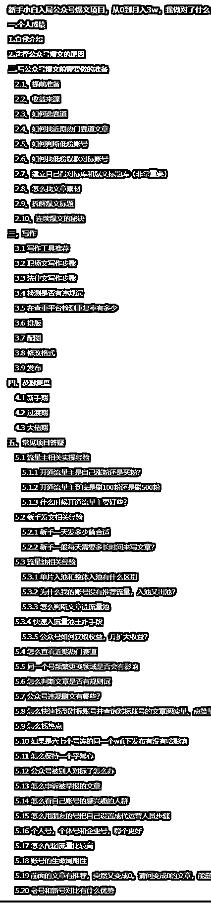

# ('新手小白入局公众号爆文项目，从 0 到月入 3w，我做对了什么', (2, 33))

从零基础杀进公众号爆文赛道，我用三个月把月收入做到了三万。这篇文章不讲虚的，把我踩过的坑和真正见效的方法全部摊开聊，尤其是航海结束后的复盘思路，希望能给同样在观望的朋友一点参考。

先简单交代一下背景。我的本职工作是一名开发工程师，公众号爆文是副业。今年一月，我参加了生财有术的公众号爆文航海实战，那期航海里我拿到了总收益五千多，排名第三，还写出过单篇阅读量破二十万的文章。很多人觉得航海结束就完了，但真正的增长其实从那时候才开始——我每天都在复盘，不断试新号，反复调整方向，最后做到了千万爆文创作者，月入稳定在三万。

在这之前，我也折腾过不少项目：拼多多虚拟电商、抖店、小红书教资、直播切片、短剧 CPS、中视频、漫画解说……说实话，亏的钱比赚的多。一月份之前，我在公众号爆文这个领域完全是零基础。所以这篇内容特别适合刚起步、想少走弯路的普通人。

整篇分享大概一万二千五百字，读完需要十分钟左右。我会把航海期间学到的核心经验，以及结束后我自己怎么持续迭代的完整流程，都整理出来。如果你看完觉得有收获，方便的话点个赞支持一下。

最后必须感谢@智慧和@靠谱姐的耐心指导，也感谢生财这个平台提供了实战航海，让一直观望的人有机会亲自下场验证。

