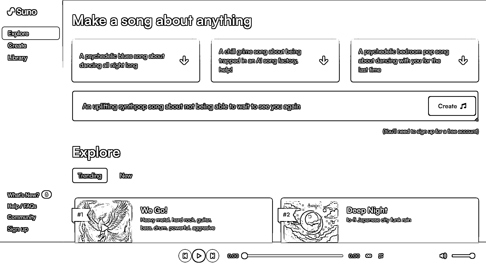
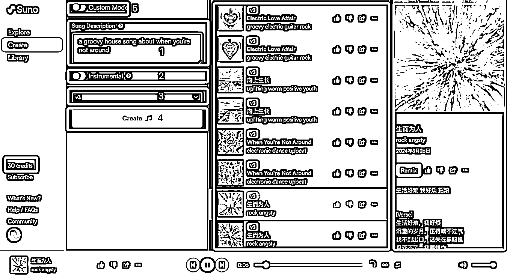
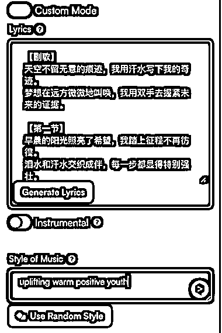

# 五分钟上手，Suno 让你一键拥有专属爆款歌
作者：龙哥

## 五分钟学会用 Suno 写歌谱曲，免费打造你的个人音乐

作者： hulei

日期：2024-03-27

上周在今晚早睡航海的高手领航直播中，易仁永澄老师聊到了 Suno，当时我就被种草了。还没试过的小伙伴真的要冲一波，几分钟就能生成一首属于自己的洗脑神曲，玩起来上瘾。

这款被大家戏称为「音乐圈的 ChatGPT」的 AI 工具，我前两天摸索了大概一个小时，效果直接把我惊到了。完全零基础的我，竟然也能产出让人惊艳的成品😂

我先前发过一篇👸号教程讲怎么在 5 分钟内学会 Suno，这里把精华浓缩成一个极简速通版，直接开干：

很多人好奇，做歌会不会很专业？要不要花钱？对网络会不会有门槛？

我先把结论说清楚：操作门槛极低。看完这篇花 5 分钟，注册登录官网花几分钟，一分钟内就能出歌。基础版完全免费，付费会员功能更多但免费额度日常使用已经足够，国内就能直接访问，用起来很顺手。

第一步，打开浏览器进入官网 [`app.suno.ai/`](https://app.suno.ai)

第二步，完成注册登录，熟悉一下页面布局：

整体页面大致分四块。最左边是侧边导航，点 “Explore” 可以逛全球创作者的作品集，点 “Create” 就能开始自己的创作。刚注册的新账号每天会赠送 50 点积分，单次创作消耗 10 点，会同时生成两首同主题不同编曲的版本，算下来每天免费 10 首没问题。

右侧两块分别是作品列表和播放详情，这里就不多展开了。

接下来重点说一下中间那一排创作区的功能：

1、Song Description，相当于创作指令区，就像做 AI 配图一样，这里填入关键词就是核心。

2、Instrumental，是人声与纯音乐的切换开关，默认是关闭状态。关闭时生成带歌词的人声作品，打开后则只输出纯乐器版。

3、模型版本，目前可选 v2 和 v3，强烈建议用最新的 v3，音质和理解力提升明显。

4、Create，就是一键生成按钮，设置完成后点它即可。

5、Custom Mode，自定义模式。开启后可以自行填入歌词，也可以用 ChatGPT 先写好歌词，再指定风格，让 Suno 严格按照你的文字来谱曲。

到这里是不是感觉很清晰？

对，就是这么简单，剩下的就交给你的想象力去碰撞旋律吧。

为了让大家少走弯路，再补充几个实操 Tips：

1、免费账号生成的作品仅限个人娱乐，不可商用。要做商业用途需要先升级付费会员，再重新生成。

2、免费额度是每天 5 次创作机会，共 10 首歌，额度用完要等次日恢复。

3、提示词中英文都支持，但英文的识别更精准。建议先写中文思路，再用翻译工具转成英文提交。

4、写提示词不用拘泥格式，风格 + 乐器 + 情绪感随便组合即可。比如钢琴可以用 piano，摇滚可以用 rock，多试就能找到喜欢的感觉。

别再犹豫了，打开链接就给自己或喜欢的人定制一首独一无二的音乐吧。

* * *

评论区：

暂无评论

* * *