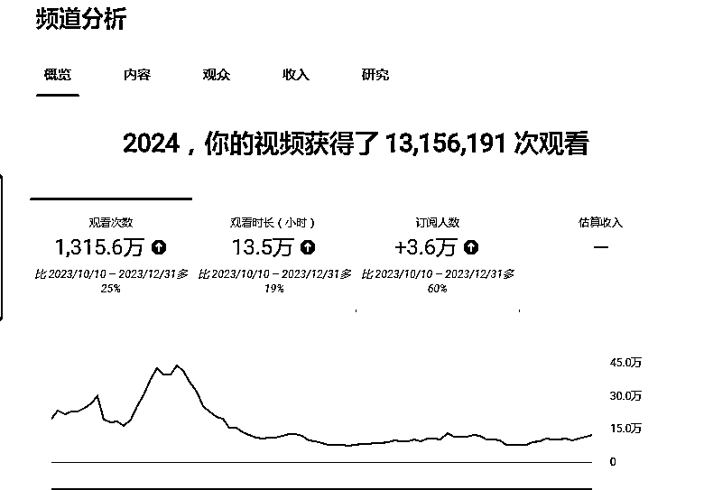

# AI 炸裂玩法，10 分钟制作一首“天后”级 MV 原创歌曲，保姆级教程来了
作者：龙哥

最近被一件事整得既兴奋又无奈：我在YouTube上开过音乐频道，差点忘了它的存在。隔了快一年再登录，后台居然还有不少播放量，数据比我想象中好很多。

可这个账号真的让我又喜又忧——里面传的都是经典老歌，由于版权原因，这类内容在油管上根本没法开通收益，眼睁睁看着这些流量白白浪费。没想到昨天我偶然发现，AI竟然已经能自己写歌了！一瞬间感觉又抓到了新机会。既然AI能独立产出原创歌曲，那MV、背景音乐这些不也能自己搞定吗？我试了一下，10分钟就能做好一支天后级MV，原创歌曲也一并搞定，整套流程整理成了一份保姆级教程，具体玩法放在下面这份文档里：

顺便提醒一下：有朋友反馈打不开链接，那是飞书文档，直接复制到浏览器地址栏访问就行。

如果你觉得这篇分享对你有启发，不妨点个赞，后面我会持续更新更多AI玩法。