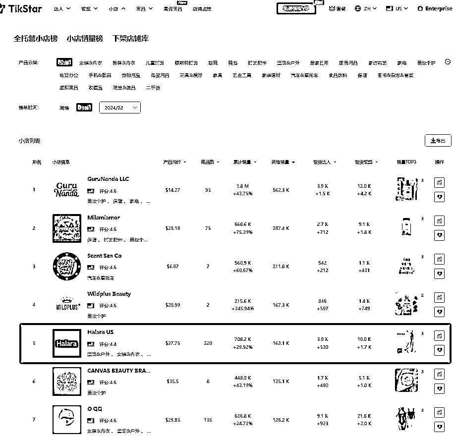
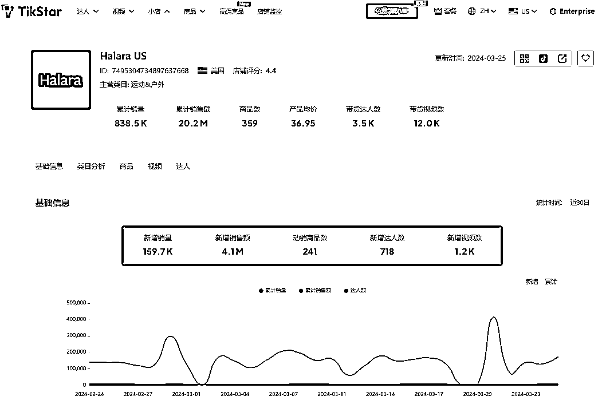
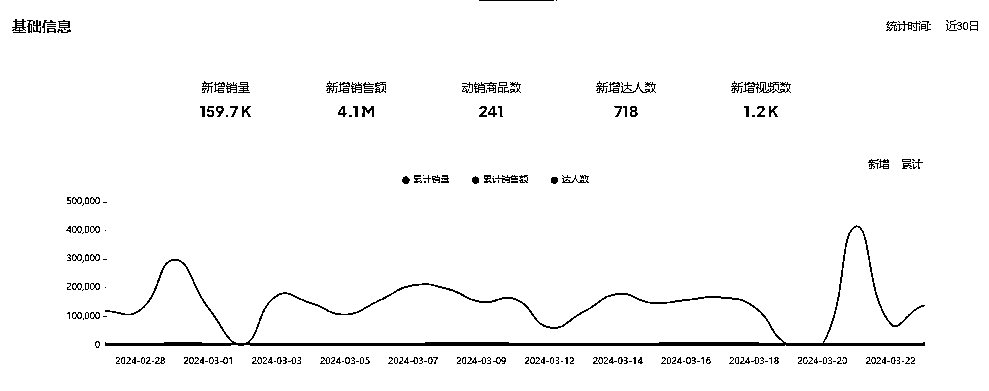
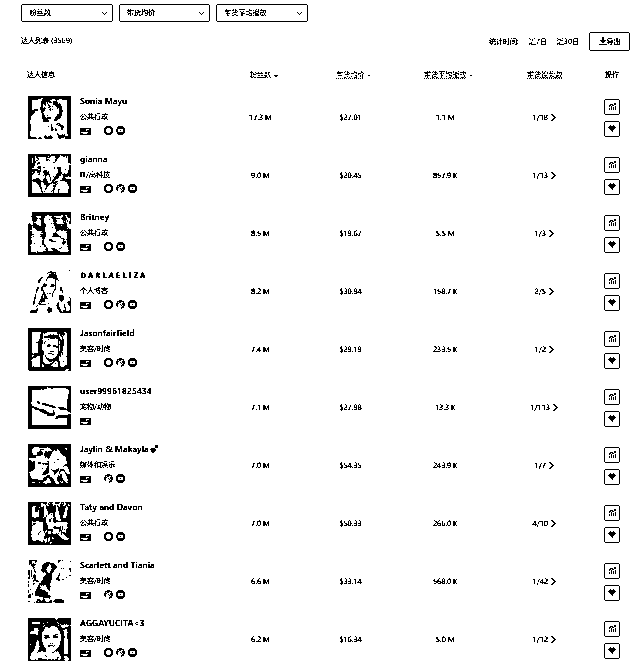

# 83 万单，Halara 的 TikTok 美国小店爆单思路拆解
作者：龙哥

来自TikStar的统计显示，截至2024年3月25日，Halara US在TikTok美国小店的累计销量已经达到83.85万件，销售额突破2020万美元，这个成绩让它一举拿下了2月小店销量榜的第五名。 具体来看，目前在售商品359款，客单价36.95美元，合作带货达人超过3500位，相关带货视频超过1.2万条。 最近30天的增长势头依然很猛：新增销量15.97万件，新增销售额410万美元，动销商品241款，新增达人718位，新增视频1200条。

Halara其实是个很年轻的品牌，2020年才成立，主打快时尚跨境出海。成立第一年就先后拿到天使轮和A轮融资，2021年6月17日更是一举获得今日资本、红杉中国、IDG等机构的1亿美元投资。它被外界称为“lululemon平替”，也有人叫它“中国版ZARA”，主打运动休闲女装。产品强调高品质和性价比，场景覆盖全天候，能适配不同身材和类型的女性，主力价格带在20到40美元之间，特别受欧美运动女性的欢迎。

在渠道策略上，Halara没有死磕单一平台，而是早早布局了Facebook、Instagram、YouTube和TikTok。但真正的增长拐点出现在去年10月中旬入驻TikTok Shop美国站之后。它通过大量达人合作来带动品牌曝光，平均每天合作的达人数达到24个。

再看达人生态。目前Halara建联的带货达人中，粉丝量排名前十的账号，粉丝数都已经突破千万，而且绝大多数是时尚类博主，与品牌气质非常吻合。

关于达人合作，有几点值得借鉴：

第一，粉丝数量不等于带货力。真正重要的是粉丝质量，只有粉丝群体和产品目标用户高度重合，转化率才可能高。

第二，一定要看达人风格。选那些与目标客群匹配的达人，粉丝更精准，购买意愿也更容易被激发。

第三，别小看低粉达人。有些达人粉丝量虽然不大，但视频质量和粉丝粘性很高，他们的转化潜力甚至比大V还猛。

目前评论区还没有留言，如果你对这个案例有想法，不妨来聊聊。