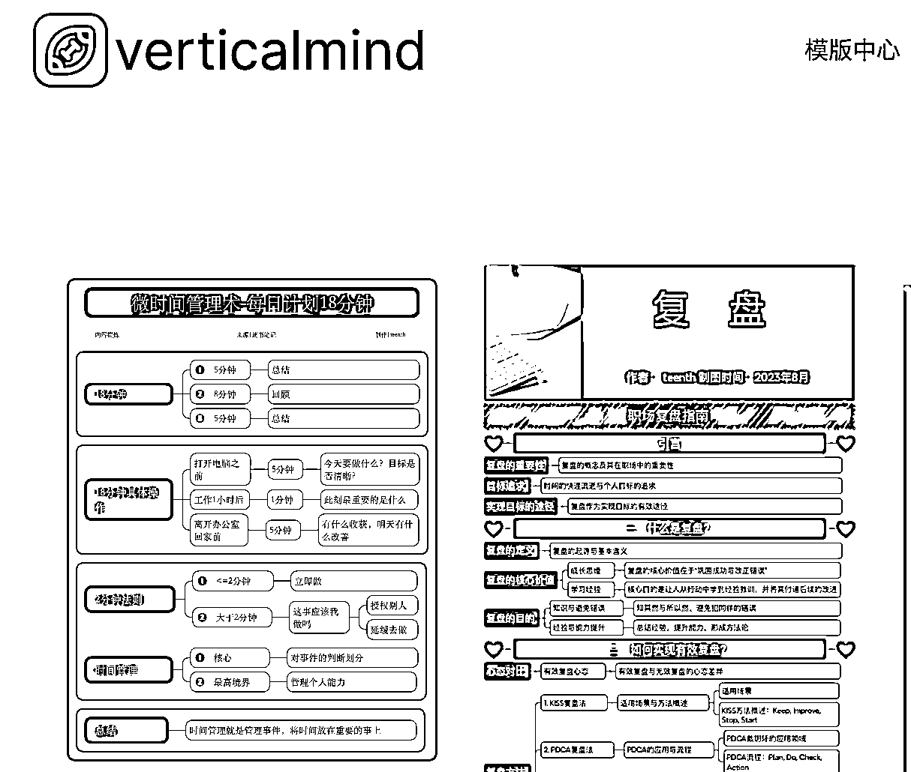
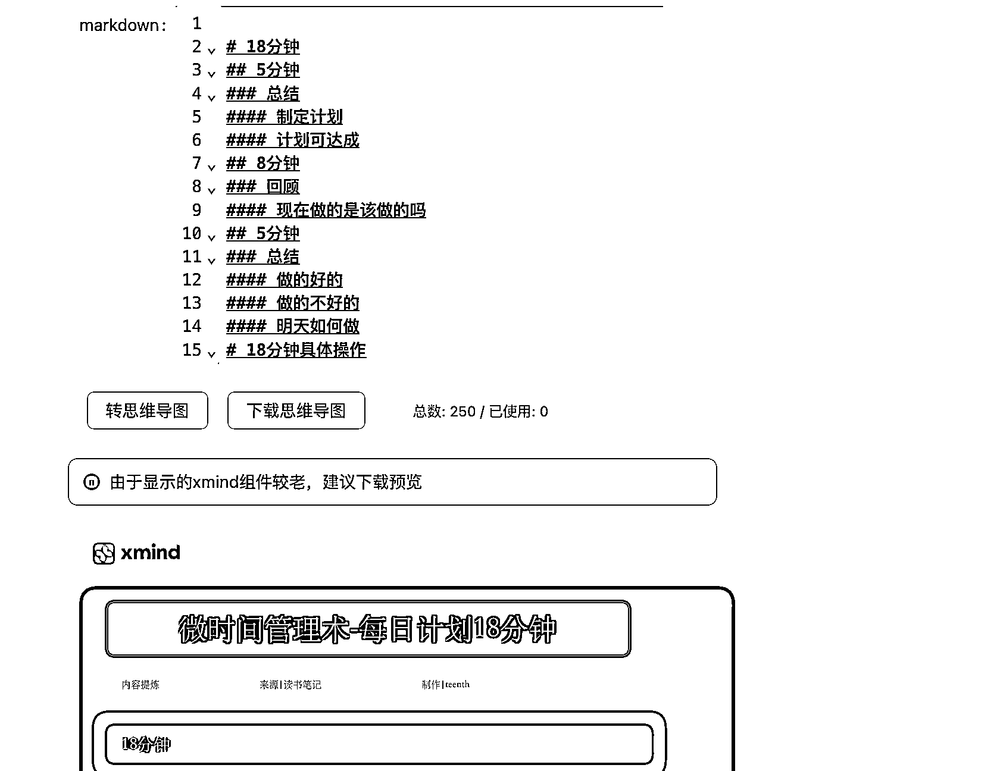

# 从一次航海到一款工具：程序员老哥的竖屏思维导图实践

前阵子在生财有术刷到一篇程序员老哥的分享，很有意思。

他说自己是去年4月18号加入的生财，一直在这里学习成长。平时工作就是写代码，偶尔会做些小工具网站。这次正好赶上续费，他干脆整了个新作品——竖屏思维导图工具。而起因，就是参加了上一轮的思维导图航海，结束后突然有了“自动生成”的点子。

用他的原话：感谢生财。

这篇分享不废话，直接拆成三块：
- 为什么要做竖屏思维导图工具
- 怎么用这个工具变现
- 未来还想往哪些方向搞

如果想看完整版，他放在了飞书文档里：
[`qx5811ufta9.feishu.cn/docx/FQWbdbi4DouJ5OxhF4Uc6fX3n1d`](https://qx5811ufta9.feishu.cn/docx/FQWbdbi4DouJ5OxhF4Uc6fX3n1d)

评论区也有不少人好奇：XMind是不是手机App？需要充值会员吗？还有人想付费加微信求带。作者都耐心回复了，而且补充说电脑端也可以用网页版，直接进去就能用。

看来这种竖屏思维导图的需求确实不小。如果你也想看程序员是怎么把一次航海灵感落地成产品的，或者想知道工具变现的路子，这篇值得一读。

