# 七天拉新七千粉，裂变十七群、私域进账一千五：我的红包封面引流复盘

## 七天👸号净增关注 7000+，裂变社群 17 个，🛰️ 1500+

作者： 老秦

日期：2024-03-29

### 开场话

大家好，我是老秦。春节期间红包封面这波热度非常猛，我也亲自上手玩了一把。

围绕红包封面大概有四条路线可以走：

1.  1、做红包封面微店分销，借助公域渠道卖封面拿佣金

2.  2、自己去制作带流量的红包封面，前提是有免费额度

3.  3、蹭明星/机构/品牌的官方封面做导流

4.  4、借助🛰️搜一搜分发免费封面做引流

### 一、结果数据

先说结论。

**7 天👸号净增关注 7000+，裂变社群 17 个，**其中帮朋友涨粉 2000+

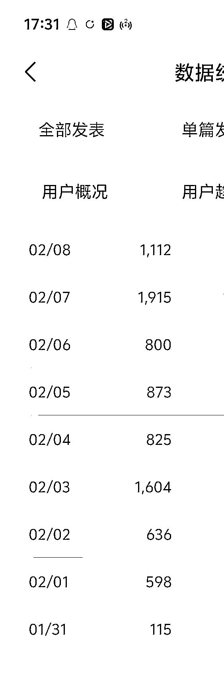

### 二、封面代理玩法

封面代理的开通教程网上已经很多了，这里就不重复讲了。

### 三、自己定制封面做引流，有额度更划算

定制入口在🛰️红包封面开放平台：[`cover.weixin.qq.com/cgi-bin/mmcover-bin/readtemplate?t=page/index#/`](https://cover.weixin.qq.com/cgi-bin/mmcover-bin/readtemplate?t=page/index#/)

可以申请个性化封面定制。

#### 一）定制思路

冲着引流去做的话，设计文案和图建议直接用 gpt4 生成，注意平台有尺寸规范，具体可自行查阅。

#### 二）引流打法

审核通过后就能投放使用了，目前市面投放价大约是 1 元/个，成本不低。

不过每年平台会给👸号/视频号主赠送一定免费额度，**有额度**的话性价比就很高了。

#### 1、抽奖小程序联动

用【抽奖助手】或【活动抽奖】这类小程序做红包封面抽奖，比如抽 50 人送封面，中奖后引导用户私聊🛰️领取，从而完成私域沉淀。

也可以设置先关注👸号再参与抽奖，一步到位做涨粉。

这个做法适合封面刚火的阶段，等封面泛滥后用户参与欲望会下降。

#### 2、👸号发封面领取文

在👸号文章里直接内嵌红包封面，结构一般是两步走：先提示关注👸号，再提示领取封面。

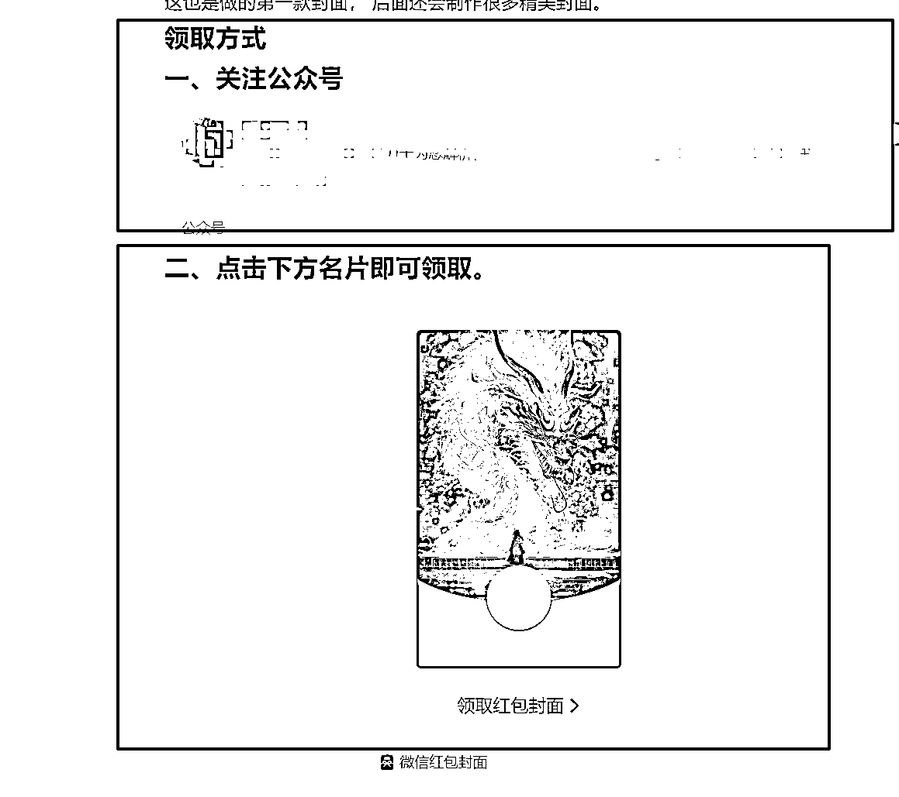

这类内容很容易被系统推荐或被搜一搜收录，所以即便账号粉丝不多，阅读量也往往不差。

#### 3、社群与朋友圈二次分发

如果手上已有社群或朋友圈基数不错，可以在发封面文的同时，再发一篇【引流文】，话术比如关注 xxx 👸号，回复关键词【红包封面】即可领取。引流文本身不提供直接领取，必须先关注后领取。

操作下来基本一波能涨 200+ 粉。

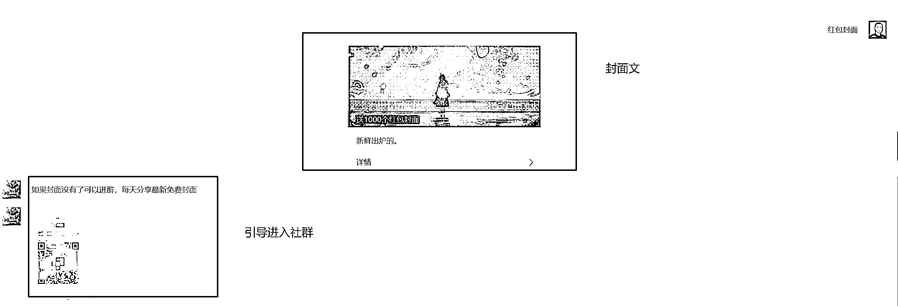

### 四、借势明星/机构/品牌封面引流

封面热度启动期，用明星、机构、品牌的热度封面引流效果很不错，这类玩法对已有基础流量要求更高。

直接看实操案例：

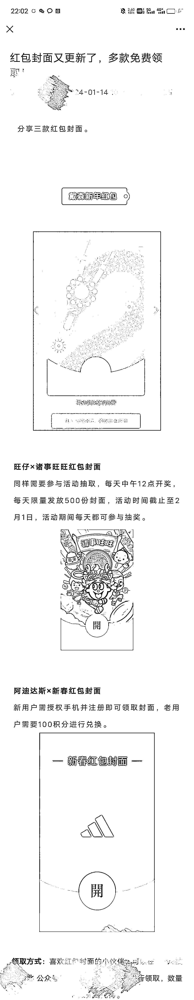

最终导向👸号自动回复关键词领取：

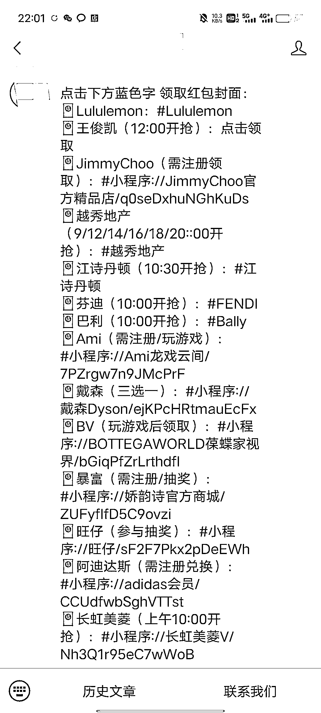

### 五、搜一搜 + 免费封面引流

过年前一周，我用搜一搜 + 免费封面这一套路做了实操引流。

我手上有一个粉丝量不多的👸号小号，日均阅读几十，但发引导文后搜一搜带来的自然搜索流量意外地多，于是决定结合春节前红包封面热点做测试。

于是形成了 **社群 + 👸号 + 免费红包封面 + 搜一搜** 的组合打法。

#### 一）核心逻辑

主思路是👸号发布多款免费封面合集，测试不同标题，通过搜一搜不断获得新用户，再在👸号里放社群码，促使用户进群实现裂变。

1.  N 款免费封面合集文章，打通搜一搜关键词，持续带来新流量，同时激活社群

2.  单款免费封面文章，作为社群维护工具，让用户每天都有东西可领

#### **二）N 款合集封面文章**

这类合集极容易被搜一搜收录，我的账号近期每天都被搜到，带来的流量很稳定。

举个例子，搜一搜里直接搜“红包封面”就能看到相关结果。

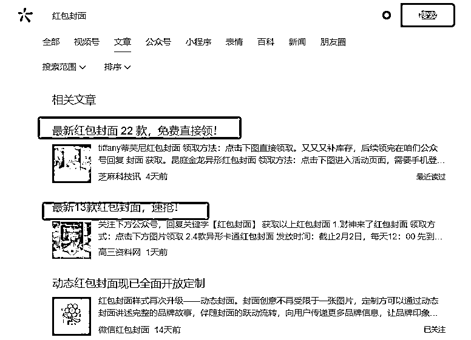

做法和上面类似：找一些非原创的封面合集，文章主线就是引导关注👸号并回复关键词。

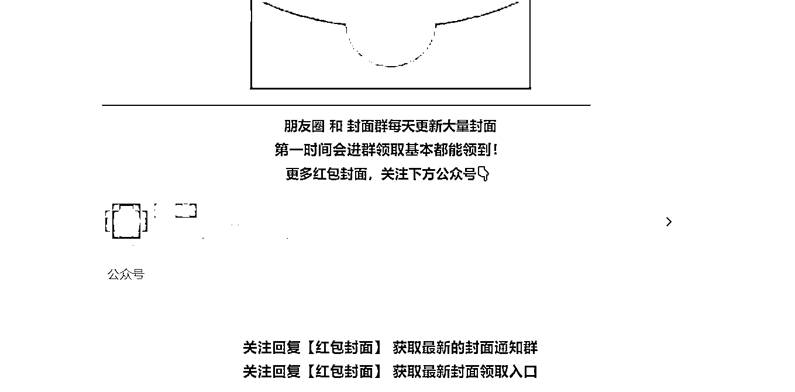

关键词回复的设置和前面说的一样：

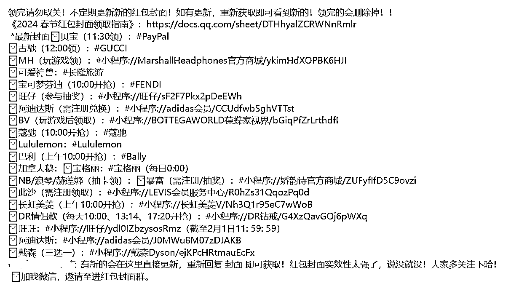

下面是几篇我近期发的合集文的数据截图：

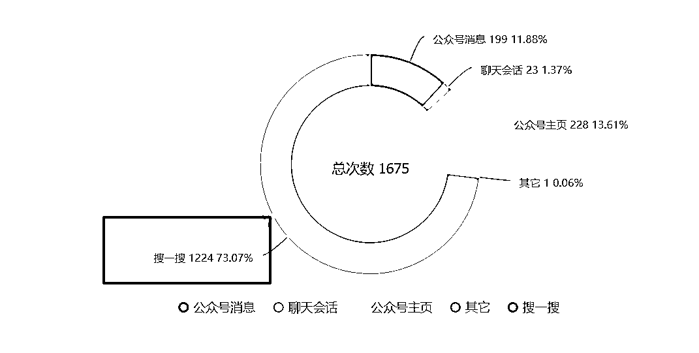

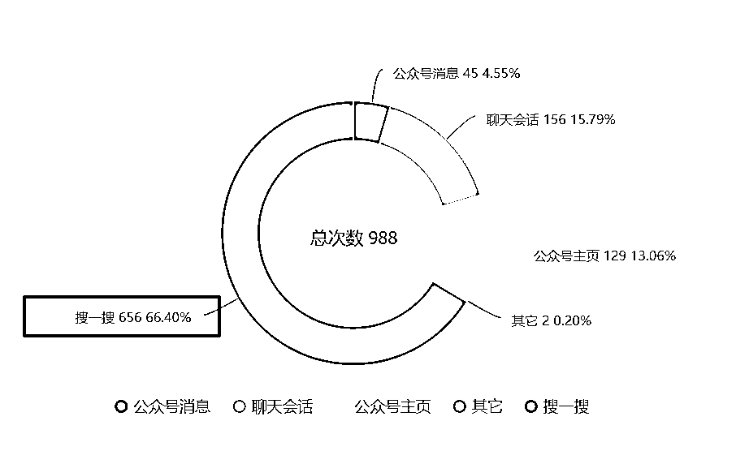

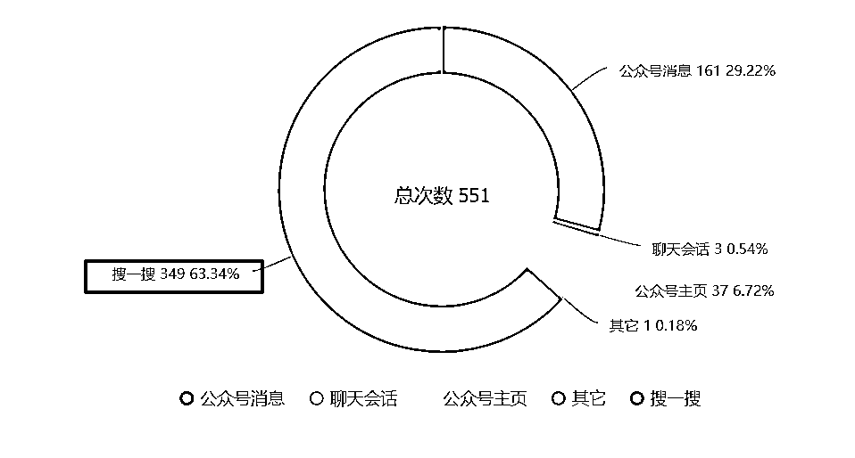

这类文章不需要主动转发，也能实现被动涨粉。

#### **三）单款免费封面文章**

单款封面文章有三个明显好处：

1.  投放到红包封面社群里，每个人都能领到，增加社群信任感

2.  用户领取后容易转发，带来二次裂变和关注增长

3.  文章本身流量主收益也不错

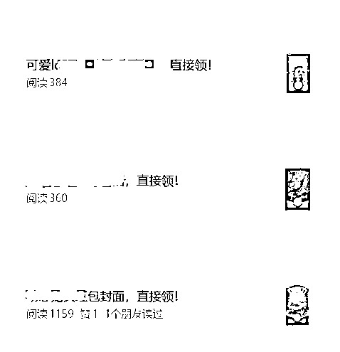

虽然单篇内容有保质期，但👸号一天可发多篇，用户基本都能及时拿到封面。

### 六、几个细节优化

1、在👸号关键词自动回复里，除了放封面领取链接，还同时放了🛰️群二维码，一并给社群导流。

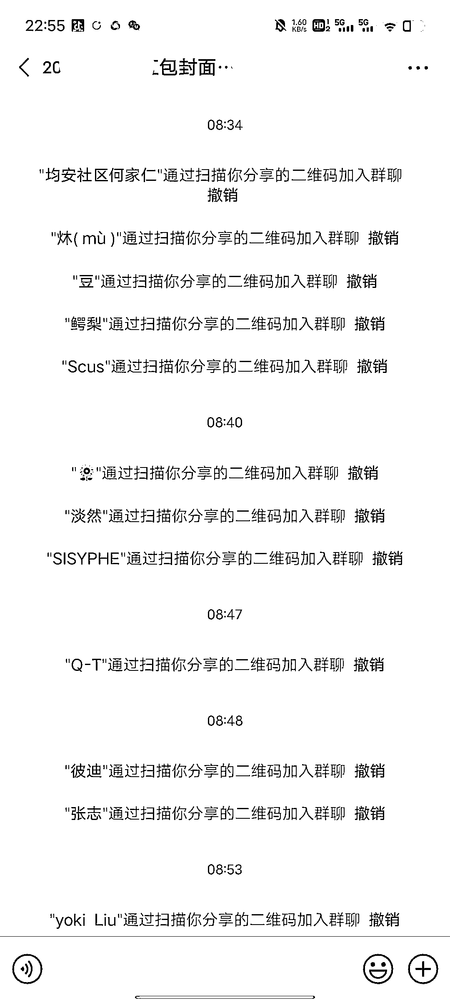

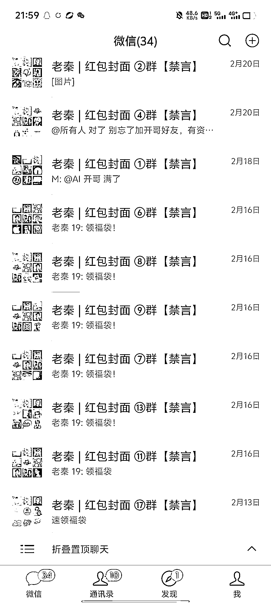

2、单篇免费封面文章里适当插入文中广告，提升流量主收入。

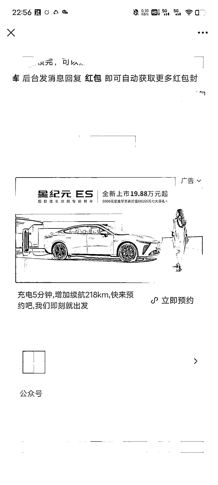

3、在👸号自定义菜单里增加【封面获取】入口，引导用户加🛰️。

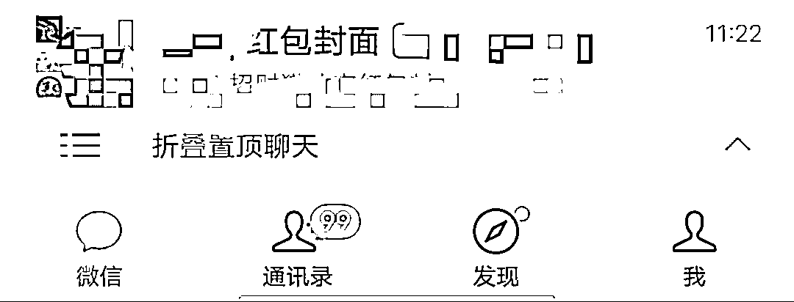

* * *

评论区：

暂无评论

* * *