# 3 个人的小团队做英文绘本，直播一开 30 天卖出 40 万+

> 原文：[`www.yuque.com/for_lazy/thfiu8/mq6zik5cez4gv0rb`](https://www.yuque.com/for_lazy/thfiu8/mq6zik5cez4gv0rb)

## 3 个人做英文绘本教育，30 天直播成交 40w+

作者： 沈宇

日期：2024-03-27

21 年我开始把绘本做成可持续的课程，核心打法是老师带领孩子一起共读，把家长从陪读的压力里解放出来。日常里除了专业度，老师还要示范跟读，整体体验感很强。

但真正起量的不是内容本身，而是我们怎么把直播间变成成交机器。现在 3 个人稳定下来，月净收稳定在 30W+。

先聊前端的选品逻辑。我们选的都是家长心里有数的大众品类，再叠加一点技术壁垒，用差异化打法和低价锚点把人先吸进来。

后端靠私域冷启动变现，用 0 到 599 元的入门课把人拉进私域，再往千元以上的主课去转化。靠着每天的朋友圈、日更沟通和社群服务，把转化率一路推高。

这个模式能跑通之前，我们至少花了 3 个月去试错，换了好几个号，定位改了好几次，人群不准就推倒重来，才把账号盘活到现在的状态。

下面我把课程设计、产品上架、获客以及公域到私域的转化关键点拆开讲。

# 一、自我介绍

大家好，我是行者-悟空，沈宇，南通人。30 岁前我一直在武术这条路上，12 年从 QQ、贴吧开始做武术线上的知识付费，赶上微信爆发，月流水一度破 50w，在圈子里算是头部。

19 年后疫情冲击，线下活动萎缩，爱好类学习热情下降，业务进入震荡期。团队已经成熟，21 年我决定找不受疫情影响的赛道。

什么样的需求在疫情下只增不减？我观察到双减后线下教培被压制，但宝爸宝妈对孩子教育的焦虑反而放大了，渠道变少需求更迫切。

于是 21 年底我入局家庭教育知识付费，并跟着生财参加航海，号很快起量，正式进入抖音赛道。目前月收入稳定在 30w 左右，踩过的坑后面会展开。

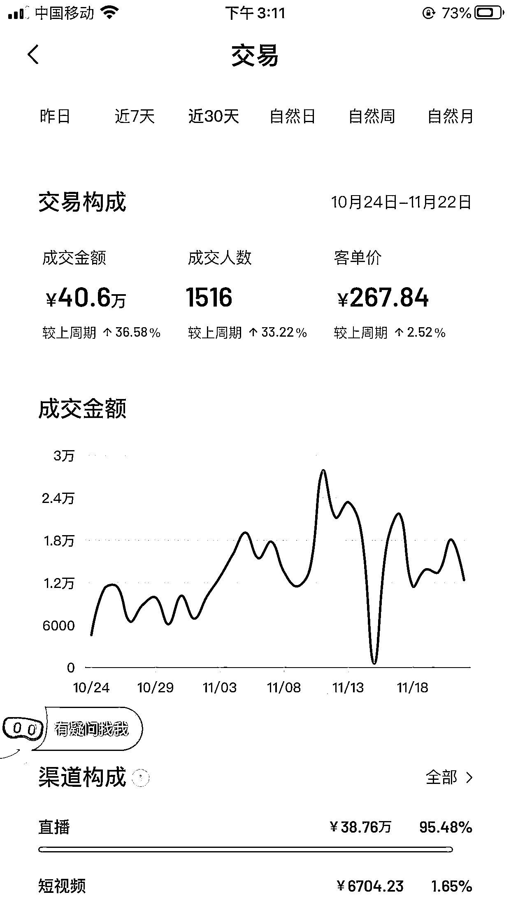

# 二、我们在做什么产品和服务

方向定了，就要定课程内核，大概分两条线：

**1. 做大众已熟知的品类**

出发点不能是老师觉得好，而是家长是否秒懂。很多课程听起来专业，家长却无感，需要大量教育成本去说服，前端根本卖不动。

这也是我们前期销量不佳的原因。后来我们转向市场调研，发现英语分级阅读家长认知度很高，但普遍苦于不会读、不会用。于是我们推出匹配的分级阅读课程：

1、主播都在推，市场已经教育好，不用我们再造概念，直接卖被教育过的产品；
2、家长有基础认知，但操作有缺口，正好有服务和被教育的需求；
3、用基础普品建立信任，后续才有持续复购的可能。

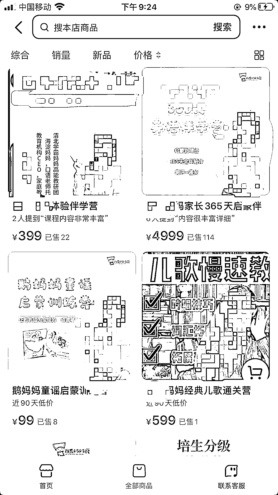

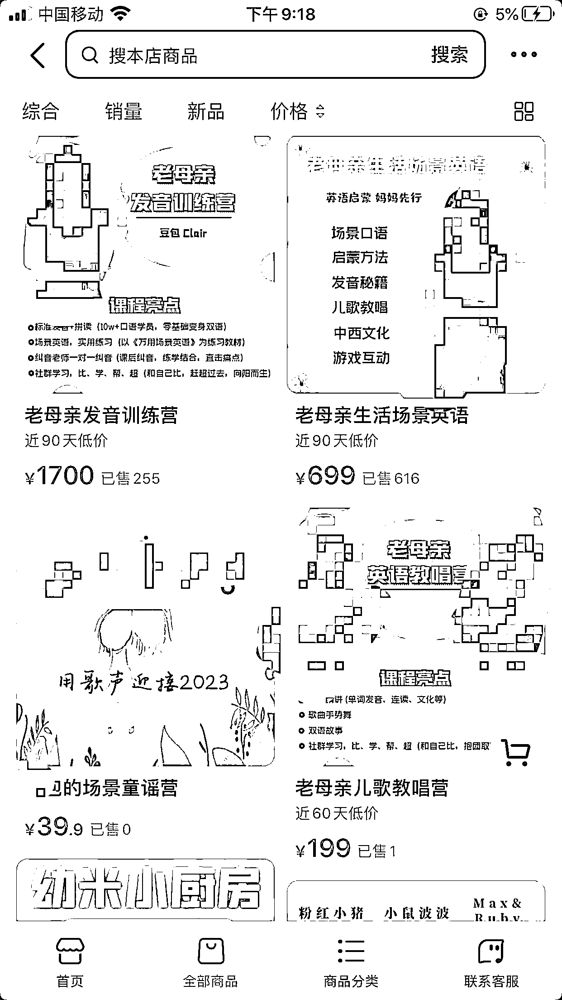

像上图这类同质化严重的课，基本在考验主播 IP 和直播转化力，干一年多多个主播带出来的成交量其实流量浪费很严重。所以做课时必须明确课程的购买点。

**2. 课程要有壁垒**

做产品一定要有不可复制性，要么有专利属性，要么难被模仿。互联网产品很容易被抄，所以一开始就要设想被抄后的应对。

我之前做武术线上课，就是把技术体系化，把专业名词做成搜索资产，在网上大量输出内容，占领关键词和词条。筋骨训练、开发筋骨这些词一搜基本就是我们。

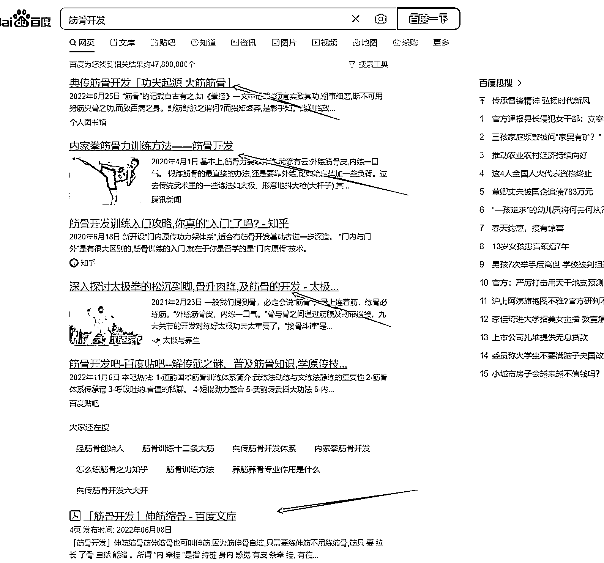

上面是我当年布局的关键词和内容，搜索结果基本被我们占据。

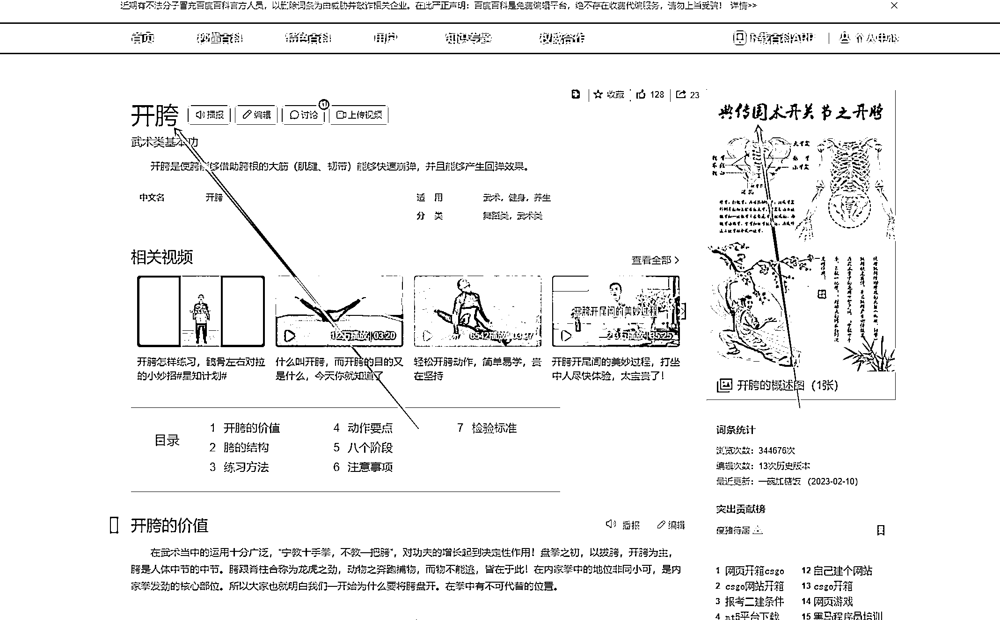

再后来占领词条，图片里看到的典传国术就是我们的品牌名。

可这个项目起步只有 2-3 人，没精力做大规模 SEO，就直接在课程设计上做不可复制性。如果你有资源，也可以布局抖音搜索 SEO 做护城河。

总结下适合直播销售的课程：

1.  是大众已教育过的认知品
2.  有一定技术壁垒

具备这两个条件，基本就能大卖。

**3. 课程如何上架各个平台**

**1.抖音平台入驻学浪**

上架虚拟课必须入驻学浪，个体老师最省事的是申请个体户，几百块就能搞定。关键是类目，要把**【教育咨询培训】**申请上，后续方便小红书、视频号开店。其他类目按需选择。

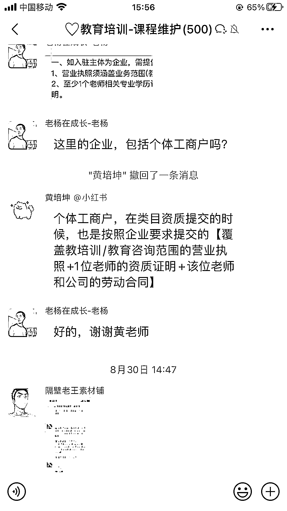

个体需要老师资质，找个有证的配合提供材料即可。

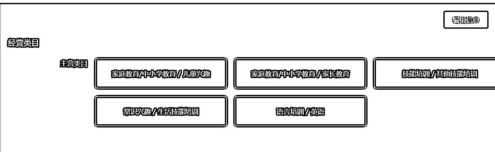

想开什么类目按要求去申请就行。

**1.2 苹果手机看不到怎么办？**

抖音和苹果有冲突，纯虚拟课苹果端看不到。解决办法是一个链接下建多个 SKU，一个虚拟一个实物，直播时引导客户拍虚拟 SKU 发课程链接。

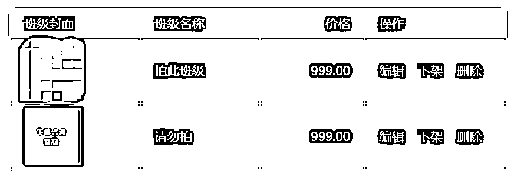

如图所示，拍此班级为虚拟 SKU，请勿拍实物 SKU，就能正常观看了。

**1.3 抖店上架课程必须入驻学浪吗？**

目前不建议。虚拟课上架苹果端看不到就需要发实物，个人操作麻烦；抖店上架教育类还需 ICP 认证，虽然流程不难但要去阿里云申请，成本高。直接入驻学浪更省事。

**2.视频号小店上架课程**

视频号小店需要第三方交付平台，常用小鹅通。把课程建在小鹅通里绑定视频号自己的小店，就能提交 SKU 上架。

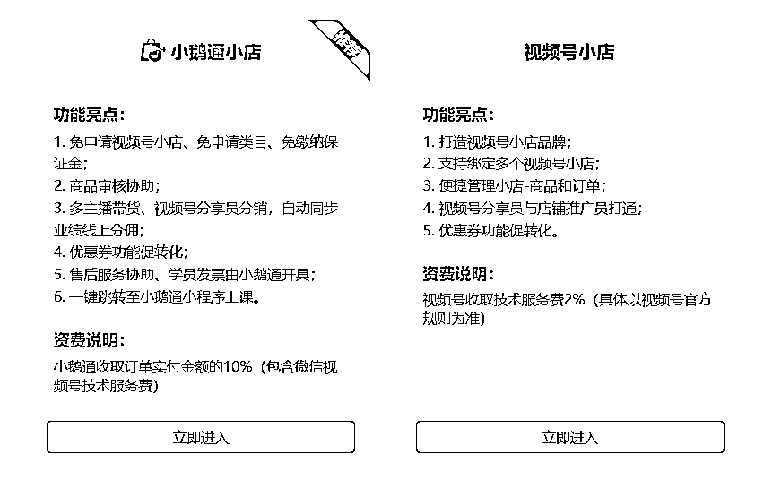

直接选视频号小店，把小鹅通课程提交即可。

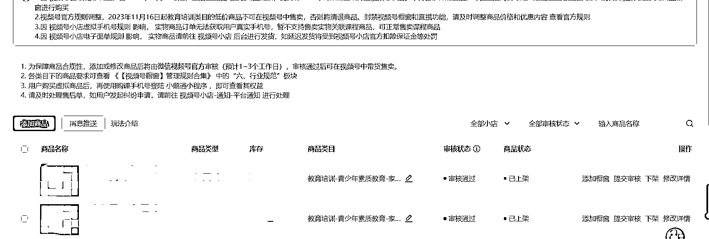

如果没有自己的小店，也可以走小鹅通小店，手续费大概 10%，看个人选择。

**3.小红书上架课程**

小红书教育类目要求营业执照具备**【教育咨询服务】**，否则开通不了。类目打开后上架流程很顺畅。

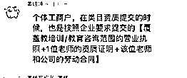

# 三、流量怎么来

项目方向确定后，就要解决来客。21 年起短视频平台就是最大流量入口：抖音、快手、小红书、视频号，都要布局。

**1. 重点是抖音**

抖音是流量基本盘，引流方式是短视频+直播。

做直播的弯路很多，产品即课程，必须先把课打磨好。直播逻辑和做短视频一样，要持续迭代。

23 年的直播模型：**短视频引流 + 直播能力 + 小额测试投放**

**3.1 自然流怎么拉**

走自然流要盯核心数据：关注率 2% 以上，平均停留 1 分钟，粉丝互动率 3 以上，达不到这几个指标自然流很难起量。

抖音直播后台会给出分析图：

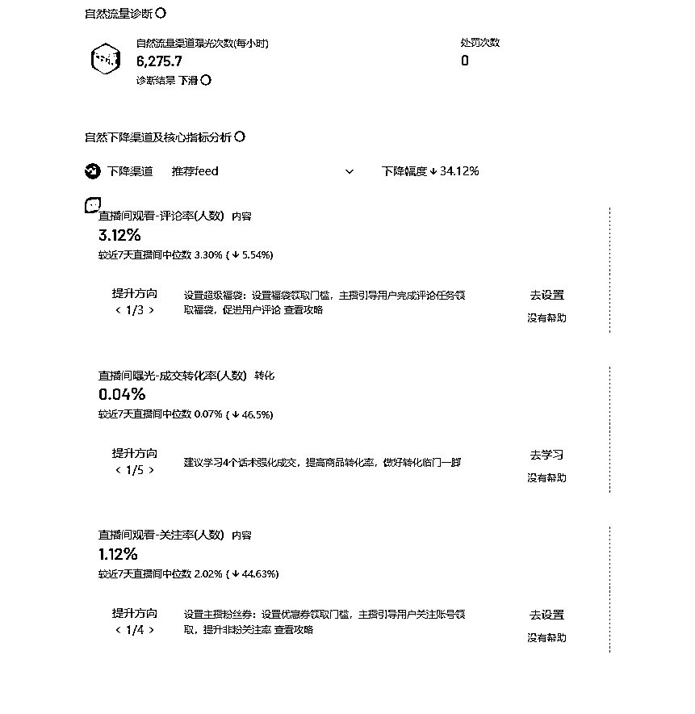

上面这些指标就是优化方向，篇幅有限后面再细聊。

善用福袋和超级福袋，流量下滑时它能迅速拉回关注和粉丝团。

一场直播的节奏我们是：40 分钟干货 +10 分钟过渡 +30 分钟成交。

1. 前 40 分钟守数据，决定当场流量和下场的冷启动流量；
2. 中间 10 分钟做心智过渡，从学习到购买的心理切换；
3. 后 30 分钟分三段成交：冲动消费、信任背书+好评、点对点成交。

**3.2 付费投放**

个人起步先用小店随心推测试，一场 100-200 元即可，重点投成交不要乱投数据。

稳定后可以上千川，但付费占比不要超过 40%，否则不赚钱。目前英语类目 ROI 大多在 1-2，好的能做到 2，多投就多赚。

个人工作室建议先把自然流模型跑顺再放大投放，避免被投手带跑。

**3.3 短视频作用**

直播很卷，短视频能力不能弱。直播时段以外，曝光全靠短视频维系个人形象。能真人出镜一定要真人出镜，利于直播间转化。

**3.4 多平台同步直播**

抖音模式跑通后可复制到快手、小红书、视频号。我一般用 obs 做多开：

[`mirror.tuna.tsinghua.edu.cn/github-release/obsproject/obs-studio/`](https://mirror.tuna.tsinghua.edu.cn/github-release/obsproject/obs-studio)

用虚拟摄像头实现多平台同播。前端流量打通后，下一步就是如何把人接进私域转化。

# 四、私域运营和变现

**1. 前端低价收，后端高价转**

前端产品定在 0-500 元区间，后端课程定在 1000-2000 元，3 倍转化逻辑。

目前前端 299 入门课，进私域后转千元主课，再做横向延展和复购。

抖音直播引流私域的方法：

**进群后用卡片或短链跳转，例如微客链接，一键进微信。**

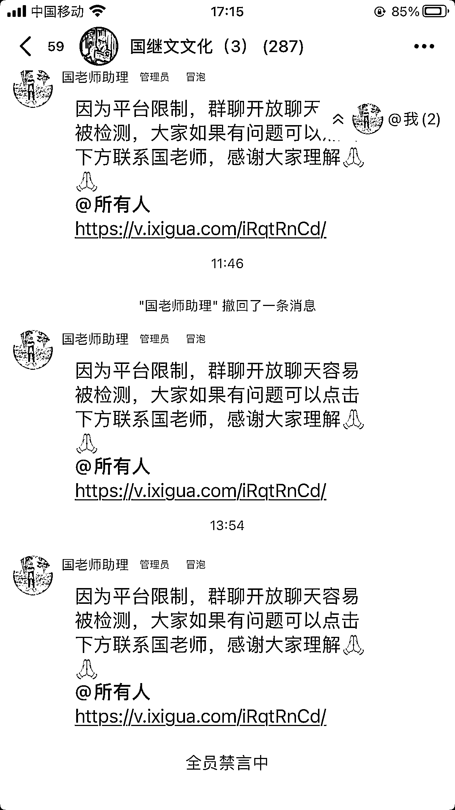

群公告、群名写加微信提示也行，但直接跳转最省心。

**2. 私域转化的三大抓手**

23-24 年只做前端会很吃力，后端私域必须做起来。我们的做法是：朋友圈常更、微信群每周讲课、周末做一次私域直播转化。

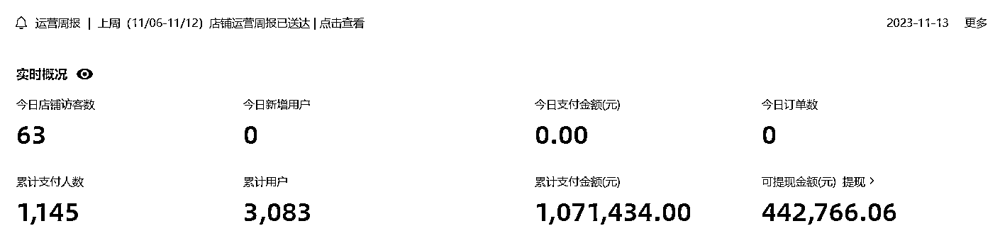

**朋友圈、微信群、1v1 私信**

配合视频号文章和短视频做触达，不断建立信任。朋友圈的更新频率、每日沟通人数都直接影响后端转化，交流越多转化越容易。

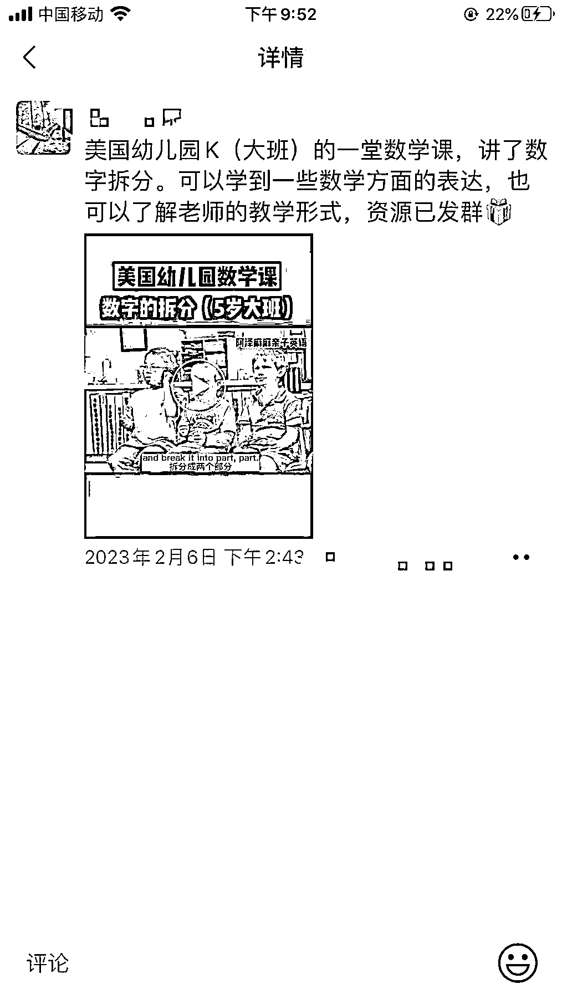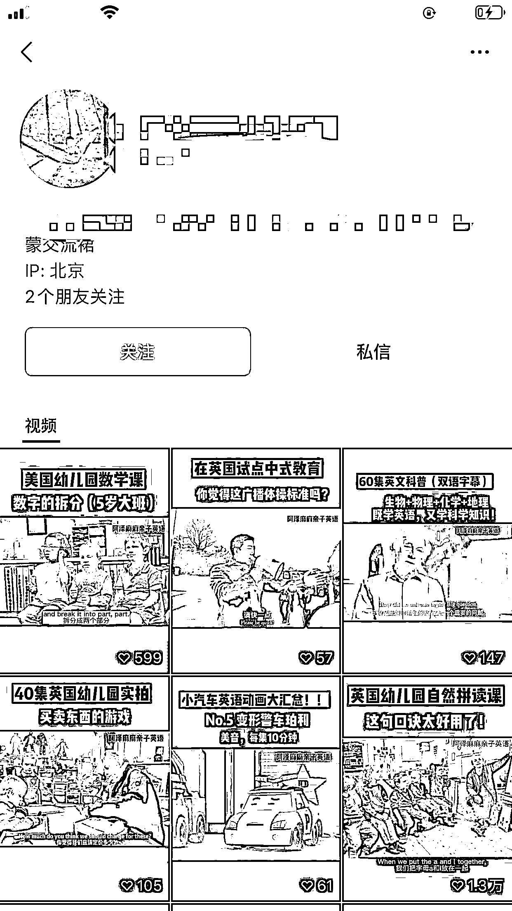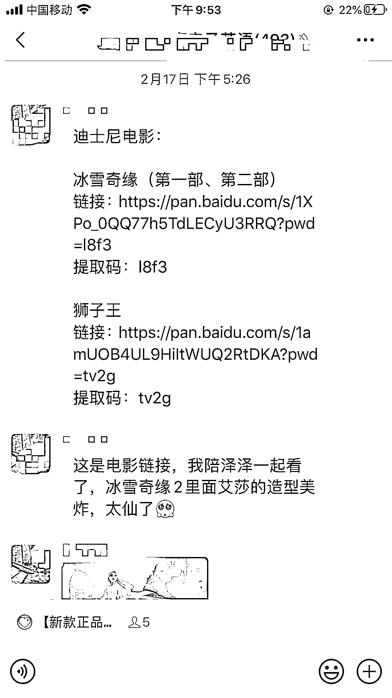

这是个典型案例，资料在视频号、朋友圈、群里流转，形成完整触达闭环。

**3. 每周建群做一次宣讲**

直播投入时间大，小团队可把一周积累的用户集中到微信群，做一次集体宣讲。比如周一周五收集用户，周六集中进群，周日宣讲。

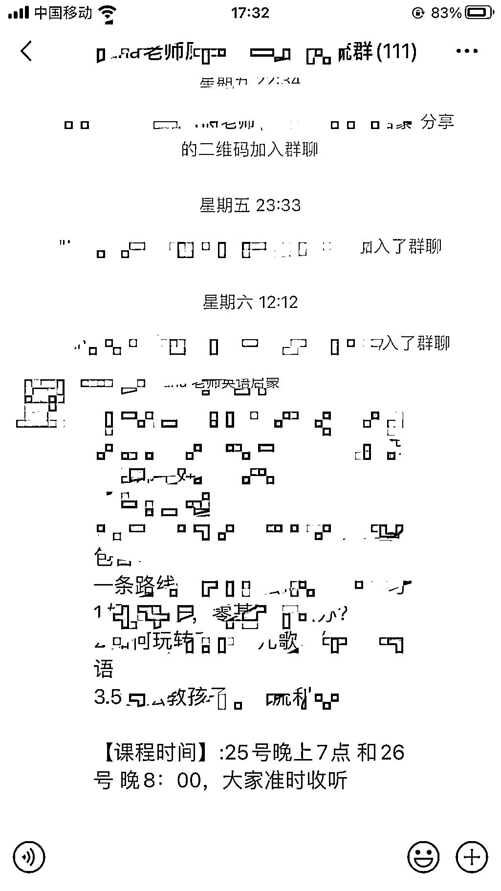

节奏可以是第一天文字讲解、第二天直播讲解，当场成交。操作轻量，适合小团队。

# 五、实战经验分享

**1. 宝妈多次变现**

除了卖课，短视频带货也很可观。我们因精力有限没重点做，人设稳定后每月也有几w 销售额。后期会组建视频团队补齐这块，视频号合伙人模式也适合宝妈群体。

社群团购也在本月启动，预计会成为新收入线。

**2. 专注与坚持**

项目起量前至少调整了 3 个月，做过多个号，定位换了好几次。人群不准就推倒重来，中间差点放弃。想法和落地是两回事，项目看准了就要坚持。

另一个是专注。项目起来后容易想复制，但团队才 2-3 人，必须先把基本盘做稳。之前看到视频号好就拉人一起做，结果精力分散两边都做不好。确定方向后先做透再延展。

一路优化离不开生财的陪跑，从大航海到小航海，一直在迭代学习到现在稳定。

* * *

评论区：

小菜 : 课程是自己开发还是？

沈宇 : 前期自己开发，后期直播跑顺后需要补体系就会对外合作，核心还是把直播做好。

* * *