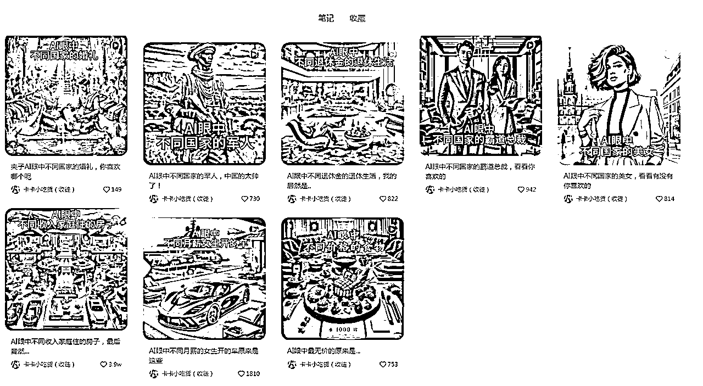
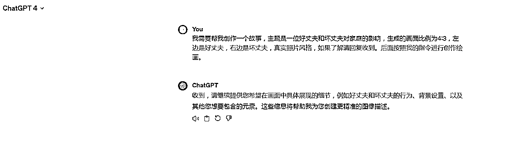
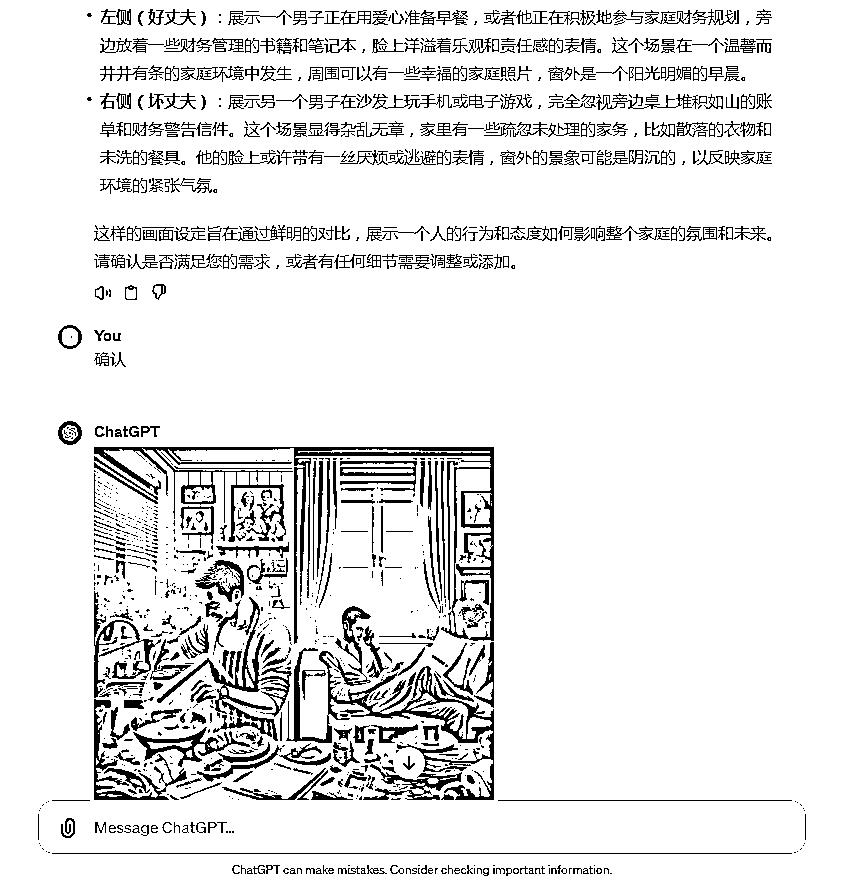
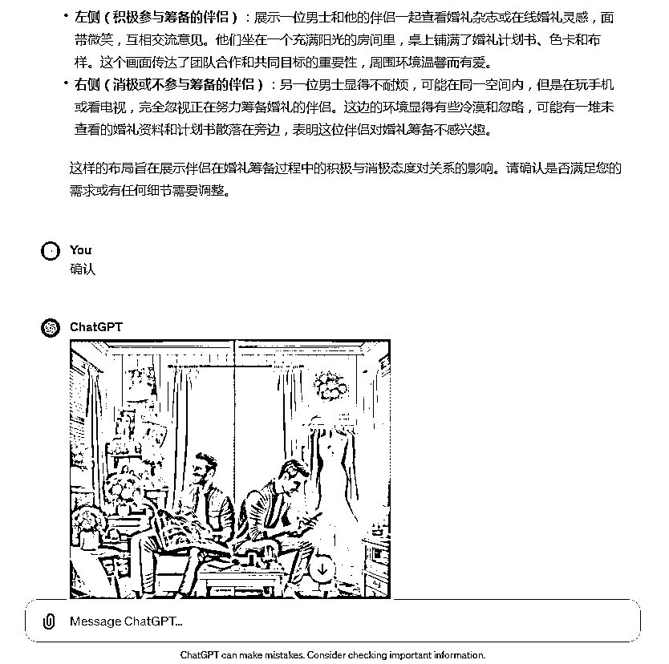
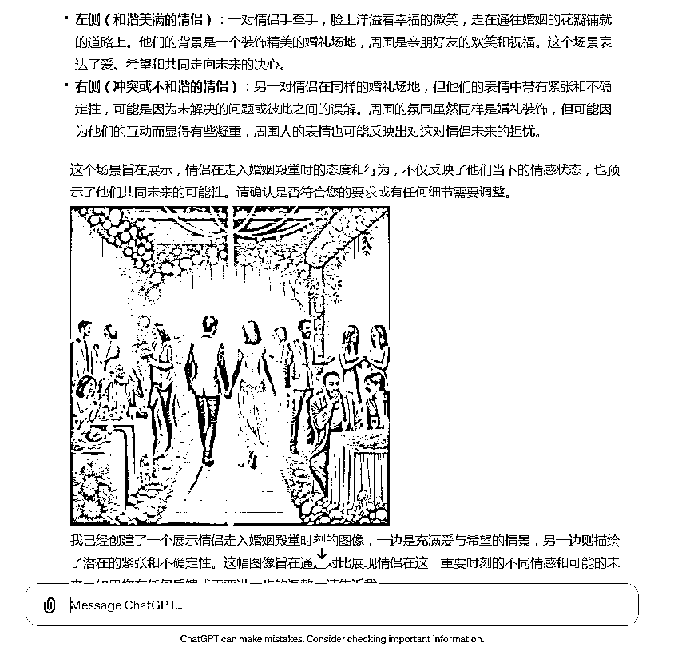
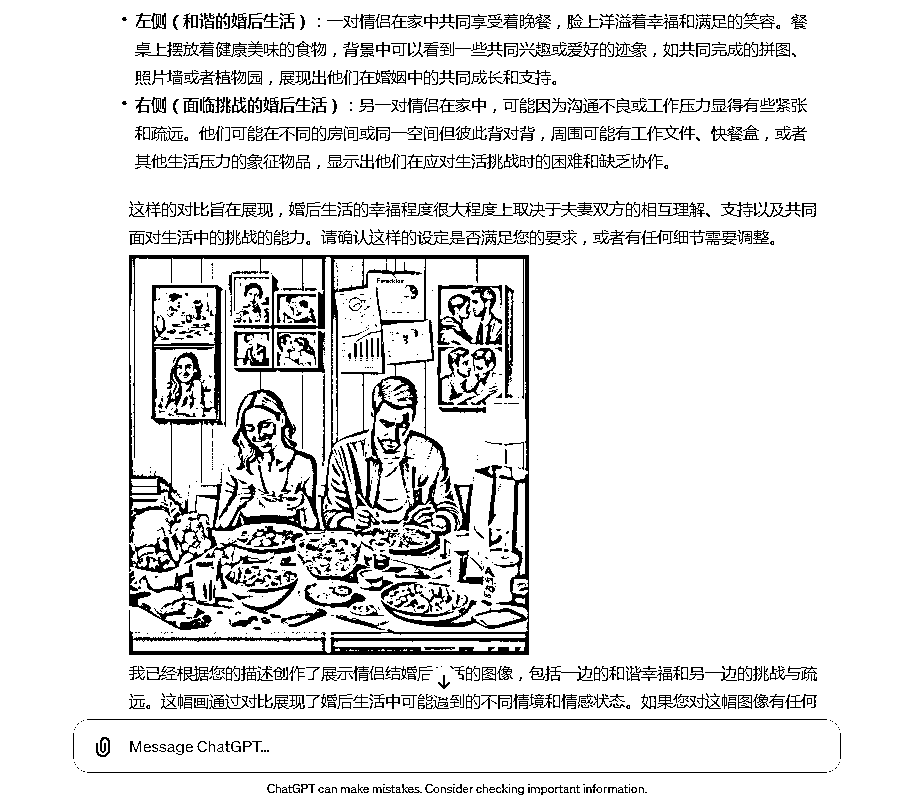
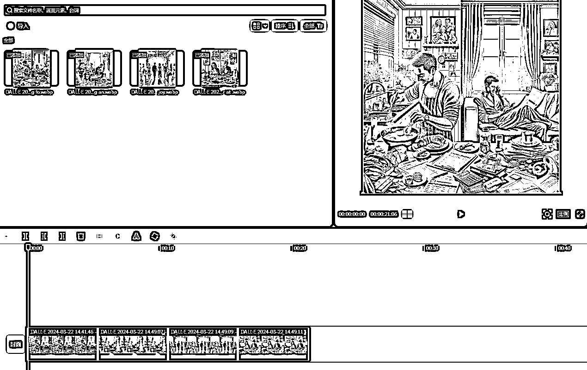
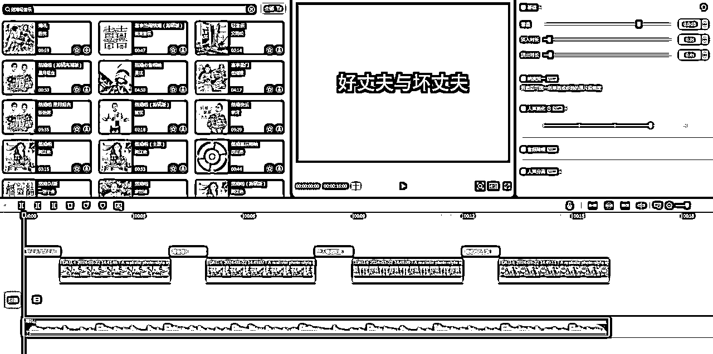
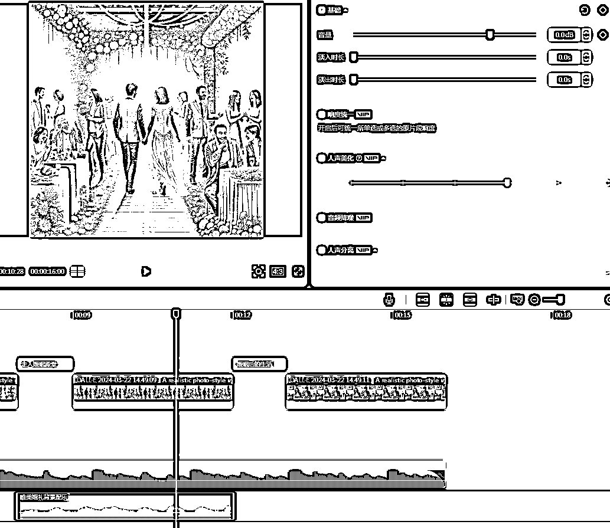
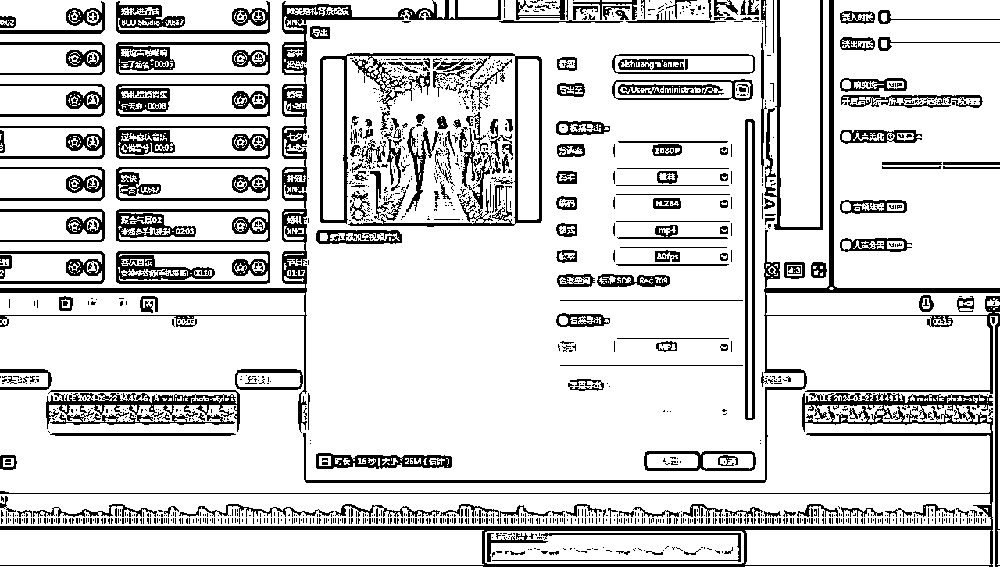

# AI双面人生短视频，完全拿捏情感共鸣

最近“AI双面人生”这类短视频在小红书上一路刷屏。老实说，第一次看到“双面人生”这个词，我也没太明白，直到点开视频才突然反应过来：同一个家庭，一边是温暖的丈夫，一边是冷漠的丈夫，左右对比带来的冲击力极强。这种内容之所以能火，核心就是它精准击中了大家对亲密关系的复杂感受，谁看了都忍不住代入，情绪共鸣直接拉满。

既然这个套路已经在某个平台被验证有效，换个平台复制也照样有戏。下面我就从零开始，拆解这类视频的制作方法。

第一步是生成图片素材，工具要用ChatGPT4.0，其他版本画不了图。打开之后给它发一段提示词：
“请帮我构建一个故事，主题是一位好丈夫和一位坏丈夫对家庭带来的不同影响，画面比例设定为4:3，画面左侧是好丈夫，右侧是坏丈夫，风格贴近真实照片。如果你明白了，请回复收到，接下来请按我给出的指令一步步完成绘画。”

等模型回应之后，就按时间线依次生成四个阶段：恋爱期、备婚期、婚礼现场、婚后日常。
提示词：情侣还没结婚的阶段

提示词：两人筹备婚礼的时期

提示词：携手走入婚礼殿堂

提示词：结婚之后的共同生活

所有画面生成完毕，把图片全部保存到本地。想换主题的话，只需要改动提示词里的故事设定，这个模板可以直接复用。

接下来进入剪辑。打开剪映，把保存好的图片全部导入轨道，然后把画面比例改成4:3。

再看对标视频，每段画面之前都有一行文字引导情绪，我们也照做：点击“文本”，把文字轨道放到每张图片前面，再调整字号、字体和样式，让整体观感和原视频一致。

接着添加背景音频，时长也要和这段画面覆盖的时间区域匹配，并给音频设置淡入淡出，让开头与结尾更自然。

还可以给单个画面加入音效，比如婚礼那段就配上典礼氛围音，如果音量不合适，随时手动调整大小。

所有细节都处理完，最后设置一个吸睛封面，就能直接导出了。整套流程并不复杂，核心就是用AI制造视觉冲突，再用剪辑制造情绪节奏，学会这套思路，你也可以做出容易共鸣的爆款短视频。

