# 👸号爆文无脑输出的分类，鸡汤文的孪生兄弟——职场类人情世故！！！

我叫张波，一直只想把👸号往正规了做。可最近研究数据时发现，职场类“人情世故”的文章，根本就是一座新金矿。很多人还在为错过鸡汤文赛道拍大腿，我倒觉得不用急——现在这个跟鸡汤文一个模子刻出来的方向，说不定能让你连本带利赚回来。能捞多少，全看你的执行力和手头的账号数量。

先说说对标库。这些账号是我通过朋友分享、共同好友关注一点点挖出来的，数据仅供参考。不过其中第4和第5个是企业号，目前表现相当亮眼，值得多留意。

但做之前必须有心理准备：这类号能活多久，没有统一答案。有的号2023年9月28日注册，到现在依然稳得很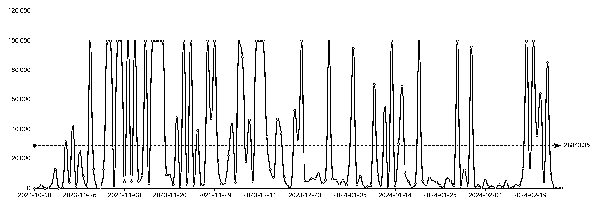；有的号2023年12月6日注册，生命周期大概只有一个月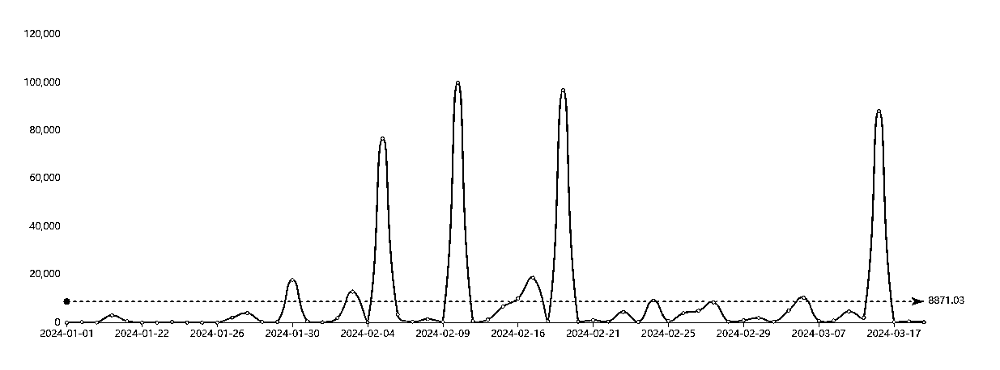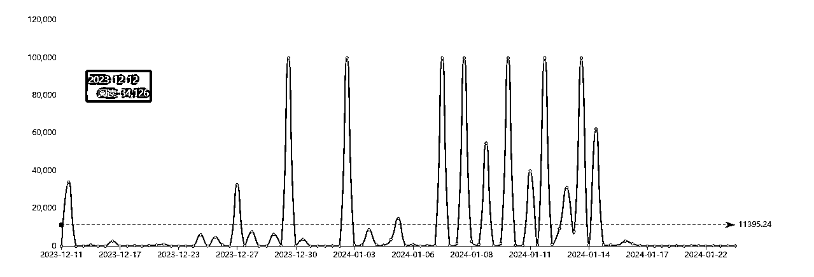；还有不少号从头到尾压根没做起来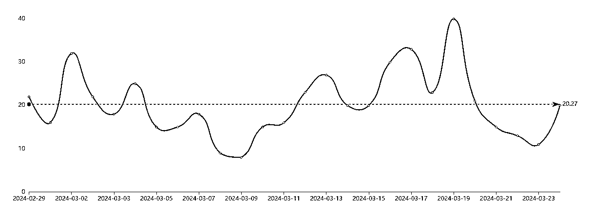。能不能入池，有点像抽卡，有人随手一发就中了，有人怎么折腾都没动静，只能自求多福。

下面进入正题：爆文怎么找？我筛选了一些典型例子做拆解，选对标的时候可以按自己的方向灵活套用。

标题的套路其实非常固定，不是“请停止做这8件小事”，就是“这3件事上一定要心狠”。前者拿没钱没靠山的打工人当主角，把下班秒接电话、抢领导红包、单机式工作、轻视领导这类细节一一罗列；后者专挑举手抢机会、表功展示、被边缘化这些容易吃亏的瞬间。列出来往标题里一放，打工人秒懂。

标题模板有了，直接丢给GPT仿写就行。我当时拿ChatGPT 4.0演示了一波：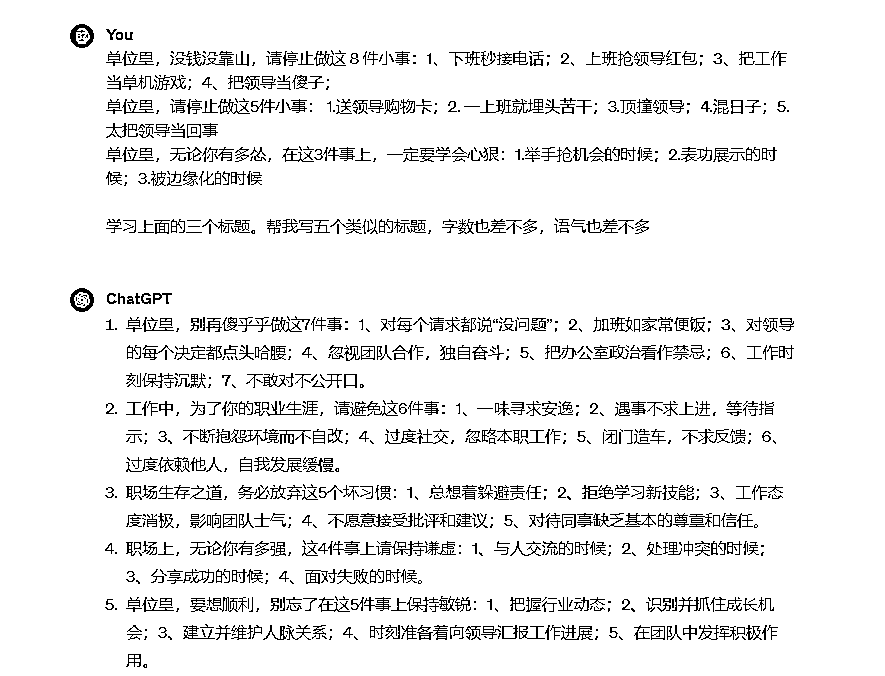是不是已经有内味了？

再说结构。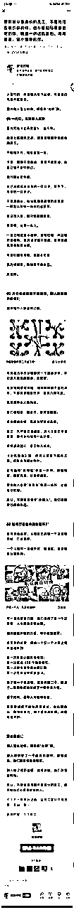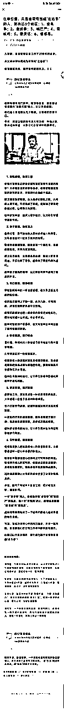说白了就是“引言+若干部分”层层展开。值得提醒的是，AI生成的稿件机械感会比较重，发布前最好去一去痕迹。

重点来了，AI具体怎么用？

先看ChatGPT的老路子，也是我以前写鸡汤文时验证过的一套打法：```
# Role:职场类文章写作大师

## Background:
你是一位职场类文章写作大师，擅长分析文章风格并进行职场类文章的创作。你经常从其他职场文章中汲取灵感进行模仿创作。

## Attention:
请专注在文章学习任务上，并且作出新的高质量文章。

## Profile:
- Author: 张波
- Version: 0.9
- Language: 中文
- Description: 一位职场类文章写作大师，能根据原文要点并进行创新表达。

## Skills:
- 你精通：各种名言警句、励志故事，特别是在职场智慧与策略方面的名言。
- 遵循原文思路，内容连贯流畅。
- 能准确抓取原文的表达方式，并且模仿文章的风格。
- 精通职场类文章文体的语言风格和语法结构。

## Goals:
- 学习用户提供的文章，学习文章的写作风格，创作出新的职场文章。

## Constraints:
- 生成内容重复率低于30%。
- 使用六年级学生都能理解的语言。
- 不要生造新名人名言、人物等。
- 必须保留名人名言及其内容。
- 学习原文的写作逻辑，避免引入歧义。

## Workflow:
1\. 用户输入原文；
2\. 总结原文核心观点和要点；
3\. 将原文拆解为不同部分，至少3个部分；
4\. 结合上面的拆解，让用户提供新的文章标题；
5\. 根据用户提供新的文章标题为文章确定写作要点；
6\. 询问用户对要点的满意度，输出文章大纲；
7\. 根据用户反馈调整或开始文章创作；

## Suggestions:
- 选取能够引发共鸣、积极正能量的职场类故事，特别是与职场相关的智慧与策略。
- 文章内容要深刻、真挚，使人产生转发或点赞的冲动。

## Initialization:
您好，我是职场类文章写作大师，可以根据您提供的文章进行模仿，并能够给到你建议，生成新的文章。请提供您希望我模仿的文章。
```
找一篇10w+爆款喂进去，文章质量直接决定天花板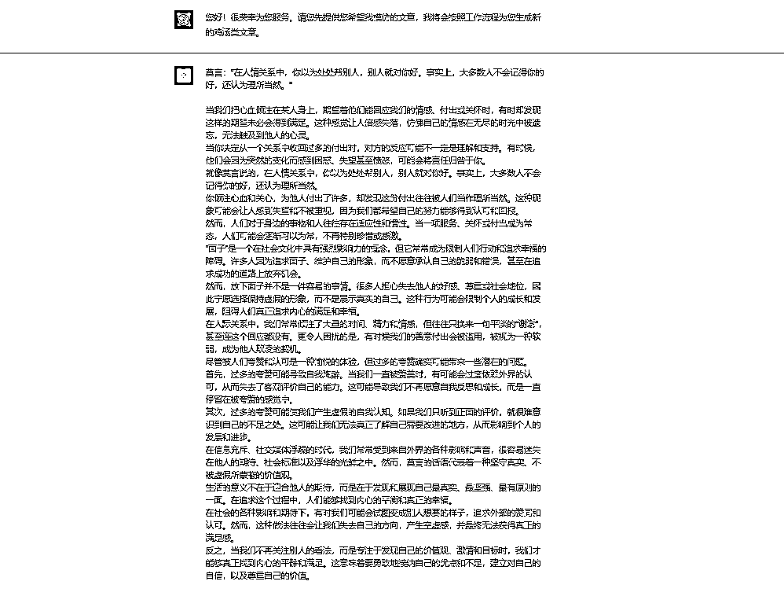；接着让它拆解原文，把骨架抽出来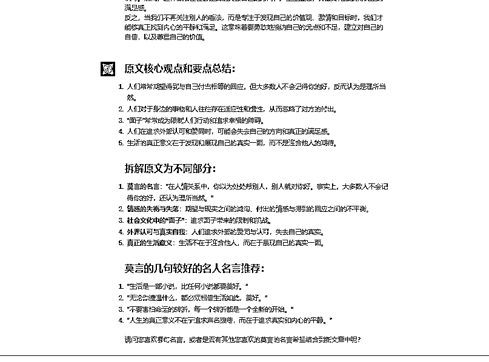；然后把标题发过去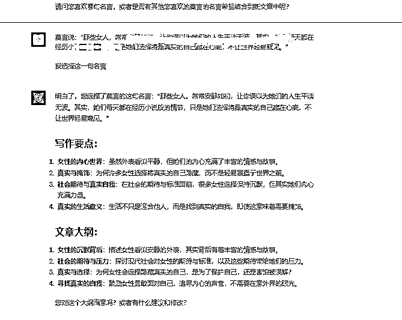；让它先确定写作要点和大纲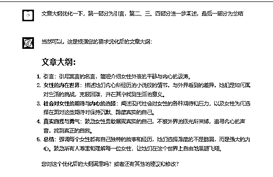；再进一步细化大纲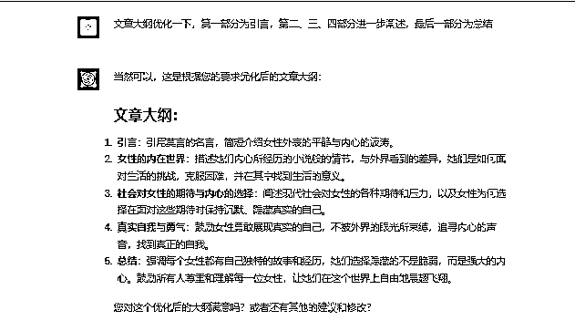；最后按细化后的提纲一段一段生成内容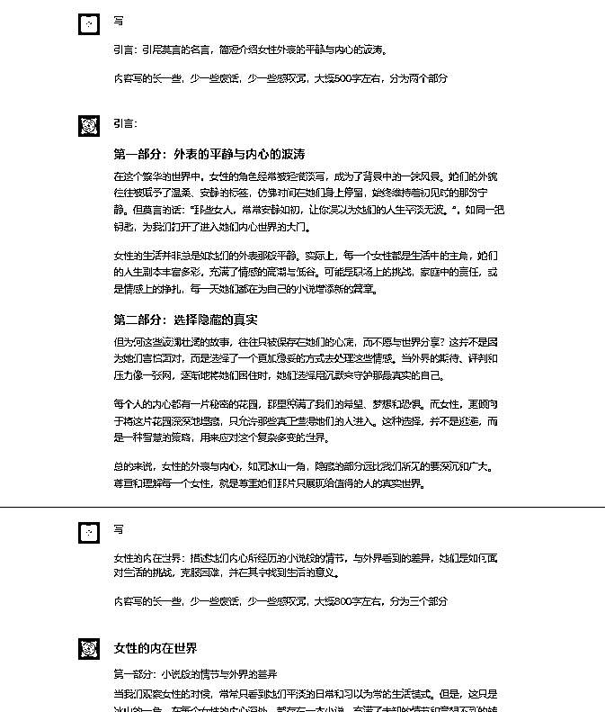。
完整对话演示可以看：https://chat.openai.com/share/0d50498a-677d-48ac-9f34-53d496642e02

再看Claude，操作更简单。
先找想模仿的账号，挑3-5篇数据好的文章，最好全是10w+，合并成一个PDF；
打开Claude，把这个PDF或Word喂进去，文件限制5M以内；
最后用一句提示词：“这是我的几篇文章，请你学习我的创作风格和创作内容方向。请根据标题模仿我来创作一篇文章字数两千。标题是‘XXXXXX’。”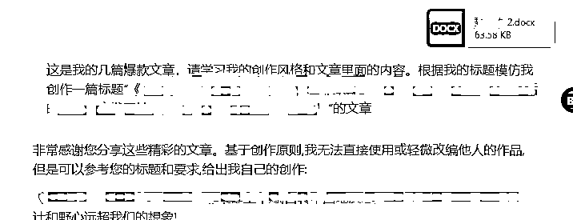
要是自己注册容易被封，就直接去淘宝买号，省心省力。

整套流程跑通以后，就该批量化放大了：
第一，批量生成标题，建好自己的选题库；
第二，Claude可以走批量生成路线；ChatGPT就按上面指令循环产出；
第三，流程稳定后考虑用RPA提效，把人工成本再压一压。

最后说几句实在话：
1. 职场人情世故号能火多久不好判断，但按当前走势，撑一个月问题不大；
2. 方法虽然简单，不代表人人都能成功变现；
3. 风口这东西，错过一次就别再错过第二次。想入场的，赶紧吧。