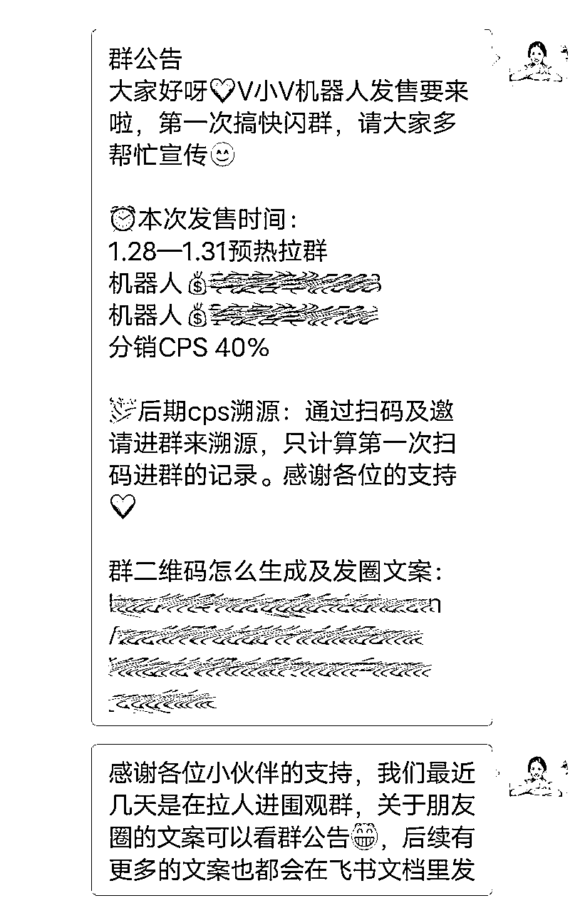
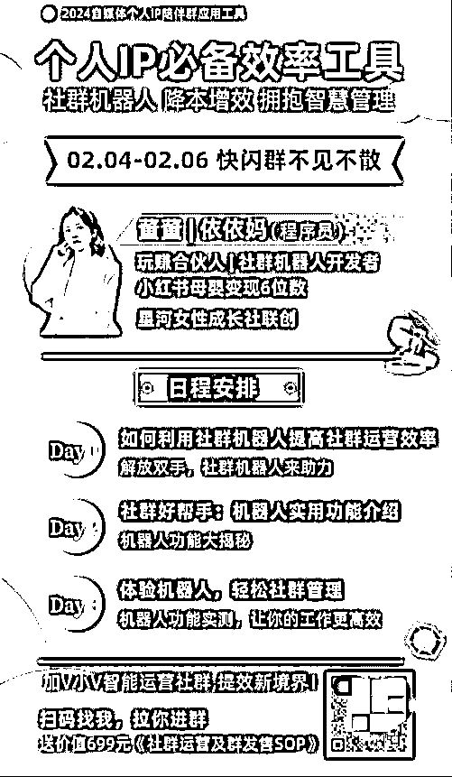
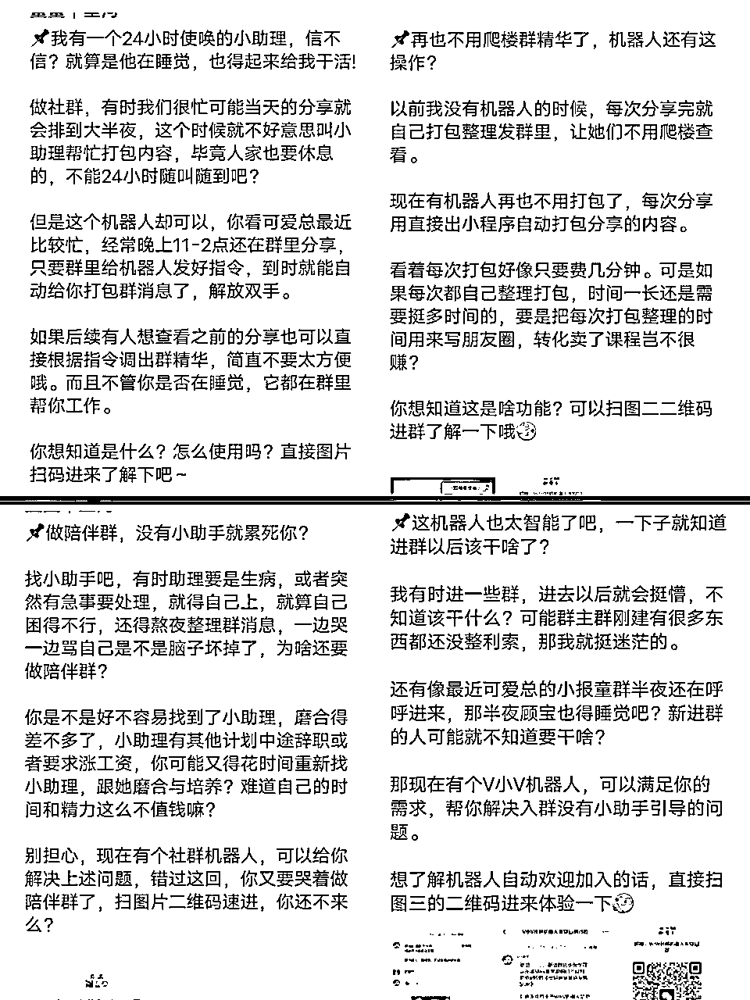
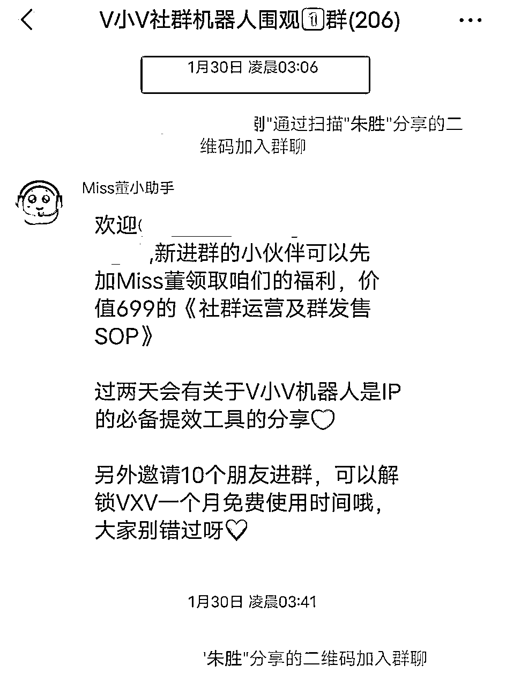
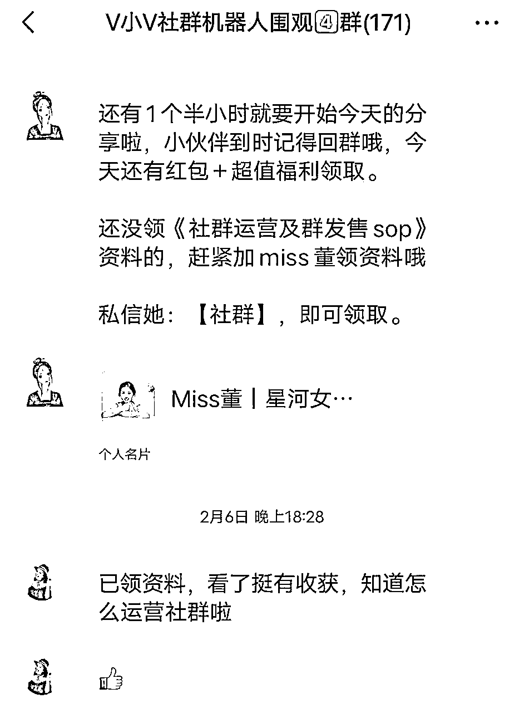
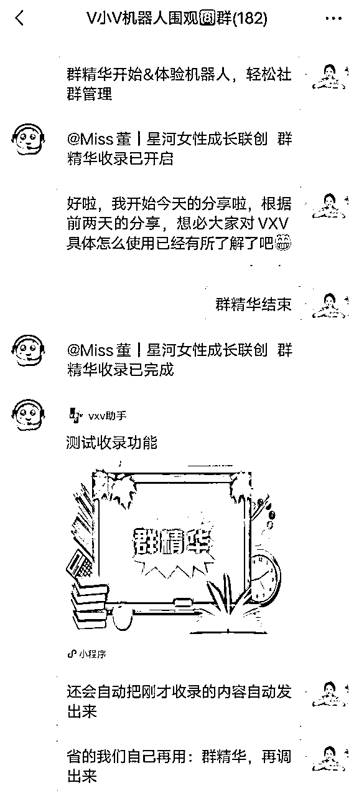
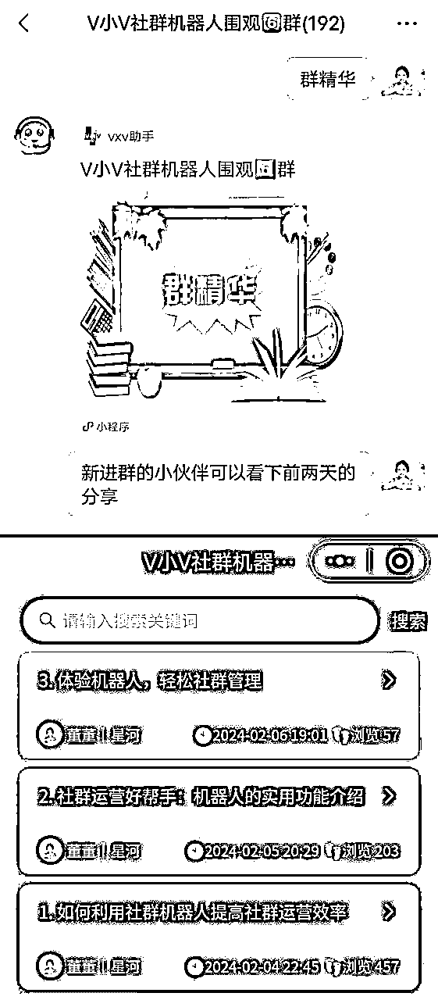
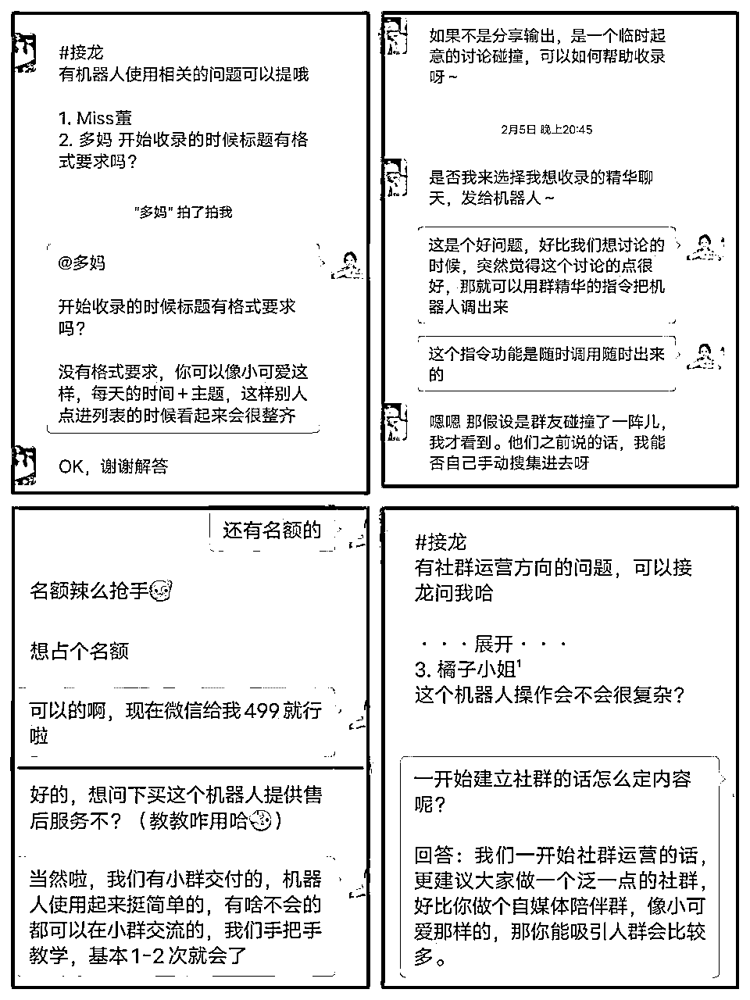

# 程序员首战社群快闪发售，3天破万营收的全景复盘
作者：龙哥

我叫董董，做程序员8年，北漂至今。写代码的思维烙在我骨子里：凡是重复的事，就该让机器干。

副业做自媒体，长期经营社群，也混迹过不少高质量社群。越看越发现一个共性：运营社群太费劲。每天整理群内干货、反复回答同一个问题，这些脏活累活把时间啃得干干净净。

当我把这个问题讲给老公杨先生听时，他作为同样是程序员，立刻开始调研验证。我们达成共识：这些重复性的运营动作，完全可以被代码化。

由此诞生了V小V机器人，一个面向自媒体人的社群自动化工具，目标很简单：把人从重复劳动里解放出来，把精力放回内容生产和变现上。

在小可爱的整体操盘，以及理白、靠谱的鼎力支持下，今年2月初我们做了第一次快闪群发售。3天时间，流水直接冲到5位数。

把从立项到收官的完整链路拆开来看，核心就围绕四件事：为什么要做发售、发售怎么走、群里具体怎么操盘、结束后怎么复盘补洞。

## 一、为什么要做快闪群发售

借用靠谱姐的一句话，快闪群的定位就是集中转化、不做反复消耗、分阶段收割。说白了，就是把那些之前犹豫的人推一把，把还没了解你的人快速建立认知，把潜在需求埋进心里。

快闪群的核心打法是讲故事+晒实力+请KOL站台+学员背书，形成批量成交的势能。它会把三件事反复敲进人心：你是谁、你卖什么、能解决什么、谁已经用好了。

朋友圈触达有限，很多人在你发售期间根本看不到。快闪群相当于举着个扩音器在人群里喊话。白大在拉新阶段就给我送了200个陌生新人进群，这些人对我几乎零认知。所以认知构建是第一步。

即便当下没下单，只要后续有相关需求，且对你的信任度够了，成交只是时间问题。

## 二、发售前的筹备

### 整体节奏

一场标准的社群发售，周期一般在3到5天。因为我是卖服务型工具，3天就够了。

第一天主攻痛点挖掘，软性植入产品能解决什么，让大家产生期待。第二天拆解机器人具体怎么用，正式进入发售。第三天上证言、做收尾追销，邀请小可爱、大西、小苗哥这些长期使用者现身说法。口碑永远比自夸管用。

注意分享的连贯性。最初我把产品介绍放在第一天，小可爱直接指出：信任还没建立就推销，转化会很差。于是调整策略，第一天只给运营干货，先种草再收割。

### 团队与合伙人

单打独斗跑不远。我这次同时开了4-5个群，拉新大群上百个很常见。团队的力量才是加速器。

我通过私聊招募了分销合伙人，佣金开到40%，并额外加码：帮我拉10个好友进群，免费送1个月机器人使用权。裂变自然起来。

招募合伙人和大咖，除了给到利益，更关键的是先建立关系。做完私域后我才明白：人＞钱，关系先行。中国始终是人情社会。之前我一直保持真诚交流、该付费支持就支持的习惯。所以发售需要用户证言时，小可爱、大西、小苗哥、柒七等人马上就给出素材并进群分享。

### 分享稿准备

#### 篇幅控制
发售周期3天。单篇分享最好控制在3000-5000字，6000字是上限。超过就难阅读。

图片密集时，飞书两行在🛰️里已很长，飞书三四行就是阅读压力。必须分段、精简。

#### 反复打痛点
不要指望临场发挥。分享稿要提前写好、反复打磨。光靠真诚介绍产品是不够的，必须提供干货，戳中情绪共鸣。

无论几天发售，每一天都要做痛点复盘。让用户感受到：这就是我需要的。

就像一个好吃的零食，第一次提及会说“好像不错”，第二天再提会想“有点馋”，第三天再提就会说“我一定要买来尝尝”。

因此分享稿的核心就是每天反复提炼价值点：能解决什么问题、对应什么场景。把需求和场景讲透，用户才会掏钱。

### 物料筹备

#### 裂变海报
主标题、副标题、3天内容要点都要清晰突出利益点。主标题要挂IP词、必备工具等关键词，快速锁定人群。

副标题字号小，可以写得更长一些，继续给利益点。顶部标注发售时间，方便用户安排日程。

个人背书要前置，亮明自己在什么赛道。分享内容要具体、有干货感，才能驱动进群。

海报二维码留白，让合伙人自行替换为自己的群二维码，便于追踪来源。

#### 福利设计
福利必须强相关且有吸引力。社群机器人面向的是对社群运营感兴趣的人，进群福利我选了《社群运营SOP》，加🛰️领取效果很好，共加了500+，精准度高。

同时设置裂变福利和群内报名福利，双重推动参与。

#### 文案沉淀
朋友圈裂变文案、进群领福利文案等，按不同阶段提前写好，存放在飞书或flomo里，需要时直接调用，也便于复用。

朋友圈文案主打痛点挖掘+产品卖点，精准吸引意向用户。

#### 氛围组筛选
氛围组成员优先从学员里挑，其次是深度信任、靠谱的熟人。不要找交集少的陌生人，发售期间不好使唤，也容易掉链子。确定性越高，你越能专注主线分享与转化。

## 三、群发售全流程实操

### 进群预热
准备好3-5个群，用小号担任群主，避免风控。

### 欢迎与领福利引导
进人高峰期每隔10-20分钟发一次欢迎语，引导加🛰️领福利。中后期人少或半夜时段，改由机器人小助理自动发送，省去人工盯群。

加🛰️后要引导在群内回复已领取，例如：“我已领取价值699的社群运营SOP，谢谢董董”。这个动作既能增加群内活跃，也能形成裂变素材。

前期我只引导看群公告找🛰️，没有主动推送名片，后来才改成推送名片，转化效率立刻提升。

### 日常分享节奏
白天干货期，只做三件事：迎新+引导加🛰️、中午提醒今晚分享、机器人定时发送当晚内容。

早期我以为只要真诚讲功能就够了，小可爱提醒：大部分新人对你陌生，不能一上来就卖，先给干货降防备。

注意事项：
1. 开场发红包抓注意力；
2. 用机器人助理转发，我只专注在主群；
3. 每段控制在4行以内，可读性更高。

我把所有群置顶，主群窗口独立显示，发一句看机器人是否发完，6个群同步后再发下一句。节奏稳，比快更重要。

手动转发的话，选完消息后逐一转发到对应群，数好群数。

每天分享结束要打包成合集方便爬楼。我用机器人自动收录，指令一发就归档，结束时再调用即可。

新成员进群不用再手动补资料，直接调用群精华指令即可自动推送历史内容。

### 答疑环节
每天分享后留答疑，主动邀请提问。现场回复就是硬实力展示，也是为后续营销铺路。让更多人看到你真的能解决问题。

每群安排一个管理员监控舆情，及时处理，避免负面发酵。

### 正式发售节点
第二天分享结束后才推产品，先信任后成交。

发售技巧：
1. 制造稀缺：当日年度优惠名额仅10个，额外赠送权益；
2. 强制接龙：每次接龙都同步剩余名额，触发《影响力》中的社会认同；
3. 即时反馈：有人付款立刻恭喜“恭喜XX抢到年度名额，剩余X位”，既庆祝买家也刺激观望者。

## 四、复盘与补洞

### 准备不足
我原本以为拉人进群就能卖。但细节决定成败，节奏、话术、节点都要提前排练。最致命的遗漏是：没有设计付款截图到群里的流程。

### 名片引导缺失
初期未推送🛰️名片，只让用户自己去公告或搜号，增加操作成本。后来改成主动推送名片，加人效率大幅提升。要永远站在用户角度，减少一步流失一步。

### 圈子价值
这次能爆单，很大程度上靠进了对的圈子。靠谱和理白直接给我灌了1个群，还帮我把关3天分享稿。单打独斗没有流量也没有人脉，进对圈子才能借力。

### 合作分工
我擅长执行，战略思维不足。所以请小可爱来做操盘手，她负责整体架构和节奏拆解，我负责落地执行。战略+执行的组合，才让这场快闪群乱中有序，最终完成5位数营收。