# 从月入45万到单月247万：我们2个人团队的短视频突围笔记
作者：龙哥

大家好，我是龙哥。三个月前我在这发过一篇《3个月拿到结果，新人入局抖音教辅资料带货经验分享》。

上个月同一个项目，GMV直接冲到247万。

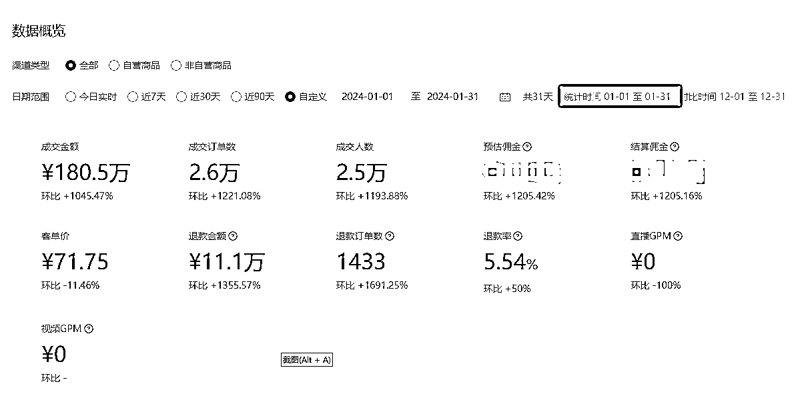

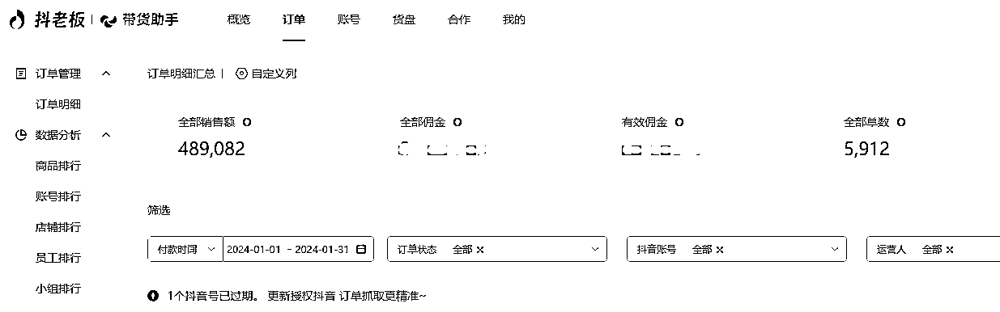

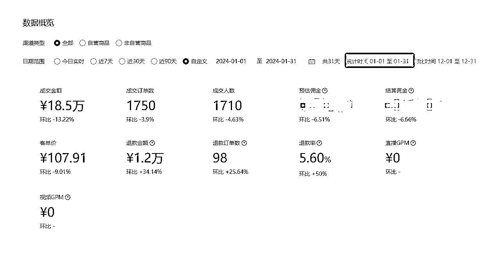

短视频带货内卷到白热化，新人狂涌入的当下，过去这三个月到底做了哪些调整，能让我实现GMV的阶梯式跃升。

下面这篇，是我对过去一季度的完整复盘：从低谷徘徊，到理清主线、做减法，再到规模化放量的实操全记录。全文约6000字，阅读8分钟左右。对想轻资产起步、1-2人小团队的伙伴来说，应该能直接拿走。

## 用旧路径硬扛，就是慢性自杀

上篇文章里说过，我是去年7月切进教辅品类的。那个时间点回头看，基本踩在了抖音教育红利褪去的节点上。

入局没多久，7月抖音对教育类内容收紧了审核。暑假刚开始，大量博主都在视频开头喊：初一暑假很可怕、初二暑假很可怕、六年级暑假很可怕。平台一锅端，看不下去了。

从那以后，焦虑类话术全面封禁。“现在不学就晚了”“初二暑假是分水岭”“用了就能考90分”，任何带焦虑、保结果的表达，只要沾边就过不了审，流量直接被掐。

但好在赶上了暑期旺季，手上还是出了几个爆款。当时爆率其实还不低。

于是我顺着这条路继续猛做，甚至加大投入。

结果进入9月，开学大促本该是泼天流量，我却颗粒无收。更要命的是，产量翻倍了，收入不升反降。7月时一天8条，现在一天16条，工作量翻了一倍，GMV却在掉。

我像个没带指南针出海的人，每天拍、每天发，看似很忙，其实在原地打转。再不改方向，下周就要去找工作了。

## 复盘：先找主线，再做减法

做抖音最难受的，就是没主线时的摇摆。这种摇摆分两层。

### 第一层：大的方向失焦

当时我同时在做三种形态：混剪、演绎、口播。市场上三种都能赚钱，我三种都试，都能出单。

现在想明白了，最怕的就是都能出单。因为三种形态的打法、复用逻辑、扩张路径完全不同。

混剪的打法是标准化暴力流：起号、找对标、下素材、重剪、多账号分发。每一步都要规模化。

演绎要的是爆款脚本+场景搭建+演员实拍，效果好就复制到混剪里去用。

口播看起来简单，但文案量极大，需要持续写、持续拍。账号越多，工作量是线性倍增。

业务流程不一样，就很难流程化、SOP化、复制化，最后只能靠拼命换单量。

当时更痛苦的是取舍困难。A品混剪出2单，演绎出3单，下一步加码谁？根本定不下来。每天都在纠结，吃不下睡不香。

### 第二层：微操上的干扰

除了大方向，小动作上的干扰更致命。你刷同行的时候，随时会被带偏。

A博主让小孩面无表情说话爆了，我也去试。
B博主加了个小动作，我也拍一个。
C博主穿了件衣服，我立马去下单。
D博主开头用动画，我也跟风。

我跟着这些细节改了一堆：混剪开头总结、口播加歪头推眼镜、换场景换着拍、卧室户外轮流上。结果一个都没用，销量依旧难看。

大问题和小问题在我脑子里打了整整一个月。数据越差，心气越低。国庆一到，我直接放假冷静。

### 用擅长的点去打

我以前做大客户销售，养成了爱跟人聊天的习惯。谁是决策人、谁在掐架，这些碎片信息往往最能点醒人。

十一期间跟一个老行业老板吃饭喝酒，我把困惑倒出来。老板没听懂细节，但把问题抽象成了：你现在需要选一条能长期走下去的路。

他就说了句：选你把控力最强的。

这句话点醒我了。创业初期，最可靠的就是自己。员工离职、拍摄人员变动，任何对团队的依赖都是不确定性。

哪个最可控？演绎靠大学生弟弟拍素材，人家一回校就断供了。混剪虽然当时出单多，但剪辑里太多隐性细节决定成败，需要SOP和团队，控制力不足。

最后我选择坚定做口播。把不确定性全部收拢到自己身上。业绩好坏，只能是我自己的问题。这就是可控。

## 突破靠精进，不是靠运气

十一确定口播后，我开始重构流程。

主播负责文案和录制，内容好坏90%在我；剪辑负责产品图和成片剪辑，减少我的负担。

方向一清，每天只需要专攻口播文案。每天4小时写文案，3小时拍摄，剩下时间刷同行找灵感。月底的时候，抖音终于出现了单天过千单的爆款。

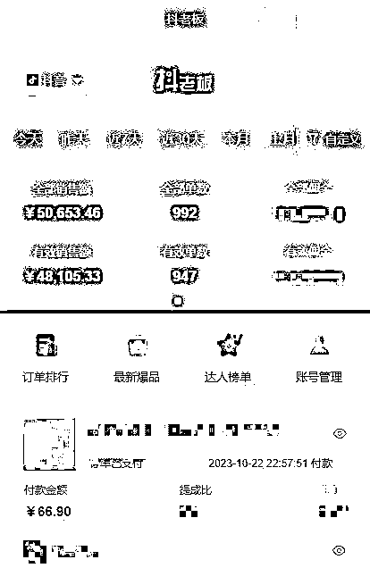

爆率上来了，效率也明显比同行高。回头总结，核心是抄得有策略。

大家都知道要抄爆文，但抄的结果天差地别。我自己也走过那套：照抄→没播放→继续抄→还是不行→多开号→依旧没结果→放弃。

再加上零积累，一条视频爆的要素太多，开头、产品、动作、初始流量，1:1抄也只能抄文案，画面抄不走。于是永远爆不了。

后来我开始算账：之前200条出1条还算能看的视频。200条没爆不代表白干。拆一下，第一条视频里某个开头、某个提问方式，能用在后面的199条里，能力就在累积。

我开始大规模拆解别人的结构。

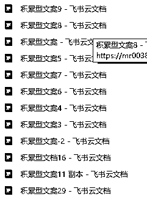

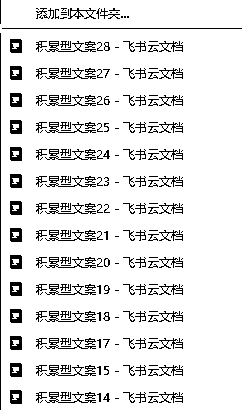

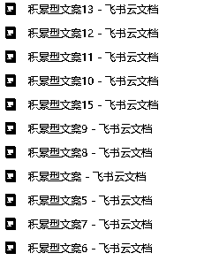

大量整理被算法验证过的爆款开头，建了自己的开头库。

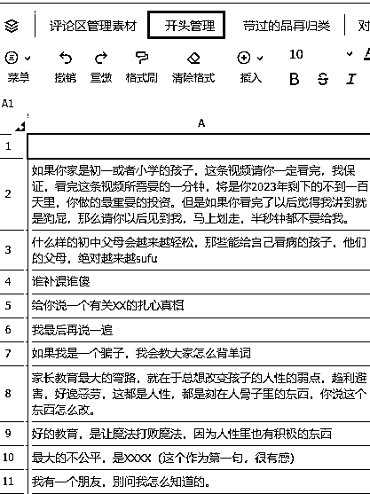

再梳理不同学习痛点对应的产品打法和承接思路，让我对“用户要什么、用什么产品解决”有了更大选择面。

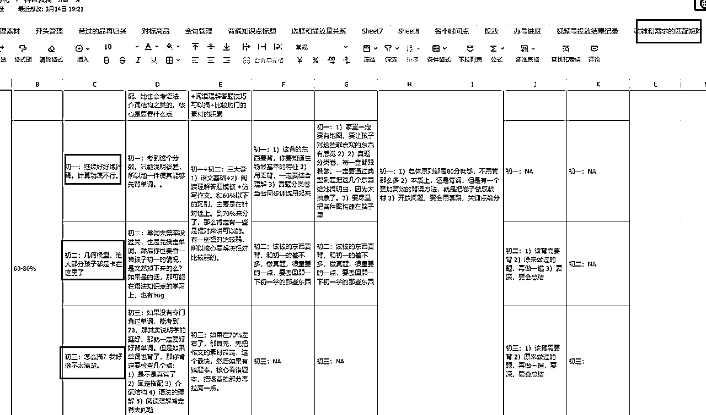

执行下来，爆款率从200条1个提升到了20条必出。文案我专门建了库，把非卖点部分拆分类别。写新品时直接拼装，效率翻倍。

|  | 语不惊人死不休 | 描述问题 | 切入点 | 提高效率 | 书里细节 | 看不懂咋办 | 介绍全套 |
| 语文 |  |  |  |  |  |  |  |
| 英语 |  |  |  |  |  |  |  |

这样做的好处是思路清晰、同品能反复出内容、算法也会越来越看好。

## 听高手的，再加码

有了初步成果后，我开始思考如何保持势头。答案在供应商那边。

信息掌握的人才有话语权。达人只能看到自己的小窗口，头部供应商能看到全盘和同行动向，更接近真实一线。

有人会说商务会告诉你吗？我去一本聊的时候，商务小姐姐一个人对接1000个达人。你觉得她会把关键信息无差别分享给你？见面机会都没有，人家凭什么把核心资源给你。

想在供应商心里有点分量，只有两条路：帮他卖得多，给他情绪价值。

🛰️沟通已经泛滥了。我以前做销售，深知线下见面的价值。见面是个人魅力的博弈，是活人打败抽象条件的时刻。现在电话都少，更别说见面了。

要脱颖而出，就得拿一手信息，而信息在供应商手里。于是我开始拜访合作良好的供应商，收获的信息确实超预期。

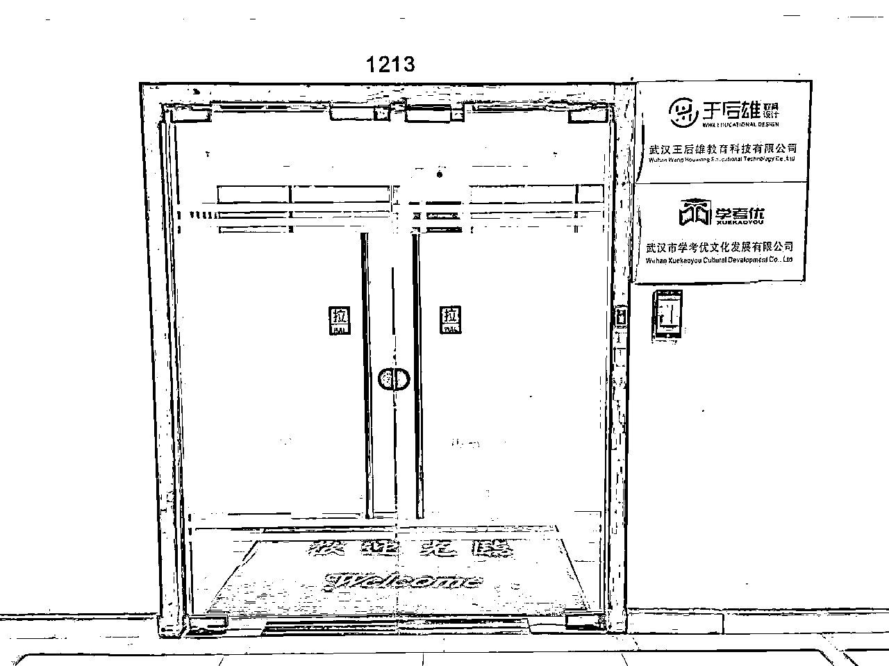

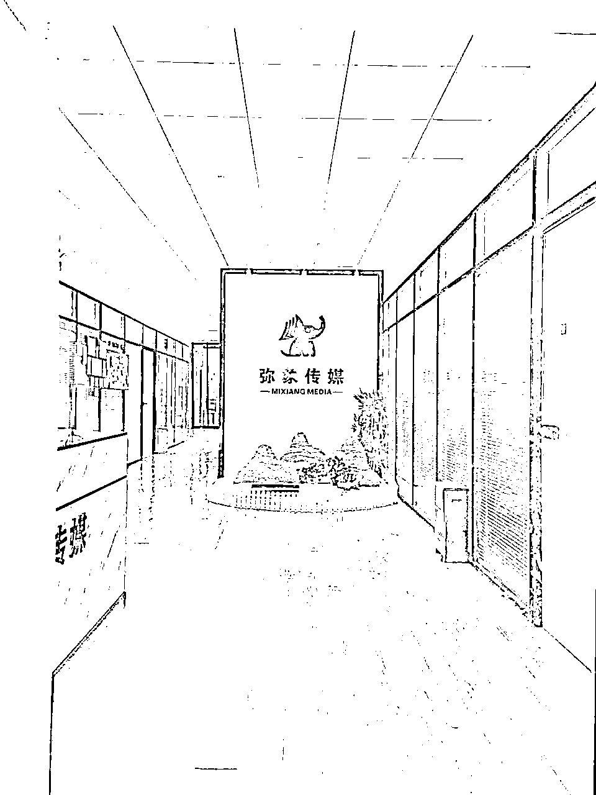

## 风口来了，就往死里干

拜访之后，我发现视频号数据在悄悄起飞。慢慢把内容重心向视频号倾斜。视频号更扶持真人口播，流量比抖音更友好，很快就反超。

回头看，就是风口+积累+执行力三合一。

于是我把所有能投入的精力都压上去，团队加我一共2个人，年前的那段日子只有执行：

文案每天3小时写20-25条，写20条绝不写19条。
拍摄每天5-6小时，一个场景出单就连续刷到红利吃完；一个品应季就用同一文案换20种说法。
商务每天必须聊，跟商务聊大盘、聊谁爆了、为什么爆、我能学不，聊到凌晨两三点，第二天六点起床继续写。

标准动作落地，往死里执行。

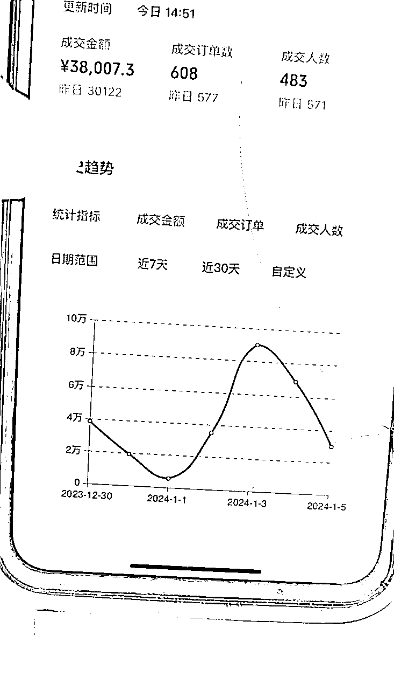

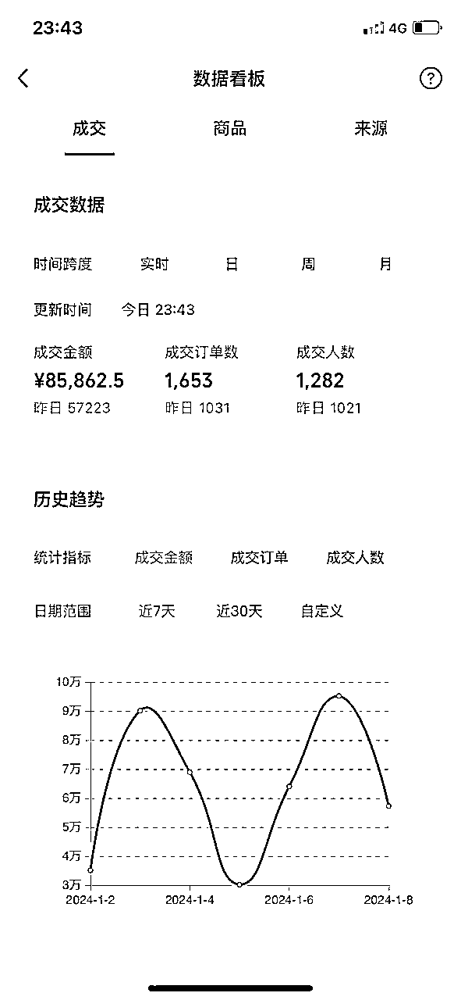

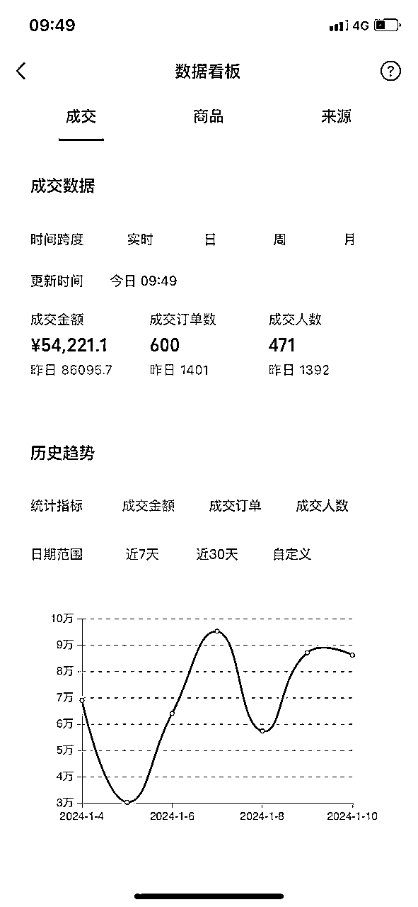

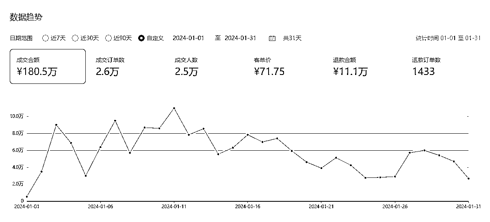

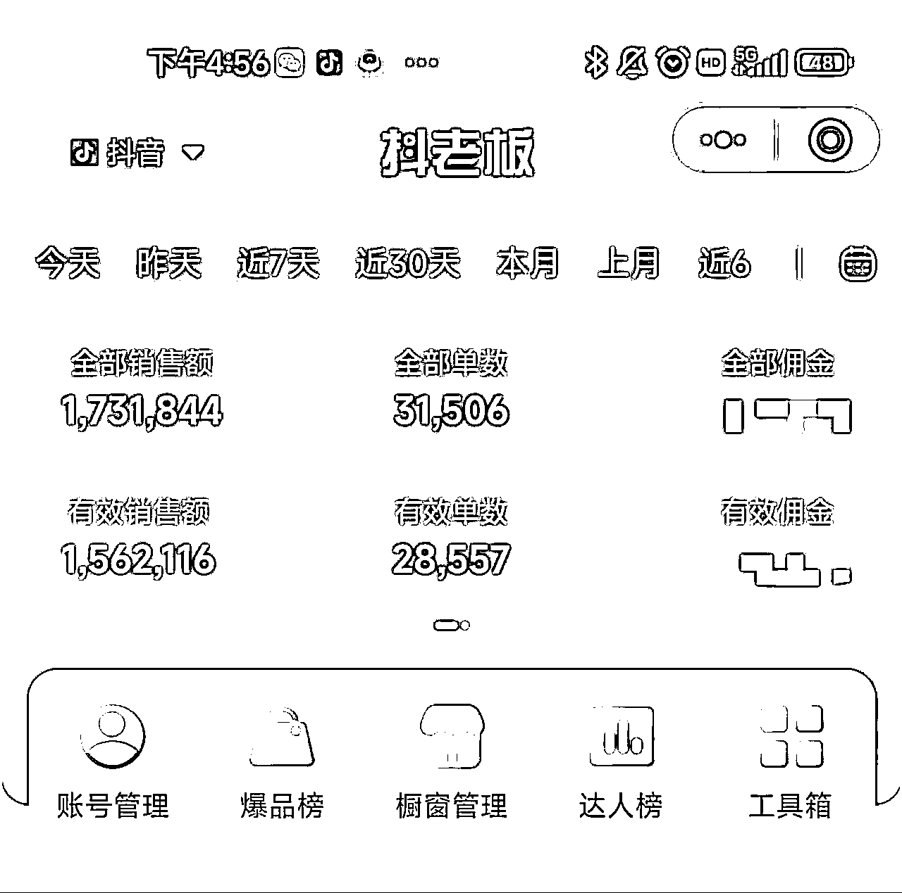

## 我做对了哪三件事

年前流量爆棚，我接住了这波红利，单月245W+。从上次复盘的3月45W，4个月涨了200W。我归因于三点。

### 1. 执行力
有没有结果的执行都是执行。很多人在黎明前夜倒下。方向对了，就不要掉头，持续调整动作即可。互联网行业，很多人看到赚钱才行动，没结果大多是执行没到位。质量问题本质是数量问题。想提高视频质量，别靠玄学，多靠量堆出来。创新只拍一条验证不了，拍10条、20条才能显现价值。没别的办法，就是怼执行力。

### 2. 持续微创新
短视频的生命周期越来越短。去年一个好视频能跑一个月，现在3天就不错了。这要求持续微创新。不要追求大创新，每天10条视频里有一个小改动，哪怕只是“厨房拍更容易出单”，半年积累下来就是质变。

### 3. 心态稳住
当下环境差，大量跨行的人涌入带货，竞争极大。短视频是赢家通吃，也是小博大。沉住气，多请教高手，多打磨内容，小成功会带来正反馈。没有经历过日出千单，很难体会到简单动作就能带来巨大结果。最后赢的，不一定是能力最强，而是最沉稳、最能坚持的人。

以上就是我的项目复盘。

写在最后：

身处赚钱这片圈子里，最直观的收获当然是能接触到形形色色的项目机会，但对我而言更抓人的感受是，这里很容易遇到与自己频率相近的人。

我之前也提到过，抖音对于绝大多数人来说，和现实生活没什么区别，都得靠一次次试错去硬磨，而这个过程往往像关在黑盒子里，摸不到方向也没有即时反馈。

恰恰是和同频的人聊聊，能让人跳出这种信息孤岛，快速找到出口。

愿你也在这儿找到属于自己的同频。