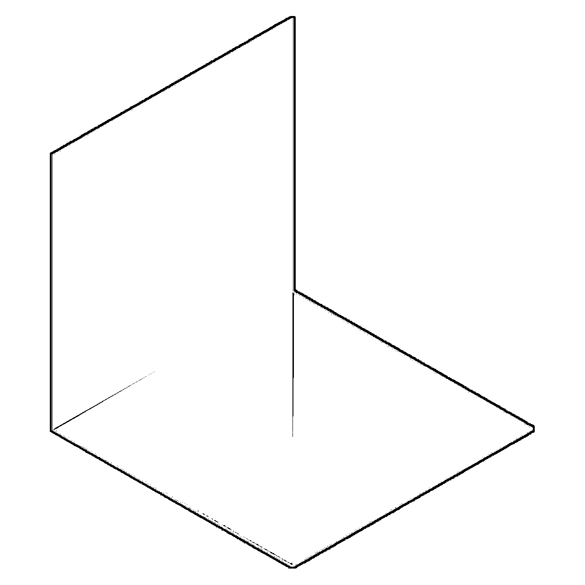

# 1\\. AI精选工具库

最近后台总有朋友问我：AI工具那么多，到底哪些真正值得用？哪些只是噱头？说实话，我也有过同样的困惑——直到我花了整整一年时间，把市面上叫得上名字的AI产品几乎用了个遍，才有了这份压箱底的清单。

今天就把这份“AI精选工具库”完整分享出来。它不是什么泛泛的合集，而是我从真实使用体验里筛出来的“少而精”，一共18个板块、100款产品。信息太杂反而让人无从下手，所以只留下真正经得起用的。温馨提示：在电脑上打开体验最好；名字前带⭐️的都是我个人强烈推荐的；正文里的蓝色链接点一下就能直接跳转。

如果你刚接触AI，建议先读读我这一年实战下来的复盘心得：3个方法，帮你跑得更快。

快速索引（按需跳转）：

🍎 尝鲜区：新鲜出炉、最近值得一试的软件
🏅 日常主力：我本人高频在用的工具
🎇 AIGC模型：能产出内容的对话/绘画/音视频产品
🚴‍♂️ 效率神器：用AI帮你省时间的干活工具
🍔 生活趣味：让日子变得更有意思的AI应用
📖 信息源：值得订阅和关注的优质AI内容

先看尝鲜区（每周一晚上9点更新）：

智谱清影视频：智谱出品的AI视频生成，现在已全面开放使用。

海螺视频：海螺AI家的视频生成工具，同样是开放状态，想试就试。

Lumalabs：文字直接生成视频，实际效果还挺惊艳。

可灵AI：快手的大模型，视频生成能力相当能打，在短视频圈很火。

推特博主分析：基于Wordware低代码平台搭建的小工具，适合做社媒调研。

再来看我日常主力区：

通义听悟：把音频/视频转成文字并自动总结，好用到离不开。

ChatGPT：目前公认的AI天花板，几乎没有短板。

Kimi：国产之光，支持20万字超长上下文，读长篇报告很舒服。

Perplexity：AI搜索神器，能多渠道抓取信息并整理成答案。

秘塔AI搜索：搜完直接给结论，广告？不存在的。

一、AIGC模型产品

对话模型（按使用场景选）：

想系统了解大模型原理、提示词和API调用的朋友，建议先补一下基础知识，文档已备好。

⭐️ ChatGPT：国外选手，行业TOP1。现在GPT4o有免费限量名额，GPT4o-mini则完全免费无限用；普通用户也能直接用GPTs。4和4o都支持图片多模态识别与生成。
Claude：同样来自国外，最新的3.5-sonnet表现仅次GPT4o。特别提一下Claude Artifacts，对编程小白极友好，能辅助你从零做出一个产品。
Gemini：谷歌出品，1.5 Pro能处理高达一百万个token的上下文，0801版本还登顶过全球模型竞技场；它的多模态识别强到能从几十分钟视频里精准找到肉夹馍画面。
⭐️ Kimi：国内选手中的“上手即用型”，文案、阅读、翻译这些日常场景都做得很好。
⭐️ Deepseek：国产第一梯队，尤其适合开发者。性价比非常夸张，100万token只要2块钱，API能力在同级里属于顶尖。
豆包：字节出品，APP端语音通话体验极佳，想要一个随时陪聊的AI，可以选它。

其他值得留意的模型：

Llama3：国外开源模型的扛把子，有8B、70B、405B三个版本，还能免费商用。
智谱清言：国产多面手，多模态尚可，智能体生态做得不错，适合重度智能体用户。
海螺AI：支持PC端语音电话和声音克隆，文字处理也相当靠谱。
通义千问：阿里的模型，图片解析能力强，有解析需求首选。
元宝：腾讯家的，能检索微信👸号信息，整理👸号内容很顺手。
面壁小钢炮：开源端侧模型，能在6GB内存的iPad上运行，支持视频实时解析，多模态理解水平可媲美GPT4。

智能体平台：

⭐️ Coze：新手最友好，支持云雀、Kimi等多款大模型；有文字和图片两种工作流，也能传知识库，小白几分钟就能搭出专属智能体。
⭐️ Dify：更开放的进阶平台，几乎所有热门大模型都能接。适合要搭建复杂业务工作流、喜欢折腾的玩家。缺点是组件比Coze少，知识库上传稍显繁琐。
Coze海外版：主要差异在模型和插件。海外版支持GPT4系列模型，但已经开始收费，GPT4调用有限制。

绘画产品（创作向）：

学习资料先安利一份：Midjourney入门+WebUI教程+ComfyUI教程。

⭐️ Midjourney：国外绘画王者，最近出了网页版，新用户有25张免费额度，做设计创意很合适。
⭐️ Stable Diffusion：开源绘画模型，能通过加载不同模型实现各种效果，支持本地部署，自由度拉满。
⭐️ Liblib：国内在线绘画平台，原汁原味的WebUI和ComfyUI体验，不用折腾本地部署；还有超过10万种模型免费下。
⭐️ Civitai：国外模型社区，想找什么模型都能在这淘，配和SD一起玩。
悠船：Midjourney在国内的企业版，目前内测中，个人用户暂时进不去。
堆友：国内绘画社区，多种图像生成，上手方便。
轻云图：AI认知解析，一键生成专属文字云图。
即梦Dreamina：字节出品的绘画模型，图片和视频都能生成。
通义万相：阿里家的绘画模型，主打卡通风格创作。

音频生成：

⭐️ Suno AI：国外音乐生成神器，输入提示词就能做出一首歌。
网易天音：网易云音乐出品，能编曲、作词、唱歌，更专业的音乐工具，目前内测需白名单。
Vall-e-x：微软的音频技术论文，工具还未正式发布。
SoVITs：GitHub开源项目，可以部署自己做声音生成。
魔搭社区·个人声音定制：录一段声音就能生成你自己的专属音色。
AI COUSTICS：国外音频后期处理工具，主打修音。
Voice Engine：OpenAI的声音克隆产品，15秒语音+文本即可克隆，尚未正式发布。

AI视频（数字人也在内）：

⭐️ Sora：OpenAI的王炸级别视频模型，能生成1分钟稳定视频，目前尚未开放。
⭐️ Runway：文本/图片秒变高质量视频，创作效率极高。
Dreamina：字节出品，目前视频生成功能在内测中。
Pika：输入一句话就能生成短视频，支持3D动画、动漫等多种风格。
Move AI：用普通2D拍摄视频，做成3D内容。
Pixverse：文字提示生成高清逼真视频，动漫、写实、3D都能做。
Stable Video Diffusion：SD家的视频开源模型，需要部署使用。
Animate Anyone：阿里智能计算研究院开源，能把静态图片中的角色“动起来”。
Genmo：支持1080p到2K分辨率的高清视频生成。
DomoAI：一键把你的视频改成动漫、卡通、像素等不同风格。

数字人厂商：

DID：上传图片+文字/语音就能生成数字人视频，对图片质量要求较高。
Heygen：有现成的真人模型可选，也可以自建模型，灵活性更强。
硅基智能：国内数字人方案商，录制视频后可定制专属数字人，适合短视频和直播。
风评智能：和硅基类似，也是录制视频定制数字人，直播短视频都能用。
Adobe Express：卡通角色视频生成小工具。

二、效率工具

AI搜索与浏览器助手：

⭐️ Perplexity：给问题直接出汇总答案，能定向搜科研、YouTube等多渠道内容。
⭐️ 秘塔AI搜索：给出答案的同时附上相关事件、思维导图。
Genspark：搜索结果会生成一个定制页面，很新鲜。
Copilot：微软的AI助手，能结合Bing搜索给出答案，支持多模态。
360AI搜索：搜出来图文视频来源齐备。
360AI浏览器：聚合了搜索、阅读、看视频、AIGC生成等一堆模块。
Arc：内置AI能力的浏览器，浏览体验很顺滑。
深言达意：反向搜索工具，想不清怎么表达时，它会帮你“找词”。
Monica：浏览器插件神器，选中的文字就能直接处理、对话。
Chandler：接入了GPT4、Claude3等大模型，边逛网页边问AI。

PDF阅读与音视频总结：

⭐️ 通义听悟：语音实时转文字，还能记录、整理、提炼要点。
BiBiGPT AI音视频助理：一键整理在线音视频内容，生成思维导图和稿子。
Summarize：专门整理YouTube视频，输出总结和思维导图。
Chatdoc：基于ChatGPT的文件阅读工具，传文档就能快速读懂。
EasyPDF.ai：和PDF“对话”，提取文本、总结内容都行。
Cubox：跨平台收藏工具，现在也有了AI高效阅读加成。

PPT与思维导图：

⭐️ Gamma：输入简短描述就能生成精美PPT，支持大纲导入和AI排版。
⭐️ AI PPT：一键主题生成PPT，还支持Xmind导入。
Mindshow：智能PPT生成，自动配图、多格式导入。
美图AI PPT：一句话主题，10秒出一套完整PPT。
iSlide：AI加持的设计利器，一键优化文案，模板库丰富。
Chatmind：自然语言生成思维导图，对话式修改内容。
Processon：在线协作绘图平台，流程图、思维导图、原型图都能画。
TreeMind竖图：一句话生成详实导图，模板素材海量。
Albus：AI白板软件，探索、学习、创造一把抓。
博思白板：集AIGC、一键PPT、思维导图、笔记文档于一体的在线协作平台。

AI翻译：

⭐️ 沉浸式翻译：Chrome插件，PDF、网页、视频都能双语对照翻译。
Translingual：用大模型的能力来做翻译，自然准确。
Language Reactor：看视频学外语神器，可列出字幕、暂停复读、悬停查词、双语字幕，一应俱全。

图像优化：

⭐️ Remove.bg：一键抠图换背景，救急必备。
⭐️ 佐糖：一键抠图、清晰度增强都有。
⭐️ Remini：之前五一火出圈的黏土滤镜就是它，iOS上体验最好。
Magnific：提升图片清晰度和画面质感，效果显著。
Clipdrop：自动填充、换人、抠图、背景替换，图像处理全家桶。
Krea AI：生图+清晰度增强双修。
ARC：腾讯ARC实验室出品，人像修复、抠图、动漫增强都很能打。
Imagestool：图片视频多面手，还支持视频转GIF。
Palette：专门给黑白照片上色，多种色彩模式可选。

任务处理：

Mail Master：AI写信助手，支持多种邮件风格，好用不贵。
Magic Todo：任务分解利器，大任务拆成小步骤，进度管理更轻松。
Chartcube：一句话生成多种图表，折线图、饼图等几十种样式都能做。

企业提效：

LUMA AI：从照片/视频中生成高质量3D模型，3D内容创作效率up。
Getfloor plan：简单草图秒变2D/3D平面图，外加360°虚拟导览。
绘蛙电商助手：淘宝天猫商家福音，营销文案和AI模特训练都搞定。
幂律合同助手：AI让合同签订更安全可靠，法务效率提升利器。
实在智能RPA：RPA+AI结合，自动化流程搭建门槛大幅降低。
近屿智能AI面试官：用AI来辅助企业做面试筛选，省时省力。

三、生活AI产品

角色对话：

Character：AI角色扮演网站，埃隆马斯克、心理专家、面试官各种角色随便聊。
Flowgpt：AI对话社区，角色丰富，接入了多款大语言模型。
林间聊愈室：卡通角色陪伴式聊天，放松心情、获得安慰的好去处。
Hume：主打声音陪伴，用语音对话让你感觉不再孤单。

笔记AI：

Notion AI：在Notion上增加了AI能力，扩写、总结、翻译文本都顺手。
火龙果写作：故事创作、校对、改写、续写、翻译，全能写作助手。
秘塔写作猫：全文写作、广告语、论文、短视频脚本，多种文体都能写。

四、优质信息源

AI周刊：

歸藏的AIGC周刊：每周更新AI技术、产品动态和行业趋势，视角很敏锐。

播客：

⭐️ 42章经：高质量AI访谈，能听到很多创业者的深度思考。
OnBoard：专注AI前沿，行业洞见和市场趋势不缺位。

社区：

⭐️ 即刻AI探索站：目前国内质量最顶的AI社区，大佬们经常分享一手信息和深度分析。
魔搭社区：开源模型共享平台，AI开发者的一站式服务好帮手。

👸号：

⭐️ Super黄的念想：AI产品深度分析，篇篇精彩。
⭐️ hanniman：AI行业老兵，行业判断独到，值得反复读。
⭐️ 云舒的AI观察笔记：这份工具库的作者本人，产品经理老兵，内容常看常新。

最后，所有内容都沉淀到了知识库里，随时可查。

好了，这份压箱底的宝贝就交代到这。希望你也能在这些工具里找到属于自己的效率加速器。