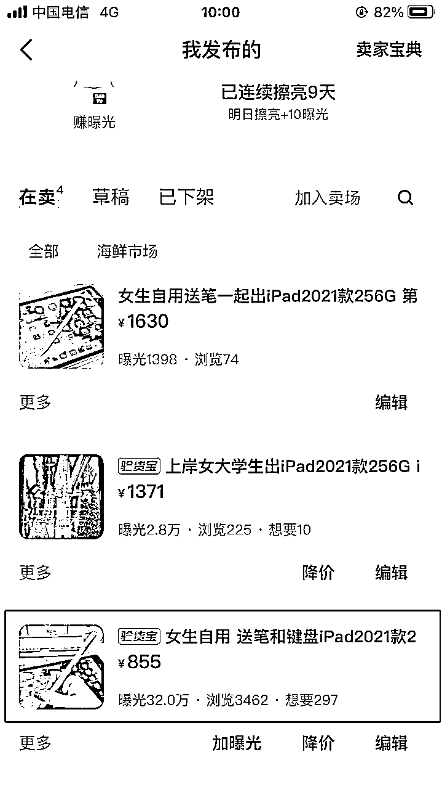
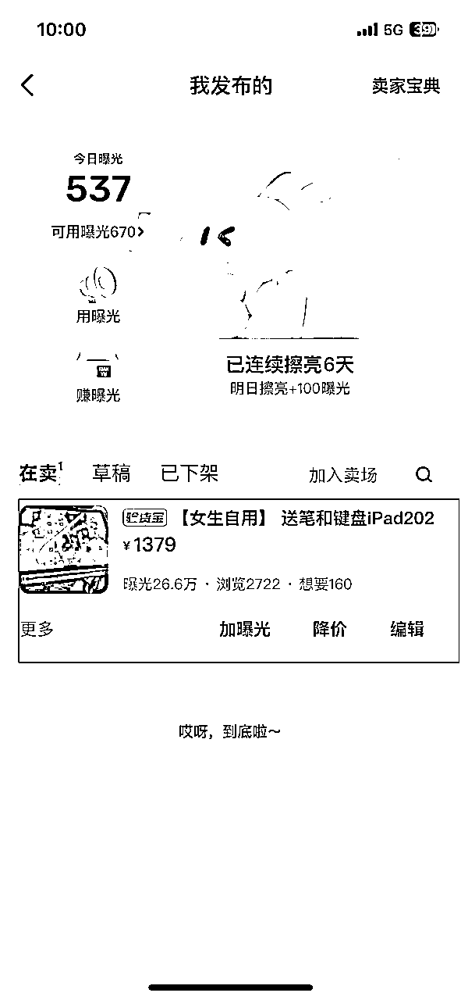
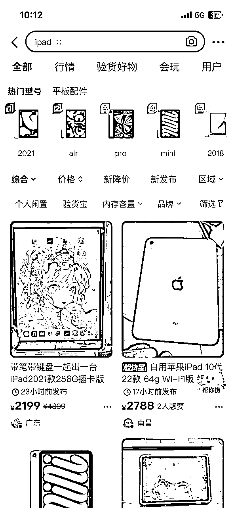
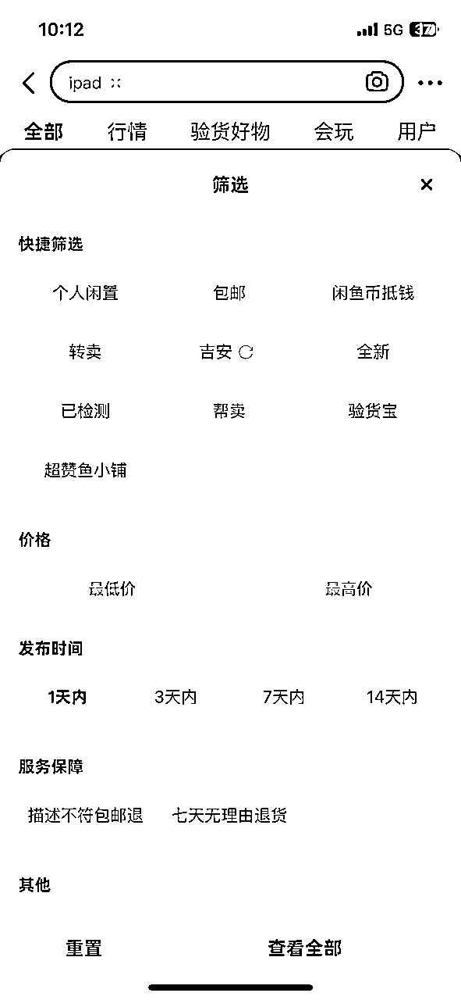

# 3天狂揽60万曝光，净赚600多，我是怎么把闲鱼跑起来的
作者：龙哥

# 作者自述

各位朋友大家好，我叫大臣，先打个招呼。

简单介绍下自己，我是龙哥，之前没碰过任何项目，现在还在到处找能做到月入过万的赛道。

这次参加航海活动我报了闲鱼和TEMU两条线，后来想了想怕精力被拆散，就在开营前一天做了减法，退了闲鱼那条，决定先把重心放在TEMU上。

不过航海正式开始前的半个月，我想先找个小项目热热身，就在赚钱上看到智慧哥分享的《想先赚到第一块钱，不妨运营一个闲鱼 iPad 数码店铺》，我直接对接了他的货源开始实操。

下面是我这半个月真实的踩坑记录，几乎全盘托出，希望能给同样是闲鱼新手、或者刚入航海的伙伴一些参考。

真正产生收益的时间其实也就三天，就是因为我同时踩准了几个关键点，导致曝光量直接起飞。两个号都是用了很久的老号，第一个号冲到30万曝光，第二个号完全照搬打法，也拿下了26.6万。

# 第一步：先把账号包装成真实个人，而不是贩子

卖货的前提是让买家信你。

实操下来发现，闲鱼上买iPad的用户特别反感那种明显是倒卖的账号，尤其是我们刚起步，没有像老牌iPad博主那样攒下大量好评背书，信任感几乎为零，转化自然就差。

所以账号建好之后不要急着猛发iPad，先把人设立住。可以根据你账号的性别、风格，先上点个人闲置。比如我的号定位是女生，就先放几张化妆品的图挂上去，然后找熟人拍一单装成真实交易。用户点进主页，看到你不止卖一台iPad，还有和人设相符的生活用品，真实感会完全不一样。

# 第二步：只打爆一个链接，别贪多

曝光期用户实际能看到的信息就那几块：

1. 文案开头的前20来个字
2. 主图
3. 是否开启验货宝
4. 定价
5. 想要数 / 金币抵扣 / 折扣信息

发布时就围绕这五点去做。

## 文案部分

别自己硬写，直接去找同行里数据异常的文案改写。账号是个人号，别人一定会问你为什么手里有这么多平板，得给个合理说法。比如我们寝室考研全上岸了，室友剩下几台拜托我一起出手，就很自然。

怎么找异常文案：

1. 在闲鱼搜iPad，也可以换成iPad2021、iPad7代等关键词拓展。
2. 点进筛选，分别看1天内上架和3天内上架的宝贝，把排名前十的都翻一遍。
3. 我的判断标准是：1天内上架，想要数>50算异常；3天内上架，想要数>100算异常。

## 主图部分

看异常宝贝时一定留意主图呈现方式。能爆的从不只有文案。我对比后发现，我爆的两个链接主图都是iPad搭配电容笔的组合，这个组合是很有感的爆点。

展示图能自己拍就自己拍，别直接搬同行的图。没货在手可以借助至尊宝插件去淘宝扒卖家秀。

一个小技巧，别直接搜iPad，去搜iPad保护壳，那里面的产品图普遍拍得比较高级，用来做主图很加分。📕的图也能用，但要过滤一下，曝光过高的图基本都被同行用烂了，效果会打折。

## 验货宝

这个一定要勾选。上勾之后相当于给商品加了一层官方背书，信任度立刻上去。实际交易中大部分买家也不会走验货宝，就算走了，我们发出去的也是能过验的原装机，提前把流程讲清楚就行。

我常用的说明是：
走验货宝，验没问题费用买家承担，有问题费用我承担，大概需要一周时间。
听到要等一周，很多想验的人自己就退缩了。

## 价格策略

价格别盲目对标同行，我的思路是：你标什么价，就筛出什么预算的人。

先确定你的真正主推款，我主推的是iPad7代，实际成交价在1400左右。然后看你参考的爆款文案推的是哪一代，我当时写的文案是21款，那挂牌价就要比市面上全新的21款更低，最好比同行低一些，比如同行1600，我就挂1500。但这个挂牌价一定要高于你主推款的成本价，这个设计会在成交环节发挥作用，具体逻辑下面会讲。

## 想要数 / 金币 / 降价

想要数没到50就打开金币抵扣，有了50以上就可以关掉。降价玩法我还没用到。

# 第三步：聊天环节才是转化核心

最关键的一句开场白：先问客户买iPad用来干嘛？

我文案打的是21款，很多咨询的客户会直接问21款多少钱，但他们很多并不知道自己的需求是否能用更低配满足。这时你就要引导用途，判断我的主推款能不能cover，如果可以，就告诉他21款配置对他来说有点过剩，推荐19款或者7代，性价比更高还能省钱。

回到定价逻辑，客户会来点想要咨询，说明你挂的价在他预算范围内。这时你反推说，你这个需求其实不需要花到那个价，能用更低价满足，还能省下预算，会产生一种超预期感，成交率会明显提升。反之像我之前有个帖子曝光32万，标价855，聊的人太多但预算卡死在800多，说多了就超预算，直接劝退，所以筛选客户很重要。

和客户聊时围绕三点：

1. 展现专业度。比如客户说你比别人贵，你可以解释我们是原装机型，市面上便宜的很多是扩容机，然后简单科普什么是扩容机。
2. 给予情绪价值。iPad不算刚需，购买冲动不强，需要点燃需求。比如考研考公的用户，他们知道iPad效率高但不知道怎么高，你就可以告诉他不用背着一堆厚书资料，一块平板就够了，还能直接用笔答题，一键清空重写，刷题对答案全都在一个屏幕完成。
3. 果断逼单。iPad这种商品犹豫基本就流失了。我常用话术是：这台我手上就剩这一台了，卖完就没有了，你现在拍我可以给你再优惠一点，我也想早点出，省得麻烦。

# 结语

以上就是我这次实操的全部心得，这是我第一次写详细复盘，难免有不周到的地方。如果能帮到正在找赛道的朋友，我就很满足了，祝大家早日找到稳定项目。

最后感谢赚钱和赚钱的伙伴们提供的优质方法，也特别感谢智慧哥帮忙解决后端货源问题，不然自己摸索找货源会踩很多坑。