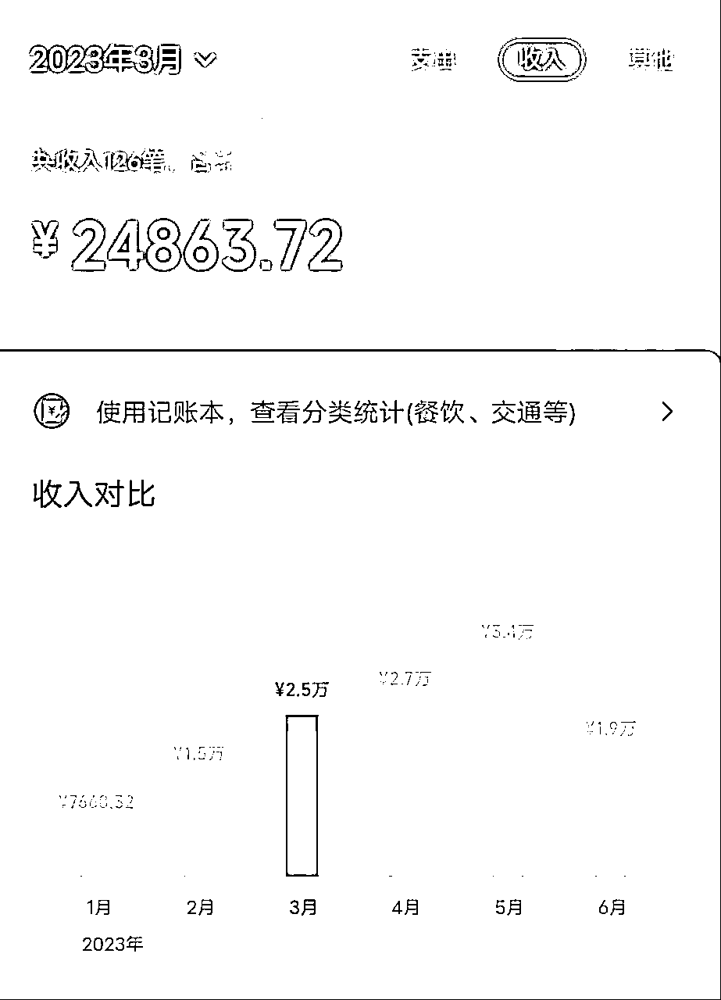
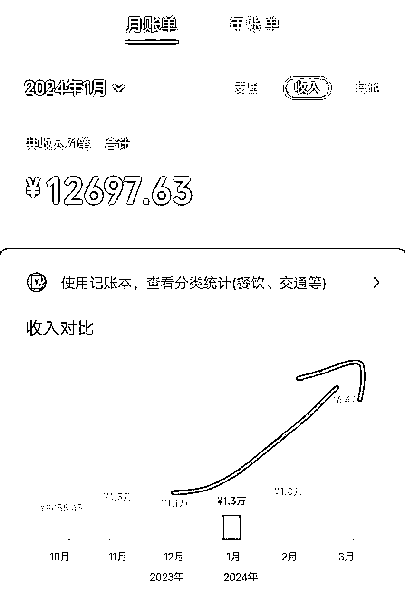
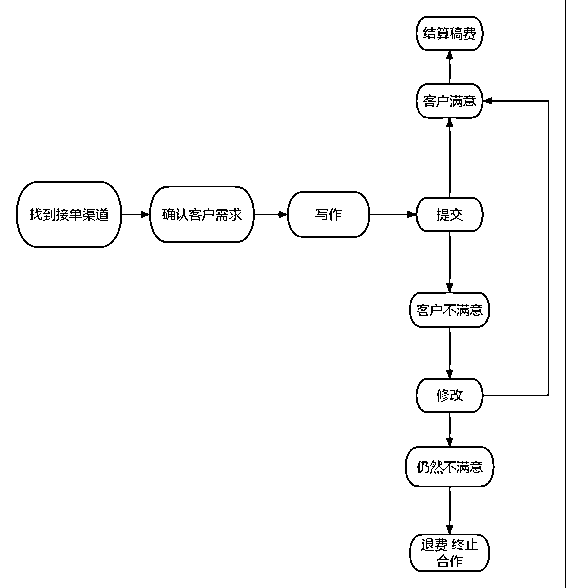
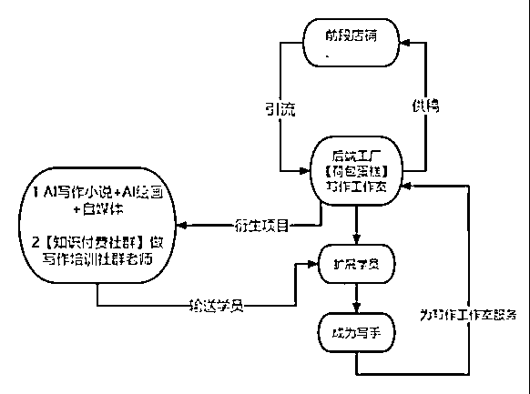
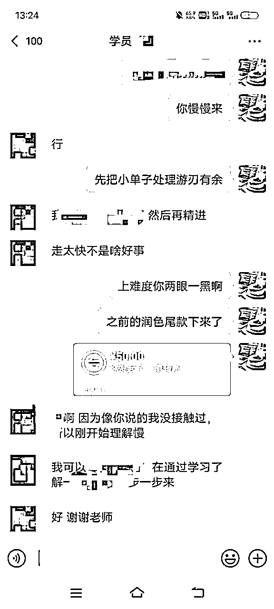
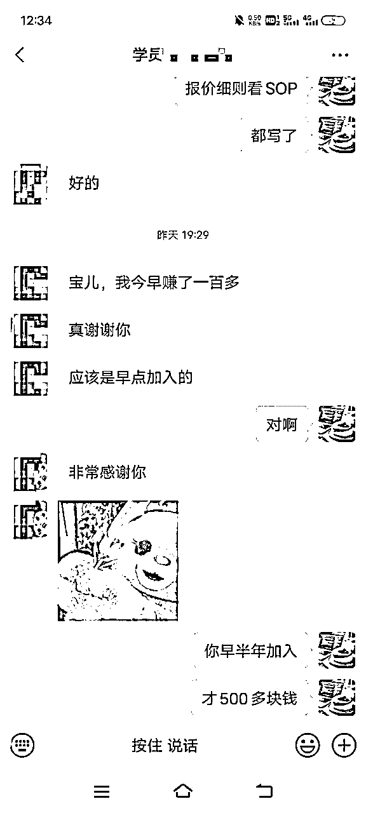
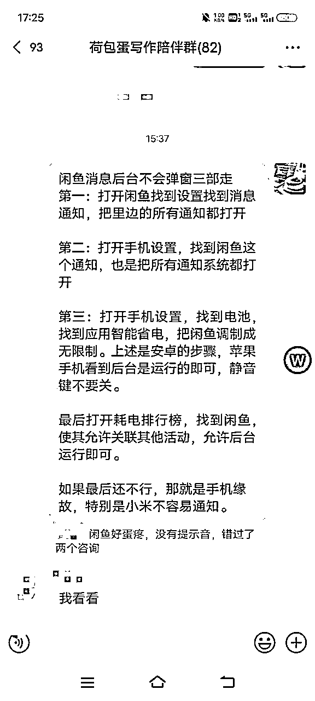
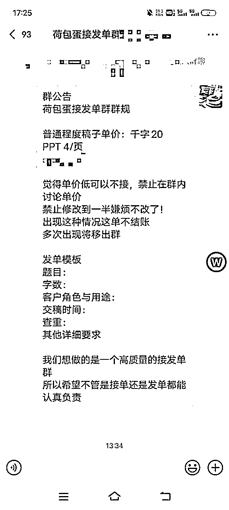

# 00后女生的AI写作变现实录：用一年时间，把月收入做到6万+

ChatGPT等生成式人工智能工具快速普及后，AI写作逐渐从“新鲜玩法”变成了可以落地的服务项目。过去一年，我也一直在探索如何把AI真正融入写作，并通过服务客户、搭建团队和培训学员，逐步完成了从个人接单到团队运营的转变。

## 1. 我是谁？

大家好，我是荷包蛋糕，一名24岁的天津女生。

过去一年，我主要专注于AI写作变现。从最初月收入三万多，到现在月收入超过六万，团队整体收入也突破了十万元。同时，我还带领100多位学员从零开始了解并实践AI写作变现。

如果你对ChatGPT、Kimi、AI辅助写作、写作接单，或者如何提升写作能力感兴趣，都可以来交流。不管你是刚入门的小白，还是希望通过写作增加收入的人，我都会尽可能分享自己的经验。

## 2. 过去一年，我完成了哪些事情？

### 第一，写作变现收入逐渐稳定

通过写作服务项目，我的月收入长期保持在3万元以上，全年累计收入超过20万元。这是过去一年最直观的成果。

### 第二，把AI真正用到写作工作中

接触ChatGPT后，我很快开始将它应用到实际工作里。AI不仅提升了内容产出的速度，也帮助我改善了文章质量，让我能够服务更多类型的客户，拓展业务范围。

### 第三，建立合作关系，扩大收入来源

我和一批同样关注AI写作、AI工具的伙伴建立了合作，通过资源互通、订单协作和项目配合，让收入结构更加多元，也逐渐提升了自己在这个领域的曝光度。

### 第四，参与培训，帮助更多人入门

后来，我成为AI写作变现训练营的导师，时薪达到四位数，并带领100多位学员完成从了解项目到实际操作的转变，帮助他们掌握AI写作接单和变现的基本方法。

## 3. 我的项目是怎么运作的？

这个项目的核心并不复杂：

用AI提升效率，再结合人工完成修改、优化和交付，为客户提供定制化写作服务；与此同时，通过不同渠道寻找客户，逐步沉淀自己的私域资源。

整体流程可以概括为：

**寻找订单渠道——确认客户需求——完成写作——交付并获得收入。**

目前主要使用的获客方式包括：

1. **淘宝写手店面试接单**  
   优点是渠道相对稳定，缺点是价格偏低，而且结算周期可能较长。

2. **闲鱼引流到私域**  
   整体报价比较普通，但有利于长期积累客户。前期需要进行账号维护和持续运营。

3. **微信群、QQ群接单**  
   这类群里的订单数量较多，不过需要提高警惕，谨防诈骗和不正规需求。

4. **小红书与BOSS渠道**  
   目前还在持续测试和优化，后续会整理相关操作方法。

5. **荷包蛋接发单群**  
   会根据情况不定期发布订单，适合有一定写作能力、希望持续接单的人关注。

## 4. 我的项目模式是怎样搭建起来的？

回头看，去年的规划已经基本逐项落地。

### 前端：店铺矩阵

目前，我和合伙人共同运营着12家闲鱼店铺，日流水已经超过四位数。

### 后端：写作陪伴与培训

我们搭建了“荷包蛋写作陪伴群”，一方面帮助更多人了解AI写作项目，另一方面带着学员学习闲鱼店铺运营、接单和引流，陪他们完成从不会到能够独立操作的过程。

## 5. 这种协作模式有什么优势？

### 分工明确，发挥各自长处

喜欢写作的人可以专注于内容生产，把精力放在产品端；擅长运营和引流的人则负责寻找客户、维护渠道，再将订单分配给合适的写手。

不会写作的人，也不必勉强自己完成稿件，可以通过渠道运营参与其中；擅长写作的人则可以专心提升交付质量。每个人做自己更擅长的事情，效率会更高。

### 互相支持，降低试错成本

大家在群里交流经验、讨论问题，遇到不懂的地方可以及时沟通解决。这样既减少了信息差，也降低了个人摸索时的时间成本。

本质上，这是对行业知识和资源的一次整合，让原本分散的人、订单和经验能够连接起来。

## 6. 如何保证工作室的交付质量？

### 以客户需求为起点

接到订单后，我们会先充分了解客户的具体要求，再根据对方的目标制定服务方案。从选题、构思到最终截稿，都会进行相应跟进。

我们提供的不只是“一篇稿子”，还包括过程中的沟通、修改和陪伴。客户遇到困难或产生焦虑时，也会及时沟通，帮助对方明确方向。

### 根据能力进行团队分工

团队内部会按照成员的特长分配工作。

比如，擅长调整版式的人，主要负责格式优化；熟悉PPT制作的人，则优先承接PPT相关订单。让成员在自己擅长的环节发挥作用，能够有效提高整体效率。

### 设置审核与反馈机制

稿件完成后，会先经过我和资深写手审核，再提交给客户。若客户提出修改意见，就根据反馈及时调整。

通过“审核—交付—反馈—优化”的过程，既能保证内容质量，也能让团队成员不断提升写作能力。

## 7. 我平时是怎么安排工作的？

目前我没有全职坐班工作，写作副业的时间安排比较自由。

在每年2月至6月的旺季，工作量会明显增加，通常每天需要投入4到5小时，具体时间根据自己的安排调整，偶尔会加班。

非旺季时，每天大约工作2到3小时，只要能够在截止日期前完成交付，就不需要固定打卡。因此，日常生活和赚钱并不冲突，整体状态相对灵活。

当然，收入和投入通常是相对应的。最近项目比较忙，我基本每天会分阶段工作8小时左右。虽然辛苦一些，但月收入突破6万元后，我依然觉得这份投入是值得的。

## 8. 我是如何拓展市场的？

目前主要采用“服务营销为主、转介绍裂变为辅”的方式。

首先，要让客户认可你的产品和服务；当客户进一步认可你这个人，愿意主动推荐给身边的人，就能形成老客户带新客户的增长路径。

除此之外，我们也会和靠谱的机构、中介建立合作关系，用稳定的合作渠道保障基础收入。

同时，我也在持续打造“荷包蛋糕”这个个人IP，通过👸号等平台分享AI写作、接单和变现相关内容，让更多人了解我、认识这个项目，也逐步扩大自己的影响力。

## 9. 最后的一些想法

以前有位朋友说过一句让我印象很深的话：

**现在真正需要培养的，不只是找到工作的能力，更是持续赚钱的能力。**

这几年尝试副业的经历，对我来说非常珍贵。它让我意识到，除了依赖一份固定工作，我们还可以不断学习新工具、寻找新机会，建立属于自己的收入来源。

我并不算特别擅长写这类经验分享，但还是希望把自己走过的路尽可能讲清楚。如果你对AI写作、接单、运营或变现还有疑问，欢迎一起交流。

希望有更多人能够了解AI写作，也希望大家都能找到适合自己的成长方式。