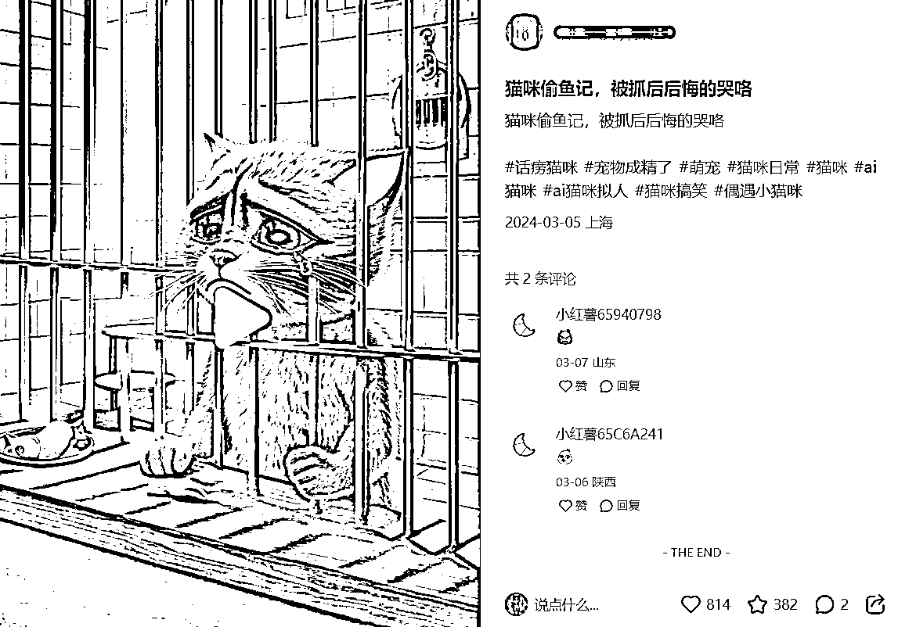
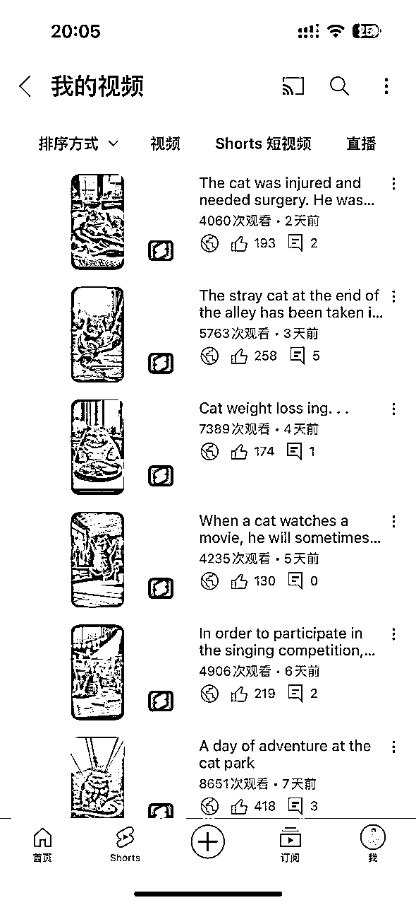
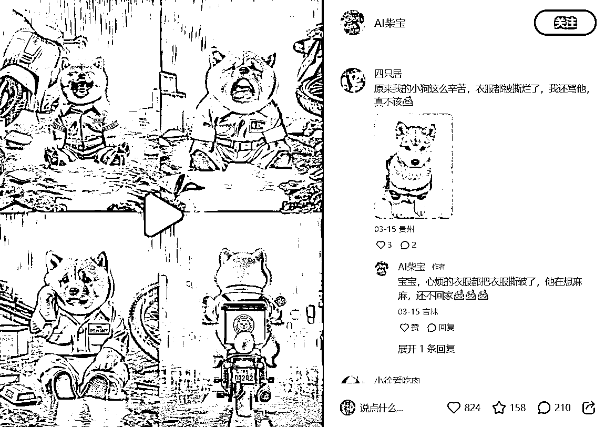
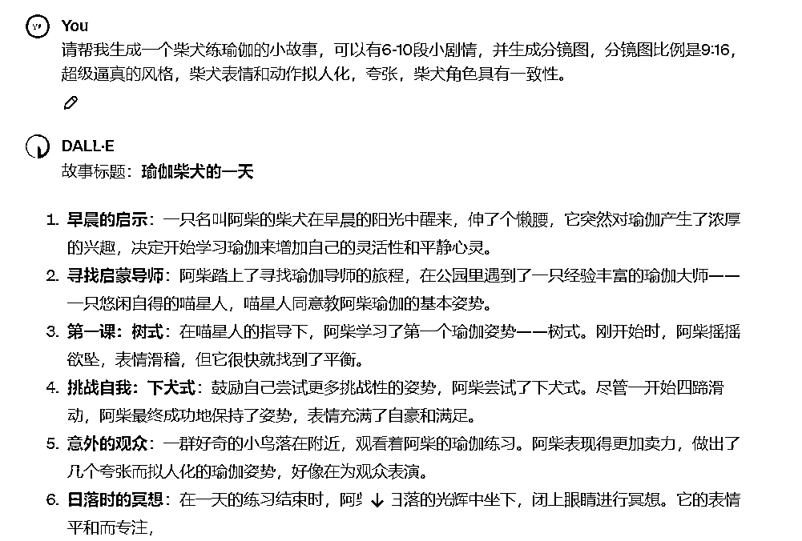
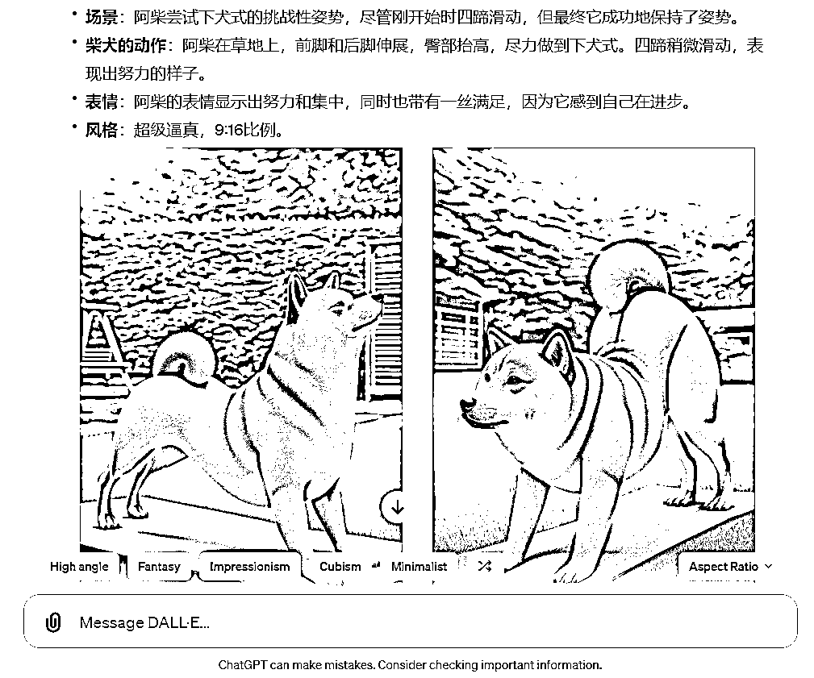
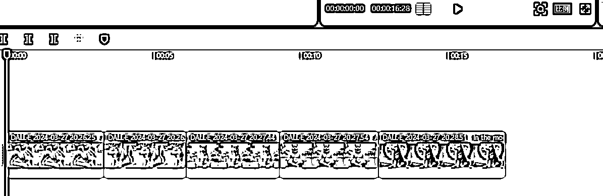
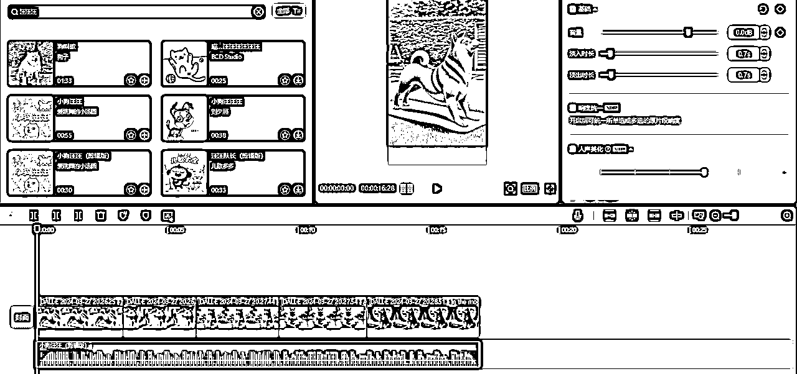
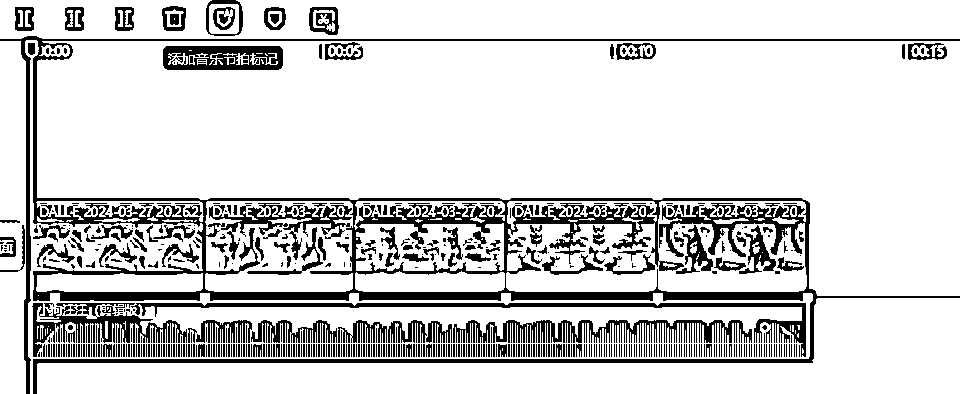
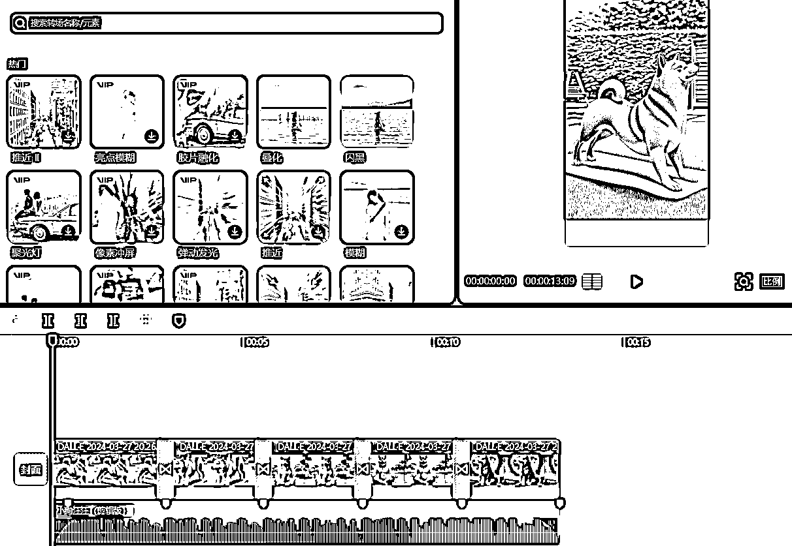
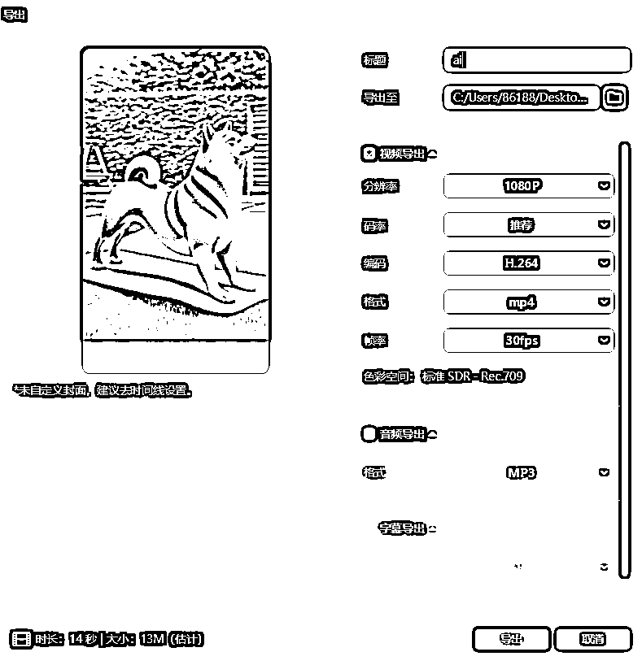

# AI柴犬剧情短视频，ChatGPT+剪映，一个Prompt全部搞定

之前给大伙儿介绍过AI猫咪剧情短视频的玩法，我自己其实也一直在实操，同步发到小红书、抖音、TikTok、YouTube、Instagram这些平台，数据都很能打。小红书上拿过800多个赞，YouTube那边的Shorts基本每条都能破百赞，这可真不是光说不练的效果。

那么AI柴犬到底有没有搞头？别到头来白忙活一场。我跑去小红书上看了看，做AI柴犬内容的账号同样能冲到800多赞，说明这市场是真实存在的，而且现在进场的人还不算多，谁先做谁就能先攒粉。

但凡你之前摆弄过AI猫咪剧情短视频，你一定会觉得这事儿太简单了，一天肝出一个月的更新量毫无压力。今天要聊的AI柴犬短视频，更是只需要一个Prompt就能全部拿下。

当然，这里得用上ChatGPT4.0，因为只有4.0版本才带DALL.E画图能力。

Prompt：帮我编一个关于“你想要的柴犬”的小故事，分6到10段小剧情，并且生成分镜图，分镜图比例9:16，风格要超写实，柴犬的表情和动作得拟人化、够夸张，还要保证柴犬角色从头到尾长得一样。

## AI柴犬分镜图咋生成

光吹不练可不行，直接甩出上面那个Prompt，ChatGPT会先给你写出完整的剧情故事。

故事内容写完后，ChatGPT就会照着剧情一段段画出对应的分镜图（能不能画成功得看当时的网络给不给力）。

给大家提个醒：每张分镜图一出来就赶紧下载存好，免得网络一波动图片就失效了。

## 短视频怎么剪出来

接下来，把存好的分镜图一股脑拖进剪映，依次码到轨道上。

挑一首狗狗主题的BGM，再设置一下淡入淡出（具体长短看BGM的感觉来定）。

打上音乐节拍标记，然后把每张图片的时长都对准节拍点。

再给每张图加转场，我个人一直钟爱叠化这个效果。

全部搞定之后导出视频，然后就能往各大短视频平台分发去涨粉啦~

