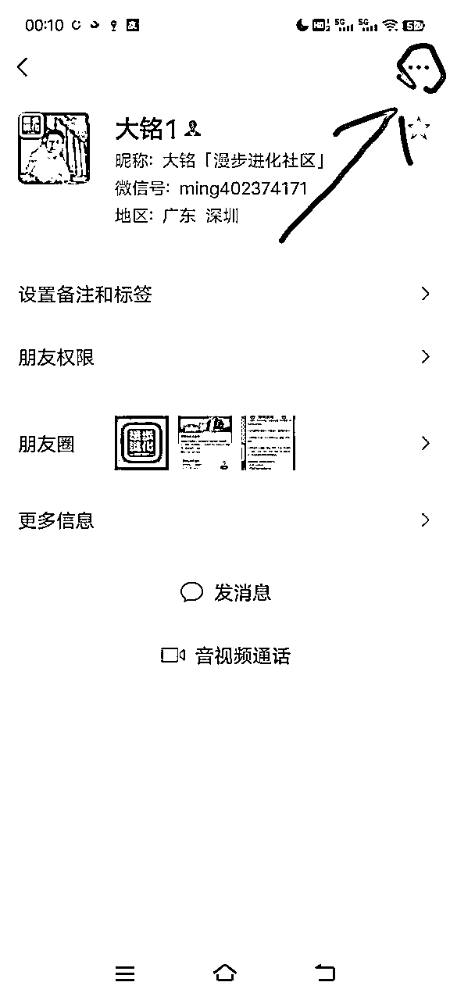
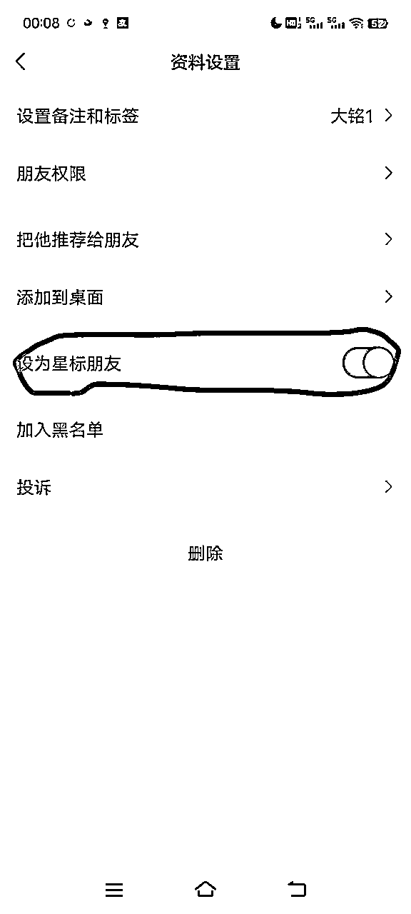
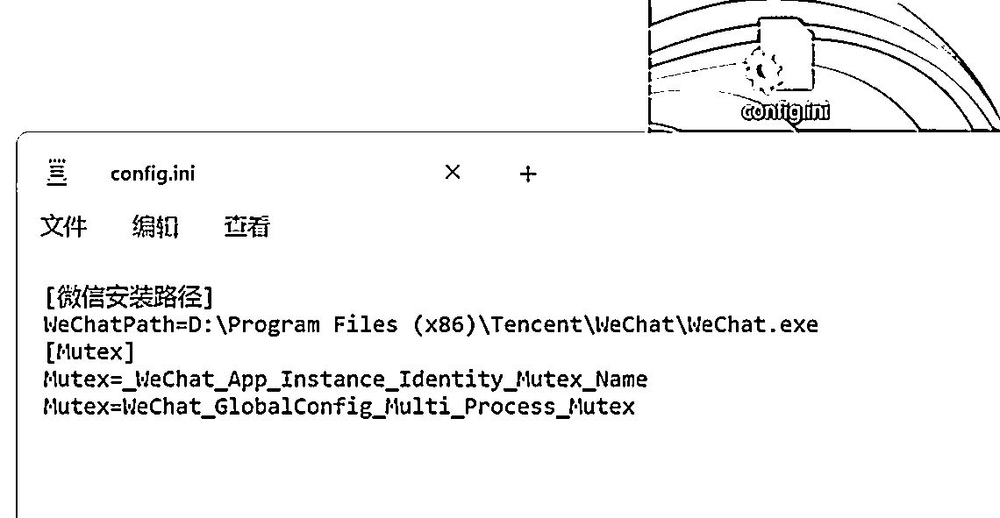
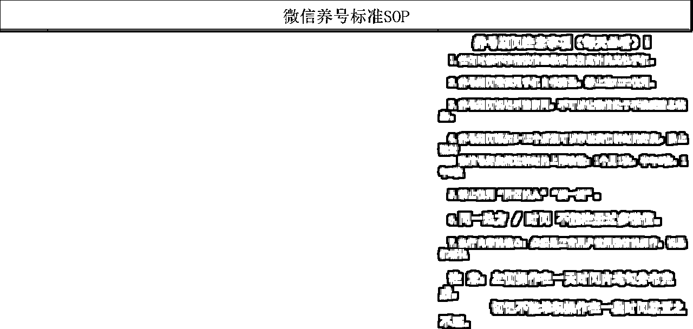

# 🛰️养号防封全攻略：从注册到运营，这些细节能救你的号

> 整理自网络公开资料，供参考学习

## 一、先聊聊我为什么整理这份东西

大家好，我是大铭，37岁那年决定换个活法，目前正处在转型期。我搞了个社群叫“漫步进化”，现在还只是试运营阶段，免费招募种子用户，欢迎大家来玩。想进一步了解我的朋友，可以翻翻我之前写过的文章。

一篇37岁大叔的硬核自我介绍：https://t.zsxq.com/18JaHjlva

我打算持续在赚钱里输出自己做项目的经验和成长心得，一方面逼自己不断输入和输出，另一方面也想给社区做点贡献。

我整理的东西可能别的平台也有人讲过，但每个人的视角和方法总会有些差异，大家可以对比着看，挑适合自己的直接用。

如果哪里说得不对，欢迎大佬们指点。

## 二、为什么你需要认真对待🛰️号

这段时间我一直在筹备自己的社群，作为纯小白，很多基础设施只能边摸索边搭建。做私域绕不开🛰️号，它是项目变现的最后一站，所以我准备了一批号。

但🛰️的风控机制真的很严格。我翻遍了各种资料（包括赚钱里的养号防封帖子），发现里面的学问比想象中大多了。我一点点整理出来，相信很多人用得上，所以分享给大家。

先声明：以下内容不是我个人实测的，都来自网络整理，有些信息可能过时了，我不保证100%真实和完整。而且说句实在话，就算你把所有防封技巧都背下来，只要营销动作变形，照样会被封——哪怕你那个号用了十年也一样。

有不对的地方，请大佬们纠正。

废话不多说，直接上干货。

## 三、新号注册：从源头就要稳

核心原则：一机一卡，全程用流量。但为了更安全，下面这些细节值得注意。

### 用什么样的卡？

一定要用实名认证的卡，也就是用你身份证登记的。有公司的话，可以用公司名义去营业厅办，一个身份证能申请5张卡。

千万别贪便宜用那种乱七八糟的流量卡、物联网卡。市面上有些0月租联通卡，一旦被检测到异常，整个号段的新号都可能被牵连封掉。淘宝上的虚拟卡、17X开头的卡也别碰。

境外电话卡更不行，🛰️需要对国内环境友好。

### 批量注册要注意什么？

必须全程流量，不能用WiFi。

所谓“四分注册法”：分时间段、分地点、分不同IP（一个IP下不超过3个号）、分基站（一个基站下注册1-2个号比较安全）。

🛰️有基站检测技术，就算你用了流量卡，如果注册位置在同一片区域，也容易被识别出来。

解决办法有两个：

1. 隔十几公里再注册下一个号。
2. 换不同手机。每部手机都有串码，注册时能被读到。如果一台手机之前被封过号，拿它重新注册新号同样会遭殃，那些工作室淘汰的二手手机一定别买，除非你能找人改串码。

## 四、新号基础设置：先把自己伪装成一个正常人

### 1. 账号信息能填都填满

头像、性别、地区、签名这些一个别落下。按照个人生活号的标准来打造，暂时不要挂任何营销性质的内容。

头像一个月内尽量别换。实在要换，先开飞行模式再关掉（相当于换个IP）再改。但最好还是忍住别动。

### 2. 每个号的资料必须差异化

哪怕地区设置也不能重复，不然系统一比对就露馅了。

### 3. 用老号带新号

拿一个状态健康的老号去搜索并添加新号，通过后备注🛰️名，再标为星标好友。这一操作能明显提高新号存活率。

## 五、必做环节：给新号上“保险”

### 1. 绑定手机号

绑对应注册的手机卡号，严格一卡一号。

### 2. 绑定银行卡

必须是用自己实名办的储蓄卡，卡里要有余额，别绑信用卡。

### 3. 绑定一个🐧老号

买一个🐧太阳号（淘宝有），买回来后放在和🛰️同一个IP下挂机7天以上，再绑定🛰️。

### 4. 关注👸号

关注一些政府类账号，比如“中国政府网”。

关注腾讯生态的合作伙伴，比如京东、滴滴出行服务、腾讯文化。如果有文章推送，积极留言、点评、转发。

最好再注册一个🛰️👸号，关注“👸号安全助手”“🛰️团队”“🛰️公众平台”。

### 5. 🛰️运动

单个号可以打开🛰️运动，能增加安全信任度。但批量养号时不要打开，防止系统通过运动距离识别出多个号是同一伙人。

### 6. 🛰️钱包

钱包里放点钱，10元以上，越多越好。

理财通里买个1-10元的产品也行。

关注“腾讯公益”，如果是你的主营账号，开启自动捐款，每月10-20元即可，成本不高但作用不小。

## 六、新号养号：耐心是金，别急着变现

### 1. 养号周期：15到30天，越长越稳

批量养号期间别打开“附近的人”，以免系统识别出来。偶尔用用购物、游戏等功能，腾讯新闻隔三差五翻一翻。

### 2. 朋友圈怎么发

每天1到3条，分不同时段发布，不要连发轰炸。

注意：

（1）绝对不发广告、营销内容。

（2）只发生活相关的正常动态。

（3）随手拍点视频发上去也可以。

### 3. 加好友的节奏

让老友把你的名片推荐给别人，一天有2个就够。

自己每天主动加1个好友。

养号期间不要大批量加人，保持稳定增长。

就算养号成功，也别放肆。每天主动加人不超过20个，被动加人不超过50个，而且要分时段去通过好友申请。

现在一个号好友上限是1万，但建议主营号控制在3000到5000。因为好友太多，你发朋友圈时触达率会低得可怜。

### 4. 第三方服务至少用一次

滴滴出行、话费充值、火车票、酒店、大众点评、其他生活服务，任选一个体验一下。

但批量养号的号，千万别用带定位功能的第三方服务。

### 5. 🛰️登录习惯

连续登录45天左右，号会转正为正常状态。

新号期间绝对不用第三方软件登录🛰️。

任何敏感内容都不能碰：大量广告、反动言论、政治敏感话题、色情信息，一律不碰。

经常直接复制粘贴同样的句子，容易被系统误判为机器人。

### 6. 加群的正确姿势

每天进2到3个群就行，太多不安全。进群不要发广告，万一被踢，后台会有记录，下次封号检测时容易把你揪出来。

最好让老号先进群，再把新号拉进去。

进群后打个招呼，随便说点什么都行。再发个红包，1块钱分成100份即可。

一个号不要加太多群，否则容易导致🛰️卡顿。

### 7. 批量养号的几种工具

群控系统大致分这么几类：

云控：不需要服务器，通过网络直接给手机发指令，实现群控效果。

服务器群控：需要把手机连电脑，通过电脑发命令控制。315报道过那种把手机主板插进一个机箱里的，也属于这一类，只是解决了连接稳定性的问题。

USB连控：适合15台以下手机，不用电脑，通过USB设备和技术，用鼠标就能直接操作手机。

一对一群控：一机一号，用软件单独操作。

代码手机群控：原理和云控类似，只不过发指令的是手机，可以随时随地进行移动办公。

注意：群控系统建议用苹果手机，更稳定。如果号太多想省钱，用安卓也行。

同一个WiFi下不要超过20个号，不要来回切换账号，要分时段切换不同号。

NZT或AWZ一键新机：适合少量养号，不建议批量操作。这是老技术了，现在还能不能用不好说。

脚本养号：可以批量自动化养号，但所有动作和内容必须不一样，不能千篇一律。

## 七、登录环境：官方优先，第三方慎碰

### 移动端

官方🛰️最安全，做到一机一号。老号用手机系统自带的应用分身功能也可以。

第三方🛰️（多开助手类）早晚会被封，而且封号前要记得定期备份聊天记录。

### PC端

用技术手段多开官方客户端，目前不会被封。B站有相关教程，可以自行搜索尝试。

但第三方PC客户端也一样，早晚会被封。

## 八、实时监测：别踩法律红线

这其实不用说大家都懂，但还是要强调：

1. 聊天中禁止涉及黄赌毒、政治敏感内容。这类举报一旦被截图作为证据，后果很严重。

2. 如果你在大量群里发违法广告，很容易被定位追踪。

## 九、防止降权：让你的号免受“隐形处罚”

1. 当🛰️判定你是营销号时，初期表现是：你发朋友圈，好友根本看不到（前提是对方没屏蔽你）。

2. 每周、每天发布的广告信息不要超过7条。最好的办法是学会把广告包装成不像广告。

3. 一个月切换一次IP：通过开关飞行模式、重启手机、换场地来实现。真人不会一个月待在一个地方一动不动。

4. 不要群发消息。一个月群发1到2次就够了，而且每次内容不能相同。频繁群发会被判定为使用第三方软件。

5. 频繁被拉黑、被举报，会影响🛰️账号质量分。

6. 每天被动引流超过20人到同一个🛰️号，下次腾讯大规模风控时，你的号很容易被误伤。

## 十、解封规则：别信“花钱解封”的鬼话

### 1. 永久封号

这种情况只有腾讯能处理。网上说能帮你解封的全是骗子，目前没见过成功案例。真遇到了，只能重新注册，或者尝试联系腾讯客服申诉。

### 2. 因外挂软件多开被封

被封后，登录官方🛰️按提示解封。解封后10天内没再被封，说明变成了正常号。但通常会被追封一次。解封后卸载官微，重新下载并登录。

解封后7天内不要修改任何资料，包括头像和加好友。

### 3. 登录秒封

苹果系统：设置 → 通用 → 还原 → 抹掉所有内容和设置 → 重新下载🛰️。这样90%不封，但需要重新养号。

安卓系统：尝试抹去手机数据，重新下载🛰️。

## 十一、举报投诉：警惕恶意团队

市面上有专业恶意投诉团队，专门用营销号加你，然后举报你的朋友圈存在敏感词、违规图片或视频，以此勒索佣金。

🛰️客服电话：0755-83765566

还是那句话，不做违法犯罪的事，遵纪守法才能长久。

## 十二、特别注意：这些行为真的会进去

### 关于多号营销

不是本人头像，千万不要用一个美女号去演剧本营销。一旦被发现收了大量客户红包，无论金额多少，都会被定性为诈骗。

不是本人，千万不要群发敏感信息，比如博彩、时时彩、三无产品等。轻则喝茶，重则判刑。请遵纪守法。

不是本人，千万不要群发和转发不确定的信息。比如砍价链接（有些恶意砍价团队会盗取银行卡信息）、“XX地方出什么事了”等。转发次数超过500条（包括被转发），会被请去喝茶。

不是本人，千万不要群发任何涉及军事和政治的话题。这个不解释，发了一定会被请去喝茶。

### 朋友圈和聊天方面

朋友圈不要发违反广告法的内容，比如“第一”“超级”等极限词。一旦被举报，最高罚款20万。

朋友圈不要晒太多成交截图，除非你的产品完全合法合规。黑五类产品更不要晒，严打举报都等着呢。

尽量不要做三无产品。注意，严打和产品本身无关，和你的销售手段有关。比如用美女号大量销售保健品、茶叶等，就很容易被盯上。

聊天成交过程中，不要使用任何违反广告法或法律相关的词汇。品牌方一定要熟悉新广告法。

总之，不要做违法之事。平台和监管部门都知道你在干什么，抓不抓你，就在那么一瞬间。

## 十三、可能永久封号的行为

这部分我也不是特别懂，但整理出来供参考。

### 特殊识别码、口令类信息

朋友圈不允许发布和传播特殊识别码、口令类信息。比如淘宝客的淘口令：可以把淘口令复制到草料网，生成一个文字二维码。用户扫码后看到淘口令，再复制打开淘宝APP即可。

### 视听内容传播

外部链接在未取得信息网络传播视听节目许可证等法定证照的情况下，不得以任何形式传播含有视听节目的内容。

### 更改用户返回路径

外部链接禁止强制跳转到非上一级页面，用户点击“返回”时也要回到正常上一级。

### 用户隐私浮层

外部链接中不得使用浮层，防止用户头像、昵称等信息泄露，否则视为违规。

### 阶梯式处理

链接第一次违规，修改后可以申请解封。但如果违规后继续恶意对抗（比如用多域名、多账号规避限制），一经发现，永久封禁账号、域名、IP地址或分享接口。

## 十四、🛰️号养号标准SOP表

下面只是参考，你可以根据上文自己增加步骤。但请记住一句话：再多的养号技巧，都经不住你一次错误的营销。

标记放在这里？原文最后有，我们已保留。注意顺序：原文SOP表前有，最后是在表格后？我们保留在最后即可。