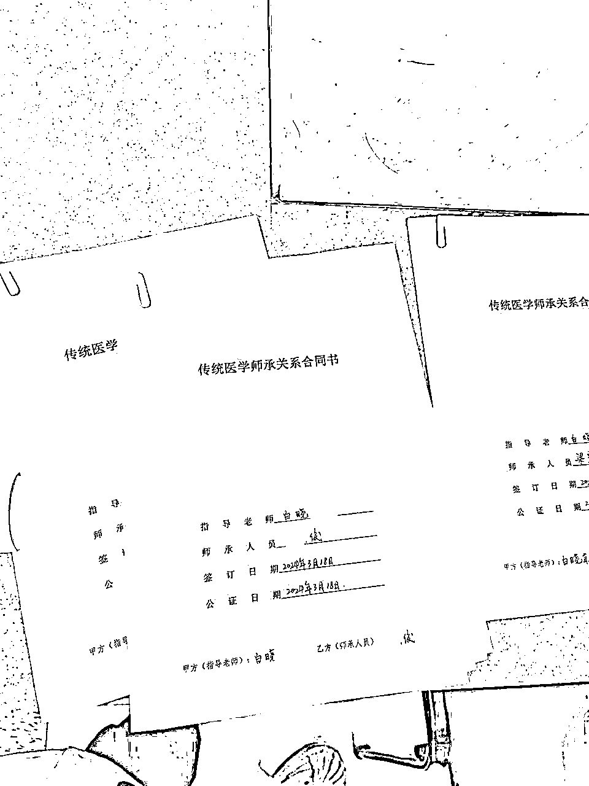
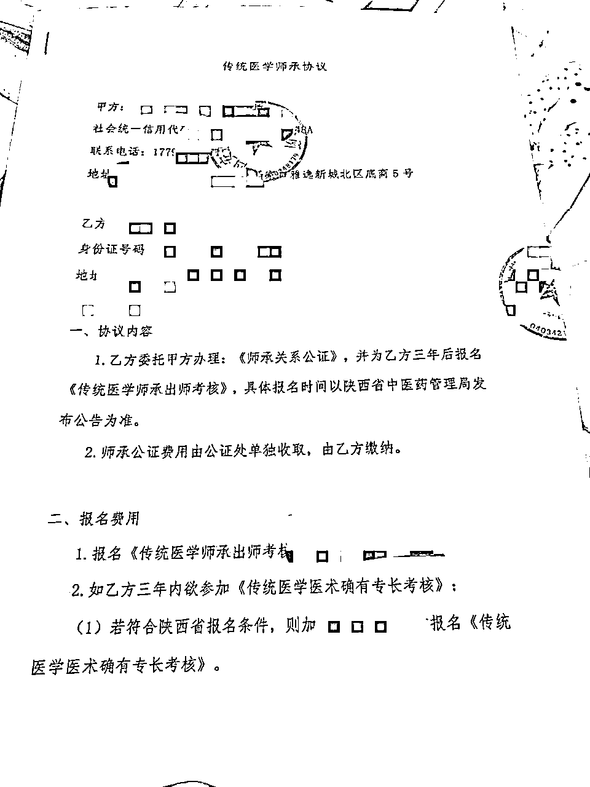
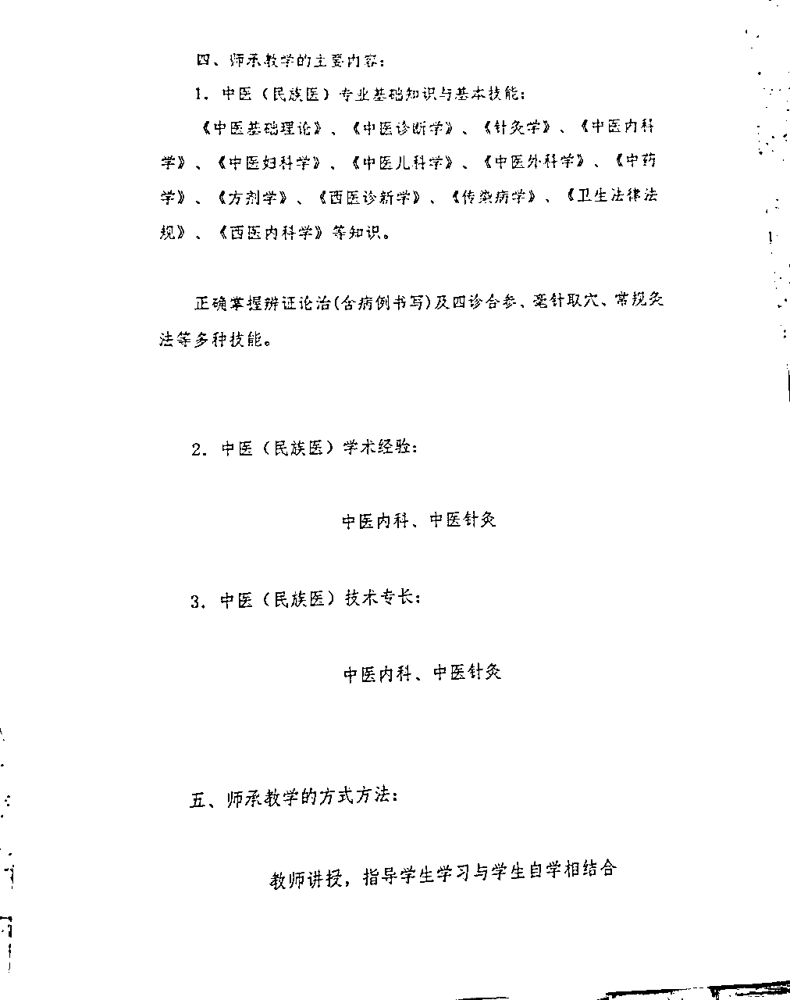
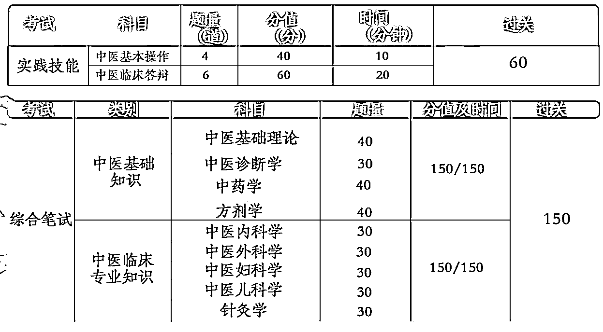
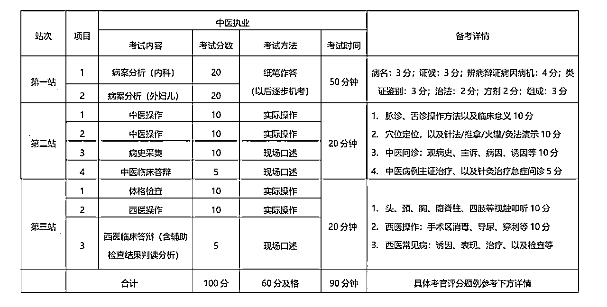
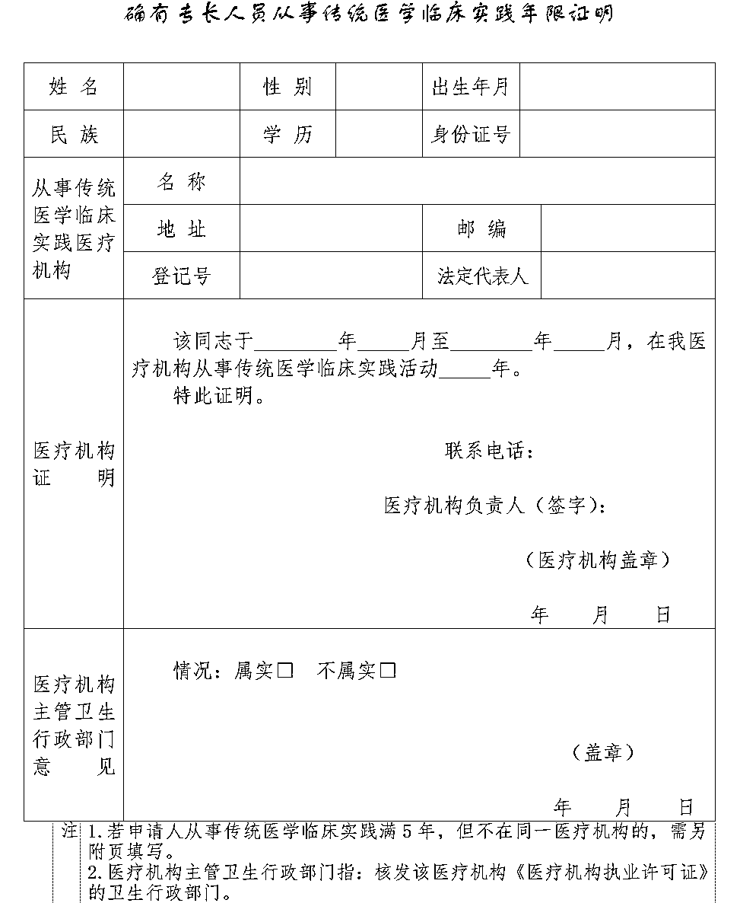
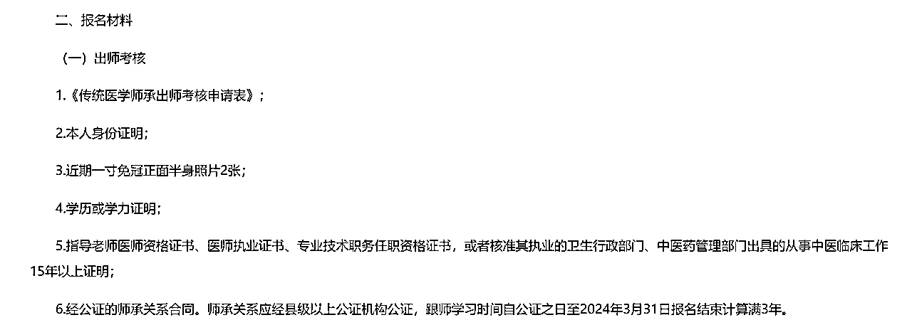
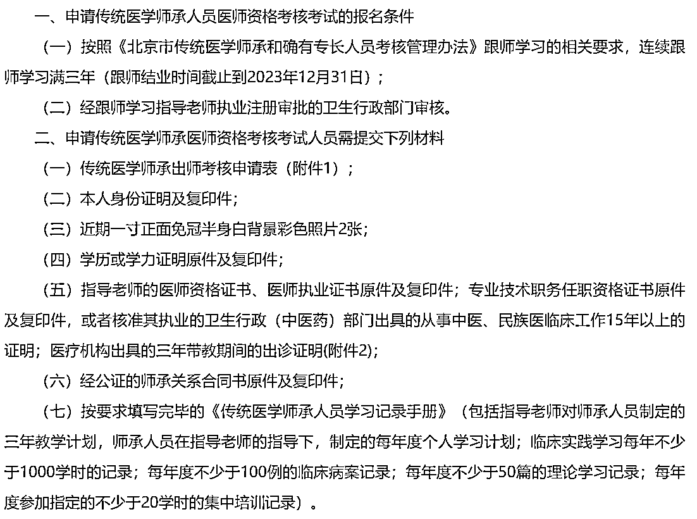

# 中医考证避坑指南：非科班拿证，这8个坑千万别踩
作者：龙哥

大家好，我是龙哥，一个03年出生、在广东读大二、爱折腾商业的男孩。目前自己在做中医大健康养生小品牌，也走了师承，名下门店月流水稳定在2-3W。平时主要研究抖音同城引流、私域IP运营和中医产品供应链。

前段时间被老妈催着去办中医师承，从研究政策到签合同、公证，一路走完我最大的感受就是：这个赛道里的中介利润大得离谱，而真正想考证的人，踩坑也踩得心累。所以今天把这条路彻底拆开聊一聊，给想转行中医的朋友、以及手里有医疗资源想变现的朋友，提供一份“避坑指南”。

先说大环境。疫情之后，中医的价值被更多人看到，非科班出身但想学中医、想考证的人越来越多。有人是为了做养生行业，有人是想照顾家人，也有人把师承当成一条出路。国家早在2007年就出台了《传统医学师承和确有专长人员医师资格考核考试办法》，给社会人士留了一条正规通道。

非科班想拿中医执业证，主要有三条路径。

第一条，传统医学师承，也就是大家常说的“师承”。要求年满18岁，有中专或高中以上学历，找一位执业满15年的中医执业医师签师承合同并公证。然后3年跟师，考出师证；再花1年考助理执业医师；最后熬5年考执业医师。

第二条，传统医学医术确有专长，俗称“老专长”。要求23岁以上，有5年相关医疗实习经验，加上两名执业医师推荐。周期是：1年考确有专长，1年考助理，再5年考执业。

第三条，中医专长医师，即“新专长”。要求类似，但通过率低到吓人，很多省份一年就过几个人，这里不重点说。

这三条路看起来都挺漫长，但也是因为这张证是中医体系里含金量最高的。市面上那些花钱就能拿的“中医康复理疗师证”，跟它完全不是一个量级。

那么该怎么选？我的答案是：如果年龄在18到22岁之间，选师承。比如我现在大二刚满20岁签了师承合同，毕业第一年正好考出师证，节奏完美。如果已经满23岁，别犹豫，直接选老专长。既然能省掉3年跟师时间，就一定要省。新专长只适合那种真正祖传的超级老中医，普通人不用惦记。

选完之后，真正的大坑才刚开始。

先搞懂几个词。师承合同，说白了就是用来证明你和师傅的师徒关系满了3年，报名出师考试时要拿给中医药管理局看。合同要从官方渠道下载，再去公证处公证。出师证和确有专长证都相当于“毕业证”，只能证明你学过，不代表你有处方权，它们只是考助理医师的敲门砖。助理医师在县级诊所有独立处方权，在城里只有一半，开方还需要另一个中医签字。只有执业医师资格证，才有全国独立处方权。新专长那张证只对特定病种有效，而且太难过，可以不考虑。

对了，顺便看一下考试内容。师承的出师考和老专长的确有专长考，内容基本一样，难度也差不多：

助理医师考试内容则是这样：

很多人会觉得：师承多好，能跟老师学真本事。但现实往往很骨感。如果你没有自己的医疗资源，靠机构找跟师诊所，先不说老师愿不愿意教，光是人情世故就够你累的。更扎心的是，没有证，病人根本不信任你。病人一句“你是大夫吗？”就能把你问住，甚至抓药、针灸都不让你碰。医术这东西，3年合同绑定的师徒关系，真能让你脱胎换骨吗？太难了。中医一辈子都学不完，不如先把理论学扎实，确保一次通过。拿到助理医师证之后，再去规培、进修，或考研专硕，那时候自然有老师带。四十岁也能跟师，但没人四十岁才去规培。所以我的观点一直是：先拿证，后学技术，别把顺序倒过来。

而且，真正有本事的中医，通常看不上中介那套，更不会靠收想学医的新手赚钱。这个政策本身是好的，但只要有信息差、有商业化，就难免偏离初心。如果你家里有诊所资源，那师承倒是挺香——签个合同挂名，不跟师，回家自己找诊所学，我本人就是这么操作的。

那为什么机构总爱推荐师承？说白了，师承收费高，中介赚得多。师承和老专长的考试难度其实差不多，可师承要磨3年，而老专长你花几个月认真学完理论就能上考场。已经23岁的人，硬去耗3年很不划算。政策一年一变，早点拿证才是硬道理。

有人问：“老专长非要5年医疗经验，可我没有啊。”

看这张图，这是陕西中医药管理局老专长报名材料清单。没资源的人，确实只能找机构盖章。很多人骂这是造假，可现实是，真正有过5年医疗机构从业经历的人，一百个考生里能找出几个？能用合规方式达到目标，本身就不容易。

另外，师承合同公证之后，大部分省份还要去中医药管理局备案。因为公证处和中医药管理局信息不互通，需要两边都存档，备案也相当于帮你再过一遍合同，确保3年后能顺利报名出师考。

再说说通过率。这里有个明显的信息差：偏远省份人少，竞争小，通过率自然高。比如我报的西安，老专长通过率约42%-43%，师承通过率60%-70%；而广东只有25%左右。为什么差距这么大？因为师承的人有3年学习时间，老专长的人往往当年报名当年学，复习不到位，自然容易挂。整体趋势是越往南越难，在西安能考高分的人，去了广东深圳可能只是及格。

还需要注意：师承和老专长的出师考、确有专长考是各省自己出题，所以通过率各不相同；但助理医师和执业医师是全国统考，助理大概35%，执业大概50%。

网课和培训班也是重灾区。很多机构承诺“网课+直播+班主任+线下培训”，听着很贴心，但收费虚高，师承最低3万、老专长1.5万。这些网课很多是直接搬医考机构的盗版内容，线下培训的老师也不一定有执业资质，随时可能跑路。理论部分真的建议自学，别花冤枉钱。

最靠谱的信息源，永远是省中医药管理局官网。中介嘴里说得再天花乱坠，都不如自己去官网查官方文件。报名材料能自己准备就自己准备，只有实在缺医生资源时才需要找中介。中介赚的本就是医疗资源的信息差，你要是能搞定医生盖章，这笔钱完全可以省。

跟师笔记也是个隐形坑。比如陕西要求师承报名提供的材料在这里：

北京要求的在这里：

看出差别了吗？北京需要一大堆跟师笔记，写到手废；陕西明确不用。这也是为什么很多人选西安的原因之一。

再说说找谁办。我建议优先找中医诊所的医生帮你推资源，而不是找专门做代报名的公司。诊所医生主业是看病，给你推荐同学、同事只是顺手人情，赚的也是小钱，不会为了这点钱砸了自己几十万的生意。但专门做代报名的公司，背后全是成本，一旦政策变动，收入一断，跑路没商量。到时候培训没了、推荐医生也联系不上，钱全打了水漂。

也不是非要花2-3万找中介。如果你有亲朋好友是医生或开诊所，问问对方能不能帮你推荐，能的话就按官网要求自己准备材料。还可以去当地诊所多碰碰运气，给医生塞点好处费、请吃顿饭，可能1000块就搞定了。但有个前提：你最好有本地医疗资源。比如你是广东人，在广东找医生容易，可广东通过率低；想去西安考，就得有西安的诊所资源，这是绕不过去的。

所以我的建议是：能考就早考。西安老专长通过率，2021年还有46%，2023年就降到42%。政策一年比一年紧，等大家都发现这个信息差，全都跑去偏远省份卷，到时候只会更难。趁早拿证就是赚到。

有人担心：7年才能拿执业证，太久了吧？其实如果不是铁了心开诊所，考到助理医师就已经很够用了。老专长最快2年拿助理，然后做做中医养生IP、私域IP，养活自己绰绰有余。助理医师在乡村地区还有独立处方权，学完也足够照顾家人健康。如果真想开诊所，考完助理可以找执业医师合作挂靠。再说，赚钱的路子有很多，真不必死磕诊所。国家把医学门槛设得这么高，是有道理的，严格筛选才是对所有人负责。

最后说说我的个人判断。如果你未来想在中医大健康赛道长期发展，不论做自媒体IP、私域还是带货，不妨自己去考一张国家卫健委体系内分量最重的证。既能给自己托底，也能给家人多一份健康保障。家里要是刚好有刚上大学的年轻人，提前报个师承留条后路，大概率不会错。政策方向和社会趋势都摆在这里，这个动作值得做。

也感谢龙哥盟的前辈们，在线下聚会给了我一对一指导，比如把中医大健康跟抖音本地生活结合起来做门店流量，提醒我找厂家批量生产产品，还有大厂前辈给了不少实习和就业规划上的建议。对一个迷茫的大学生来说，这些帮助真的很珍贵。大家有问题欢迎随时问我，知无不言，言无不尽。如果这篇反响好，我后续再写一篇专门讲有医疗资源的人怎么前端获客、后端转化的SOP，敬请期待。

最后补充一个最新动态：现在老专长全国报名人数大涨，报名难度也在提高。我的建议是：不着急拿证的，就在自己本地找诊所资源，好好师承跟诊，把技术学扎实；想快速拿证的，老老实实本省本市报名，别浪费时间折腾外省。

希望这篇避坑指南能帮你避开那些我踩过和见过的坑。