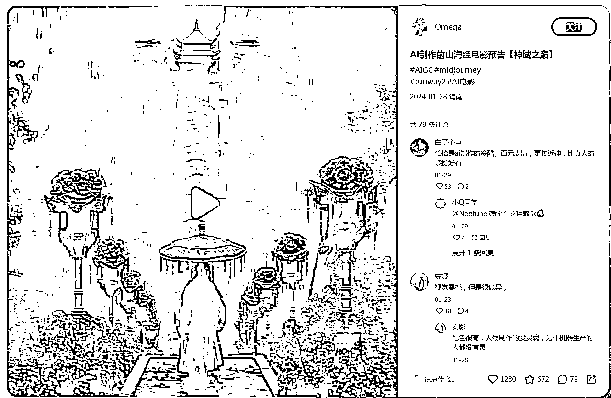
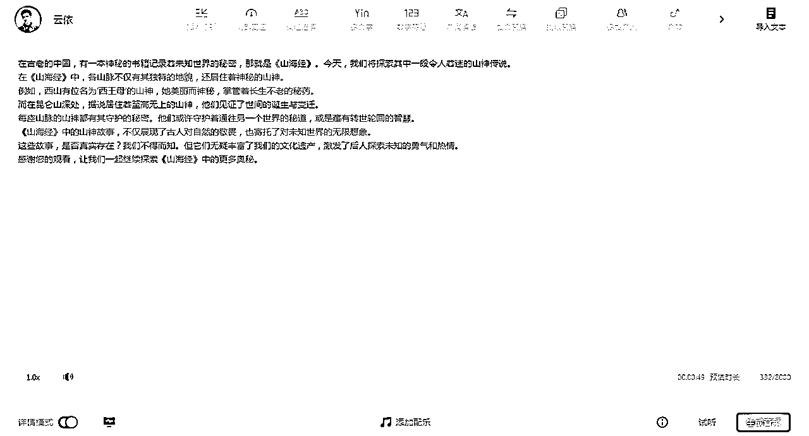

# 10分钟用AI制作山海经神话短视频，红利期赛道，起号优选

前两天刷📕，无意间刷到一些讲《山海经》神话故事的短视频，点进去一看，好家伙，画面全是AI生成的。结合之前咱们聊过的话题，真有种“万物皆可AI”的感觉了。

这个赛道说实话，现在进场的人还不算多，妥妥的处于红利期。新号想快速起盘的话，眼下是个挺不错的窗口。我随手翻了个同类型账号，单个视频的点赞量轻轻松松上千，数据相当能打。

行，咱也不光看热闹了，直接动手试试看能不能复刻出一条同款短视频。我捋了下整个流程，核心思路就一句话：故事脚本用AI写、配图用AI画、配音交给AI念、最后剪辑合成完事。

## 第一步，让AI先“读懂”山海经

写脚本这事儿，我脑子里第一个想到的肯定是ChatGPT。先确认一下它到底懂不懂《山海经》，紧接着就让它把全书章节结构给列出来。

咱们刷到的这类短视频，基本都是连续剧那种更新模式。那就继续让ChatGPT把《山海经》的四个大板块，每个部分再拆出10个能单独成篇的主题故事，素材库这不就搭起来了。

十个主题故事齐活儿之后，我们再往细了挖。先拿“山经”部分开刀，让ChatGPT帮忙把里面跟山神相关的故事写成脚本。

## 第二步，画面全部交给AI画出来

故事线有了，接下来该解决视觉部分了。最省事儿的办法就是直接用DALL.E，它会按剧本一句一句地把画面渲染出来。Midjourney这类专业工具当然也行，不过不是今天的重点，这里就不展开了。

## 第三步，给视频配上舒服的旁白

画面就位，接下来是配音环节。我试过腾讯智影的文本配音，体验还算顺手，所以这次继续用它。把刚才写好的脚本旁白粘进文本框，点一下生成，一段音频就搞定了，省时省力。

## 第四步，剪映里做最后组装

打开剪映，把画好的图和生成的音频导入进去，直接拖到轨道上。

接着找到“文本”菜单，点“智能字幕”，让软件自动识别旁白，把字幕先灌进去。

然后咱们得根据旁白节奏，把每张图片的显示时长调到一个合适的长度。这里提个醒，拖动图片时记得先把字幕轨道锁住，不然字幕容易跟着跑偏。顺便也能把字幕的字号、位置再美化一下。

接下来给每个画面衔接处加上转场。我习惯用“叠化”，效果挺柔和，视觉观感不错。

当然，想锦上添花的话，可以再上点小特效。全部处理完，直接导出视频，一条神话短视频就这么诞生了。

## 最后聊聊怎么变现

搞这个项目，赚钱路子主要有两条。一条是走📕商单，或者顺手吃吃其他平台的广告分成收益。

另一条就是视频带货，卖《山海经》原著或者神话相关周边都很对口，感兴趣的朋友可以往这两个方向琢磨琢磨。