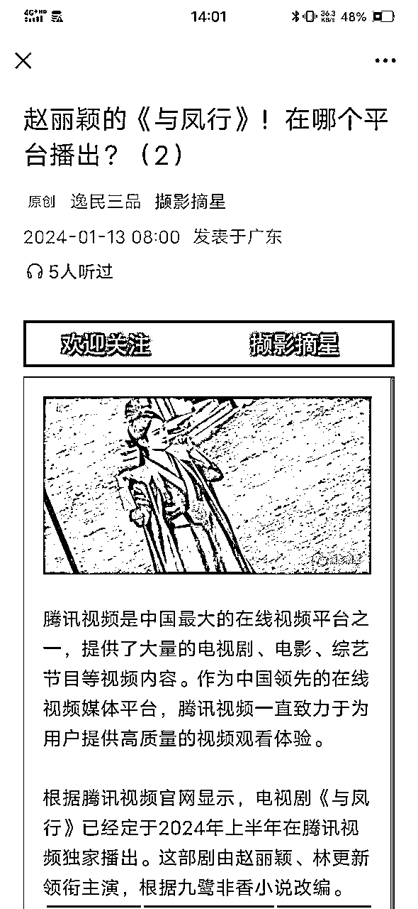
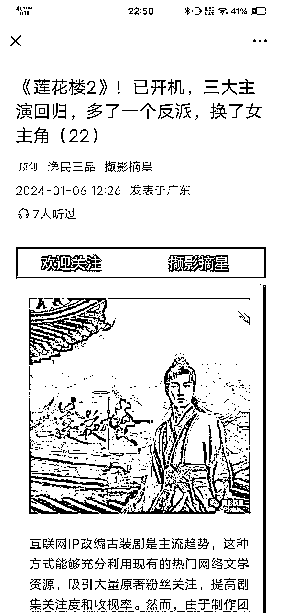
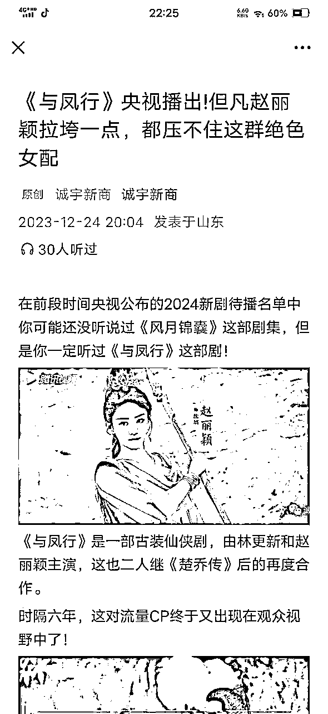
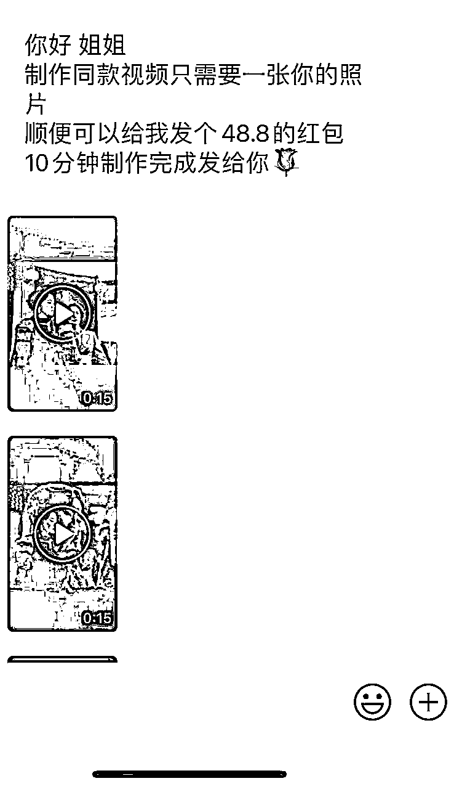

# 如何做一个赚钱的剧评👸号?

还记得《知否》里那段疯狂输出康姨妈的对白吗？一句“母慈子才孝”直接把观众的心声全骂了出来。那些姨母们的嘴脸、装傻充愣的做派，被台词一一拎出来鞭打，看得人通体舒畅。我当时就想：这不就是最好的剧评吗？妙语连珠、直击要害，既替主角出了气，也把大快人心的情绪拉满。

大家好，我是龙哥。一个带着👸号爆款写作航海团队摸爬滚打的教练。今天想和你聊聊，我为什么在剧评这个赛道里泡了大半年，以及它到底能不能赚钱。

先说说入局的原因。之前很多航海的伙伴一窝蜂地扑向情感领域、名言金句、养老金话题，我也试着写了一周情感文，结果既没见收益，也没写出半点成就感。于是果断掉头，想想自己平时什么剧都看，美剧英剧韩剧日剧国产剧，悬疑科幻奇幻僵尸脑洞来者不拒，干脆试试剧评。

做下去才发现，这里的流量逻辑很有意思：经典剧的流量是“慢热型”，来得很慢，但能持续很久；爆款剧的流量是“快闪型”，来得猛，掉得也快。我写过一部经典剧，足足等了一个月才迎来第一个10w+，当时还发帖纪念了一下。后来账号跑通了，就从一个复制到两个、三个。这个打法其实来自竞争战略里的一个反向思维——长期计划不是琢磨怎么竞争，而是想办法避开竞争。当别人都在红海里杀红眼的时候，你选一片蓝海，ecpm不会低，推荐不会少，读者也不会审美疲劳。半年下来，这条路被验证是走得通的。

为什么剧评值得长期做？第一，素材永远不会枯竭，新剧老剧、台前幕后，取之不尽；第二，它比法律、体制、职场薪资这些话题风险低得多；第三，单价在众多领域里属于中高位；第四，也是最重要的一点——AI目前很难真的写出有灵魂的剧评，这几乎是留给“手搓党”的最后机会。

那具体怎么运营一个能赚钱的剧评号？我按五个维度拆给你看。

**一、账号定位的四种打法**

1. **一部剧一个号**。别一集一篇文章地写，那容易平庸。要挑大场面、高能片段、出彩的角色，比如《天龙八部》里少室山大战、聚贤庄血战，甚至可以把五个版本的同一名场面拉出来对比。经典剧像《甄嬛传》《亮剑》《知否》《大宅门》《父母爱情》，随便一个都扛得住账号；热播剧像《与凤行》、网飞版《三体》也不错，节奏快、话题新。
2. **一种类型一个号**。比如专注悬疑、古装、动漫、港风动作、历史剧——历史剧还能写人物、写野史。我看专注美剧英剧的号也活得很好。
3. **包罗万象型**。紧追热点剧，什么火写什么，代表就是毒眸、Sir电影。
4. **人迷型**。只写自己偶像出演的剧，或者某个导演的全部作品。六神磊磊就是典型，他紧紧抱住金庸大腿，一抱就是很多年。

**二、内容体裁**

无非三种：图文、图片集（也就是小绿书风格）、短视频（包含影视解说、图文转视频）。

**三、内容选题可以铺开九条线**

- 剧情名场面拆解，重点写高能场景，以及配合BGM的泪点、燃点。
- 人物深度剖析，把每个角色的动机、变化、底色都挖一遍，这种内容封面特别吸睛。

- 演员演技点评，主角、配角、老戏骨都能单独成篇。
- 从剧里折射出的人生道理与心灵鸡汤，这部分素材还能跟你其他号互通有无。
- 电视剧资讯，定档、选角、幕后八卦都有人爱看。
- 豆瓣评分榜单，烂片排行、好剧排名都是流量大户。
- 奖项盘点，金鸡奖、百花奖等颁奖季特别容易出爆款。
- 结合真实历史对比，比如写《甄嬛传》就聊聊雍正朝的真实后宫，写《知否》就谈谈那个朝代的朝野动荡；还可以做“踩韩剧捧国产剧”之类的话题，评论区能吵翻天。

- 回忆杀，这块能反复蹭流量。8090后看过的老剧太多太多：国内的《寻秦记》《大唐双龙传》《武林外传》《家有儿女》《仙剑》系列，韩剧的《悲伤恋歌》《爱在哈佛》《浪漫满屋》，日剧的《一公升的眼泪》《龙樱》《麻辣教师》《东京爱情故事》，写一次唤醒一波情怀，百试百灵。

**四、爆款标题的七个技巧**

- 直接嵌入关键词：剧名、豆瓣、差评、央视、主演名字。
- 女一女配颜值对比，天然有流量。

- 善用情绪词：好奇、失望、人迷。
- 做剧集排名：年度排行榜、热度榜、收视率榜。
- 倒计时：距离开播还有多少天，每天写一篇，追更感拉满。
- 两部剧正面PK，杀伤力特别强。

- 其他更多标题套路，直接看图。

总结起来，剧评方向要持续做好，就咬死三个词：**热点、经典、情绪点**。

聊完运营，再说说大家最关心的变现。目前跑通的路径有三条：视频会员推广、夸克网盘拉新、电视剧AI变脸玩法。

最后提醒几个坑，都是我亲身踩过的：

1. **图片版权**：用剧方官方营销图就安全，别随便拿剧迷做的表情包。
2. **AI写作**：如果非要用AI，一定别把人物和剧情搞串。我刚开始就因为这个被读者投诉过。
3. **选剧标准**：只选经典剧和爆款剧，别用自己的个人审美去赌，要相信评分和热度。
4. **剧情分析**：确实考验写作功底，但不是没捷径，多看多拆解，慢慢就能上手。

我是亦小亮。如果你也爱追剧，也想靠剧评搞钱，欢迎来找我唠嗑。更多👸号运营的干货和技法，关注【宸叔的研究所】就行。