# 主业医生，副业互联网，如何利用4小时下班时间，撬动300%精力，实现7位数营收

哈喽，我是航海家俱乐部的理白。上个月赚钱福建年会，我人在厦门只待了大半天，手机却被加好友申请轰炸了一整天——好多圈友追着问我要那页写着“命最重要”的PPT，还有“跟渣男学时间管理，跟舔狗学目标管理”那组图。散场后，不少外省的朋友也辗转找过来，说要课件、要逐字稿。看来这次分享确实戳中了一些人的处境：被DDL撵着走，时间永远告急，主业副业生活三头烧。所以我把当天讲的内容整理成完整文字版，连同PPT一起，送给赚钱的各位。

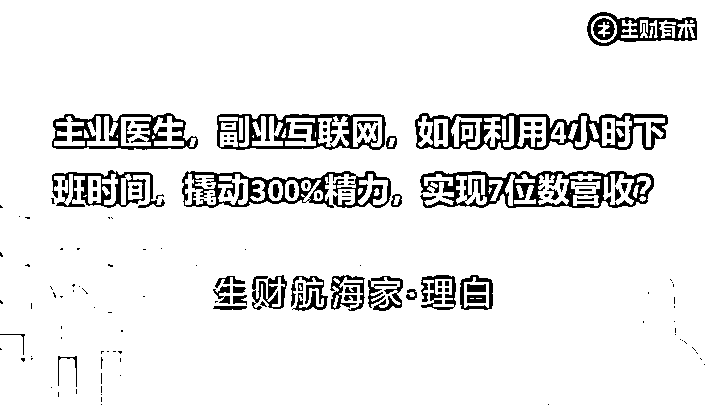

分享的主题说白了，就是12个关键词、12页图、12句话。

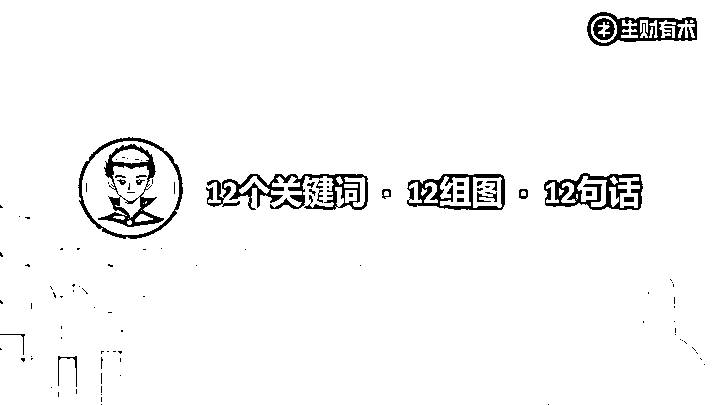

## 1、时间管理

我的主业在医院。白班夜班轮着转，还有门诊、急诊、手术台，一天下来光是站着就够呛。睡眠和吃饭之外，空余时间少得可怜。即便如此，我还是靠零散的摸鱼时刻、通勤间隙和下班后的时段，精准签下不少高客单客户。经常一整天忙下来正事没推多少，账户却进了几万、甚至六位数的款。

很多人以为时间管理的核心是排计划：下个月做什么、下礼拜做什么、明天做什么，把时间表塞到每一格。可我的看法是，复盘的分量远大于计划。别总琢磨“时间该怎样规划”，先搞清楚“时间实际上流向了哪里”。

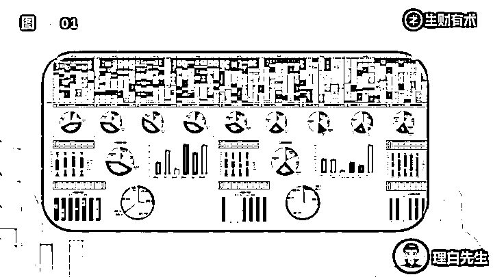

怎么查？很简单。睡前把当天的时间分成几堆：休息、娱乐、专注、睡眠，再加上发呆刷短视频这类无效消耗。分完类画一张饼图，立刻就能看清时间被谁吞掉了。

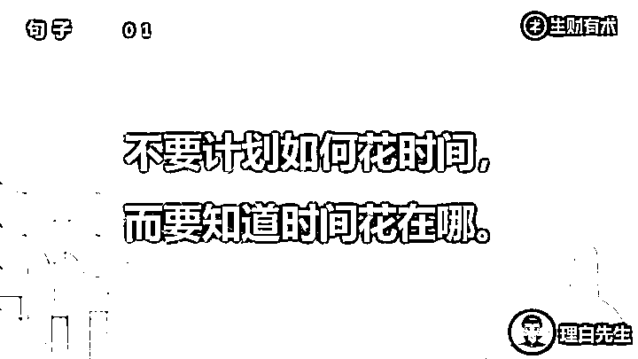

弄清楚时间去了哪，才算摸到了掌控它的门。

## 2、目标管理

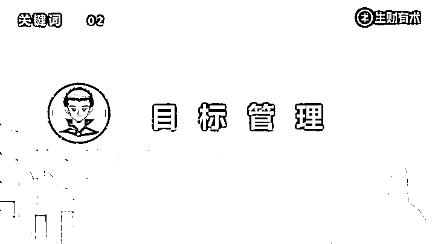

目标管理这part，常见的坑不少——有人手机里装了一堆效率APP，每天光是美化完成度就耗掉一小时；有人明明手里有主力课，非要再开个打卡营，又不赚钱，还得搭上精力去运营；有人把打卡当信仰，完不成就不睡觉，结果身体先垮了。

知道时间花在哪之后，紧接着要回答的是：你的目标到底是什么？

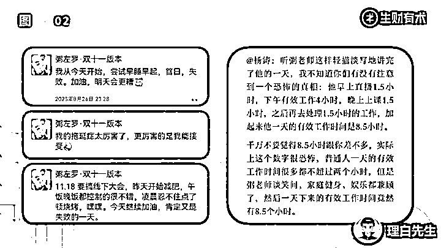

这组图里，左边是我欣赏的粥左罗老师朋友圈，右边是杨涛老师和粥老师的访谈对话。粥老师是做事上的偶像，涛爸是做人上的标杆。借他们的话讲一个观点：自律不是贴标签，而是养成习惯；自律不是终点，只是手段。

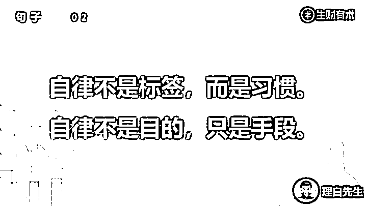

不围绕目标做的一切动作安排，都是浪费。规划路线时别给自己加戏，只做跟目标强相关的关键事项。

## 3、结果管理

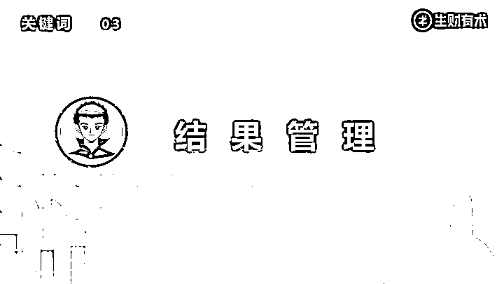

目标定清楚以后，过程和路径就能倒推出来。前几天一位客户跟我聊，说手上项目没做完呢，又想下场做IP，IP还没影呢，还想组社群，社群没搭起来，又琢磨着做发售。我说你同时铺这么多条线，精力撑不住，也没法把任何一条打透。真正的精力管理其实是做减法：只为结果服务，只留最核心的业务。和结果无关的标签、产品、内容，全部删掉。

当你真的把某一项业务深耕透了，高价客户会主动上门，你在自己这个细分领域也有了话语权，流量自然更精准。如果这批人还有别的需求，你还能靠合作分销赚到额外的一笔分成。这就是我说过的“IP簇”——有人擅长成交，有人擅长流量，有人擅长内容，有人擅长产品，一个成熟的IP要找到自己的长板，再去找人互补。

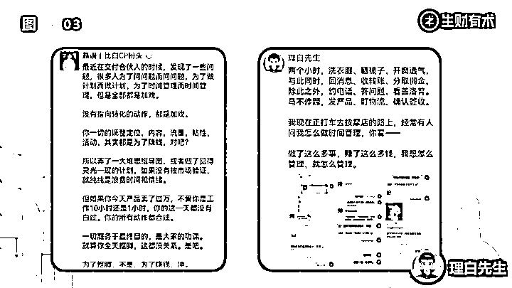

结果管理，有三条原则。

第一条：别跟风。看别人出产品你也出，看别人换玩法你也换，这不对。别人的资源禀赋你未必有，别人踩过的坑也不会写在宣传里。更要紧的是，多数人讲自己产品模式时，总会放大优势、藏起暗坑。

第二条：算成本。年初时一堆人模仿我和靠谱做年度陪伴群，最后把自己熬干了。也有人大张旗鼓搞付费星球，请各路大咖站台，结果更新不到俩月就断更，付费用户被放鸽子，背书的人也跟着处境尴尬。最近还流行花大价钱买免费星球邀请码——我开免费星球是有后手准备的：新书已经过了二审，需要提前铺量。没有这份长远规划的人跟着开免费星球，邀请码废掉不说，用户信任也一并消耗掉了。拿不到正向反馈的事，根本撑不长。

第三条：看长远。做一件事之前先衡量它能带来什么：能不能培养用户粘性？能不能作为转化的铺垫？能不能为后面的高价产品铺台阶？如果什么正向收益都没有，还特别费时间费钱，就别碰。

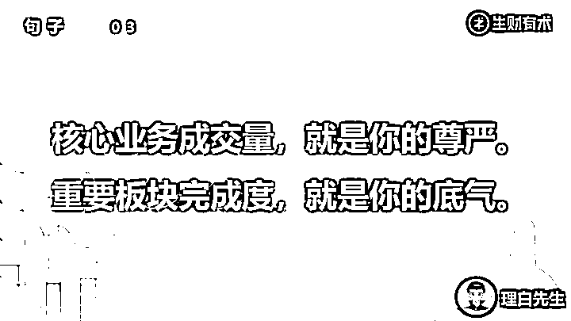

核心业务的成交量就是你的脸面，关键板块的完成度就是你的底气。等到结果面跑正了，你自然能挺直腰杆说出“我有尊严，也有底气”。

## 4、路径管理

目标在前面拉着，路径就在后面铺着。我跟靠谱老师的社群里，大家常互相提醒：“今天2700赚到了吗？”没赚到2700的人，水群都心虚。2700这个数字哪来的？年入百万拆到每天，就是2700。你的每一天怎么安排，都要围绕这个数来转。

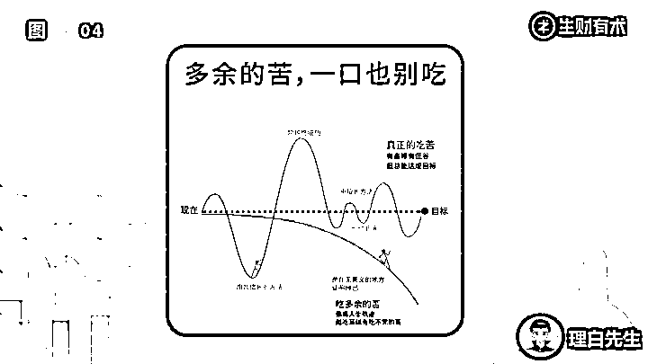

生活里各种苦都有，关键是吃苦的方式和方向。人的状态会有起伏，像波段一样，但如果一直在消耗自己，路就会走偏。吃内容这碗饭的人，做出来的东西最后都要导向引流、成交、变现，所以时间成本特别贵。能省出每天20分钟都是赚到。我是怎么操作的？三句话：产出的活自己扛，分发的活团队管，封面的活助理包。

先说自己产出：每天六条私域动态起步，每条至少200字；群里再做三十分钟分享，攒下来的都是风向标和搞钱干货。

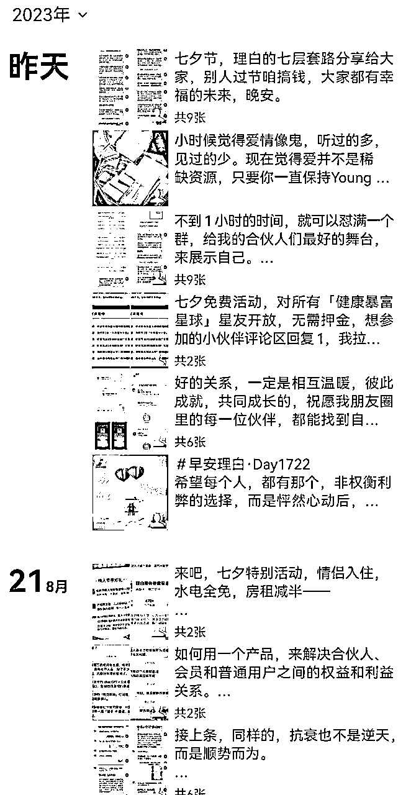

如果发完就算了，太浪费。所以每次输出我都有意识地截图、归档，丢进内容弹药库。

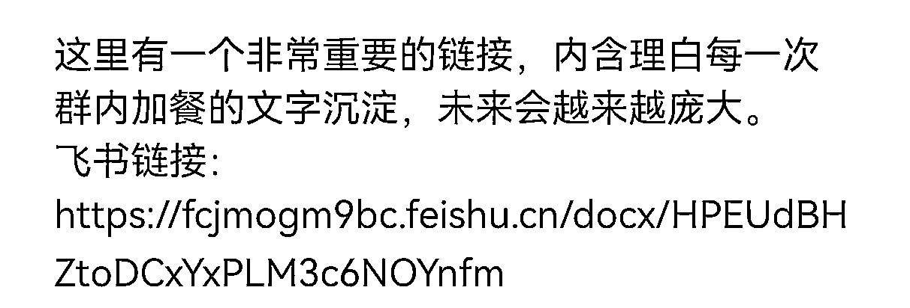

团队再负责整理、打标签、分类入库。发小红书之前，我从库里调出来拼一拼，截图就成了笔记正文。有团队的就搭自己的内容仓库，没团队的也能用打标签做个人知识库。

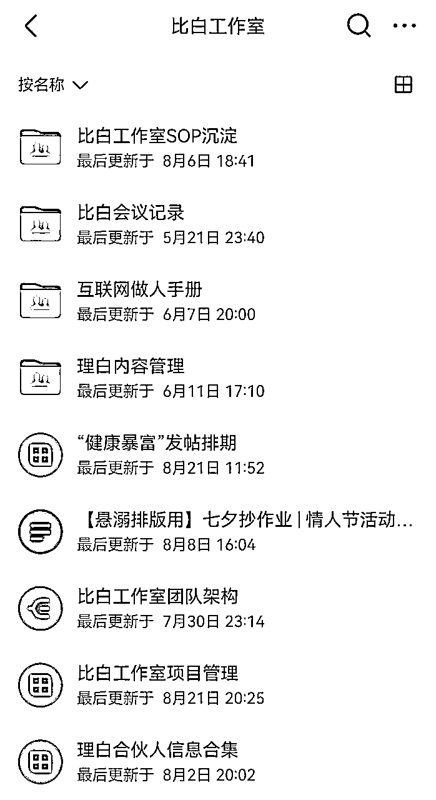

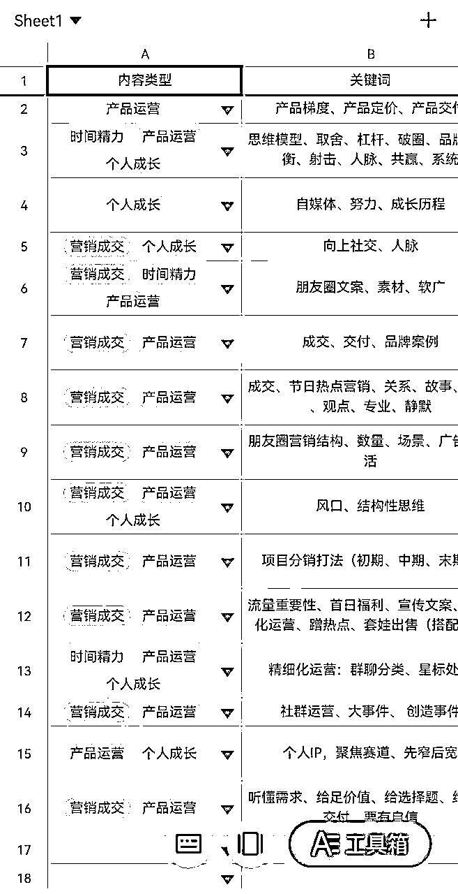

封面这种事，我请了一个跟我模板合拍的人，我丢素材和标题过去，他批量出图，按月发工资就行。内容行业有个说法：小爆靠勤快，中爆靠运气，大爆靠命。

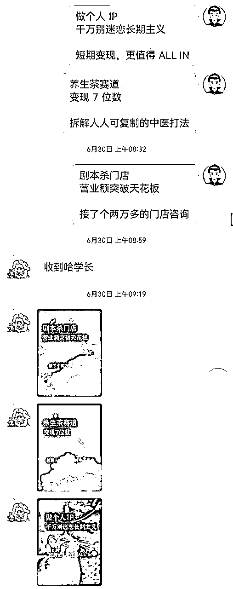

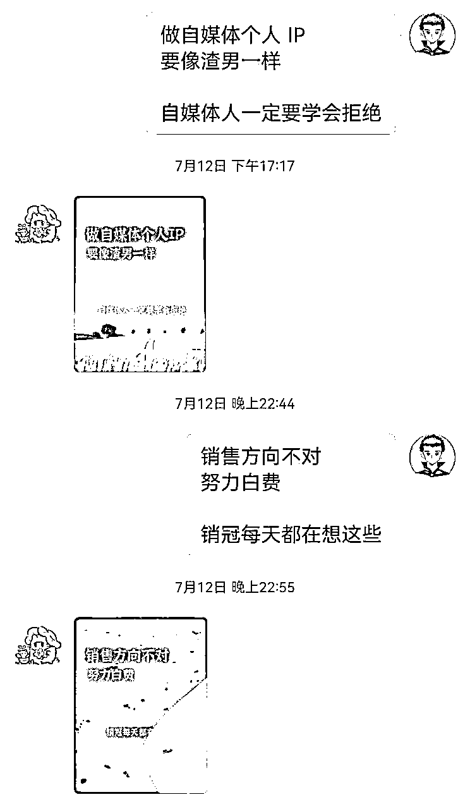

这一套下来的好处是：一不用为灵感焦虑，内容持续有供给；二不用在设计封面上耗神，发帖效率高；三能反复触碰不同关键词，反过来引导私域的内容方向，形成正向循环。不管你在哪个平台，这套省成本、提效率的逻辑都通用。

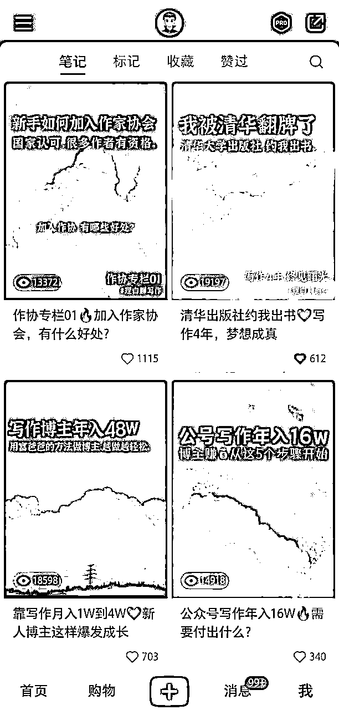

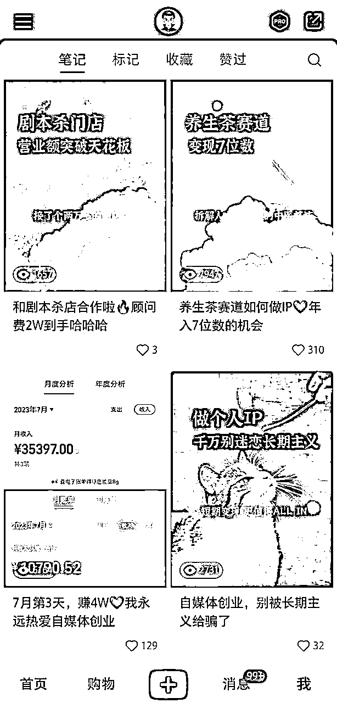

更妙的是，我的小红书帖子里全是社群或私域截图，转化信号藏在每一张图里。刷到我的人会有个默认印象：这个人的私域值得看，这个人有付费群。于是导过来的新粉，很多时候当天就来问产品。流量入口也不是只有一种：有人做精准内容，有人做社群红人，有人做直播间沉淀。找到最能发挥你优势的那个池子，把成本压下去、把时间提上来，剩下的只是时间问题。

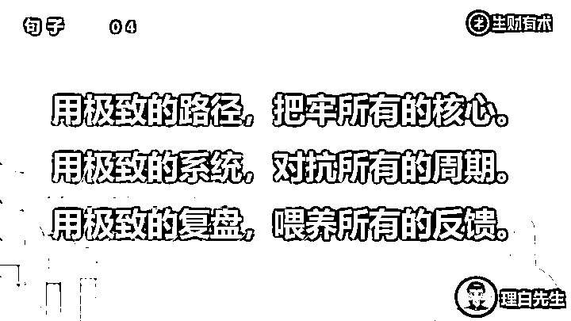

## 5、定位管理

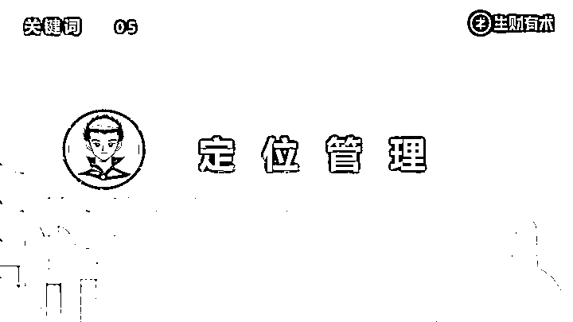

最早我的标签是“自律教练”，带人自律考研、自律成长、自律写作，学员基本是学生，收一千块一个人。后来接了B端企业培训，讲一场收一万；再后来给小微创业者和自媒体人做精力管理私教，单价涨到三万块。你会发现，方法论还是那套东西，换一拨客户、换一层认知，价值就完全不是一个量级。

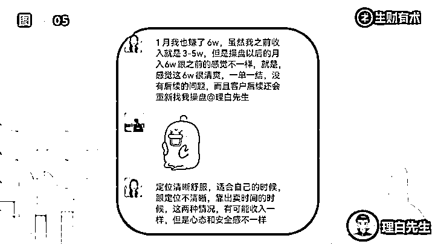

圈友彩卉也是例子。她原本帮新手从零搭建付费社群，现在定位变成帮有产品的大佬操盘群发售，赛道一变，想象空间全打开了。

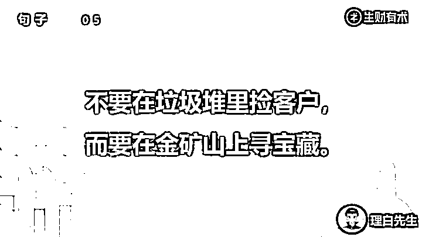

我在赚钱发过一篇精力管理的帖子，不少人私信说：原来时间颗粒度可以切得这么细。我说认知门槛其实不高，难的是执行。时间管理只是表面，精力管理才是内核，因为它要管的不只是时间表，还有决策、成本、情绪、能量这些维度。目标定下了，从A到B的路径却不止一条：有靠资源堆出来的，有靠破局打出来的，还有自己暂时看不见的。上班也好创业也好，难的不是在对与错之间选——那个根本不用选；也不是在错与错之间选——那个没得选。难的是在对与对之间做取舍，每一项看起来都对，都要消耗不同方向的精力。所谓定位思维，就是在这种对与对之间做选择：知道自己要什么，画出一条清晰路线，再用一套能落地的打法去执行，事情自然就成了。

## 6、闭环管理

项目闭环越早搭好，就越早从单位时间的成本损耗里抽身，靠系统去运转。举三个年会上的例子。

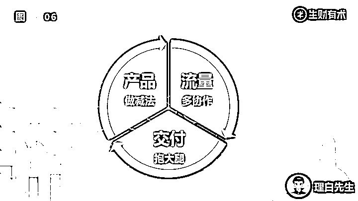

产品层面——赚钱本身的产品体系：地基是星球那一档会员，所有航海计划、风向标都围着它转；往上是航海家俱乐部，解决信息差、资源差和同行陪伴；再往上是微天使投资、大天使计划、赛道合伙人，解决的是增长问题。我理解的精力管理本质上也在解决“增长”这件事：从现有业务里找出能放大的部分。赞助商黄老板有一座茶园，他把茶园分片承包给很多超级个体，这些人再拿茶园去服务自己的用户。嘉宾张可粒，一年有一半时间在路上玩，但游学群一直在交付，旅行本身就是她的生产方式。

流量层面——赚钱的流量靠一个巨大的“共识”。整个知识付费行业能赚钱，本质也在共识。所有人都在互联网上重复同一个声音：“龙哥盟是有价值的，大家快来吧。”重复多了，共识就形成了。黄老板的流量来自“身份感”：能把logo和标签给到用户，用户愿意为之买单。可粒的流量来自“对美好生活的向往”：用户愿意为了靠近那样的人而付费。每种产品模型都有自己的流量密码，交付方式也都能让边际效率递减。多花心思设计模式，比闷头执行更有杠杆。

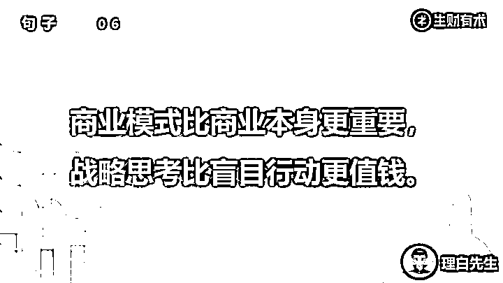

## 7、用户管理

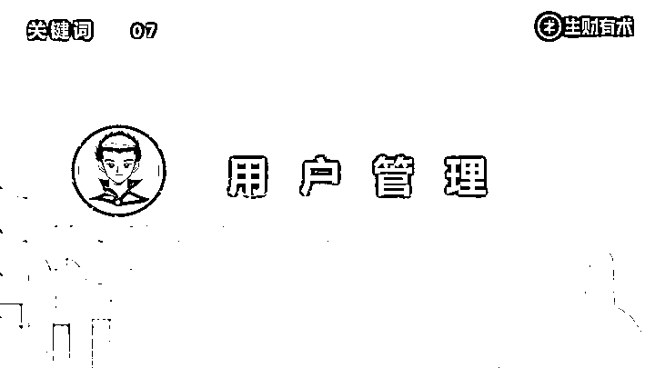

用户管理这个话题很细，也戳中很多人。

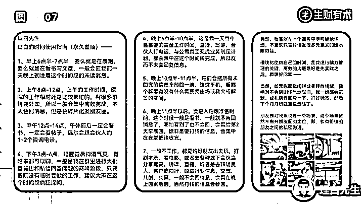

基础版的时间管理是管自己的时间，进阶版是管用户的时间。我会让用户清楚地知道：我哪里有空、哪里没空。很多人主业副业两边忙，时间还是不够用，因为随时会被打断：刚按下番茄钟，一个电话就进来了。

怎么管？

第一，反复强调价值边界。你公开输出的每一条内容，都是在教用户“该怎么跟你相处”，这种价值观会持续塑造用户对你时间的尊重。

第二，设置统一的收口时间，相当于给自己留出空间。我做公众号主编时候约稿，会明说：只收周六晚上八点到九点的投稿，早写完也别急着发我，我默认没收到。所有作者都记住了这个规则，那我的收稿工作就只有这一个小时。

第三，给用户建立反馈梯度。我的付费用户私信问我一个问题，我会回两三条有效信息；但如果在社群里问同样的问题，我回的信息量至少翻三五倍。这个机制本身就是对用户行为的一种引导。

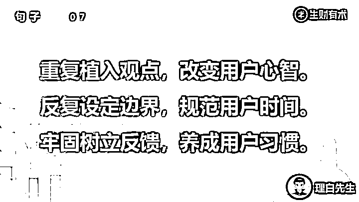

也就是说，我会刻意让用户感受到，在群里抛出一个问题，得到的反馈比私聊的单独解答要多出几倍体量。于是越来越多人主动把问题丢到群里来，我的那份一对一服务时间自然就被稀释、被分摊出去了。

# 8、信息管理

信息管理，其实是我多年下来磨出来的特种兵打法，今天直接用画面来讲。

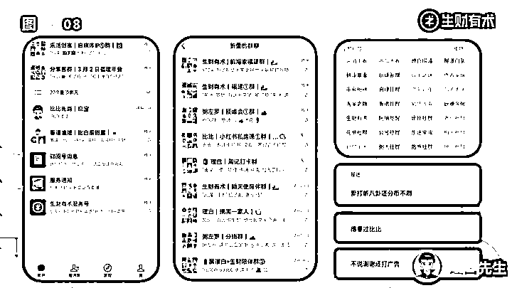

## 微信页面管理

左边这张就是我日常的微信首页，看起来信息极简。因为我把一切噪音都手动藏起来了。

这种噪音的过滤，是要长期养成的肌肉记忆：随时去“隐藏”那些无效信息。

什么叫无效信息？

已经被回复，并且不需要我继续追踪的信息，就属于无效信息。

所以我的日常习惯是，每晚睡前，把当天已经闭环的信息全部隐藏掉。

页面就会保持干净到极致——只要在首页还能看见的那条记录，100%是我还没处理的。处理完了就会被我藏起来。这样一来，我就能在手机主界面实时看见自己的处理进度。

这就是我对信息的底层管控逻辑。

## 群聊分区管理

我对群聊的用法，和大多数人不太一样。置顶对我来说并不是最重要的承载区，因为置顶太多也会被系统折叠。

置顶区在我这更像是一个当日的“信息流”。要求当天能刷到，看完之后就不要再来打扰我。置顶的特性就是自带折叠，点一下就收口了。

真正要今天内必须回复完的，是首页里非置顶也非折叠的那块区域，必须当晚前清空。

至于被折叠的群，不代表不重要，而是进入了“定期复盘”的序列。我一般会隔一周统一扫一遍，看有没有漏掉的信息增量。如果一个折叠群连续几次都带不来新的价值，我就会直接退出。

## 用户标签管理

我全部的好友都像右图这样被打了标签，还会附带一段简短的备注，有褒有贬。因为修炼筛选力，本质是给大脑减负，大脑要留给战略层面的思考，不用来记那些琐碎的人和情绪。

所以一个人的基本画像、和我的互动历史、甚至是否曾冒犯过我，都会如实记录下来。未来某天需要清理的时候，直接有依据。

现场提问：那为什么不立刻删掉？

理白作答：因为冒犯发生当天就删，对方一定会联想到被你因为那件事删掉，很可能去举报你。微信号太宝贵了，我不想留下任何舆情风险。所以我会等三个月后再删，让对方感知不到删除的时间点。

## 日常运营管理

给大家拆解一下理白的一天是怎么运转的。

### 第一件事

刚摸到手机的第一时间，把从昨晚睡觉到现在的所有未读消息全部过一遍。能处理的就藏起来，不能处理的就打标签、设定时间，确保每件事都有回应，不会掉链子。

这样一来，手机聊天首页在你眼里就是绝对干净的待办清单，你随时知道待办在哪里。

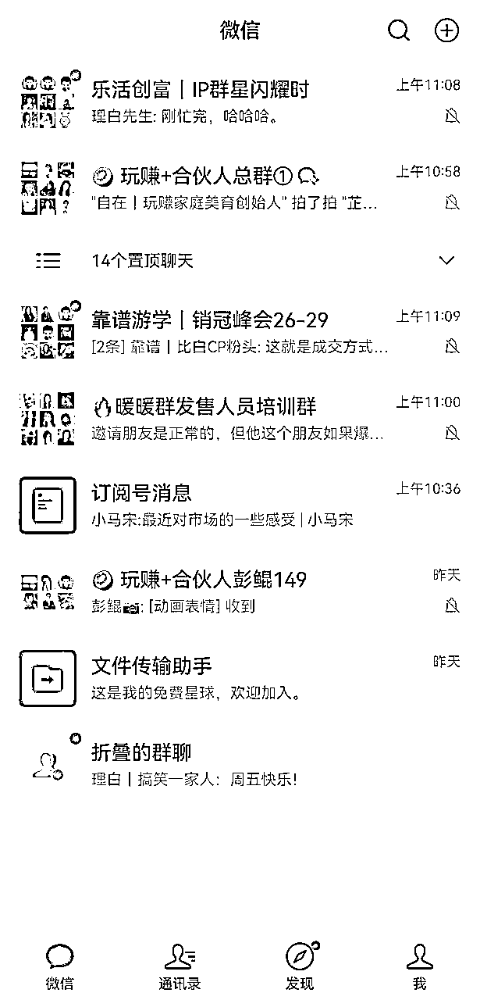

### 第二件事

把从昨晚到现在的全部新添加好友梳理一遍。来源五花八门：群里分享加的、小红书和公众号关注来的、合伙人推名片来的。日常大概是50个，有时候会爆发到300多个，就得分批慢慢通过，避免风险。

通过后就是标准化接待：发见面礼、送福利、打上来源标签和基础信息，提醒加入免费星球，别错过每日的干货。

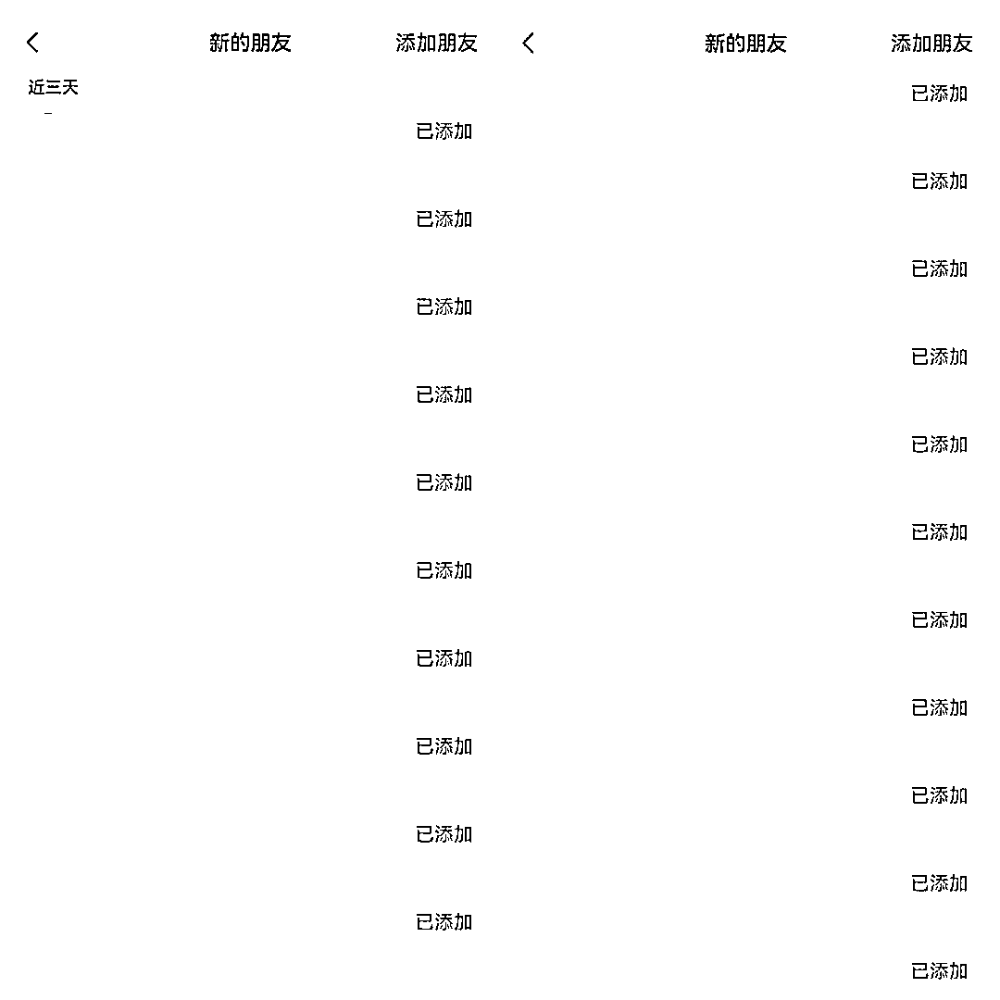

### 第三件事

回复养生群客户的下单信息，核对订单、安排发货，准备免单抽奖的福利，以及拍单后三个高能量社群的赠品发放。

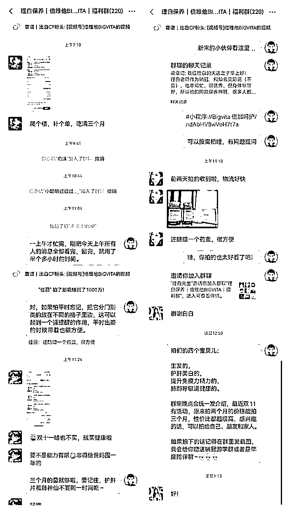

### 第四件事

和私塾学员敲定1V1语音沟通的时间，把卡点逐个击破。基础问题靠标准课解决，陪跑问题靠交付小群解决，疑难卡点靠语音解决。这样每个客户都能拿到有针对性的、长期主义的个性化指导。

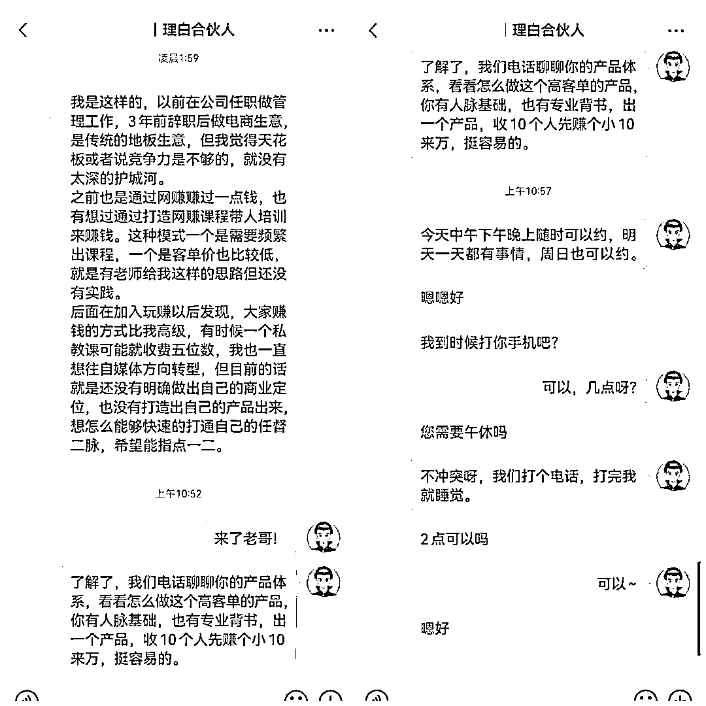

### 第五件事

在星球做每日的干货输出，同时追踪行业动态，为晚上在付费星球和社群的内容输出做准备。

上面这整整一上午的流程，实际只花了40分钟就能跑完。

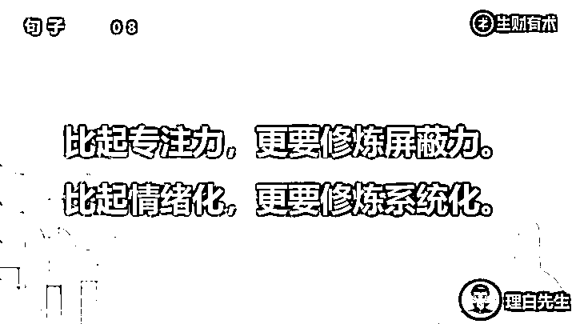

这就是搭建信息系统的意义，既能屏蔽杂音，也能屏蔽情绪。

# 9、精力管理

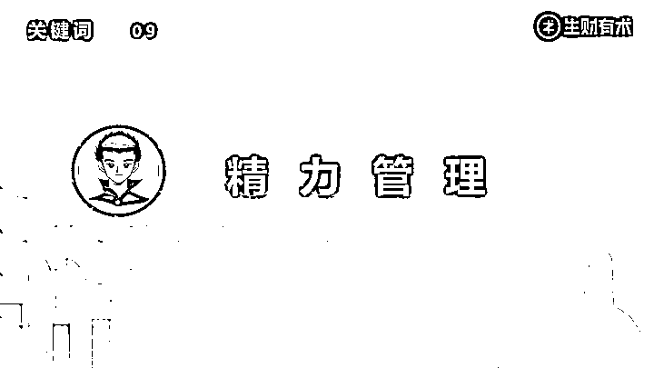

细节讲完了，我们拉高一个维度，聊聊精力的宏观管理。

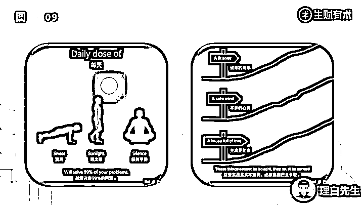

## 首先，是精力基础认知。

### 一是睡眠
规律且充足的夜晚睡眠，加上适度的午休，是生命质量的底座。

### 二是营养
保证基础营养素的充足摄入，同时控制摄入总量。

### 三是运动
保持一个基础量级的运动习惯。

## 其次，是个人耗能控制系统。

*   比如我全部的衣服加起来不超过10件，除了1-2件重要场合的，其余都是地摊款，穿几个月就丢掉或捐掉。
*   比如我的微信好友只有一万左右，每天雷打不动打标签、删人。相册照片常年不超过100张，发完随删。就靠这个又旧又破的手机，赚到七位数。
*   比如以前出门写东西要带电脑，现在有了讯飞输入法，一台手机加充电宝就能扛下90%的业务。外出最多带个小箱子，放点给朋友带的礼物就够了。
*   在社交场合，只有需要我开口的局我才会全力输出。不是我的主场，我就当个隐形人，不在陌生人面前炫技，也避免过度消耗注意力。
*   去新城市，以前穷时会住朋友家、让朋友做攻略。现在直接订高楼层的酒店，基本拒绝朋友接送。就是不想把注意力浪费在道谢、纠结和路上闲聊上。碎片时间宁可小憩或回消息，等到饭点或约定的时间再好好交流。

装懂社交其实很累。所以在物质、环境和社交上，都要保护好自己的注意力，因为注意力就是生产力和赚钱力。

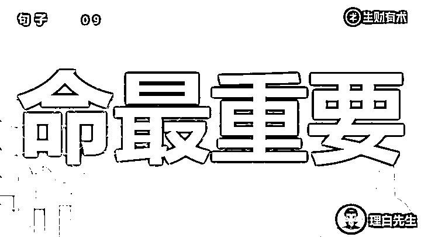

# 10、极限管理

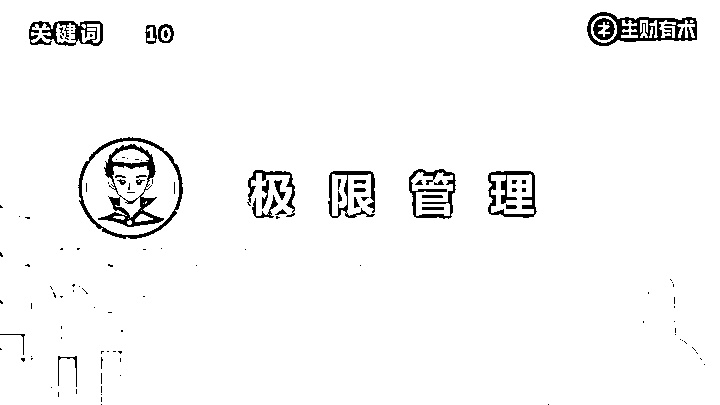

在健康是底线的前提下，难免会遇到极限状况。

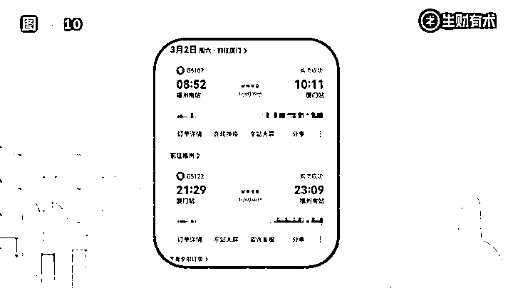

比如单位不批过夜假，就是我遇到的极限。要参加线下活动，就得当天早出发，晚回来。

我是医生，要值门急诊班。为了平衡主副业，我在过年放假时主动申请值了4天班，把其他周末班和同事置换。

这么做的好处有三：

第一，其他医生可以回家过年；
第二，他们会觉得我靠谱，欠我一个人情；
第三，过年病人本来就少，我能把空出来的时间用在自己的业务上。

我的时间就是这样一点点抠出来的。极限时间内就要极限处理问题。请不了假，那就抢最早航班去，见完面再抢最晚航班回，当天往返是常态。

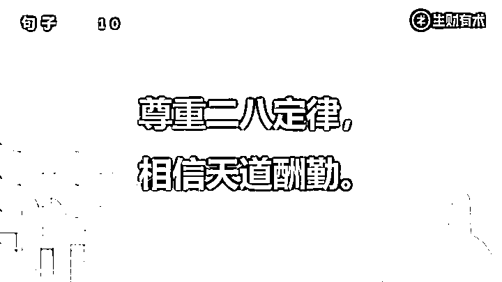

极限情况下，我们反而能做出更高效的选择。这也是我说的，“尊重二八定律，相信天道酬勤”。当你真正清楚要什么，你会愿意付出对应的代价。

# 11、稳态管理

聊完健康和极限，我们再聊聊稳定。

平衡=PlanB+SOP。

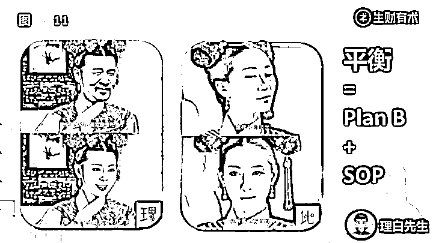

时间分配上，我会学皇帝。每月初一十五要去陪皇后，还要安抚年大将军的情绪，去陪华妃，也要和甄嬛贴贴。前朝后宫都要平衡，所以你得像个渣男一样，把时间分给不同的优先级。

而安陵容，我觉得她很会活路。她的所有技能都围绕着那个项目这个男人，目标死了就多线并行。

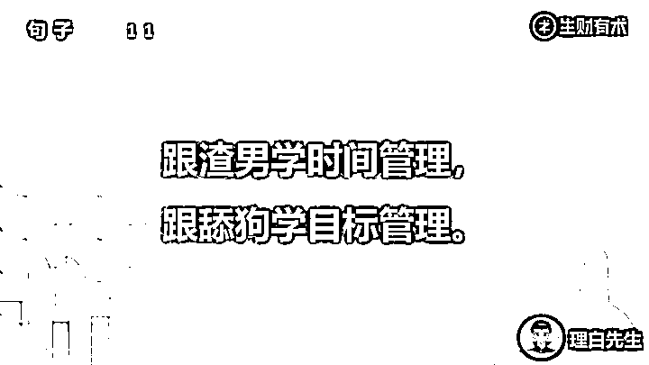

所以我认为，时间管理要学渣男，目标管理要学舔狗。搞反了就全完了。

# 12、框架管理

最后收尾，聊框架管理。

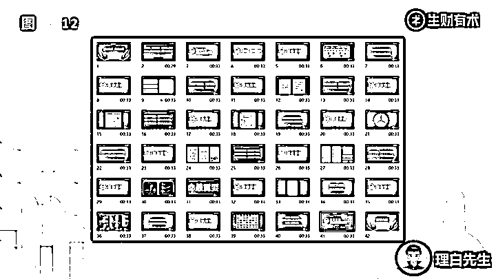

我会在最开始就先把框架搭出来，带着主线再根据现场微调，这样思路会更清晰，目标也更容易达成。

当你确信方向是对的，周期就制裁不了你，但理解周期很有必要。

有了系统，你就知道哪些是规定动作，比如每天发够6条朋友圈、所有社群巡一遍、把分享都看完。只要这些动作不干扰主业，就能确保系统行动打败周期波动。

找到一件能持续给你正反馈的事儿，重复它，沉淀成SOP，降低操作成本，先在一曲线上取得确定性结果，再去启动二曲线，这才是正路。

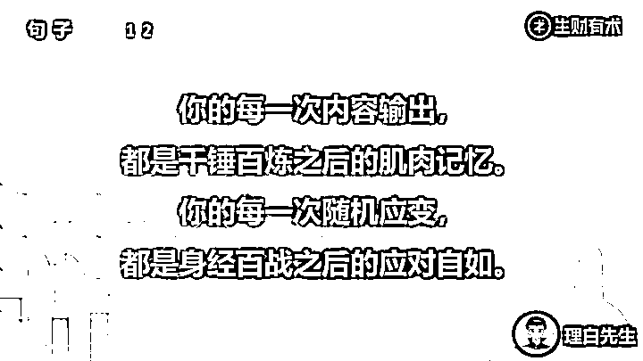

所以我常说：“你的每一次内容输出，都是千锤百炼后的肌肉记忆；你的每一次临场应变，都是身经百战后的自然反应。”

# 结语

时间管理的核心是：

1、搞清自己的人生目标，以目标为导向拆解路径和步骤；
2、以终为始，把优质的精力和时间用在刀刃上；
3、拒绝自我欺骗式的忙碌，倡导高效自如的成功。

这就是我给所有想提升效率的人的注解，12个关键词，12张图，12句话。

祝愿大家都能找到自己的十倍杠杆，撬动百倍精力，做时间的主人，赚钱有道，精力自有章法。