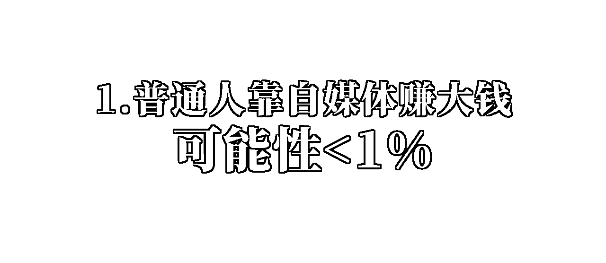
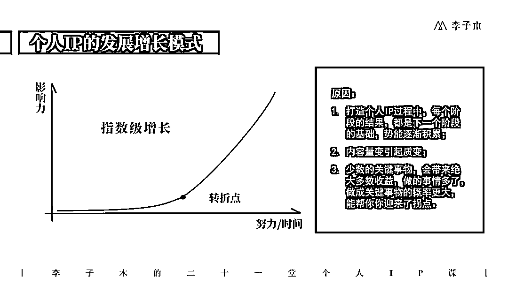
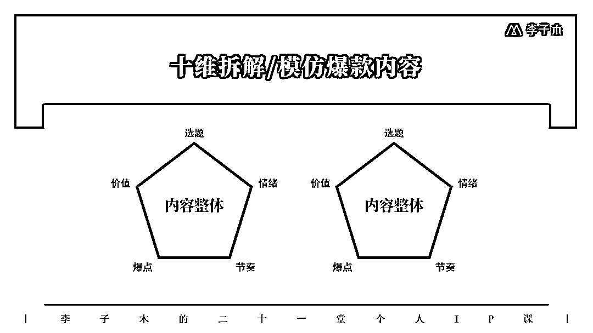

# 自媒体新手上路，先弄明白这三件事

大家好，我是李子木。做了十年品牌营销的广告人，也玩了五年自媒体。

从🧣那会儿起步，到后面陆续操盘过好几个账号。手上有过粉丝十五万却一直卡在变现的号，也有过几百粉丝却月入过万的号，现在还在冲刺六位数年收入。

最近有学员问我：刚入行该怎么学？说多不如写出来，下面这篇就给想入坑的朋友先泼点凉水。

# 关于自媒体的三个认知

1、赚小钱相对容易，赚到可稳定依托的生活费极难
用自媒体拿到几百到几千的零花，门槛并不高，出一俩爆款，或者把人群做得够聚焦，就能接到小额广告。但想靠它彻底脱离体制工作、获得可预期的持续收入，成功概率极低。你看到的那些财富自由案例，要么是极少数运气加资源的复合体，要么本质上只是内容自由。

2、没有无成本的爆红
市面上流传的“随手一发就火了”，背后多半是团队、资金在推，或者是多年积累的结果，或者是纯运气。运气不可复制，也很难延续。像📕上不少账号，发一个万赞后就再无声息。公司上班摸鱼还能领底薪，自媒体偷懒就可能颗粒无收。现阶段赛道越来越拥挤，必须比同行更投入、更懂专业，才能被看见。

3、自媒体是放大器，不是凭空创造的工具
它能把你有的东西放大，却做不到无中生有。变现逻辑没想清楚，哪怕数据好看一时，也走不长。

看完这三点还想做，那请先做好两件事。

# 入行前的两个前提

1、调正预期：先投入，再谈回报
先问自己能投入多少。职场人士是否愿意把大半业余时间挪出来？创业者能否拿出至少三个月、半数精力去研究并跑通流程，且持续输出？回报是投入的副产品。前半年大概率是负收益，例如日更三个月才拿到第一笔五百，坚持半年才有两三千的流水。但熬过那个临界点后，回报速度会明显加快，甚至出现指数式上升。关键在于能否撑到拐点。

2、想清楚自己的变现路径
先以终为始，再开工，避免瞎忙。
若你已有实体或知识产品，比如服饰店、餐饮店，可以做主理人IP，为自家门店导流带货；若你有情商课、经济课这类内容产品，可做知识IP做付费转化。
若没有自有产品，就先列出兴趣方向，再去匹配这八类变现手段：带货、广告、咨询、陪伴、卖课、付费出席、出版、做品牌。记住一个排序：自有产品变现 > 帮商家带货 > 接广告。体量相同，变现效率天差地别。

弄清前提后，可以按下面五个动作推进。

# 五步走

1、选定阵地
明确变现方式后，结合目标人群与产品客单价来选平台。
目前对新人相对友好的有三家：
📕，对素人友好，爆款率较高，且种草属性强，用户质量高，变现效率可观，2024年趋势可参考我之前的拆解；
视频号，处于成长期，对新人友好，且背靠🛰️庞大流量池，发展空间大；
👸号，曾被唱衰，如今推送机制在调整，又推出了图文笔记等新形态，有了新增长曲线，同样依托🛰️大盘，且私域导流能力极强，特别适合做知识IP的新人。

2、找对参考
自媒体是开卷考试，同行是最好老师，拆解是最好解法。
你想做的方向，大概率已被人做过，去看别人做了什么、怎么做到的、你能否做得更好。同时也要看失败案例：没赚到钱的、停更的，他们踩了什么坑？这能帮你判断可行性、学方法并提前规避风险。

3、做十个模仿稿
看懂还不够，要亲手拆解、模仿、内化。就像读书，有人考高分有人不及格，差别在消化程度。
建议从选题、标题、封面、结构、互动等十个维度拆解十个优质内容，内容掌控力会迅速提升。

4、尊重平台规则
了解你选择的平台社区规范与运营政策，比如📕的社区准则、视频号的运营要求。懂规则才能顺势而为。梁宁在《产品思维30讲》中讲过点线面体，我们个人是点，平台是面，顺着平台上升的势能走，才能产生1+1大于2的效果，这也是必须研究平台趋势的缘由。

5、持续复盘迭代
前四步做好后，就可以开始发布并运营。运营是长期战，不能蛮干。要看数据、看反馈，好的坏的都复盘再优化。好比从长沙开车去北京，必须出发，但每到一个路口都要判断选更优路线，才能更快更稳到达。

最后推荐四本入门读物

1、《运营之光》，三节课创始人黄有璨的运营经典，能建立大局观，思路对了执行才不偏。
2、《影响力》，社会心理学家罗伯特·B·西奥迪尼著，梳理了影响他人的七大原则，被《财富》列为商业必读书，杨天真也称后悔读晚。
3、《定位》，特劳特的传世之作，今天所有人说的垂直、细分赛道，都能在这本书里找到源头。
4、《低风险创业》，樊登著，讲降本增效与商业效率，适合想以个人身份创业、打造个人IP的人做认知补齐。

我是李子木，一个用自媒体改变自己、也希望用经验帮更多人改变现状的人。生活不易，别放弃努力。加油。