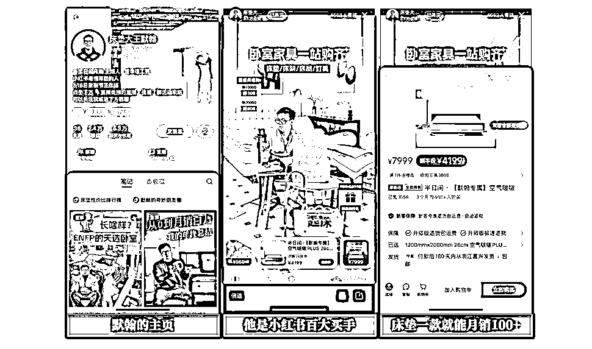
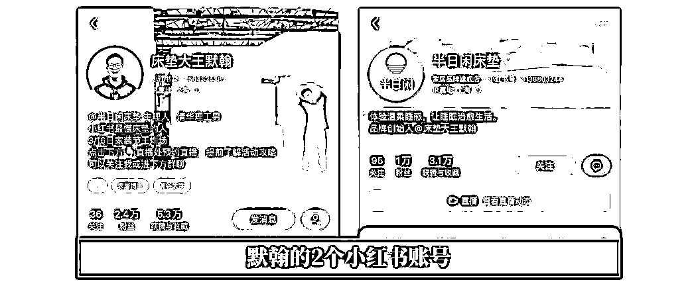
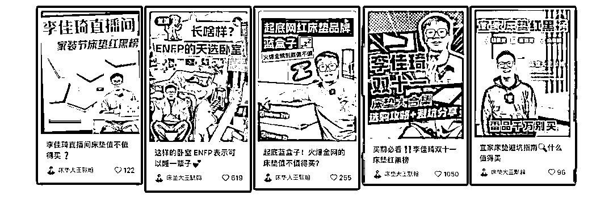
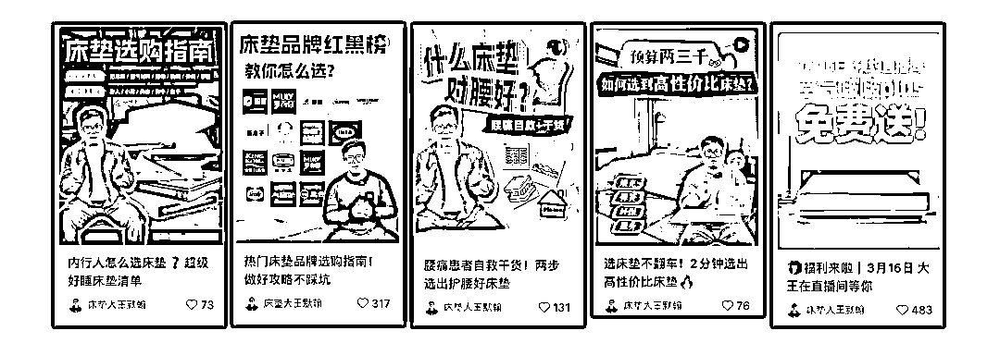

# 2.4万粉做自创品牌月销破百万：老实人做自媒体也能赢？

自媒体圈里，流传着两句看似合理的“铁律”。

一是老实人玩不转自媒体，二是粉丝体量决定收入天花板，20万粉天然比2万粉赚得多。

家居博主@床垫大王默翰用一年的时间，把这两条说法都推翻了。

粉丝只有2.4万的他，创立高端床垫品牌“半日闲”，从0起步做到月销百万，变现效率直接碾压同赛道不少20万粉的账号。

他到底怎么做到的？

下面我结合10年品牌营销、4年自媒体运营的经验，从可复制的学习角度，把默翰的成长路径拆开讲，给大家做个人IP、靠内容变现提供一些思路。

# 01、变现从洞察开始：先找到别人愿意买单的痛点

赚钱的逻辑很朴素：有人有需求，你提供价值，价值被认可，就得到回报。

个人IP做内容赚钱也是这个逻辑。

默翰捕捉到的痛点是：人们对睡眠的重视度在提升，但花钱买床垫却很容易踩坑。很多人不知道怎么选，或者花了高价买回来的床垫体验并不理想。

痛点一形成，就自然衍生出“怎么选好床垫”“怎么买到合适的床垫”的强需求。需求在，供给价值的机会就在。

# 02、变现要选品类：你是做选品能力，还是做产品

需求明确后，下一步要想清楚：你用什么去满足它。

围绕“选到好床垫”这个需求，至少有两条路：

1、做买手，用选品能力帮用户避坑。用户为你的专业眼光买单，品牌为你的带货力买单收佣金。这本质上卖的是你的筛选能力。
2、做品牌方，自建产品线直接给用户交付一件好用的床垫。用户为实物产品买单。

选哪条路，取决于当下的资源和能力。

默翰走的是第二条路，创立了高端床垫品牌“半日闲”。

能做这个选择，是因为他有过住范儿COO的创业履历，有一定的资源和经验去做实体品牌。

做品牌的优势很明显：对品质的掌控更强、可变现的路径更多、收入上限更高、后续延展也更宽。

而如果创业经验不足、资金有限，子木建议先从买手能力起步，用选品积累口碑和资源，再考虑做自己的产品。

无论选哪条路，核心一致：产品要打磨。质量过关才能产生复购和转介绍，而不是赚一波就跑路。

# 03、变现要铺渠道：对的人在对的平台看到对的内容

产品有了，就要让目标用户看到。

默翰把“半日闲”放在了小红书。

床垫单价在3000到10000元之间，淘宝竞争激烈，抖音消费力相对不足。小红书更适合生活方式种草，女性用户多，对品质要求高，付费能力也匹配。

在账号布局上，他做了双线操作：

一个是个人买手IP“床垫大王默翰”，一个是品牌号“半日闲”。

两个号分工明确：

* 买手号输出选品价值，以评测、避坑、选购知识为主，还会客观测评包括竞品在内的各品牌，强化中立感；
* 品牌号输出产品价值，不堆砌参数，而是呈现用好床垫后带来的舒适生活和放松氛围。

一个负责拉精准流量、建立信任，一个负责承载品牌形象、推动成交。

# 04、内容打法：默翰能高变现的细节

1、人设标签化，让信任加速

默翰反复给自己贴了三层标签，让用户一眼就能记住：

* 清华毕业进厂做床垫，反差吸睛又增加专业背书；
* 半日闲创始人，既为自家品牌背书，也提升身份感；
* 拆过几百张床垫的产品研发专家，用真实经历证明专业和较真。

标签叠加后，带货时的可信度自然上升。

2、守住赛道，只追强相关的热点

他从不乱追热点。所有选题都紧扣床垫：MBTI人格的卧室布置、双十一床垫怎么选、李佳琦直播间床垫红黑榜、宜家床垫如何选...

符合“当下热、大IP相关、品类强相关”三原则。不追求万赞爆款，但流量精准，专业形象不被稀释。

3、始终做用户真正需要的干货

除了少量个人故事，内容基本都是硬核干货和福利预告。

* 各类床垫红黑榜、李佳琦同款测评；
* 床垫选购指南；
* 省钱攻略；
* 直播福利预告。

这些都是有购床需求的人在真正在搜的内容。哪怕没有篇篇爆款，精准流量+高信任=转化自然发生。

4、内容形式持续试错

从图文到短视频，再到2-4分钟的中长视频，默翰一直在测试。不同形式带来不同转化效果，找到适合自己的节奏最重要。

5、靠“老实”建立长期信任

这是最关键也最难复制的一点：

* 做品牌时踏实做产品；
* 做买手时亲自花钱买回来拆对比；
* 推荐时推适合的，不推贵的；
* 做内容时讲干货，不讲噱头。

老实人涨粉可能慢，但信任一旦建立，用户愿意花一万块买一张床垫，还会带来朋友圈的转介绍。

总结一下，默翰2.4万粉就能实现自创品牌月销百万，并不是运气。

他先洞察到睡眠选购的痛点，再根据自身能力选择了做品牌并打磨产品，最后才去选小红书这个平台，并用买手IP建立专业信任，为品牌引流。

先找需求、再定产品、最后做渠道，三步缺一不可。只追流量不做前两步，最后只是无根之木。