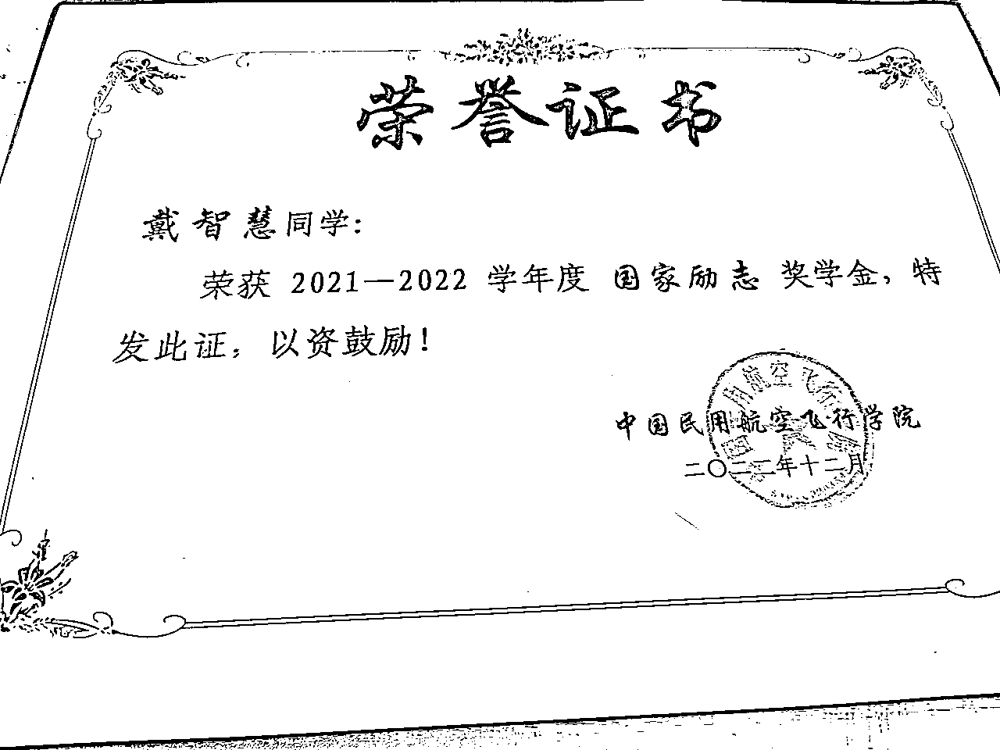
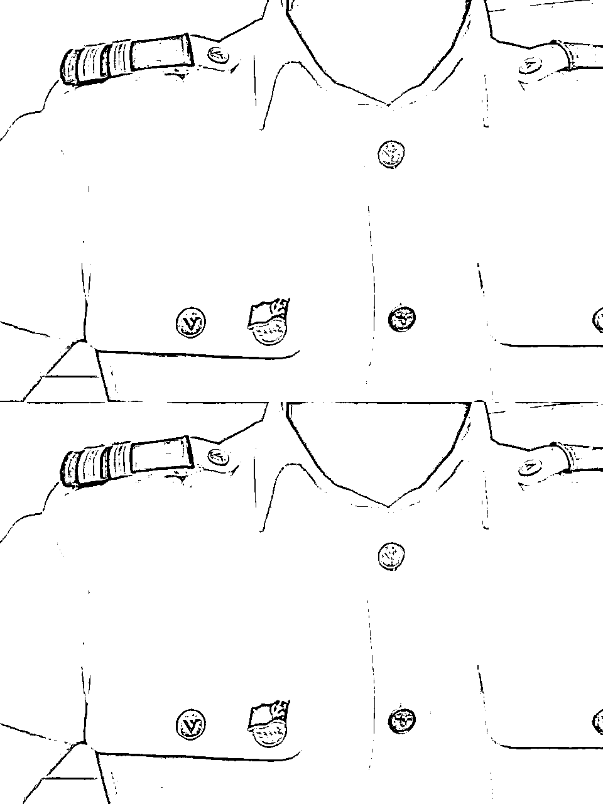
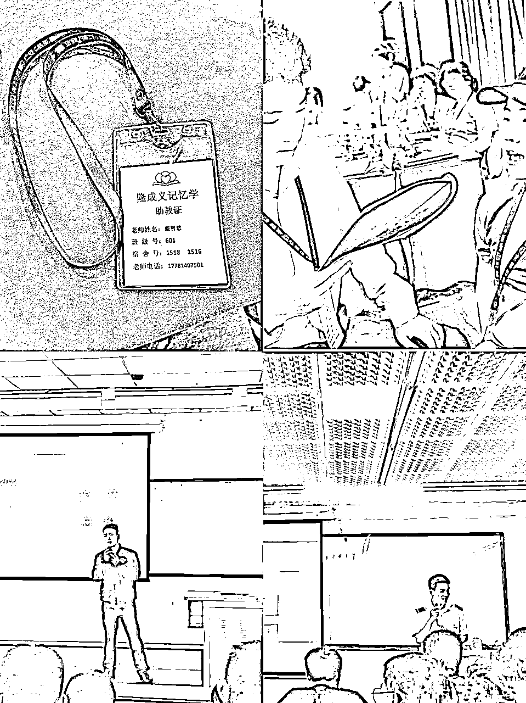
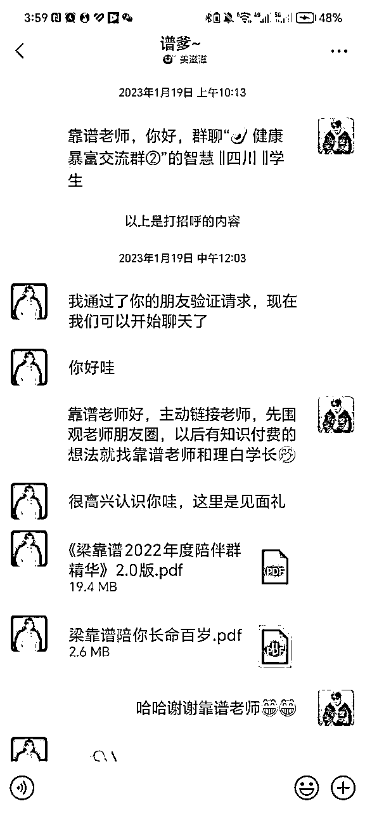
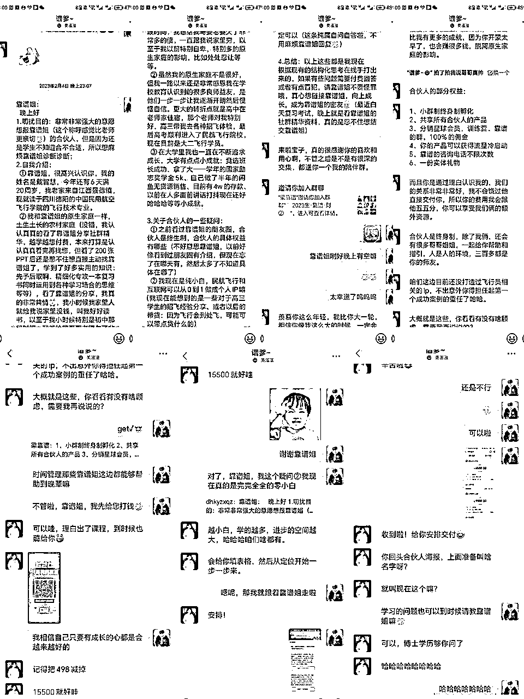
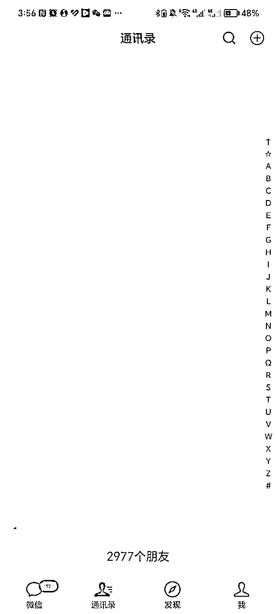
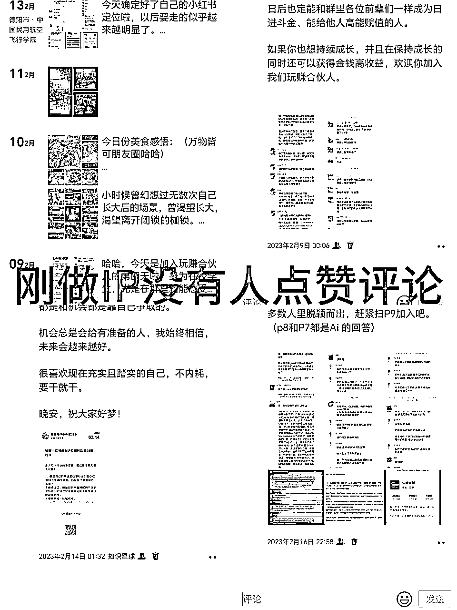
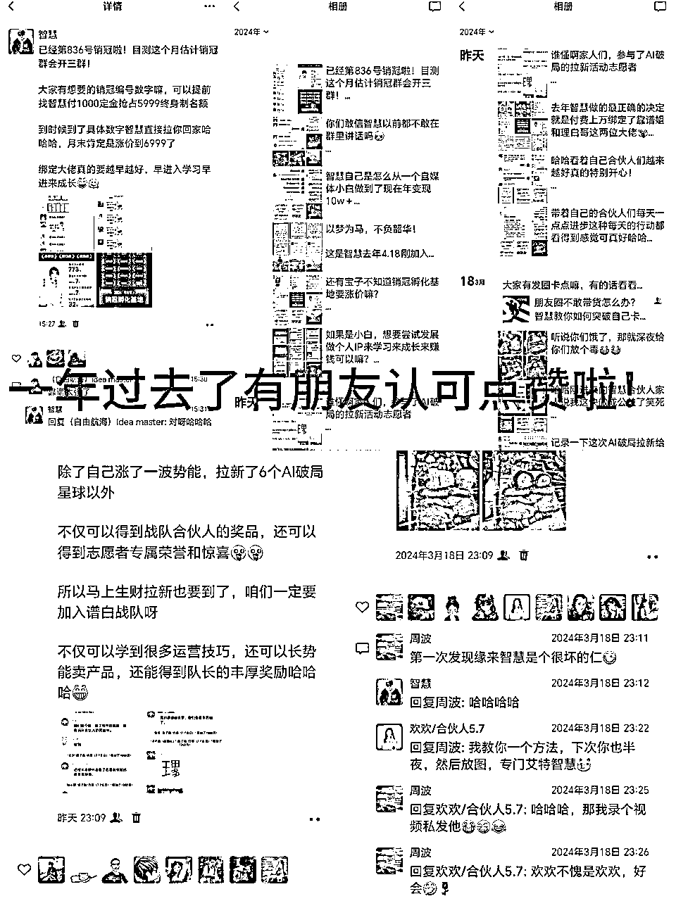
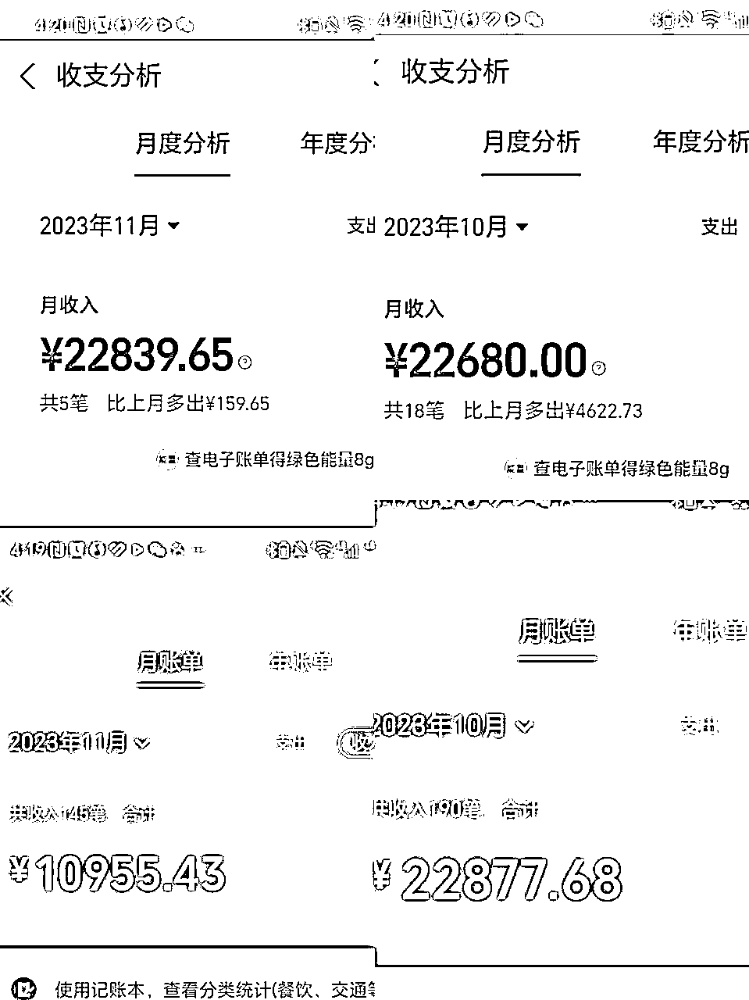
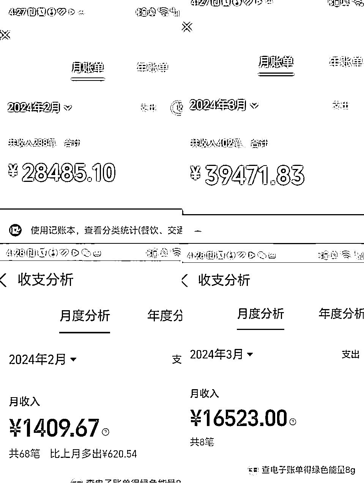

# 从“隐形人”到驾驶舱，再到自媒体年入十万，我是怎么翻盘的
作者：龙哥

嗨，我是龙哥。

先坦白一个事实，小时候的我特别怕事。出生在农村，家里经济拮据，父母常年吵架，我在那种环境里养成了极度自卑、内向的习惯，说话小声、怕被看见，像个透明人一样的长大。

转机来自校园。求学路上陆续遇到一批贵人老师，他们不断推着我往外走，让我相信自己能行。后来人生轨迹被彻底改写——我考上了飞行员。那份录取通知书对我来说就是一次改命，我把所有力气都砸进去了。

大学期间我开始主动改变：当班干部、成功入党、拿奖学金、做社会实践，同时也开始做内容。整整一年下来，账号的累计收益突破十万。

这笔钱的意义远不止数字。对我而言，它把根深蒂固的胆怯和唯唯诺诺给治好了。我至今记得第一次跟靠谱姐通话，整个人抖得不行，声音细得像蚊子。现在回头看，变化是真实的。我能独立在陪伴群里做分享，一天能稳定输出多条朋友圈，能跟合作伙伴开电话给到干货，也能跟朋友线下见面侃大山。这些事一年前的我根本不敢想。

能走到这里，要感谢白哥、芷蓝姐和靠谱姐三位前辈，是他们让我进入了靠谱姐的合伙人体系，也带我进入了龙哥盟。这次我把踩过的坑、摸索出的路径、以及如何做到年入十万的整体思路摊开讲，就是希望还在路上的人能少走弯路。

今天分享拆成两部分：

第一，为什么我会坚定做个人IP；
第二，过去一年我做对了哪些关键动作。

## 一、为什么会选择做自媒体IP

做内容之前，我在做闲鱼 iPad 电商。2022 年靠这个项目挣到人生第一笔五万元，对我来说是互联网上的第一桶金。

最深刻的记忆是 23 年寒假。那段时间我同时运营三家店铺做矩阵，有一天突然爆单。从早到晚都在处理消息、下单、发货，循环往复。那天利润超过一千八，一天成交八台设备，创下个人纪录。可当夜深人静的时候，我却感到强烈空虚。感觉自己像台只会赚钱的机器，没有成长感，也没有自由。

那一刻我决定要开辟第二条收入曲线。

当时我正待在理白哥的群里，无意间看到靠谱姐的分享，便主动去链接她。她给我发了一份她在 22 年陪伴群里的精华笔记。

我把那份笔记从头到尾研读，学到很多之前完全没接触过的东西，比如私域怎么搭建、朋友圈内容怎么设计。再了解才知道，靠谱姐和我一样来自普通的农村家庭，她的主业是医生，却通过做个人 IP 做到了年收入大几百万，身边还有一大批喜欢她的人。

这个认知在我心里种下了一颗种子：我也要成为像她那样的人，既能通过内容学习成长，又能赚钱，还能带动更多人一起进步。

大概半个月后，我直接给靠谱姐写了一封很长的文字说明，表达我想加入合伙人的意愿。聊几句后便打款，正式成为她的合伙人，随后也加入了龙哥盟。

去年二月是我正式入局内容创作的时间节点，也是我这笔十万收益的起点。

## 二、一年做到十万，我的关键做法

### 1、把朋友圈当作资产，把私域当作基本盘

进入赚钱后，靠谱姐反复强调的一点是：做IP，朋友圈就是门面，私域好友就是资产池。

从去年二月起，我就一边报班参加训练营，一边在星球发长文，同时持续增加🛰️好友。一年下来，在排除现实熟人后，真正有效的私域规模到了两千五百人左右，平均每天新增六个，基本达成了每天至少加五人的要求。

朋友圈的频率也在变化。过去我一天发一条都很吃力，现在连续输出七八条是常态，而且开始有人主动点赞评论，甚至称呼我为大佬。

前段是没有反馈的硬扛期。前七个月的总收入不到一万。真正的拐点，是后来一篇闲鱼项目的复盘文章在赚钱被置顶，带来大量精准好友，后续两个月的销售额冲到七万多。再到今年二月十七号至今的这一个月，销售额接近九万。

这十万，绝大多数都来自朋友圈的转化。我常遇到一种情况：新好友加进来，翻完朋友圈就直接转账，根本不需要长篇沟通。所以个人 IP 的底层逻辑很简单——朋友圈持续输出，私域持续积累。

### 2、照着老师的思路，把自己复制给别人

刚开始我并非全盘听话。靠谱姐建议我把手里的闲鱼 iPad 电商经验做成导师产品，一边做项目一边带学员开启知识付费。我当时觉得自己的案例不够亮眼，没底气招生，于是固执地只做分销别人的课程，前七个月只赚到一万出头。

后来被赚钱官方邀请去做项目拆解分享，才借机推出了自己的电商社群和一对一陪跑服务。以往沉淀的案例被重新打包，两个月做到七万多。

今年我又把带学员出成绩的完整流程再复制一遍，推出了自媒体陪伴群和十年合伙人产品。最初吸引我的就是靠谱姐能带着一群人一起赚钱成长，我也想做到同样的事。

能变现的核心就在于：把自己真实走通的路，提炼成可交付的方法，帮助别人重复走一遍。你能做到，别人也能跟着你做到。

另外一点是，必须听有结果的人的话。不要等撞墙了才回头，早听话就早见效。

### 3、对标跑通的模式，先照做再优化

这里的照做不是抄袭内容，而是借鉴已经验证的交付结构和商业闭环。

当时闲鱼的复盘贴带来流量后，我没有浪费，而是设计了两层产品：低客单一年社群 49.9 元，提供手册和答疑；高客单季度私教 1299 元，增加爆款文案素材、电话陪跑等服务。低客单降低决策门槛，高客单承接深度需求，转化率自然提升。这个思路是参考了很多做陪伴群和合伙人的前辈的打法。

再看我本月接近九万的构成。决定做私域运营教练后，我花两天调研同行的产品结构，发现一个成熟的百万级模型：用日更的陪伴群做蓄水，用阶梯式的合伙人做变现。

我照着这个逻辑搭建：陪伴群 49.9 元一年，每满五十人涨十元；合伙人从 199 元起，每期三人，每满三人涨两百。配合中高客单的销冠孵化基地、理白 IP 俱乐部、玩赚合伙人，形成低中高三层产品链。

用户先在低客单体验价值，建立信任，再升级到合伙人，最后补差价购买高客单，路径非常顺畅。

所以与其纠结市面上是不是千篇一律，不如先把跑通的模型照做。每个人的经历和表达方式本就不同，差异化是天然的。

### 4、绑定正确的人，待在正确的池子

这是最重要的杠杆。

如果当初没有遇到靠谱姐、芷蓝姐、理白哥，可能我还在原地自卑，没有人提醒我写朋友圈、积累私域，更不会有本月近九万的成绩。进入龙哥盟后，我从一个纯新手坚持了一年，拿到了十万级别的初步结果。

只要不退出牌桌，跟对导师、选对圈子，持续行动，结果就会到来。

以上就是我的完整复盘。感谢靠谱姐、理白哥、芷蓝姐，感谢龙哥盟这个平台。希望我的经历能给还在犹豫的朋友一点信心和方向。一起加油。