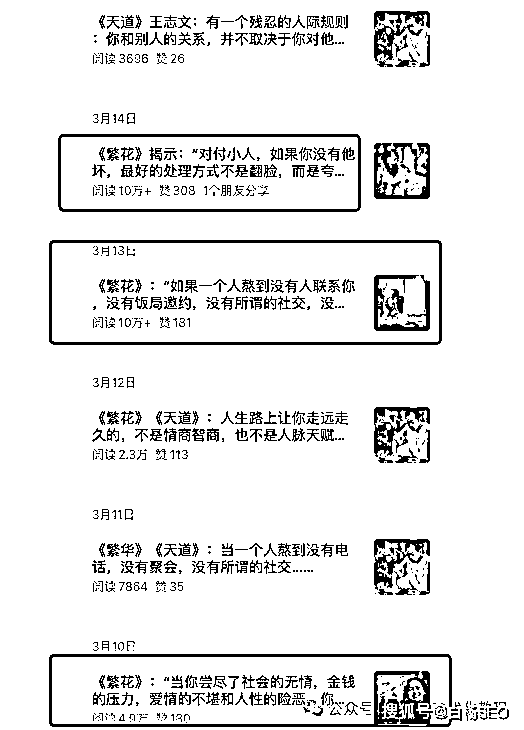
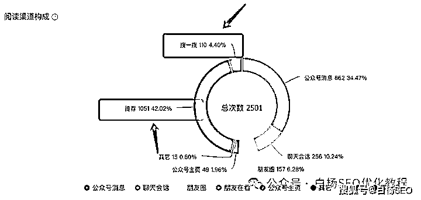
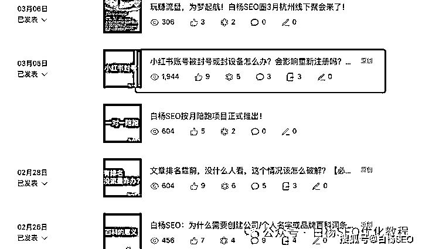
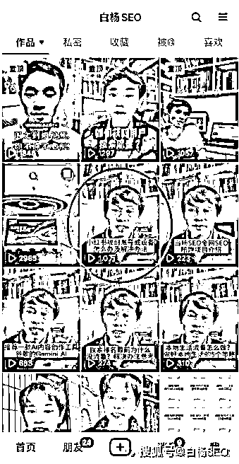
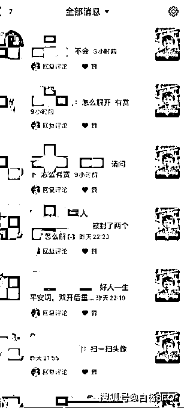
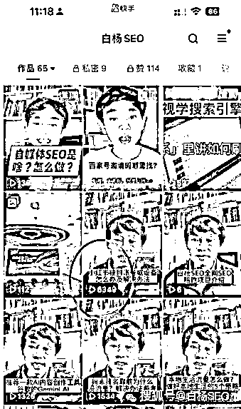
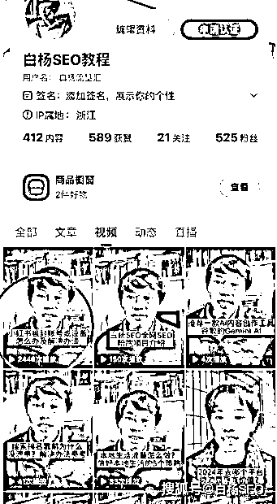
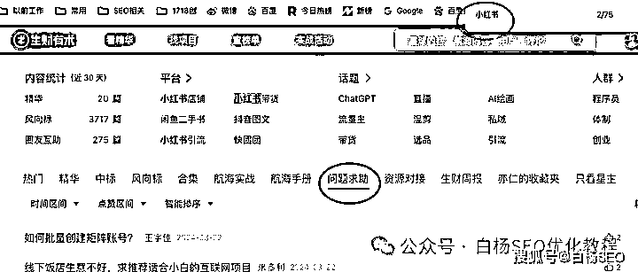
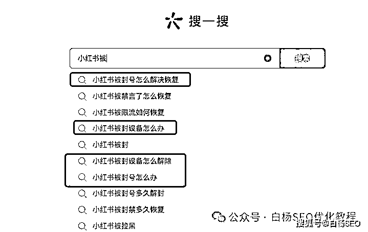
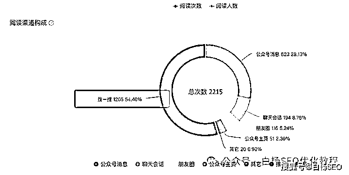

# 想吃到精准搜索和平台推流？先把用户痛点卡准

> 原文：[`www.yuque.com/for_lazy/thfiu8/yzvunfbdy1t3m1a0`](https://www.yuque.com/for_lazy/thfiu8/yzvunfbdy1t3m1a0)

## 找准痛点，是拿到自然搜索和推荐流量的关键

作者： 白杨 SEO

日期：2024-03-25

最近常有人问做微信公众号怎么冲流量。

有人主张标题要短平快，好抓住老粉眼球，快速上推荐。比如：

2024 一定要做小红书，马上！

第一批靠 XXX 的人已经赚翻了！

XXX，才是最牛逼的流量密码！

也有人坚持爆款标题必须拉长，信息点堆满，勾人点开。比如《繁花》热播时刷屏的那几篇十万加：

《繁花》看懂了婚姻，女人最值得嫁的男人不是身价过亿的宝总，也不是怕老婆的陶陶，而是这个吃 5 毛钱油墩子的他。

《繁花》揭示：“对付小人，如果你没有他坏，最好的处理方式不是翻脸，而是夸赞。你要知道，凡是小人多半虚心和嫉妒心都极强”

如果你也在经营微信图文，看到这两种截然不同的打法，是不是也在心里打鼓，到底哪种写法才靠谱？

如果你是我的老读者，或许还会好奇，我自己公号的标题时而短时而长，到底在搞什么？

先说结论，短标题、长标题都能用，而且都对。

区别在于场景。短标题更适合已经有一定粉丝基础的号，目标是让关注用户提高打开率。打开率高了，平台自然更愿意推。像我之前那篇《除了抖音，这 2 个平台流量必做！》，最终破了 2 万+ 阅读，说实话就是一次老粉召回式的自我推广。

长标题则多见于起号期、粉丝不多、主要靠冷启动推荐的账号。这一类号通常走日更路线，以前靠 AI 生成就能入池，现在要 AI 辅助加人工润色，甚至需要更专业的表达。周期一般在两周到一个月左右，这一波打法圈子里叫公众号爆文+流量主变现。

比如我之前发的《[一句话让我如履薄冰！说说百度搜索新变化与月之暗面 kimi Chat【白杨 SEO】](http://mp.weixin.qq.com/s?__biz=MzU2NTQzMzA4Nw==&mid=2247499454&idx=1&sn=5d8fb64f38fcd2da2991aae4c44c928c&chksm=fcb9792ecbcef038d7c2540f9a617e6bfdd623c209942cdff82dc8b536a425a8ba515a7f2e74&scene=21#wechat_redirect)】》，标题就很长。

再说第二个疑问，为什么我的标题风格会变来变去？因为我一直在测。一直自称实战派的我，测试就是家常便饭，这就对了。

前面的案例只是热身，接下来说重点。

**为什么锁定用户痛点就能同时撬动搜索流量和推荐流量？**

这里说的痛点，指的不是泛泛的兴趣，而是用户迫切想要解决、甚至愿意掏钱解决的问题。

我前面提到的短标题长标题，本质上都是在戳痛点。比如“第一批靠 XXX 已经赚翻了”，戳的是想快速变现找项目的焦虑；比如“对付小人要多夸赞”，戳的是人际关系里无计可施的烦恼。

痛点和流量是怎么挂钩的？简单说，人有问题就会找答案。有人会去搜，有人会刷到。搜，就是关键词搜索和 SEO 排名的机会；刷到，就是平台推荐的入池机会。只要你给出了解法，流量自然进来。

表现形式不拘一格。擅长图文就写图文，擅长短视频就拍视频。

怎么挖掘痛点？可以参考我之前的两篇思路：

[白杨 SEO：从百度一下到抖音搜索，挖掘用户需求流量新机会！](http://mp.weixin.qq.com/s?__biz=MzU2NTQzMzA4Nw==&mid=2247490668&idx=1&sn=99ae1e302fff65e313cda2d533795741&chksm=fcba9bfccbcd12ea40efae813aa91fed96c74527d66a6f9bf948cf54236c1c4286ad3ee8c4f5&scene=21#wechat_redirect)

[白杨 SEO：写文章或拍短视频时，如何找到自己用户的真正需求？](http://mp.weixin.qq.com/s?__biz=MzU2NTQzMzA4Nw==&mid=2247493275&idx=1&sn=14a6a3d1b8ce4e78b236370ee298906&chksm=fcb9610bcbcee81d53aa4c15fb41cbb72ecd906407f3790f18c4bd4d9f064da1e867396a9775&scene=21#wechat_redirect)

下面用一个亲测案例拆解。

不久前我写了篇《小红书账号被封号或封设备怎么办？会影响重新注册吗？小红书负面处理参考》，后来又把核心观点录成视频发到各大短视频平台，数据都不错，如图。

看数据，微信、抖音、快手、百家号的流量都比平时高，小红书也没截，但也有收益。

你可能会说，这点量拿出来说事？我的号只做 SEO 垂直流量，而且主打搜索。不是因为小红书是 2024 年的热点才有流量，我的核心词压根不是“小红书”，而是“小红书账号被封”“设备封禁”这类问题词。

**1、这个痛点是怎么被发现的？**

最初源于付费群里有人提问：小红书被封了，设备还能不能继续用。

像龙哥盟的网页版问题求助区，我经常会去逛，看看是不是共性需求。

结果发现大量人在问账号解封、设备封禁怎么办，基本可以判定为普遍痛点。

没有社群资源也没关系，直接去各平台搜下拉框，输入相关业务词，看大家都在问什么，重复率高的问题就是痛点。

**2、痛点怎么被解决的？**

最好是自己有实操经验。其次可以访谈身边有经验的人。

我个人没做过小红书批量号，所以没被封过。恰好我认识一个做小红书 SEO 私教的同学，他有处理经验，我就去请教。再结合赚钱社区里其他人的回答做交叉验证，内容就完整了。

我当时做这个内容不是为了卖解封服务，而是用来做流量测试和吸引精准关注，所以变现路径并不直观。

**3、搜索和推荐怎么一起做？**

写标题前，我先在搜一搜里看别人是怎么写的，然后结合我对搜一搜 SEO 的理解，选了关键词做布局，如图。

从结果看，这篇文章搜一搜的流量占比超过 50%，搜索为主。

那为什么还要做推荐？因为微信里需要的人有，别的平台也需要。而且抖音流量大，小红书自己也在做内容。我就把文章要点口述成视频发到抖音、快手，数据也起来了。

短视频要上推荐，通常需要热门 BGM、合适标签、以及互动引导，我这条都做了。

当然我核心还是搜索优先。哪怕现在是买量和推荐为王的时代，搜索需求依然稳定存在，且长期有效。

这个案例本质是小红书运营的账号封禁问题，换成美容培训、产品售卖，痛点挖掘和打法的逻辑完全通用。

**作者介绍：**

白杨 SEO，专注 SEO 十年，全网 SEO 流量实战派，对互联网精准流量有深入研究。全网同名：白杨 SEO。

* * *

评论区：

暂无评论

* * *