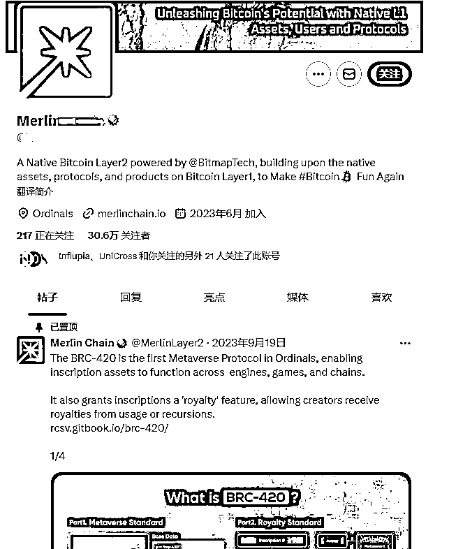
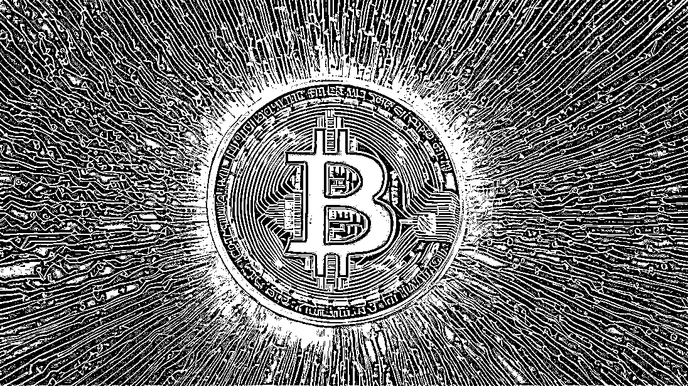
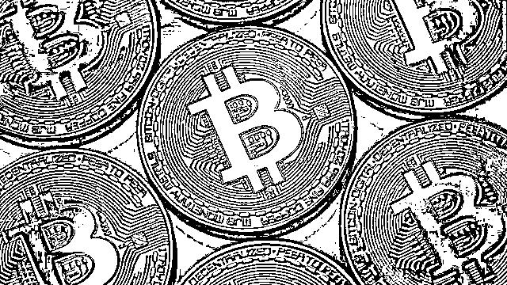
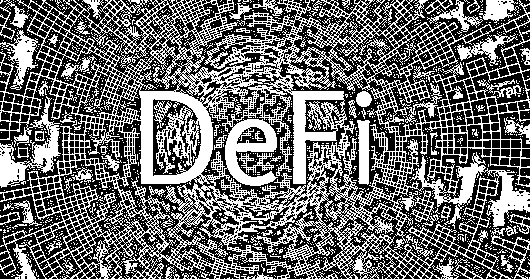
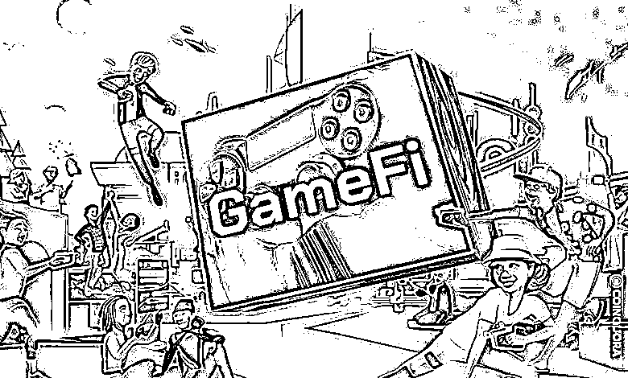
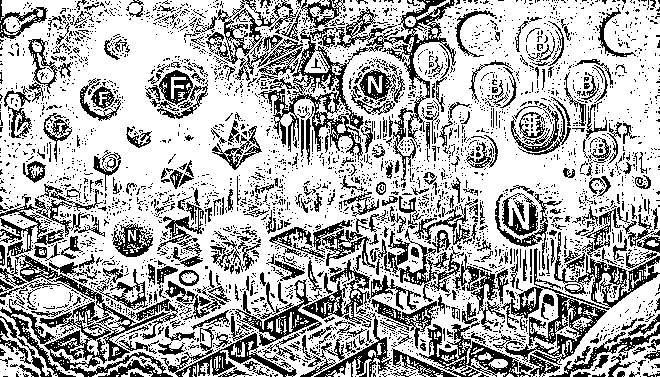

# 给新手看的 Web3变现实操笔记

> 来源：[https://uklrrqhpyq.feishu.cn/docx/K9KhdcFpQoqcDcxcrhbc7hXnnId](https://uklrrqhpyq.feishu.cn/docx/K9KhdcFpQoqcDcxcrhbc7hXnnId)

大家好，我是乔橘

玩 Web3 已经好几年，手里也带过一个小社区，这些年基本都是跟着风口跑。

最近在赚钱翻看 Web3 相关帖子，发现对纯新手来说，读完还是云里雾里。

满篇都是专业名词，看起来费劲。趁着这个机会，我就把市面上比较火的几个方向，用最通俗的话给赚钱的朋友们盘一盘。

很多人对 Web3 只有模糊的概念，一到怎么赚钱就卡壳了。

今天我就用大白话，把 Web3 到底能怎么赚钱讲清楚。

新手会发现，抖音、小红书这些主流平台，关于 Web3 尤其是比特币的深度内容基本搜不到，有也是只讲概念。国内对去中心化相关内容比较敏感，能见到的信息自然有限。

Web3 并不是一个人闷头就能学会的东西。

我当初从零开始跟着大佬全职学，整整学了三个月，才算摸清门道，投入程度跟考研差不多。

基本上所有靠谱的项目都在推特上更新，中文项目方少得可怜，就像这样

每个币背后的底层逻辑都不一样，概念学起来很难，就像让体育老师去学写代码。

正如巴菲特说的，投资一定要理性，搞不懂就别碰。

国内玩 Web3 的用户占总人口比例不到 1%，美国则能达到 20% 左右，所以国内的主流渠道很难看到一手信息。

Web3 的最新动态基本都在推特和 Discord，这两个地方都需要科学上网。

2024 年又逢四年一度的比特币减半，市场上比特币暴涨的消息一直不断。

物以稀为贵，产量减少自然价格有支撑，再加上牛市周期，宏观环境对 Web3 也偏利好。

* * *

### 一、Web3 到底是什么

从 Web1 到 Web2 再到 Web3，核心始终围绕着“去中心化”在演进。

Web1.0：只能看信息，只读
Web2.0：可以创作内容，只读+写入
Web3.0：内容归自己所有，只读+写入+拥有

Web3 现在已经衍生出很多细分赛道，比如

* 元宇宙 虚拟现实+AR+游戏
* 加密货币 比特币等
* GameFi 可玩可赚的游戏
* NFT 数字藏品
* DeFi 去中心化理财
* 区块链生态 各类币背后的价值生态 等等

简单概括就是 去中心化+具体赛道 = Web3

* * *

### 二、去中心化是什么意思

假设赚钱是中心化平台，管理员和龙哥就能直接删掉我的笔记。

如果赚钱是去中心化平台，我发布的内容，除了我自己，没人能删改。

这就是去中心化的核心，完全私有。

有人会问，没有监管怎么运行？这里就用到了区块链技术。

记账
假设赚钱就是一条区块链网络，里面有 5 万 6 千个用户
用户 A 给用户 B 转了 100 元
其他所有用户都会收到这条记录：用户 A 给用户 B 转了 100 元

链上每一笔交易都是公开透明的，A 和 B 的转账所有人都能看到。信息人人都有备份，真实性自然就被共同验证。

运行
没有中心监管，区块链靠什么运转？
简单说就是矿工机制。

大家都知道比特币矿工，他们用算力为网络提供安全保障，获得区块奖励，也就是比特币。
矿工出算力 网络正常运行 矿工拿奖励，这是一个正向循环。

* * *

# Web3 六大热门赛道拆解

* 元宇宙
* 加密货币
* GameFi
* NFT
* DeFi
* 区块链生态

### 1、加密货币是什么

大家常说的比特币，其实只是其中一种币。市场上还有 ETH 以太坊、SOL 索拉纳、BTC 比特币等上千种。

这些币之间可以自由兑换，只需要支付手续费。

比特币是目前市值最高的加密货币，一枚价格已经冲到 50 万人民币左右。

比特币总量 2100 万枚

1 人民币 = 10 角 = 10 个 1 角口香糖
1 个比特币 = 1 亿聪 = 1 亿串代码

比特币不必整枚买，可以拆成 1 亿份购买，所以大家常说的炒币买比特币就是这个逻辑。

加密货币像黄金一样会涨会跌，不同的是黄金是实物，加密货币是一串独一无二的代码。

怎么赚钱？很简单，低买高卖。

比如 24 年 1 月比特币才 2-3 万美金，两个月就涨到近 7 万美金，提前布局的收益很可观。

币圈一天当股市一年。股市是 T+1，币圈秒级买卖。股市年化 10% 就不错了，币圈很多币每天涨跌 10% 很正常，涨跌 100%-500% 的波动也时常出现。

* * *

### 2、铭文

铭文是近两年才火的概念。

1 枚比特币 = 1 亿聪
在聪的单位上刻一个字符，就叫铭文。

打个比方，我有 10 粒米，其中 1 粒刻了专属符号，这粒米就和其他不同，这就是铭文的稀缺逻辑。

聪被赋予编号后就有了独特性，随着生态发酵，价格也会涨跌。

玩法就是低价入手铭文，高价卖出。

* * *

### 3、NFT 数字藏品

NFT 简单理解就是 一张图片+一串代码。

现在的 NFT 基本都和品牌、艺术家联名发行，比如

无聊猿近几年炒得最火，最高一张图卖到几百万美元。

背后是独一无二的代码+艺术家背书+代币生态加持，当然投机情绪也很大。

NFT 主要用来收藏、抢白名单、倒卖赚差价。

艺术家名气、市场热度、新闻事件都会影响价格。比如艺术家获奖、明星买单，相关 NFT 往往会大涨。

发售初期通常会大量放白名单，条件可能是持有过往作品等。

* * *

### 4、DeFi 去中心化金融

去中心化金融 公开透明，无中心控制
中心化金融 由政府或机构调控

比如政府募集 100 亿捐款，没人知道实际到账和支出多少。
如果用 DeFi，每笔交易都会上链公开可查。

去中心化下，收款方付款方都无法篡改交易信息。

DeFi 也催生了很多理财产品，比如活期年化收益。传统银行利息 0.4% 左右，牛市时 DeFi 年化能到 40% 甚至更高。

但 DeFi 也是匿名的，容易被用于洗钱，所以国内对这块很谨慎。

* * *

### 5、GameFi 游戏赚钱

能赚钱的游戏。每个游戏都会发代币，玩家打怪升级获得代币，代币可在交易所交易。随着游戏热度上升，代币也会涨。

看好项目可以提前在交易所布局，游戏赛道目前还未真正爆发。

### 6、区块链生态

每个币都有自己的生态。比特币的生态包括用比特币买的 NFT、参与的活动等。

不同时期生态的发力点不同，新技术、新玩法、新叙事都会推动生态价值。长期持有优质生态资产是常见策略。

### 7、元宇宙

方向是虚拟现实+AR+虚拟游戏。

21 年被称作元宇宙元年，概念极度火爆。

虚拟现实就是在网络上建一个真实世界。苹果 Vision Pro 就是 AR 的代表产品，戴上头显就能看到虚实融合的场景。

一句话总结元宇宙：在虚拟世界复刻真实世界，用 AR 实现交互，让它像游戏一样好玩。

当年爆火的原因是：新概念+虚拟现实 AR+虚拟资产。

近三年热度回落主要是技术不成熟，大家只看到概念看不到落地。21-24 年从 VR 到 AR 迭代，现在苹果才推出相对成熟的产品，未来还有很长的路。

技术成熟后，元宇宙大概率会再次爆发，Web3 也会是重要载体。

* * *

# 交易所怎么选

交易所是进入 Web3 的最简单入口，可以买到加密货币和生态资产。

类比电商，交易所像二级市场的淘宝，一级市场像 1688，对新手不友好。

目前主流推荐两家：币安和欧易

币安：全球最大，上币多，但 Web3 功能相对不完善，适合普通交易用户
欧易：上币量不如币安，Web3 生态更完善，适合玩生态的用户

* * *

# Web3 钱包是什么

新手常听到的就是钱包。

最常见的助记词钱包由 12-24 个单词组成，没有账号没有密码。
这 12 个词就是你的资产凭证，泄露就意味着资产丢失，且无法找回。

钱包不实名、不绑定手机号、没有身份信息。

钱包用来存放 NFT、比特币、加密货币、铭文等所有数字资产。

* * *

# 空投是什么

空投就是项目方发新币、新 NFT、新代币时做的预热活动，会送出白名单或免费额度，类似抽奖。

拿到空投可以直接卖出，也可以长期持有等增值。

* * *

# 撸毛是什么

就是薅羊毛，但 Web3 的羊毛价值很高。国内拉新几块十几块，Web3 的撸毛动辄百元千元起步，遇到好项目一波几十万的也不少见。

常见玩法：
游戏项目方上线，打怪升级获得代币、NFT，可在市场上交易
NFT 项目方发新作，设置关注、转发、持有旧作等条件免费空投
预热项目做签到、拉新等活动给予奖励

* * *

### Web 知识库

如果你对以上内容感兴趣，可以系统学习 Web3 全书

* * *

Web3 黑话术语

* * *

以上内容仅为知识分享，不构成投资建议，请理性判断。

我是乔橘，有问题欢迎加微信：sup7772