再过22天，我加入赚钱就整整一年了。回想当初，我只是个不起眼的小透明，过去的经历不值一提。当时给自己定了个目标：在赚钱做一场竖屏思维导图分享。说实话，心里直打鼓，我问自己行不行？有个微弱的声音说“能”。至于怎么做，没人告诉我，那就交给时间吧。

前三个月一直在迷茫中摸索，直到共读《龙哥益语》，我才找到了竖屏思维导图的方向。如今，我已经带队做过4次导图、担任4期志愿者、2次思维导图特训教练，和团队一起完成了400+张导图。下面聊聊这一年我都经历了什么。

## 加入之前

其实很早我就知道赚钱，还参加过3天体验营，但一直没付费。因为我觉得自己没资源、没背景，能力也不够，进来能有什么用？身边没人能解答，只有公众号和其他营销号的信息，始终打动不了我。那会儿我也在折腾副业，小红书、抖音、视频号都试过，没做起来。看到别人轻松赚钱，进圈之后才明白，背后全是汗水。三天的体验卡信息量很大，但我没冲动付费，这点我还挺理性的。后来一直若即若离地关注着，看着别人晒收益，我当然心动，但也知道自己几斤几两。进来以后尝试过才发现，真没那么容易。当时对大佬还有畏惧，不敢靠近；现在我会借导图项目去和大佬合作，希望提供一点价值。

## 2023年4月18日，正式入圈

那天看到好友“简单”朋友圈的赚钱拉新海报，被周边福利吸引，果断付费。后来才知道自己进了靠谱大佬的战队，还进了陪伴群。战队手把手教新人怎么用资源、怎么找方向、怎么拿福利，就像小学生一样，跟着8天入门指引一步步学。

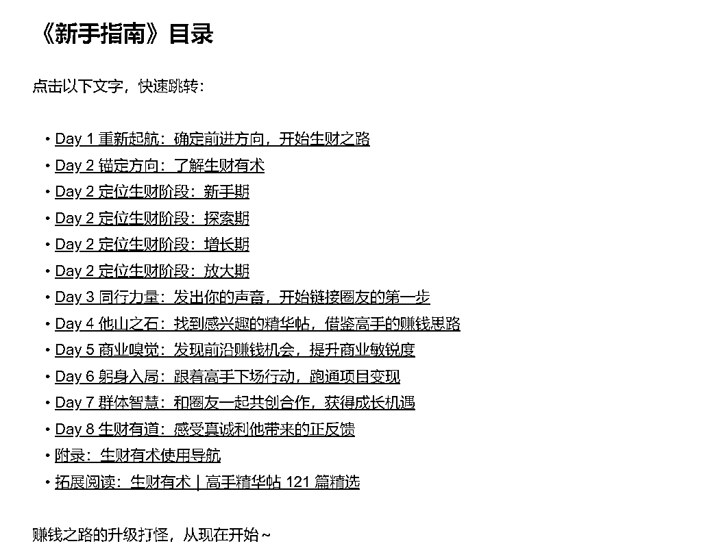

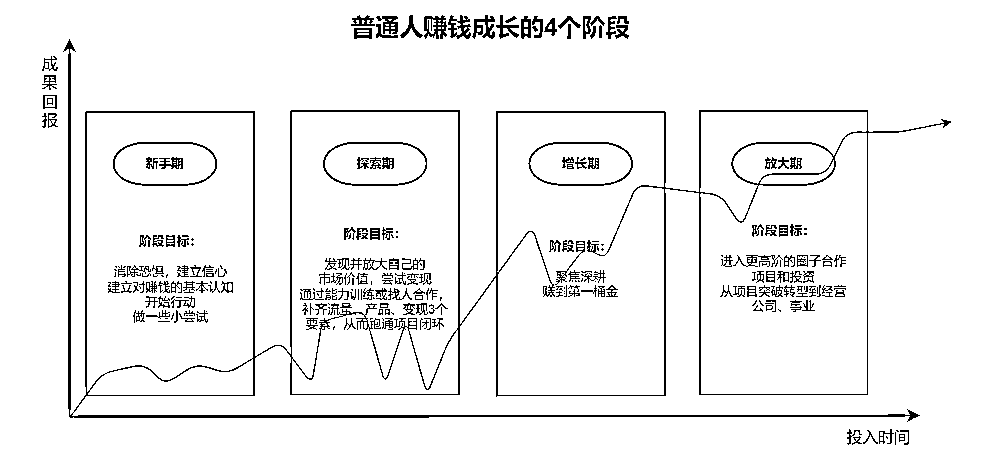

（新圈友建议多看几遍，老圈友也可以温故知新。）

看完还是有点懵，毕竟认知有限。那就多围观、多靠近优秀的人吧。我先琢磨自己的优势，以为读过几本书、写过些文字就能发好帖，结果没那么简单。加入后认真写了两篇帖子，靠谱给了我好多建议。我和大多数新人一样，在探索期留下了小目标。现在翻出来看，当时正好读到涛哥说“做好工具人”，没想到涛哥还给我的目标点了赞，这一下动力就来了。其实那时候我并不知道自己能做什么“工具人”，虽然目标里写着要分享竖屏思维导图。

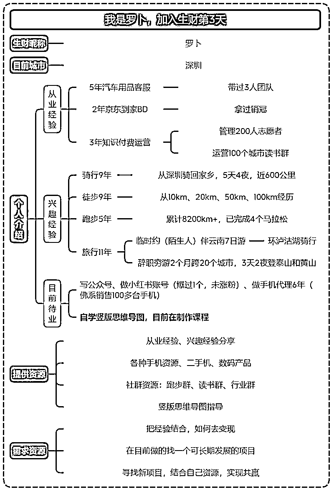

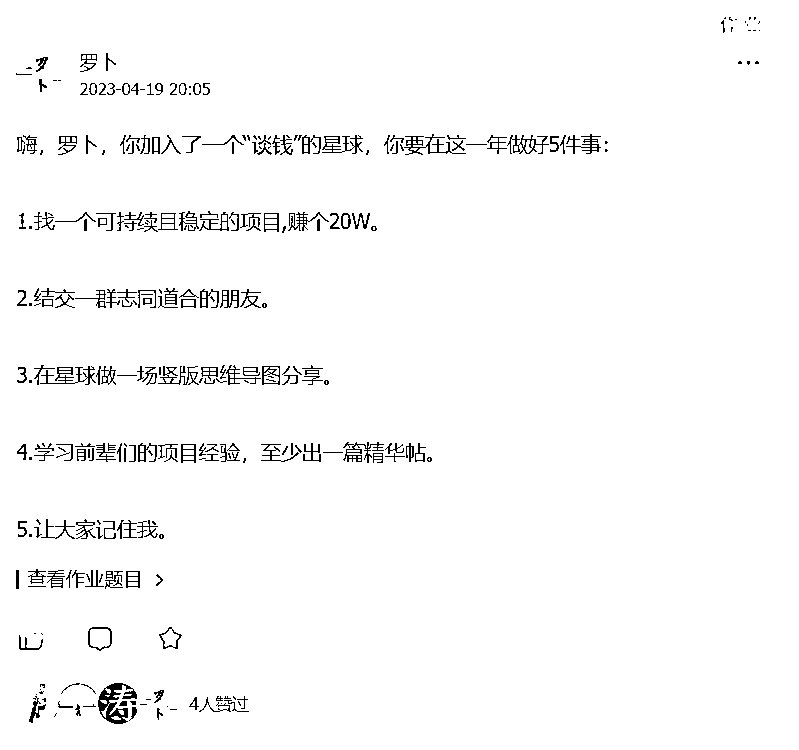

写完我就后悔了——那会儿我的导图水平，满分十分只能得四分，顶多算“会做”。

## 勇敢写下第一篇帖

即使如此，我也没急着分享导图。我觉得这技能很多人都会，只是竖屏版更适合手机阅读和传播。既然定了目标，就往写帖方向冲。我知道自己不如实战大佬，但有些信息可能存在信息差。于是我把微信小技巧整理成“100个技巧”，很多可能已迭代，但有的现在还能用。花了几天，迈出了第一步，先完成再完美。

后来还写了手机/二手机副业的那篇。那是我的老本行，通过华强北资源佛系卖机，有人问就答，有人买就发货，后来熟了才让档口代发。那篇全是真实经历，也让我对副业有了更清楚的认识。记住一句话：“你不发声，就不会发生。”你可以用文字、语音、视频，任意形式。

## 四期志愿者

第五期小红书运营、第八期朋友圈运营、第十二期自由职业、第三期小红书达人——我都报了第一志愿，从没被调剂过。建议每个圈友至少当一次志愿者，很值。以前我也做过公益读书会志愿者，但赚钱志愿者让我犹豫了很久：一个新人去当志愿者，能对船员负责吗？会不会被问倒？会不会遇到大佬？心里全是怕。但既然选了，就从角色开始。到2024年3月，我连续做了4期，不敢说最好，但问心无愧，还帮大约100位船员成功上岸。

## 初试竖屏导图

5月航海时，我只做了2张导图。

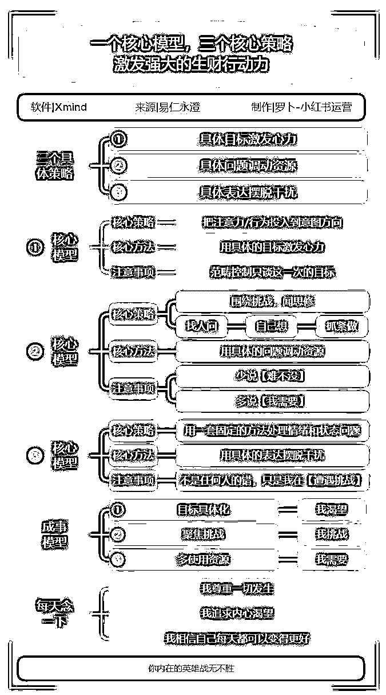

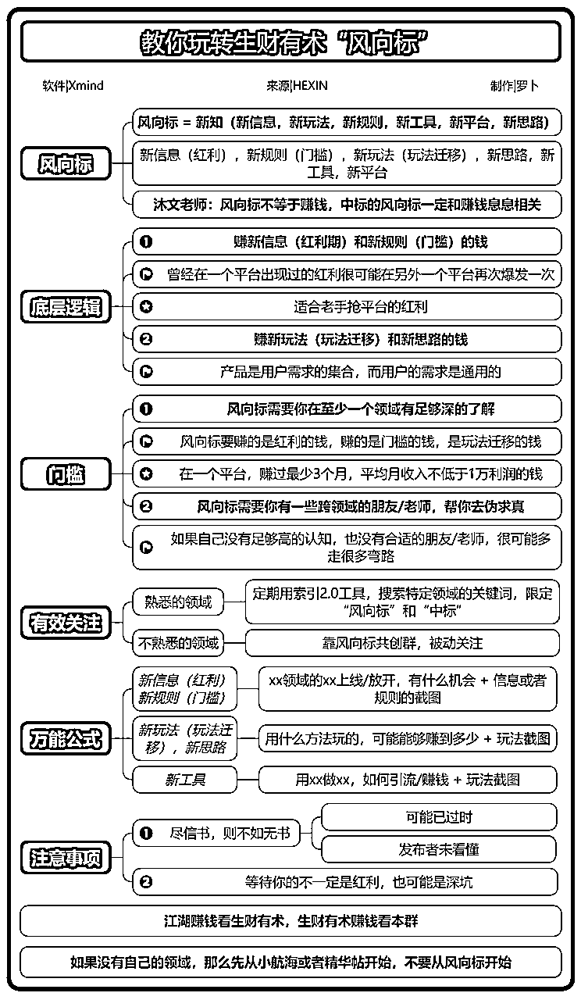

没想到一张导图让我链接到分享教练，在航海里掀起一点小水花，还被圈友点赞好评。这期航海很快结束，我依旧觉得自己是小透明，没拿到什么结果。但我不气馁，继续保持着热情和热爱，接着出发。

## 认识胖大魔

胖大魔是我命里的贵人。没有他的支持和鼓励，就没有我的导图分享，也不会有后来的思维导图特训航海，更不会连续开两期。5月当志愿者时，我只在点赞榜上见过他，觉得是高不可攀的大佬，没敢加微信。后来湖南圈友同城社群出现，交集多了：我们是老乡，他待过深圳、做过汽车行业、爱运动，距离一下子拉近了。他邀请我参加《龙哥益语》共读。研学社最早也是大魔、老侃、云舒、超强哥、鞭炮、费曼同学、段子手、笑笑、小竹、九歌、挖坑的萝卜和我一起搭建的。因为共读，我们聚在一起，他们成了我导图路上的亦师亦友。我的第一批导图团队就来自这里，第一次航海制作也是大家把我推到前面。胖大魔看我连续分享好多天，就商量：8月航海要不要一起玩？我们像草台班子，第一次线上组织竟然很成功，300多人参与，这意味着有300多人看过我做的导图。

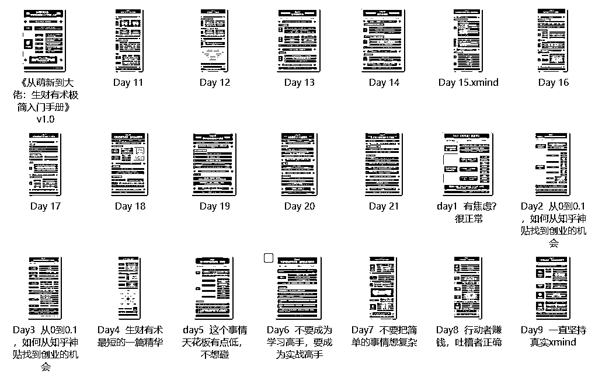

## 航海导图的第一次

决定做8月航海导图后，我们分了工：我负责培训、模板、选航海，每人至少做一个，我独自完成4个——那期我还是志愿者。做模板时，我在旧模板和新升级之间犹豫，最后选了上面这款，配色也大胆向赚钱logo靠拢。那时我的导图能力从4分涨到6分，可以教别人了。大家都有基础，培训只花了2小时。我们尽量不占大家工作生活时间，每天至少出一张图，发到群里，再各自分享到航海社群和志愿者社群。很多人帮忙转发，于是8月出现了“一群人分享同一套导图”的画面。先做、再审核、有问题随时改，几天后大家就熟练了。

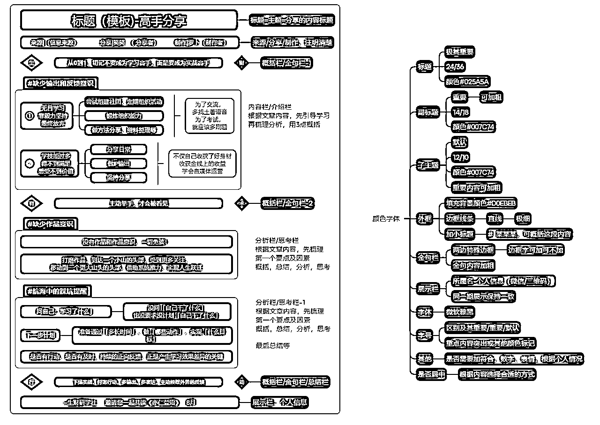

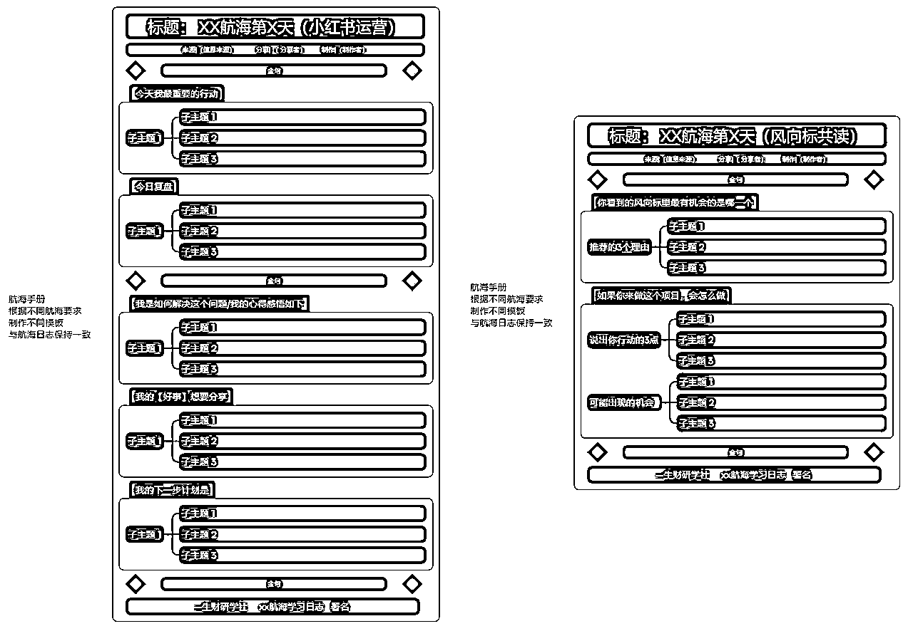

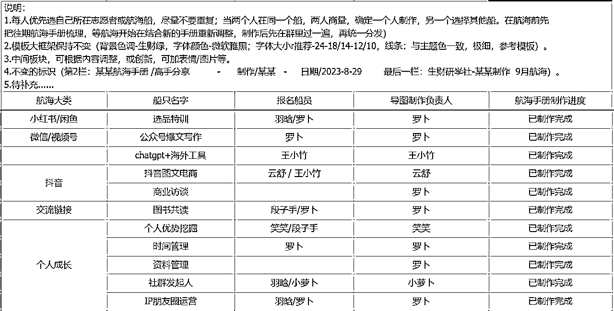

这里有个原则：因为我们都是小透明，没成绩，所以导图上不留任何联系方式或二维码；也不要主动批量加人。我们希望靠内容吸引感兴趣的人，来研学社一起学习。

## 一个人的10月续航

赚钱有续航传统，但9月结束后，能续的只剩朋友圈IP运营。我问伙伴们还做不做导图，结果只有我留下。那就一个人继续吧。再坚持21天，总能上岸。每天有优秀圈友分享，我也报了分享，稿子改了三次还是不合格，我就放弃了，那不是我擅长的。但我每天完成打卡，把导图发进社群，偶尔同步赚钱朋友圈。后来这篇复盘详细记录了那段经历，还附了团队所有导图和制作教程。

## 遇见贵人陈雪

陈雪老师做播客《搞钱女孩》。我为了了解播客，读了她的文章，顺手做了份导图。

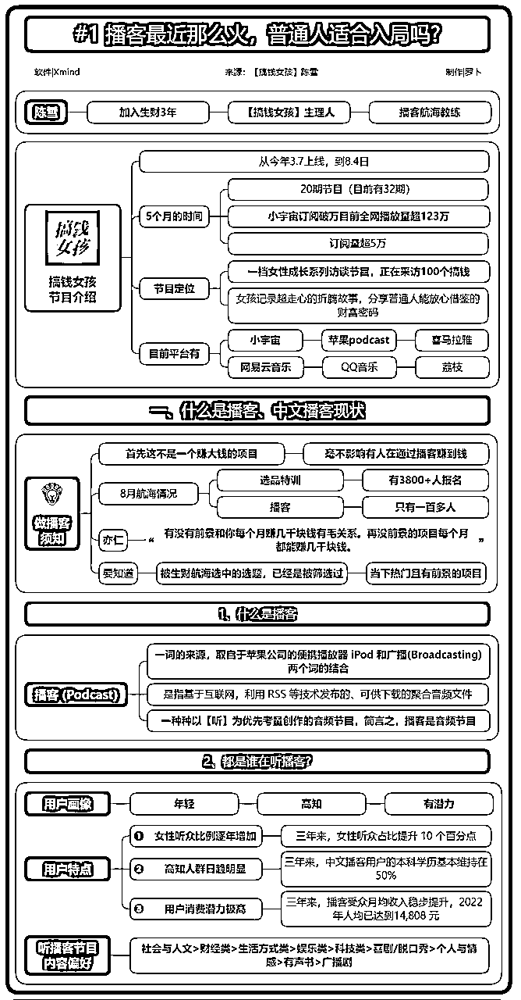

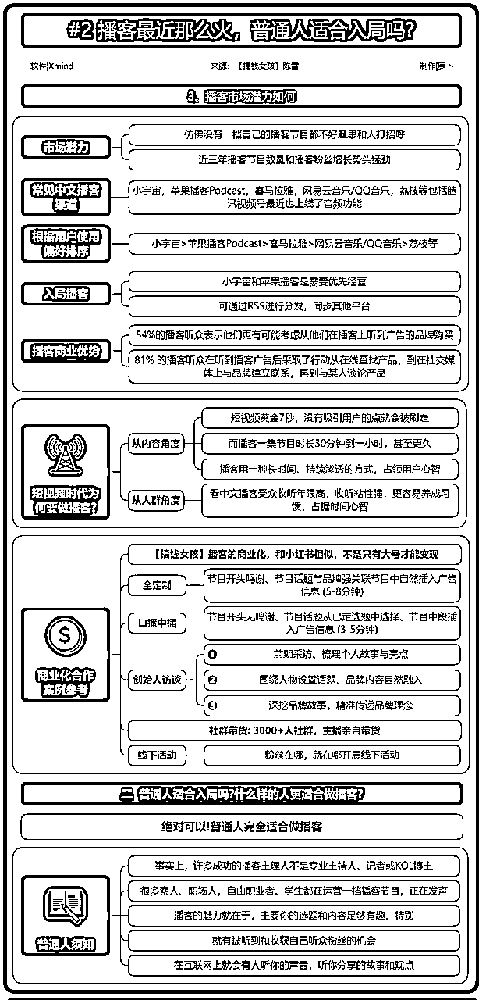

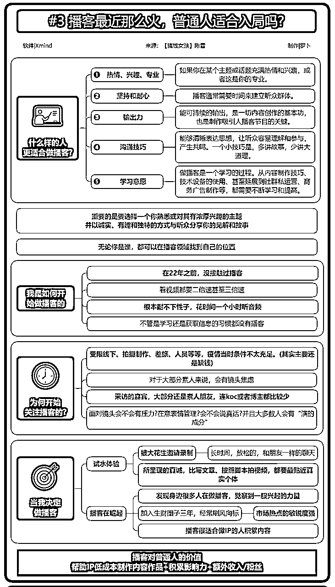

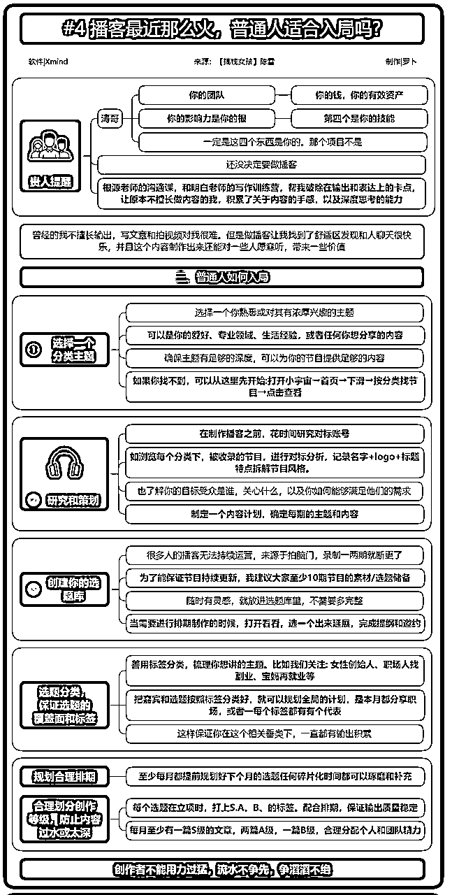

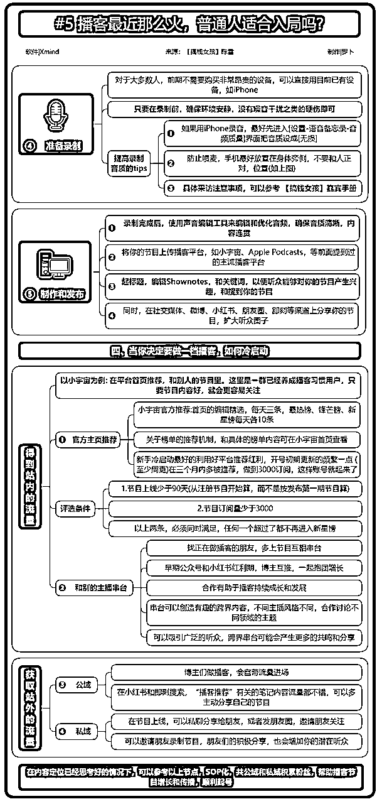

后来才知道，有个听友做导图不够美观，她看了我的复盘，先在评论区留言，我没在意。有一天她在另一个共同社群找到了我——这也验证了“不留微信”是对的，留了可能就没有这个故事了。她直接让我做课程，我本来录过7天入门课，沟通后决定重录。等我录制时，她已招完第一期学员，50多人。第一次合作我报价低了一半，她说太便宜了，你的课值得更高价。接着我们又合作了21天进阶课，我的导图变现之路就这么打开了。我用这笔钱买了她和明白老师、根源老师的俱乐部。陈雪老师一直在帮我传播好内容，我只能继续做更优质的播客导图来回报她。

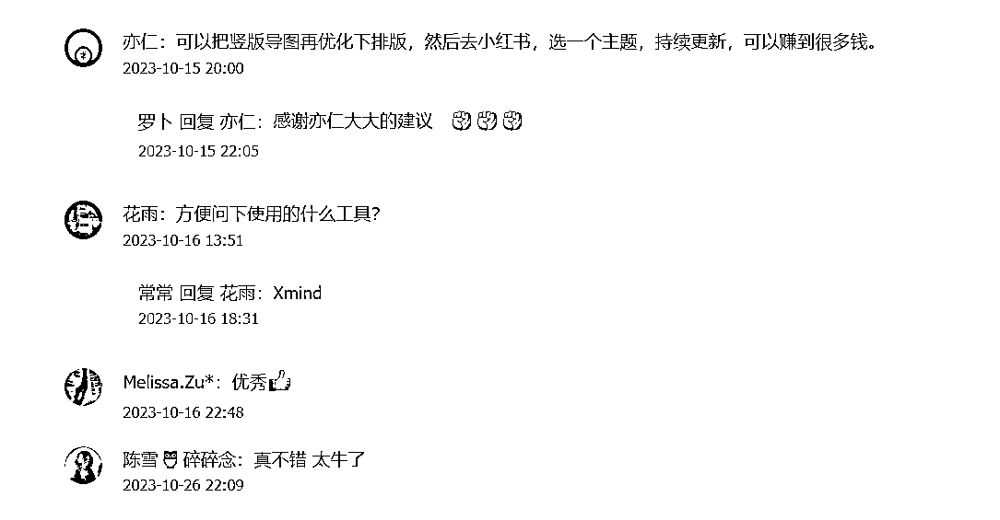

龙哥大大也给那篇帖子评论，建议我尝试小红书。但我觉得自己导图还不够好，用赚钱内容分享也不合适，就没照做，换了些别的发，结果没做起来，主要还是我的问题。这条评论我一直在想、在试，导图分享也会继续。

## 研学社导图营

和陈雪老师合作的同时，我在研学社办了两期导图训练营。加上之前免费分享，我已经教了300多人学导图。2023年我原计划影响500人，到10月还觉得完不成。结果这些训练营和分享，恰好为后面的航海导图制作攒下了团队基础。现在回头看，好像上天安排好似的，给了我接航海制作导图的底气。那之后我更加确信：要带着更多小伙伴通过导图被看见，甚至变现。

## 11月航海内测，第2次组队

静伟发来微信时，我根本不敢相信，这种运气会砸中我？我犹豫了一会儿，先找研学社小伙伴商量，列出几个担心，得到好几个人支持；再找陈雪老师，她建议我从训练营里召集。有了人，担心全消失了。结果来了23人，远超预期，简直“多多益善”。人越多任务越轻松。以前是游击队，这次得按正规军来，统一部署，一个都不能少。那次内测只有4艘船，我却拉了23人。我安排挖坑的萝卜当助手，不派任务，专职指导答疑；其他人有的做航海手册，有的做高手领航，每艘船5次分享只需4张导图。每个人都承担一点，最后顺利完成，官方好评不断，也为后来的思维导图特训航海埋下伏笔。当时内测没有公开，我做了一份制作文档，感兴趣的圈友可以看。

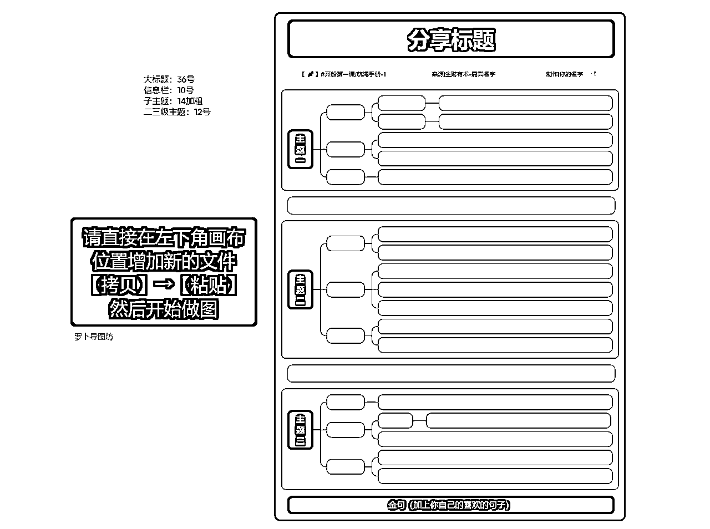

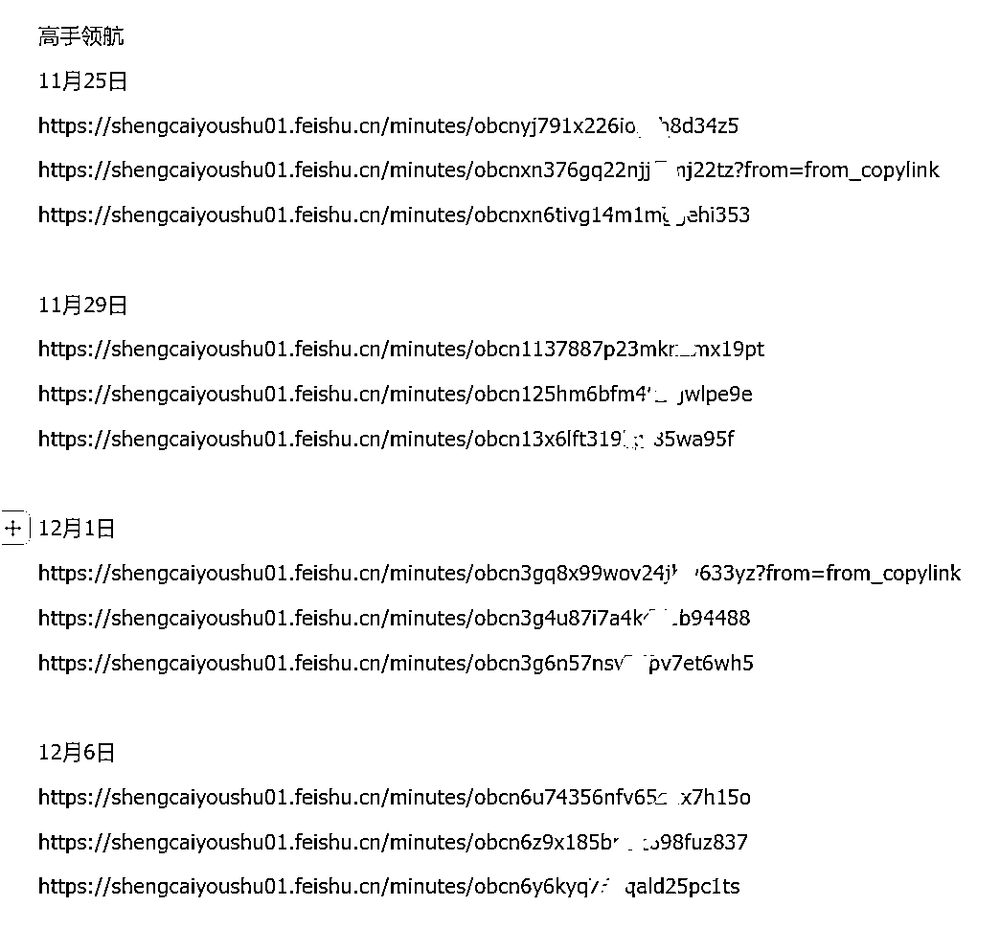

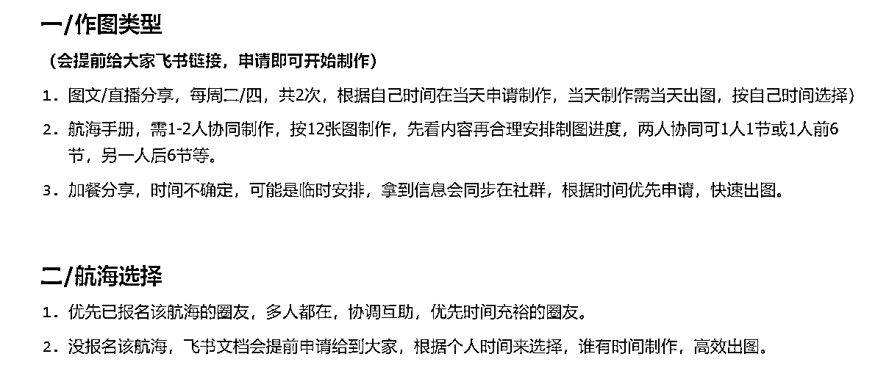

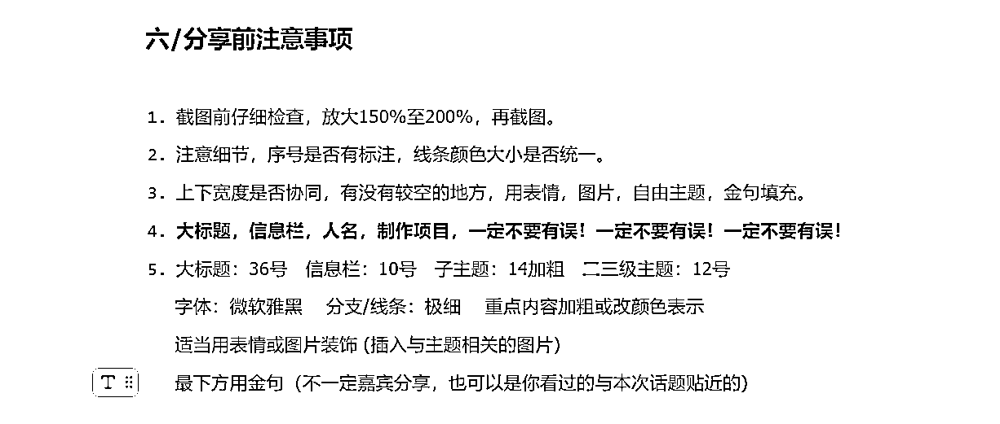

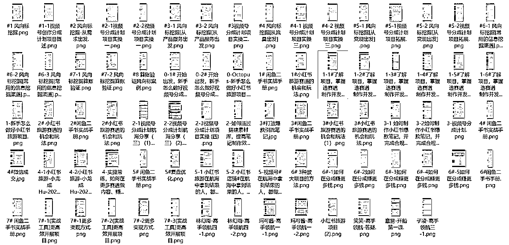

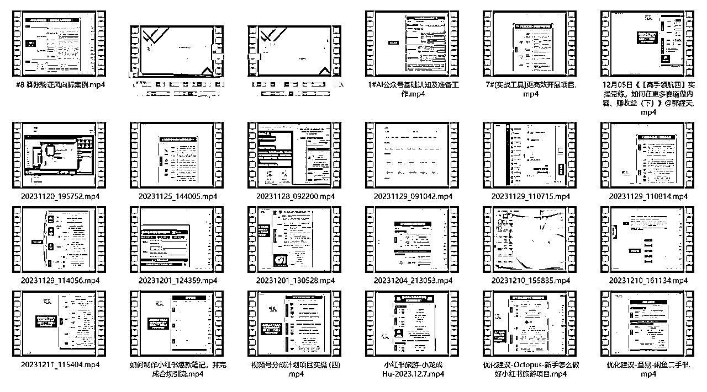

## 12月思维导图特训航海，第3次组队

又是静伟先来问，最近忙不忙？我说还行。他问两个问题：零基础圈友21天能学会吗？我说“必须能”。制作要花多久？我说前两三天每天一两个小时，熟练后会更快。他听完就对接了艳君，后来还有肉松、萌虎帮忙。

这一路走来，从犹豫到坚定，从一个人到一群人。竖屏思维导图不仅让我被看见，还让我收获了很多惊喜——新晋深圳“组局之王”、被邀请参与杭州航海家导图制作、和更多大佬建立合作……如果你也想被看见，也许可以从一张导图开始。

在艳君的牵线下，航海手册从无到有。最开始我的思路和她的初稿走的是两条路，最后还是采纳了她给的方向进行调整。我先按她的框架把内容填进去，过程中反复电话对齐每个环节的细节，拆到最细、讲到最透，几乎是手把手带过。

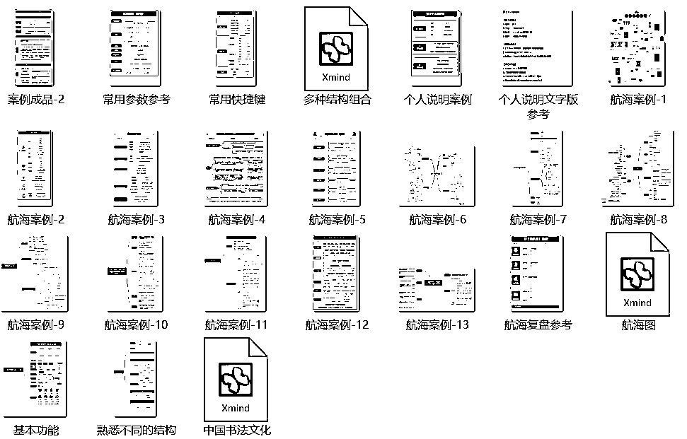

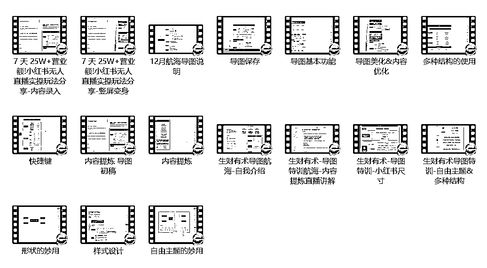

眼下能看到的资料和视频都已是精修后的版本。我记得有几段素材，单一条就重录了五次以上，每次录制都得半小时往上，不是步骤复杂，而是为了把操作失误全部剔除，让加入思维导图特训的伙伴一看就会、跟着就能做。

临近航海启动的时间比较紧，我邀请了小熊老师一起把航海手册做完，这就是大家现在手上这份手册的来历。

思维导图特训在三月份做了迭代升级，内容值得重新翻看，我边实操边记录，照着做的人都能上手。

开航前我对接上了 Xmind 的官方负责人，说明了这次航海会使用 Xmind，对方给了我一个 7 折的优惠码，有效期半年，需要的伙伴可以找我。

随后也联系上了亿图脑图的运营团队，他们对导图制作很支持，表示可以提供一个月会员，后来知道我们已经在用 Xmind 后有些犹豫，但申请最终还是通过了。后来才知道圈里就有在亿图工作的朋友。

以上是一些小插曲，再回到第三次组队。这次在第二次的基础上没有对外扩招，全部是过往合作过的伙伴，一起完成了 12 月航海的 17 张航海导图。模板在每次使用中都在进化，主要是在细节上的打磨，大家可能也注意到图上出现了“赚钱有术 航海实战”的标识。

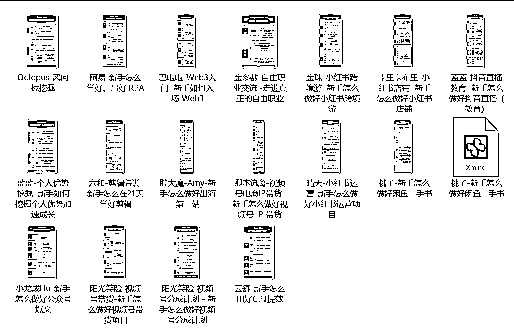

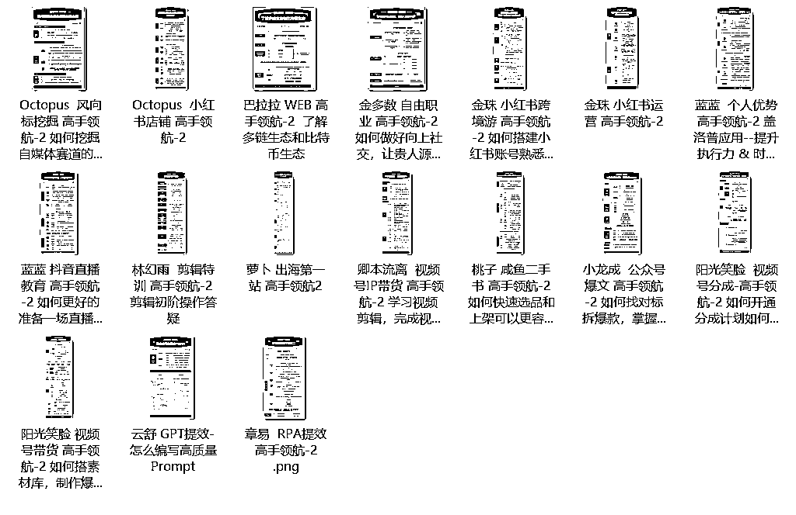

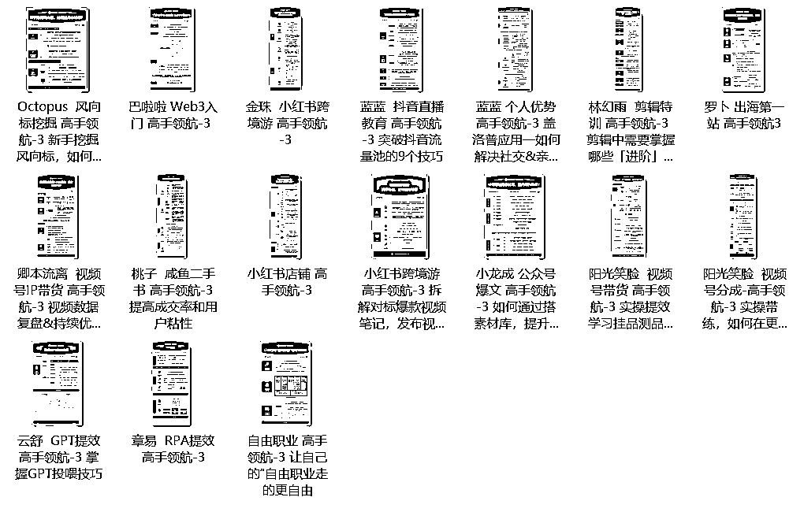

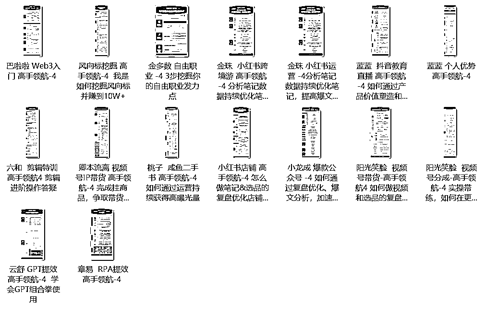

12 月的每张导图都已在航海社群里分享过，这次就不汇总链接了。

# 新晋深圳“组局之王”

要说一个人必须提到深圳鱼丸，也就是叶子。在我决定线下组局之前纠结了很久，一直想在深圳线下做一次竖屏思维导图的分享，她给了我很多可落地的建议和思路。在她的协助下，我在双十一当天成功办了第一场，后面几乎每周五下午都持续组局。

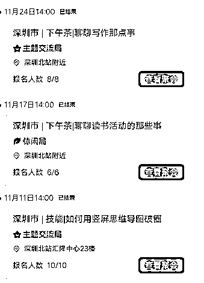

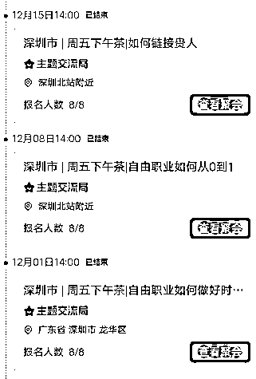

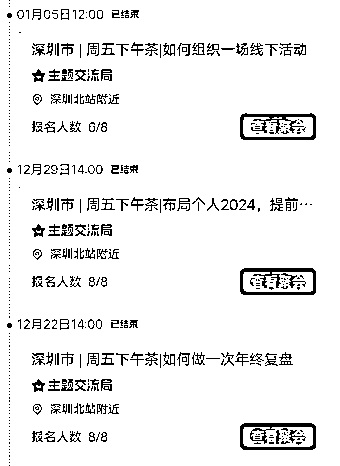

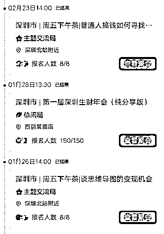

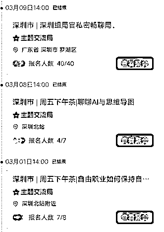

连续的线下聚会让深圳的伙伴们逐渐认识了我，叶子和运营也笑称我是“深圳局王”，这称号我有点惶恐，因为组织的都是小规模的局。但这个名字也让我更坚定地持续组局，也带动了一些伙伴加入组局官的行列，为大家提供线下交流的机会。

还有一个小细节，活动地点基本都定在【深圳北站附近】。如果你恰好路过深圳北站，不妨停留一下，告诉罗卜，我带你逛逛深圳北站不为人知的一面，其实就是附近走走，线下见个面。

组局过程中，有一次发起了一场思维导图的分享，没想到七小也来了。那天他结合自身经验做了大量关于思维类的方法分享，我这局居然请到了大佬。之前也有遇到过几位航海家，组局真的能带来很多意外的相遇。

我本以为和七小的见面只是偶然，后来在深圳年会上才明白，原来是七小在默默帮我。年会当天他单独找到我，在附近陪我逛了大半天，给了我很多关于思维导图的建议和思考，非常感激，也知道自己在这件事上欠他一份，这份一定要以后补上。

很多时候别人的建议并非义务，人要懂得感恩，我在这方面做得还不够，就要用行动去证明。加入深圳同城后，我还根据社群通知做了一份同城加入须知，如果你也在深圳，欢迎回家，我们在等你。

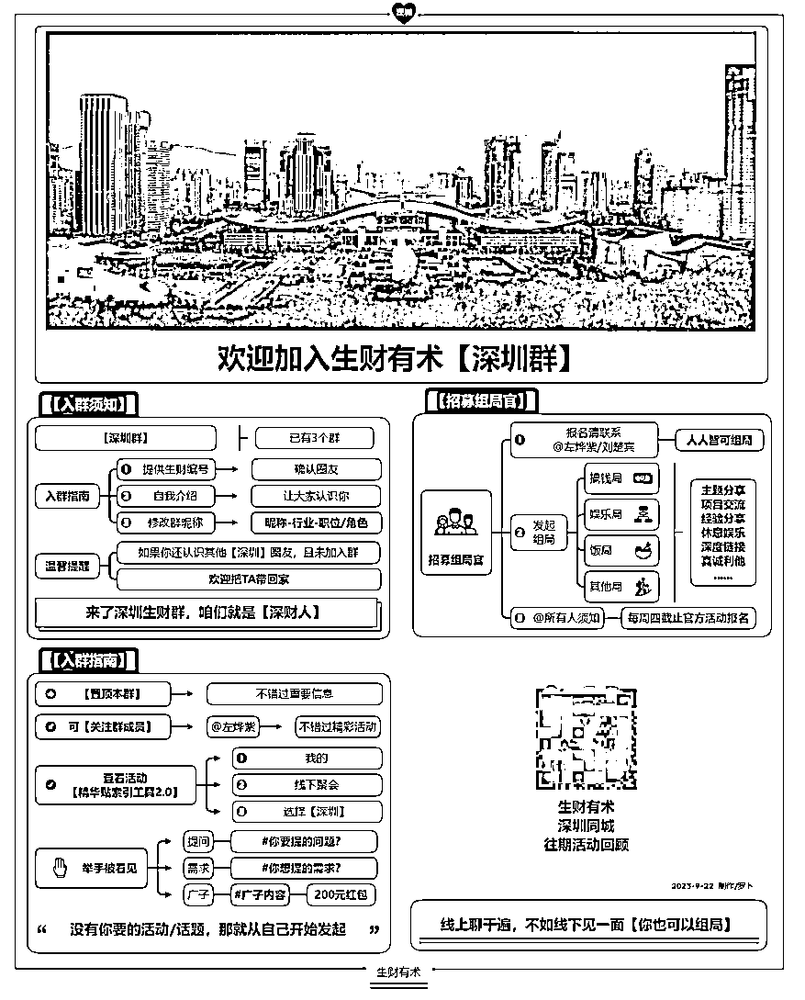

# 因为导图收获很多惊喜

尤其是鱼丸，多次看到我发布的导图作品后主动来找我申请授权，一次是做航海补给，一次是做深圳年会。

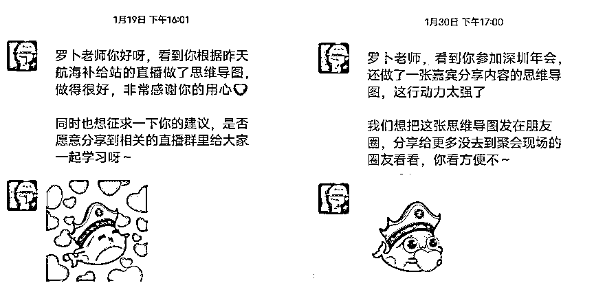

类似的例子还有不少，就不一一展开了。

想对同样做图的小伙伴说，敢于把导图发出来，可能是被看见的第一步。持续输出，你终会被看见。

建议没看过这篇内容的可以再读一遍。

后来得知弗兰克也会参加年会，我就提前把他的书《多买三倍》整理成了导图，打算加他后第一时间分享给他。

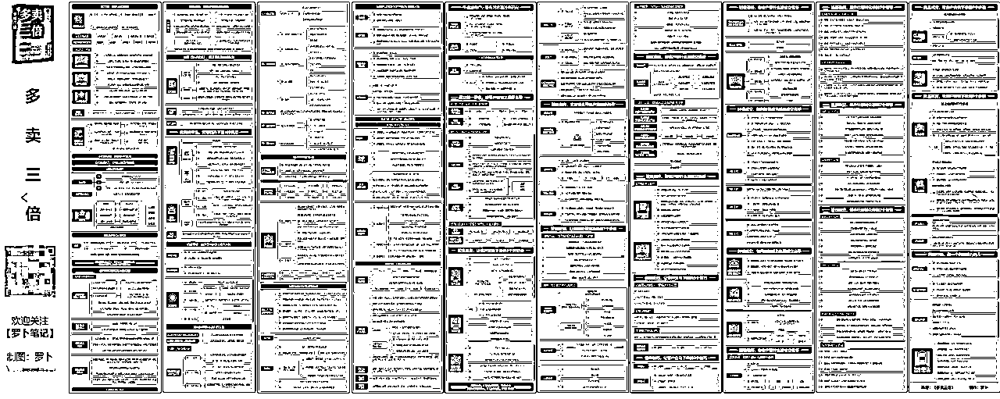

# 邀请参与杭州航海家导图制作

接到叶子和小鹅的邀请，因为之前有多次组织经验，这次直接答应了。仍然在原有成员里召集了 7 位伙伴协同制作。线下活动进行的同时，线上团队也在同步推进，周日晚上基本就把导图完成了。

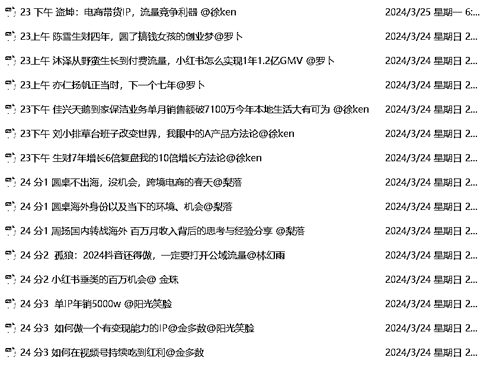

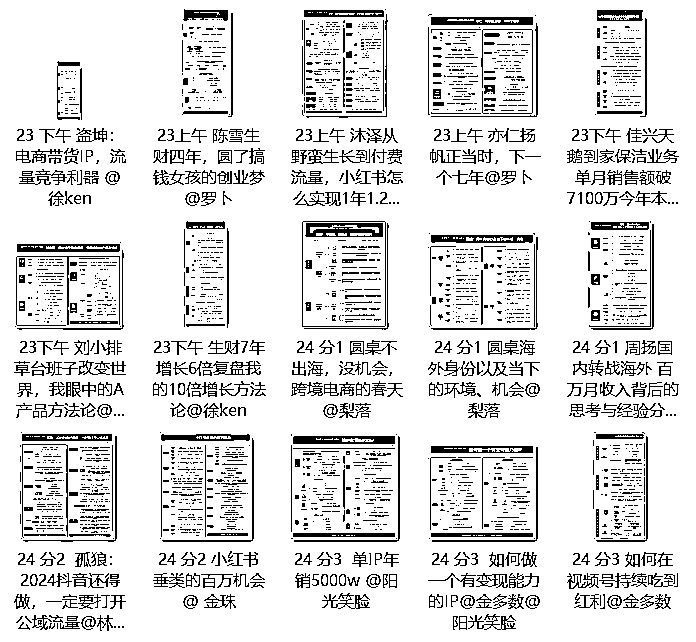

由现场速记组把文字整理到飞书，线上小组则在飞书文档里对应制作导图。

随着清晨的光线慢慢亮起，我意识到现在是凌晨两点半，脑子还算清醒。趁着这个时间点回顾了这一年我在赚钱里发生的事，也借这篇文章告诉自己，你的付出和努力终会被看见，找到适合自己的节奏，用马拉松的心态坚持下去，慢一点没关系，保持前行就能到达终点。

# 我在赚钱一年的总结

过去一年在赚钱对我来说是一段清晰的成长线。

1. 刚加入时我有些迷茫，但通过阅读精华帖保持学习热情，并用思维导图提升阅读效率。阅读时同步画图，既加深理解记忆，也能把收获分享出去。
2. 我原本不擅长表达，自从开始制作并发布思维导图后，我更愿意表达观点和成果。这带来了链接和支持，也让我能通过分享呈现成长。
3. 在独自摸索阶段，我遇到了赚钱研学社，这个社群氛围很好。我参加了他们的共读活动，通过真诚交流既学到知识也建立了关系。
4. 我知道分享导图不一定立刻带来收入，但我依然坚持。还给自己一个挑战，连续 100 天制作竖屏导图，刻意练习让技能大幅提升。分享与学习互为循环，也让我更熟练地运用费曼学习法。
5. 在陈雪老师和研学社的支持下，我建立了自己的竖屏导图小圈子，教大家画竖屏导图。过程中也在不断探索。依托赚钱的知识库，我产出了更多优质内容。和圈友一起做航海导图的过程很有价值，乐于解决问题，我们互相成就，共同进步。
6. 我的成长离不开贵人的帮助，包括胖大魔、陈雪老师以及一直鼓励我的老师们。还有一起做航海导图的小伙伴们，他们都是我的贵人。
7. 我相信真诚交流、多付出、多主动、互相帮助，我们会走得更远。我最近在读《10倍比2倍容易》，在思考如何把竖屏思维导图的价值放大 10 倍甚至更多。
8. 始终保持学习心态，线下活动结识更多优秀圈友【线上聊千遍，不如线下见一面】，向他们学习，同时把所学传递给需要的人。我相信通过互助，我们都能在赚钱的路上越走越稳。

种树最好的时间是十年前，其次是现在。空想是难题，行动才有答案。

# 说到最后

我都没想到自己能因为竖屏思维导图被大家看见
也没想到能通过导图链接到大佬
更没想过竖屏导图能帮我找到真正的热爱

一年时间不长不短，这一年的惊喜太多

导图帮我去帮助别人，也让别人来帮助我

我清楚在还是小透明的时候，最关键的是把基本功练扎实，不断对外输出

当有了一些影响力后，更不能自满，要做更多利他的事情，让更多人了解思维导图

截至今天，我已经影响超过 1000 人学习思维导图，未来会继续增加......

跑步对我来说不只是锻炼，更像一种隐喻

一边每天跑步积累经验，一边一点点抬高目标的横杆，通过挑战高度来提升自己

我并不是什么优秀的跑者，只是非常普通甚至平庸的水准

但这并不重要

重要的是我超越了昨天的自己，哪怕只是一点点

在长跑里，最大的对手就是过去的自己

——村上春树

每一次航海何尝不是如此

每一次学习都是为超越昨天的自己

我是罗卜，欢迎链接，和我聊聊思维导图的更多可能性......

祝愿各位在今年的盈利之路上，都能实现显著的飞跃！