# ('做思维导图IP，如何实现月入1W+到月入10W+的10倍增长？', (2, 33))

收入从一万到十万：我用脑图个人品牌走通的路

各位赚钱平台的朋友，见字如面。我叫小熊，一直陪别人经营脑图方向的个人品牌，也曾在平台带过三期资料整理营和两期脑图营。很多伙伴看着我这位普通上班族妈妈，从0起步，把脑图慢慢做成自己的事业。目前利润累计超过60万，去年12月进账超过10万。对我而言，这是人生中很值得记住的节点。

来到赚钱之后，我从总担心未来的妈妈，渐渐变成有产品、有目标的人。平台团队多次邀请我参与活动，每次被认可，都让我愿意继续往前突破。我也常常看不清方向，但我的习惯是：先动手做，路会自动浮现。就这样，我边走边看到了很多光亮。

我曾写下一篇复盘文，讲自己几次副业尝试失败后，靠脑图特训营赚到4万多。文章末尾写下了几个目标：做高价产品、经营内容账号、建立运营队伍、对接企业资源。没想到后来都一一实现。今天这篇，就当做一次完整复盘：从月入一万到月入十万，我做对了哪几件事？

这几年的经验，我总结成四件事：第一，个人品牌要有人情味，也要有可靠的小队伍；第二，用多个内容账号持续获客，让流量稳定下来；第三，推出高单价产品，把成交率做到12.8%；第四，用逻辑清晰的脑图，对接出版方和大客户。今天先把前两件事讲透，后两件我仍在持续打磨中，以后再找机会细聊。

一、把个人品牌做出人情味，把队伍搭起来

先聊个人品牌。做内容生意，拼来拼去，拼的是“人”。某项技能会的人很多，用户为什么选你？往往不是因为你最强，而是更信赖你、更喜欢你。我较早明白这点，积累两年多，现在拥有一千多位愿意付费的用户。

用户变多后，琐碎事项也变多。有段时间，我深夜批改作业，脖子疼得不能低头，休整一周才好转。身体已经提醒我，可我依然不想停。副业给了我职场中没找到的价值感，让我很想继续往前冲。晚上，大部分时间都扑在特训营里，孩子只能坐在一旁用平板学习。芷蓝姐告诉我：如果赚钱的方式让你疲惫，也许该想想是不是模式出了问题。这句话让我想了很久，但真正推动我做决定的，是后来平台团队邀请我当带班老师。

那次带班让我看到，成熟体系的威力有多大。开课前，有专人陪我梳理问题；做手册，有人和我一起琢磨思路；写完，还有人来校对；做分享、开直播，对接的人会把细节抠到分享频率。我被这种认真惊到了，也终于明白：我缺的不是努力，而是一套体系和一群可托付的伙伴。

于是，我尝试拉队伍。这对一位上班族妈妈来说，算是不小的一步。但队伍拉起来后，变化很明显：每月的进账从2万、3万、4万、5万……一路到了11万。如今，我把时间花在核心内容和关键决策上，其余杂事都交给伙伴。每天下班后，还能陪孩子两个小时。

个人品牌的人情味，体现在三处。

第一处是视觉。我在设计公司工作，对品牌风格本来就很在意。开始做课不久，我就把对外物料统一色调：脑图课的宣传图、头像、特训营周边，全部用蓝黄两色。蓝色让我安静，黄色让我积极，这很像我。后来学员还给我画了专属表情，写的是：和小熊一起，做彼此的光。每次有新人进群，大家都会用这组表情欢迎。

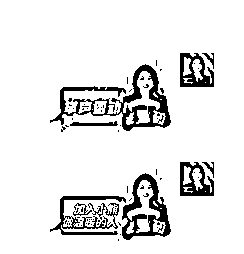

当这些元素反复出现，就像一根记忆线，让人看到蓝黄配色就想起这门课和这个人。

第二处是交付。我理解的交付，不只是讲完课，而是让用户拿到比预想更多的东西。结营时，我们会给表现突出的同学发奖，并用心挑礼物。当妈妈的学员，收到的是孩子零食或护眼用品；男学员，收到的是茶具或提升思维的书；有时我也会给学员的孩子准备小惊喜，让孩子为妈妈感到骄傲。很多人说，礼物本身不是重点，被记住才是。

除了课程，我也会在社群里持续分享。去年夏天，我选了一部分对副业和内容创作感兴趣的学员，拉了个小群，每天聊点实在的：我看到的好案例、我踩过的坑、我怎么爬出来。慢慢地，大家发现我不是只会输出知识的人，我也会焦虑、会被误会。遇到误会时，我习惯换到对方的位置想一想，也提醒自己把文章写得更清楚。群里的伙伴常常给我支持，这种连接比任何技巧都动人。

我还会把几段真实经历发在社交动态里。有位想加入课程的同学说暂时没钱，要等发薪；我想办法帮她，还是不行，就劝她先照顾好自己。后来我分享出来，很多人在留言区说做得对。还有一回，有人加我后说“这么好看怎么总谈钱”，我借朋友教的句式回他：“这么帅怎么一上来就白拿？”然后删掉。这些事我从不避讳，因为真诚是建立信赖的第一步。

第三处是情绪。不少学员在生活和工作里遇到难题时，会找我私聊。我经历过五年的低谷，缺过钱，也有过很多次重头再来。所以他们的迷茫，我多少能懂。我不会只讲道理，也会给出情感支持。这种沟通通常放在睡前，慢慢聊，慢慢陪。很多伙伴就在这段时间里，决定和我继续同行。

说完个人品牌，再讲队伍。

我习惯在特训营里留意学员写的计划和总结，从中寻找有潜力的好苗子。发现后，先私下给指导，再邀请她参与部分工作。一期特训营往往有100人左右，没有帮手，实在照顾不过来。大家分工后，我能专心做内容，学员也多了一份额外收入。有的人跟着跟着，就成了长期伙伴。

带队伍后，我把重复劳动尽可能流程化。第一次在平台做直播时，我体验了标准流程的厉害：任何问题都有对应答案。从那以后，每次指导伙伴做新事项，我习惯顺手把步骤写下来。特训营有带班步骤，接单有报价步骤，发图文有发布步骤，多账号运营也有检查清单。带熟一人后，请她把步骤写成文档，再由她带新人。等大家都熟了，再一起迭代。

现在这支队伍有十几人，都来自学员。大家分工明确，有人带班，有人管群，有人做图，有人对接外部订单。每月发酬劳时，伙伴们总替我考虑，说活少时不必给太多。这种双向珍惜，是我做个人品牌以来最珍贵的收获。

二、在内容平台做多账号，让流量稳定

个人品牌和队伍解决的是信任与服务，但生意还要有流量。所以第二件事，就是到内容平台做多账号布局。早期，我把心思放在私域，先把基本功和产品打磨扎实，也帮学员做出了不少案例。2023年起，我开始花大块时间研究平台，前前后后试了很多号，能吸引阅读，却很难成交。后来跟着平台活动，把某个号做到1000粉，慢慢找到手感。但来的人仍不够准。那段时间我正好生病，志愿者看我几天没冒泡，特意来问，领队也来关心。病好后，我一边补打卡，一边翻平台里的好帖子找方法。后来有位圈友点醒了我，我终于跑通一条路。跑通之后，我把方法复制到更多号上，现在十几个号共同运作。每日流量不大，但来的人基本都对。

第一，账号定位。脑图是通用工具，很多领域都能拿来做梳理。因此我不会让所有号都贴同一个方向，而是结合课程重点和学员容易出成果的领域，分出不同定位，比如女性自我提升、亲子教育。每个号服务一类人群。

第二，选题。选题由我统一负责：先搜索赛道关键词，看看近期哪些内容热度高，再判断是否适合改造成脑图。合适的存进选题表。

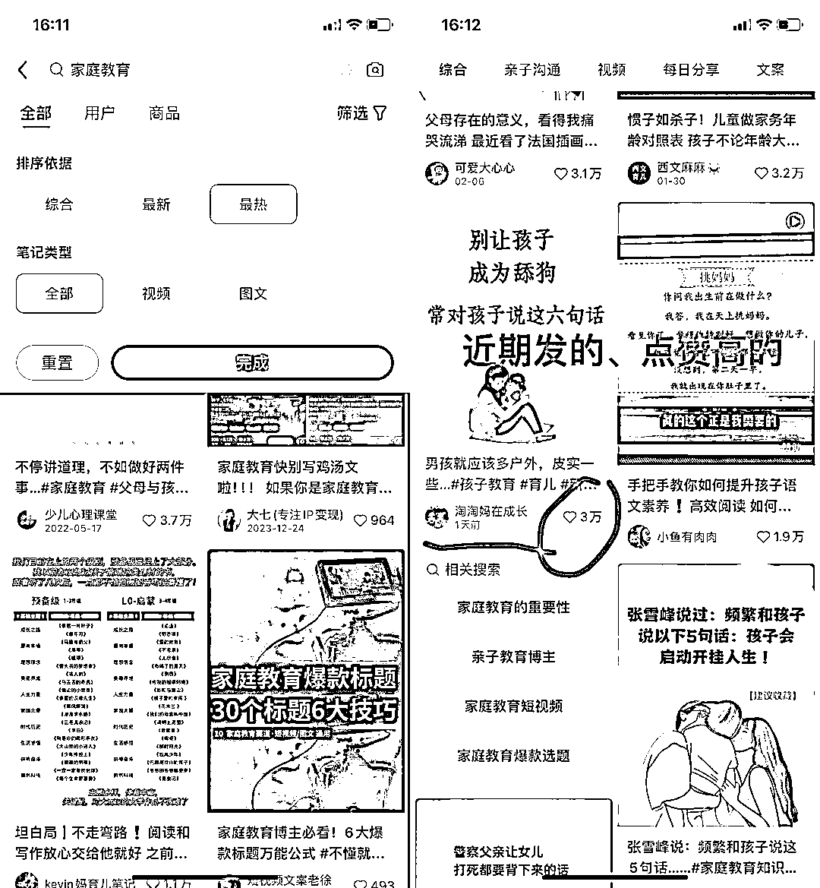

每个方向每周准备5-7个题目，放进表格，助手再接走做下一步加工。

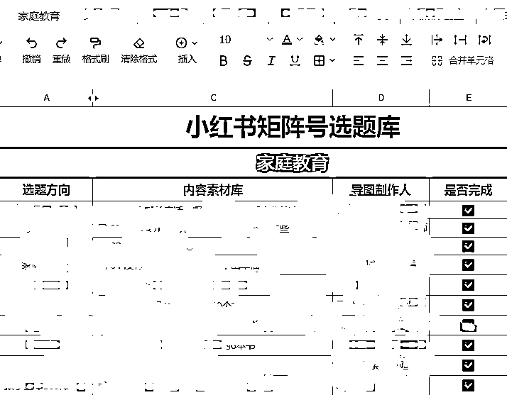

第三，内容素材。我有一支小小素材队，成员都是学过脑图的优秀学员。她们画好初稿后，我逐张给反馈。她们能练手、赚零花钱，我也能低成本拿到可用素材，算是互相成就。

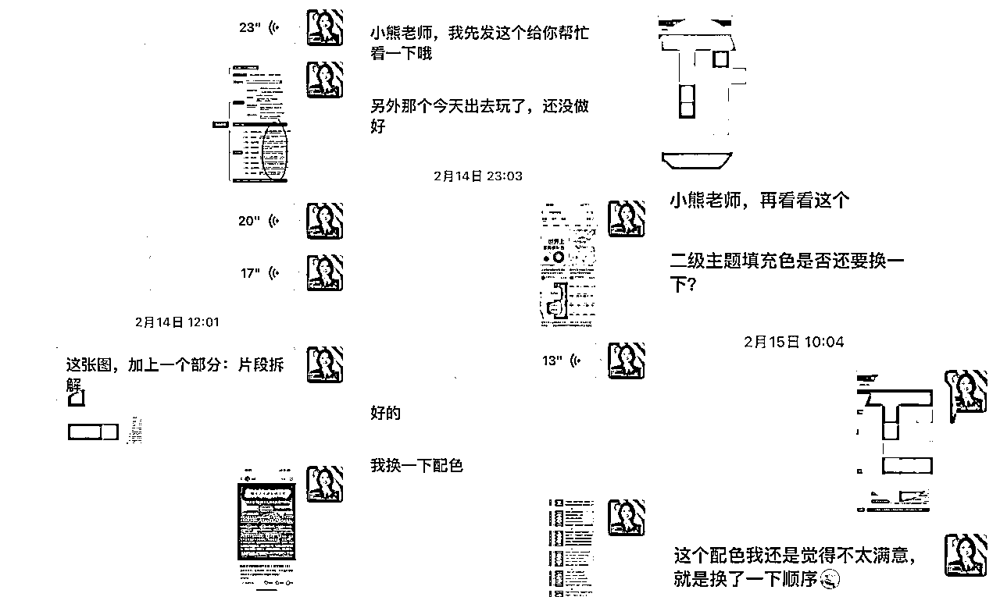

遇到外部约稿，我习惯优先分给她们，像是给书配图、给老师的课做配图。另外，我还在培养一支偏创意的制图小队，主要接宣传图订单，帮内容创业者做课程介绍图。现在已服务十多位不同量级的创作者。以后，审图工作也能交给她们。

第四，日常运营。我把自己的实操经验整理成手册，新人拿着就能接手。能力强的人，还能在我的基础上升级打法。因为图稿都是现成的，每个号的核心事只有三件。

第一件是封面。每个号启动前，先定下配色和文字风格。脑图类内容天生容易吸睛，一张图讲透、正反对照PK、有奖互动都是常用的形式。

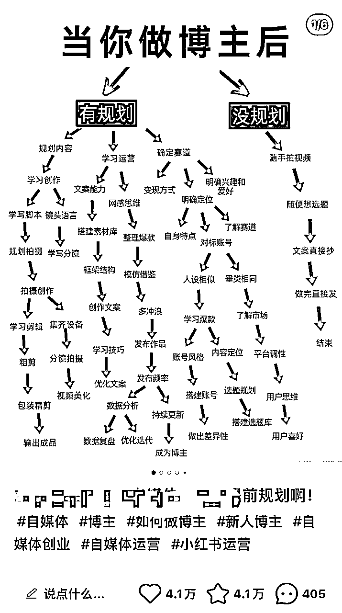

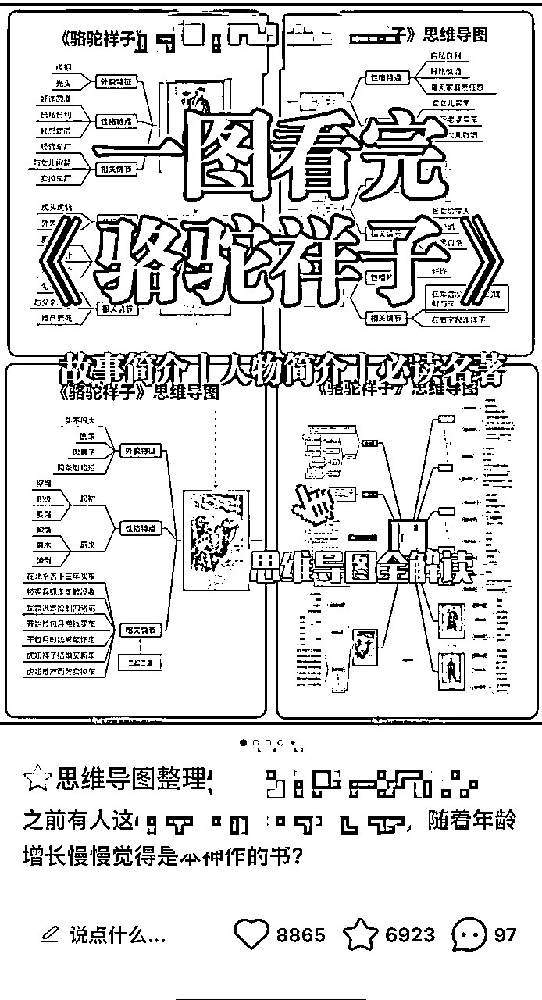

其中PK系最稳，正确与错误放在一起对比，反差越大，讨论越热烈。

第二件是标题。我常用三种写法：数字型，如“2024年，30多岁职场中的女性值得读的48本书”；提问型，如“你会不会为一件重要的事提前准备？”；对立型，配合对比式封面，如“我和闺蜜分别做了两个版本，你来康康哪个更赞？”

第三件是文案。前期每条文案我都手写，费时费力。后来请Kimi当助手：给它一段旧文案，让它按同样格式与风格生成新文案。大家发文效率因此快了很多。

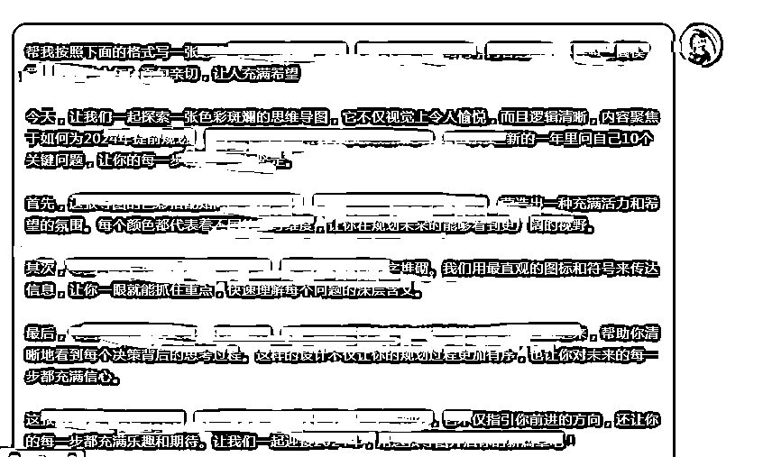

引流方面，我习惯用小号在群里放联系方式，送电子书、脑图合集。小号有时会被平台处理，这很正常，所以我通常备着几个备用号。心态放平，这个不行就换下一个。

最后是沟通成交。这也是最需功力的环节。我请教过很多朋友，自己也聊过上千人，逐渐打磨出一套方法。忻忻教我五分钟内判断对方是否真想买；根源告诉我温柔坚定地回应对方；靠谱分享给我多问需求再给建议；理白提醒我别掉进对方的节奏，把主动权握在自己手里。销售这门课，确实值得一直学。

为了让过程更顺，我设置了三层筛选。第一层，在平台私聊筛选。有人一上来就讨资料、求带，我统一回复“课程是收费的”。不愿为价值付费的人，在这一步就被挡下。

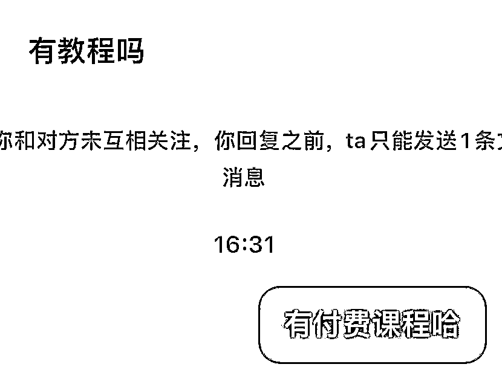

第二层，加好友时筛选。想要资料的人，备注写“领资料”；想要课程的人，备注写“咨询课程”。要资料的，加上后我马上发，不做多余推销。他们留在联系方式里，等需要课程时自然会再来。有人甚至直接转款。

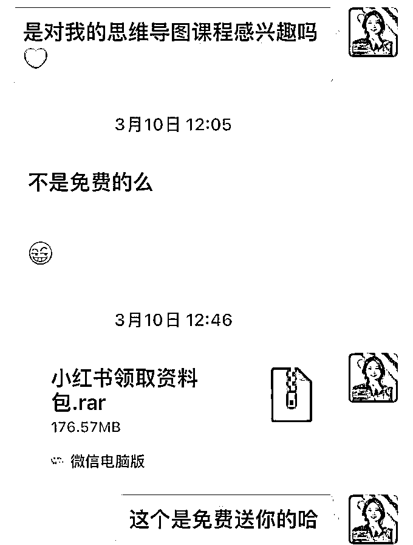

第三层，用固定话术筛选。加上好友后，我通常从收藏夹调出模板：先发一句自我介绍，再送两张参考图，然后问对方有没有购课意向。对方回“有”，我再给出两个方向让ta选。选好后，我发对应课程介绍与价格。愿意继续聊的，就进入下一步；有疑问的，继续解答。

以上便是我从零走到现在的主要路径。没有一夜爆红，只有反反复复的尝试和调整。希望这些经验能给你带去一点参考。愿我们都能在自己的路上，越走越稳，越走越亮。

总有人好奇地问：收入从五位数跃升到六位数，这中间到底做对了哪些事？今天我不藏着掖着，把关键动作一次讲透。

先说一个我观察到的规律。在私域里，认可课程价值的人，来咨询几轮后大多会直接付款；觉得价格不合适的人，聊着聊着就不见踪影。我不会追着对方问“考虑得怎么样”，只把精力留给内容展示，反复输出、反复亮相，等他们在某个瞬间被触动，自然就会回来。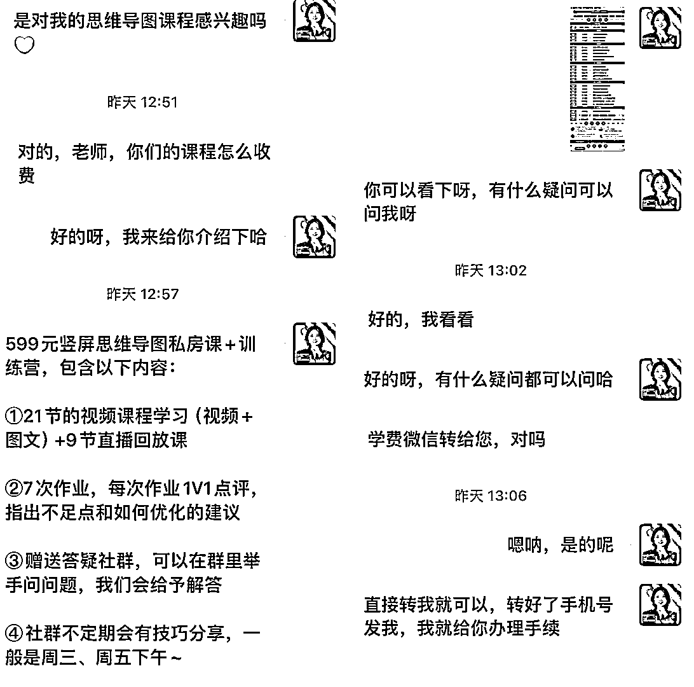

我的常态化客流，来自几个内容社区账号组成的小矩阵。平均每天能收到10到15条精准询单，量不大，但质量很高。与此同时，之前那套个人品牌塑造也在持续起作用——那些当时未成交的人，暗中观察一段时间后，会陆续回头付费。我偶尔也会在私域里推荐第三方产品，有些社区粉丝不买我的课，倒是愿意从我这儿买其他她们需要的东西。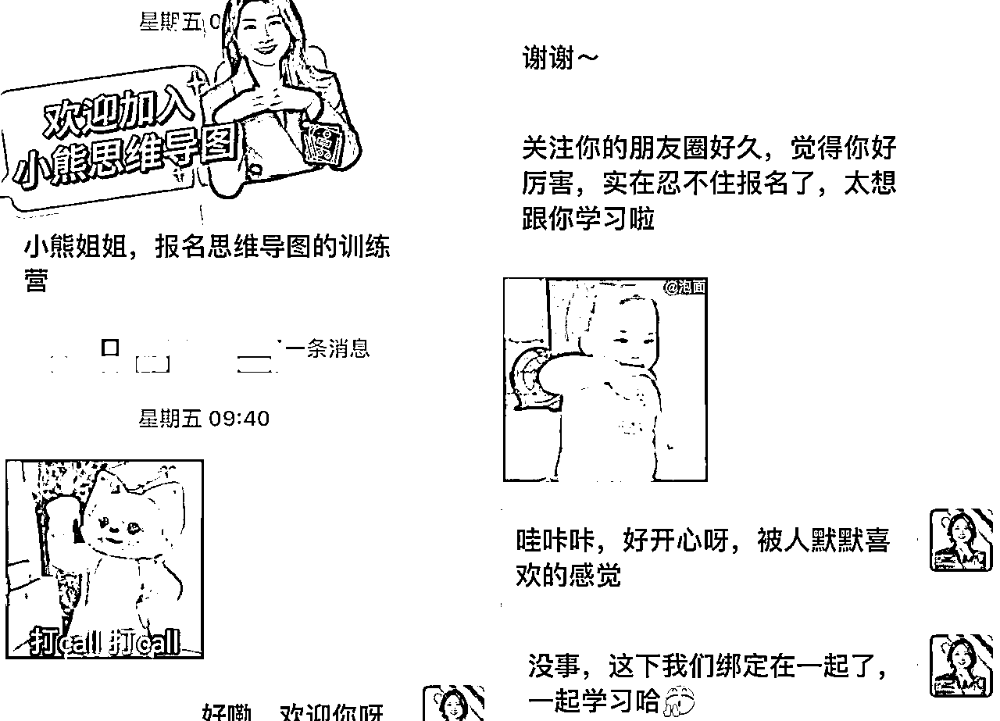

带营期间，我积累了几百位老成员，他们用实打实的四位数学费表达了对我的信任。前年6月，运营方约我写一篇脑图经验分享，我顺势把“用脑图做内容账号”的打法写进了稿子里。稿件被发到内部社群后，得到了龙哥的认可，被打上了精华标记。当时的分享链接保存在这个地址：https://t.zsxq.com/17FotTJO3

那篇稿子让很多人看见了脑图做内容的可能性，也让我意识到自己正处在一个临界点上——之前设想过的一切路径全部被验证可行，对生意的理解也上升了一个层次。通过电话为信任我的成员做一对一答疑时，我发现自己能流畅地拆解他们的大多数问题。我知道，推出更高价位产品的时机到了。

2023年10月，恰逢我的生日月，我正式发布了私教服务，并同步高调宣传我参与的合伙人项目。此后三个月的收入曲线非常陡峭：从低价服务转向高价产品的比例是12.8%，平均每笔订单的价格冲上了五位数。前者靠的是日常交付的扎实，后者则要归功于季卡用户升级为终身会员——他们体验过季度服务后确信，建设个人品牌值得长期投入，加上三个月内确实收获满满，于是年底出现了一波集中续费潮。

私教的整体框架，我给它起了个通俗的名字——“两条腿走路”：一条腿练品牌，一条腿练变现。两条腿同时迈开，成员不必在漫长的成长期里苦等收入，心态也会稳很多。

先看品牌这条腿。大多数来报名的人都有副业打算，想拥有自己的个人品牌，但还没跑通全流程。所以交付的核心，就是带他们从零到一完成闭环。

第一步，定方向。新成员进来先填一张背景信息表，我根据表格内容进行语音沟通或深度文字梳理，帮他们锁定一个既有优势又有变现潜力的细分切口。

第二步，搭内容基地。因为绝大多数人都没有跑通，我的建议是从内容社区开始试水。结合每个人的实际情况，我会给出一份完整方案，包括账号基础设施、对标参考、选题方向、封面风格和制作方法，让体系能快速立起来。这部分是服务的大头，通常拆成四个阶段来推进：先养号和完成基础搭建，再拆解对标账号，再拆解爆款作品，最后产出自己的内容并发布，之后根据数据反馈做迭代优化。

第三步，布置私域展示面。先根据定位，把日常动态按“有温度、有趣味、有干货、有商业感”四个维度规划好，然后从生活点滴里捕捉素材。规划本身并不难，难的是落笔成文。我常用的写作配方是：开场金句+过程叙事+结尾价值升华。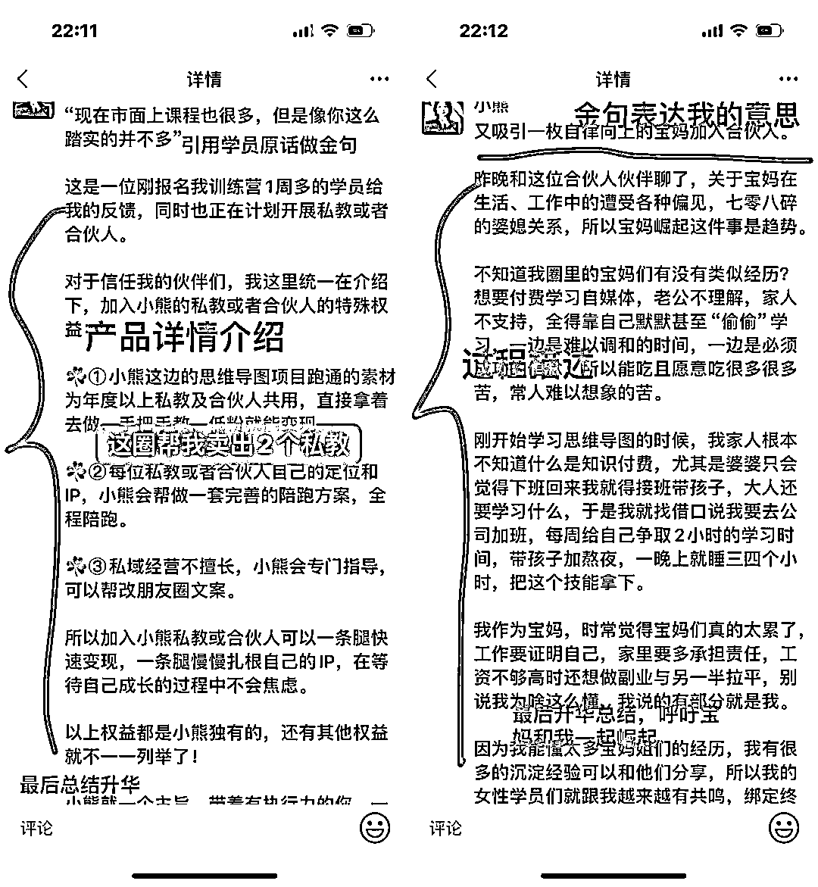

但即便给了公式，有些人还是会卡在表达上。这时候就需要我手把手地改文案、给反馈，这也是私教服务的核心价值之一。另外还有一种情况：有人带着写课需求来。那我们就直接进入课程开发环节，一起框定目标读者、确定章节目录、拆分每个小节的重点，并在各个节点上做评审和完善。

私教服务投入极大，所以我对招收名额非常谨慎。就在前几天，我还婉拒了两位申请者。找到同频、肯执行、能带出结果的人，比多收一个人重要得多。个人品牌是要做一辈子的事，我只想一步步把每一步的声誉踩实。

再看变现这条腿。这个方向就非常直接了——我会把内容矩阵从零到一的完整执行手册和现成内容仓库全部交给成员，授权他们直接使用。凡是成员自己成交的订单，利润五五开。

这样一来，成员一边经营自己的品牌，一边在真实交易中体验市场反馈，能更快理解每个平台背后的运行逻辑。说实话，如果没有亲手把一个内容推成爆款，你很难真正理解爆款背后的价值所在。

在闭环尚未形成之前，我就已经给一个体量可观的商业类大号写过十几篇标志性作品，也收到了知名脑图工具方的官方创作者邀约，作品和头像展示在对方官网上。这些经历为我积累了可观的背书与人脉。后来，出版圈的编辑开始找到我，请我配合新书推广和榜单冲刺，他们会给我的成员寄送赠书，团队也在一次次的合作中产出更多好作品。再后来，一些内容创业者也来约我制作引流素材、业务海报、个人介绍页和发售海报，我都能以较低成本帮他们解决。

这些合作让我沉淀出三条经验。

第一条，主动去链接。很多小体量的创作者会觉得大佬们有距离感，害怕自己不够格。我过去也有过同样的心理。但真正接触下来会发现，那些有成就的前辈往往很随和，他们也是从我们这个阶段走过来的，不会拒绝一个得体又有热情的微信好友申请。回想我当初加龙哥老师时，心里特别忐忑，没想到他不光通过了，还记得我做脑图的标签，那一刻给了我巨大的鼓励。这次线下大会，几乎所有人都在找那位知名金主Max交流，我也走过去，和他谈到怎么优化他的工作流程。当天晚上我们就拍板了第一次试点合作——帮他梳理直播内容。

第二条，做事要有力度。出版方找我配合推书，我从来没有犹豫过，每次都全情投入。一次、两次、三次之后，对接人自然看到了我的负责和耐心。去年端午节，他们给我的成员寄来一百多本书，还转来666元红包作节日问候。今年1月，对方说新书即将定稿付印，希望把我的名字印在封面上作为推荐人。为什么他们会想到我？我想，答案就藏在那一次次不计回报的配合里。柯洲的新书上市前，也曾邀请我写一篇文章放进书里。我立刻动笔，改了一稿又一稿，最终过稿，那篇文字顺利印在了他的书中。很多人正是因为读到那篇文章，又刷到我的脑图作品，才果断来找我学习。新书发售后，出版方邀请我录视频推荐。为了效果更好，我独自关在房间里录到深夜一点，直到自己满意才收工，并且是第一个提交视频的人。哪里有需要，我从不纠结。先决定要不要做，决定了就倾力去做——这是做事的姿态，也是别人信任你的根基。

第三条，常怀感恩之心。赚钱圈里的许义前辈出了新书，他第一个想到的竟然是我，让我把他的书做成一张纸质印刷版的知识地图。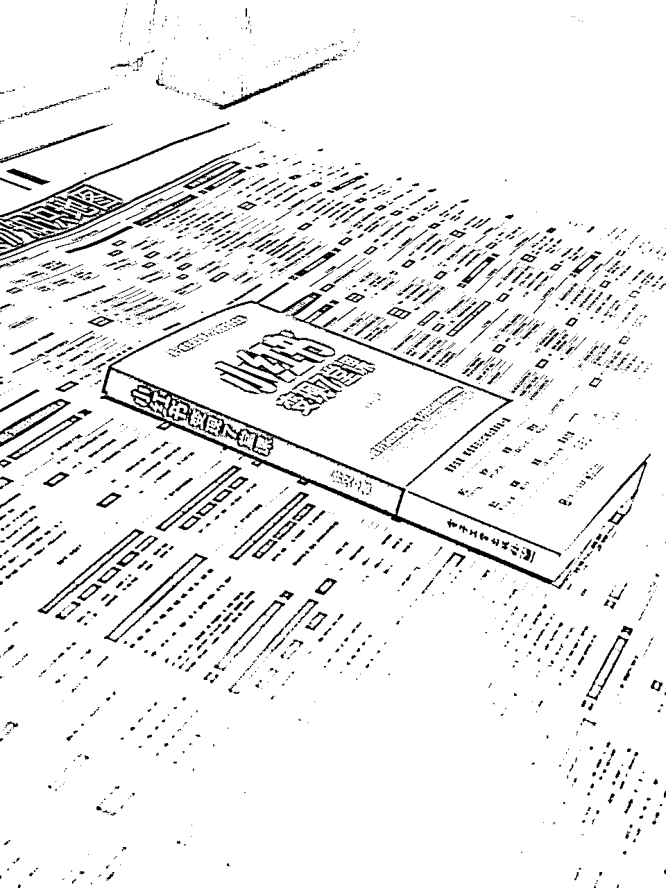

得知消息当天，我立刻在社群里同步信息，带着参与制图的伙伴们一起下单打榜、发动态推荐。之后给他人挑选礼物时，我也会默默把许义前辈的书放进去。我还遇到过一位贵人，她把我引荐到知乎的盐选项目，带着我把课程上架到那个平台。这份引荐和提携我一直记在心里。后来她有制图需求，在元旦假期和正月初一、初二发来请求，我二话没说——实际上是没有半点迟疑，马上组织团队按要求完成了交付。人生旅途里能遇见贵人已是莫大的幸运，若有一天贵人需要我，我必定倾囊相助。

以上就是收入从五位数跃升到六位数的大致过程。距离2022年那篇精华文章过去不过一年半，结果翻了十倍。这十倍对我不只是账面上的变化，更像一场由内而外的重塑。我经历过许多次被打碎、重启、自我疗愈的时刻，但我始终相信：你能活成什么样，只有你自己能下结论。这跟你是女性、是妈妈，没有任何关系。

线下聚会那次夜谈，我加入了一个女性创业者的小桌。有尔问大家：创业这条路上，你听过刺耳的声音吗？我第一个发声——何止听过，简直铺天盖地。那就拼命往前跑吧，跑得快了，那些声音自然就追不上了。

所以，这个“十倍增长”对我而言一点也不轻松。我投入了极多的时间、心力，也经历过无数自我怀疑。跟许多做大项目的人相比，六位数月收入算不上什么，我也清楚自己还有大量需要完善的地方。但这次线下交流，给了我明确的改进方向。

最后，想把一句让我印象很深的话送给大家：当你找到擅长的事情，就拼尽全力把它做到极致，别停下。

对我来说，这件事就是脑图。

同行的朋友们，去实战、去行动，在一次次的行动中变成更强的自己。愿我们都能在创造财富的路上，彼此照亮，一路向前。