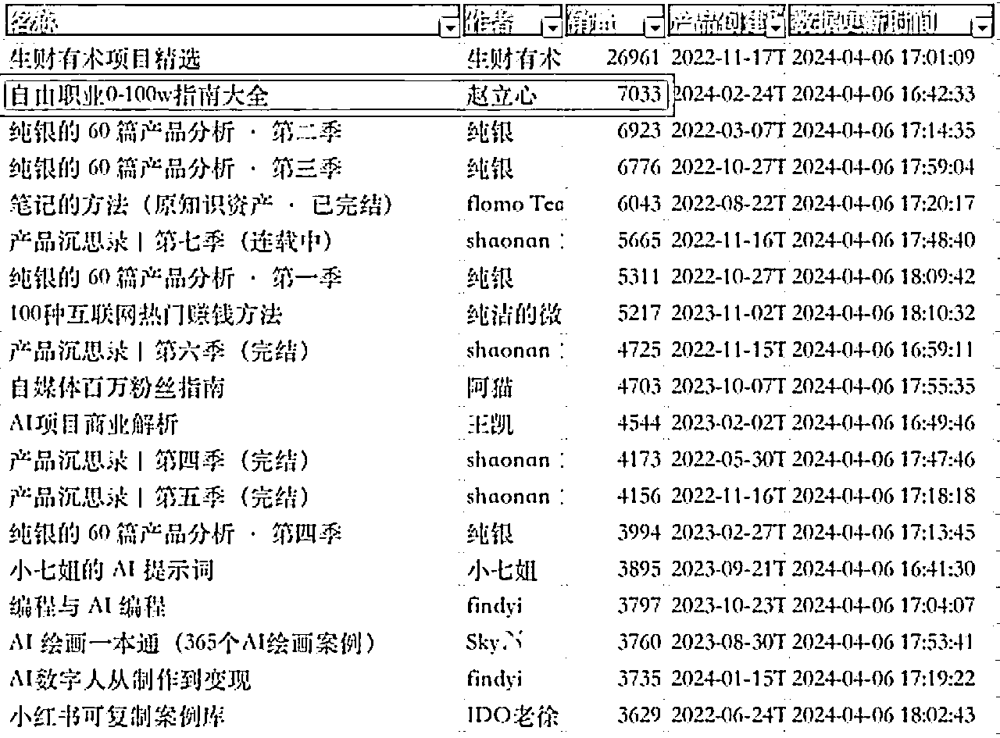
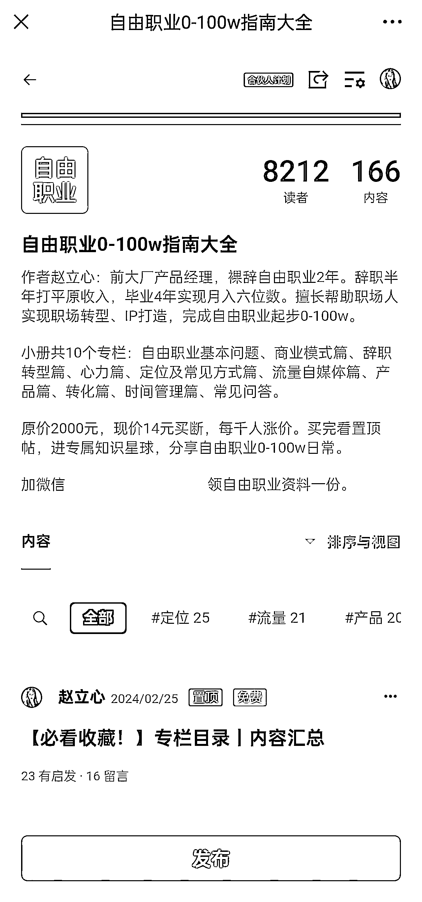
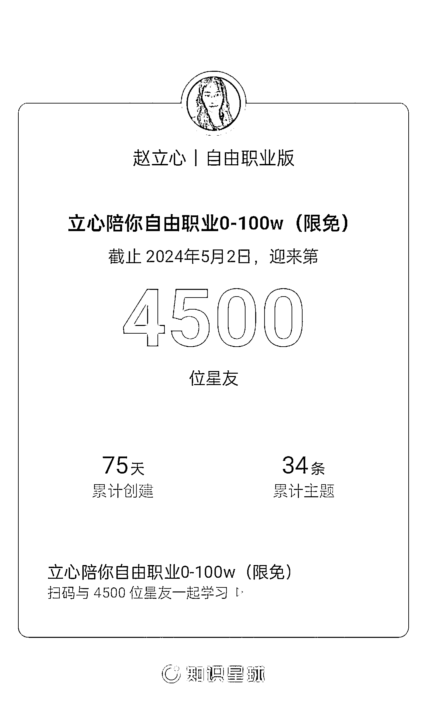

# 从 10 元引流品到 50 万营收：一个自由职业者的指数级增长实操拆解

自由职业做到瓶颈期，老问题都一样：手里没流量、变现不稳定、每天都在焦虑下一单从哪来。前大厂产品经理、裸辞一年半的立心，用一套可复制的打法，把这个问题一次性打通了。

上个月，他的个人业务实现了十倍跃迁。付费用户累计接近一万人，单月变现逼近 50 万。

核心载体是一本小报童专栏《自由职业 0-100w 指南大全》。上线 48 小时就卖出近 6000 份，6 天内冲到全网销量排行榜第二名，仅次于赚钱官方的项目精选。到现在总销量已突破 8000 册。

这一波操作带来的是完整的商业闭环复利：短短一周内新增好友超 5000 人，知识星球会员从 100 人直接飙升至 4000+，并且成功撬动近 50 万的收入。后继效应也不错，已有四家出版社主动抛出橄榄枝，邀请把这套内容体系做成出版物。

更关键的是分销端被点燃。截止目前有 700 多人完成了有效分销，卖出了真实订单，且这个数字还在持续攀升。大量几十万粉的创作者、自发形成的学习社群，都在帮着扩散传播。甚至出现头部大佬一人多码联动冲榜、原本不相识的 KOL 共同推单的局面。

成绩放在行业头部或许不算惊艳，但它带来的现金流是稳定且持续的。立心认为，这套方法本质上是一条适合绝大多数自由职业者通用的增长路径。

接下来他会系统拆解这套打法的底层逻辑，包括：

1、职场转型做自由职业，如何摆脱焦虑与收入波动，建立起真正的核心竞争力；
2、一套从 0 到 1 的标准化流程，如何驱动自由职业实现跨越式发展；
3、普通人如何同时打通流量获取、转化设计、产品包装三条线，达成指数级增长；
4、个人增长的十倍拐点通常从哪一步开始，以及执行中必须要紧盯的关键点。

全文超 17000 字，包含完整方法论和大量执行细节，原文汇总在：

希望这套实战复盘，能帮到正在卡在瓶颈期的同行。自由职业的路并不孤单，有方法就有复利。

* * *

【往期复盘】

职场 IP 品牌活动，四天收入近 8w，普通职场人如何通过 IP+内容+活动突破职场天花板 [`articles.zsxq.com/id_fo2foaxj2cx0.html`](https://articles.zsxq.com/id_fo2foaxj2cx0.html)

大厂裸辞一年半，跑通职场个人 IP，千人私域半月被动收入近六位数，我的历程分享 [`t.zsxq.com/11m3BTCz6`](https://t.zsxq.com/11m3BTCz6)

视频号第一次直播卖课，单场净利 16000+ [`articles.zsxq.com/id_lg037c6uozh8.html`](https://articles.zsxq.com/id_lg037c6uozh8.html)

* * *

评论区：

咿呀花花 : 太牛了[强]

彩卉 : 太牛了立心姐！！！！

赵立心丨自由职业版 : [玫瑰][玫瑰]一起赚钱！

大西｜私域发售操盘 : 看完立心的赚钱帖子，颗粒度太细了！！

乍看之下关于这次低转高产品发售的复盘，深挖了还看到对于自己产品商业模式的全盘思考！

赵立心丨自由职业版 : 么么彩卉，一起加油！

赵立心丨自由职业版 : 谢谢大西的打赏和走心评论！一起加油！

龙哥 : 优秀

赵立心丨自由职业版 : 少不了龙哥一份力[呲牙][呲牙]

* * *