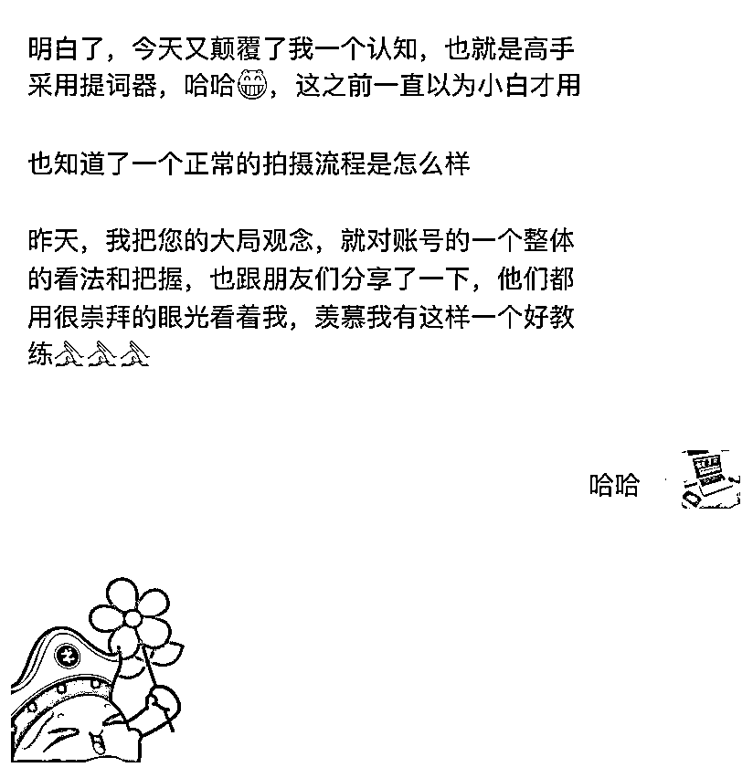
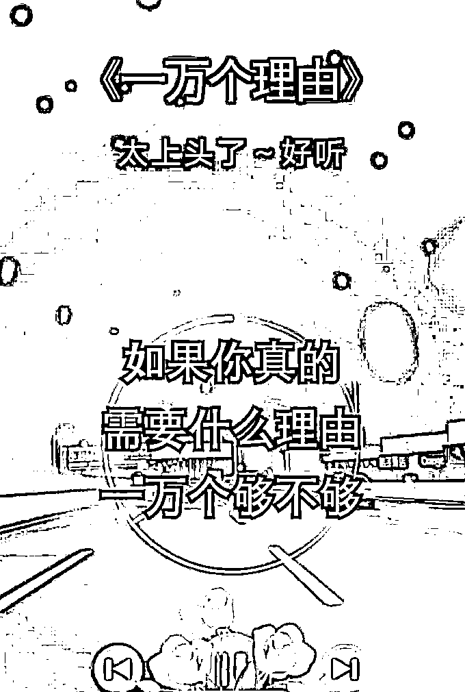
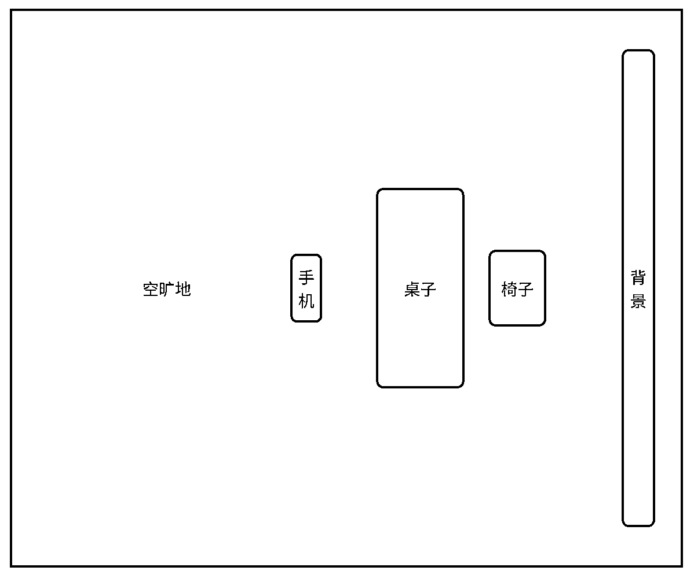

# 口播录制新手攻略
作者：龙哥

最近帮团队的小伙伴剪口播视频，发现不少人拍摄时特别“吃力”：镜头前磕磕绊绊，表情像冻住一样，情绪也传递不出来。片子剪完效果打折，后期还费劲。稍微点拨了一下，重拍的作品立刻顺眼很多。

其实很多看似基础的问题，恰恰是大多数人的盲区；而简单的方法往往最管用，却总被忽略。今天就把口播录制的核心要点和操作流程整理出来，希望能给需要的朋友一点启发。

先聊设备。一部手机加一个落地支架，前期完全够用。别急着添置其他装备，记住“学渣文具多”这句话。

- 相机？现在手机像素足够高，观看端也就那么大的屏幕，前期没必要投入。
- 收音麦？室内录制安静，人离设备近，手机收音稳定。后期剪辑还能调音量、降噪。便宜麦音质差、传输不稳定，反而拖后腿。
- 补光灯？白天迎光坐，晚上把室内灯开亮，基本够用。后期亮度也能调，没必要一开始就配齐。
- 场景？书架、窗帘、办公室、空白墙都行，只要收拾整齐。后期还能抠像换背景，不必非得打造一个特定角落。

所谓的“设备和场景不到位”，很多时候只是拖延的借口。想拍，现在就动手。

拍摄时，新手注意这四个关键点：

第一，用后置摄像头。前置摄像头会让你对着屏幕里的自己说话，注意力全被表情动作带跑，越刻意越别扭。后置拍摄看不到自己，反而能回到自然的说话状态。

第二，别碰提词器。那是高手才玩得转的，新手盯着提词器，眼神空洞、表情僵硬，一看就是念稿。还不如不用。靠记忆脱稿讲，记不住就一段一段看、一段一段录，中间断掉的部分，剪辑时切掉就行。

第三，单条素材一镜到底。无论一口气说完还是分段讲，一条视频从头录到尾，不要中途停止。如果拍成几十条碎片，后期整理、传输、校对、修改，全是灾难，效率低到崩溃。

第四，人物四周留足空间。人大概居中，周围留白。这样剪辑裁切才灵活，也避免被平台左侧的图标遮挡。画面太满，想调都没余地。

具体拍摄步骤，可以按下面来：

1. 把椅子放好，确定位置后别乱动。
2. 手机装上支架，后置摄像头对准椅子，大致居中，开启拍摄。
3. 坐下试拍一段，回看效果。
4. 根据试拍调整机位和角度。
5. 正式开拍，一条素材一镜到底拍完再停。
6. 停下后继续下一条，直到全部素材拍完。

方法就这么多，看起来简单，关键在动手。光看不练永远拍不出好效果。希望大家少一点犹豫，多一点实操，遇到问题多交流。

愿大家的项目蒸蒸日上，财源滚滚。也期待在龙哥盟，与各位一起进步，结识更多同路人。

