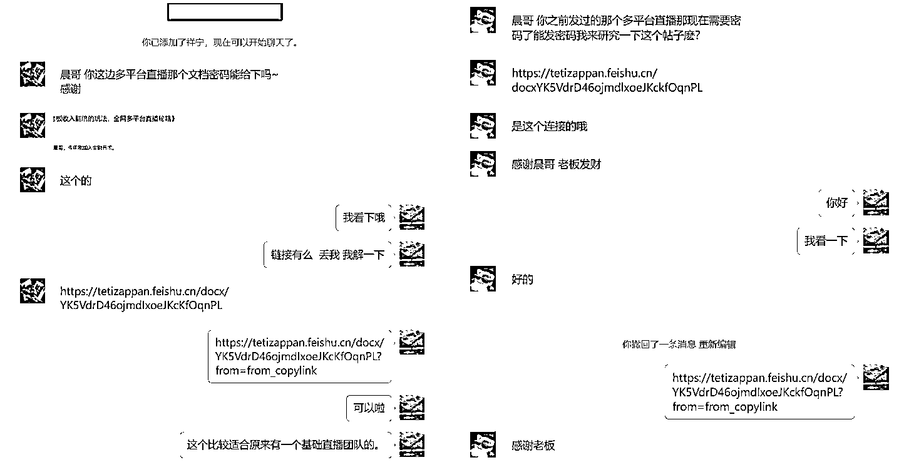
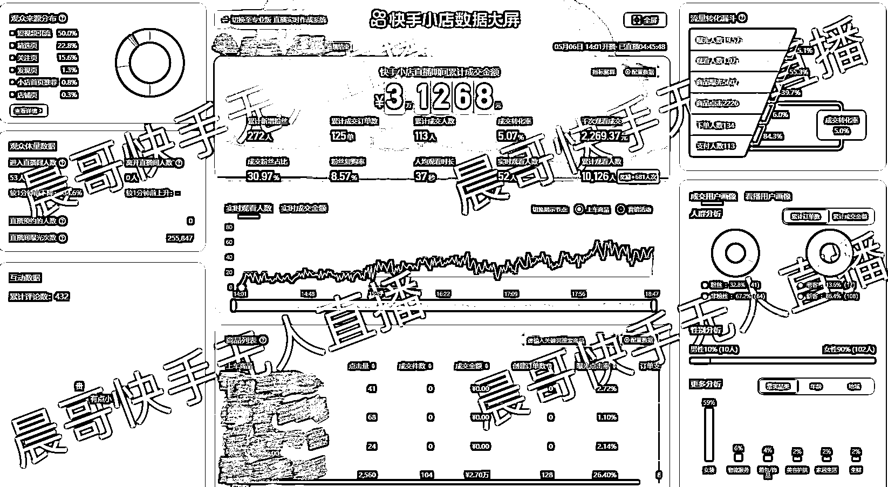
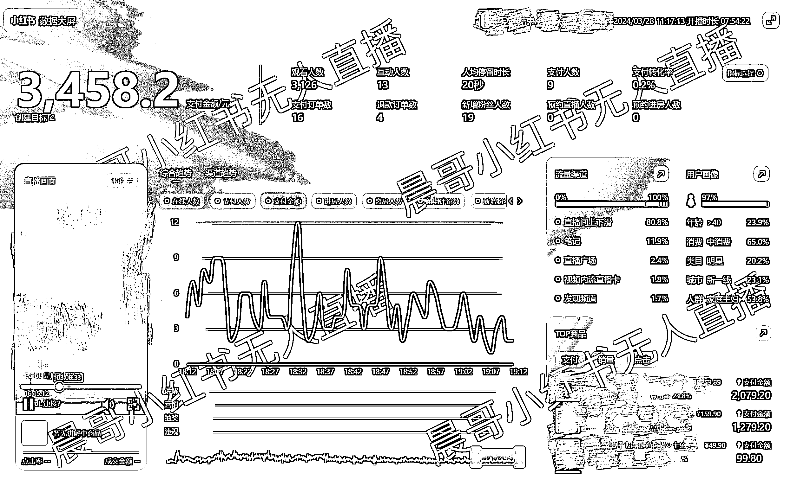
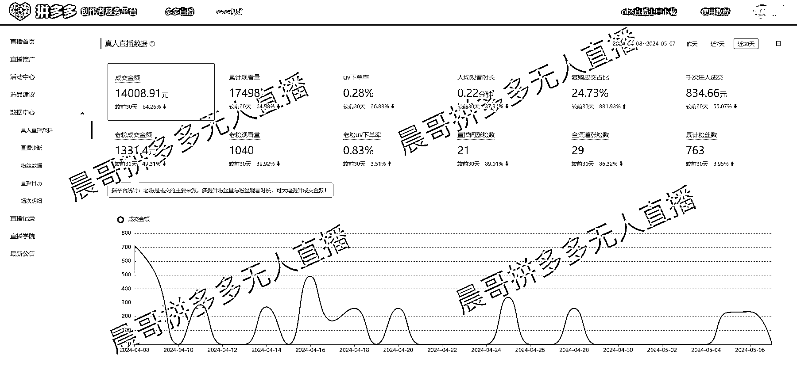
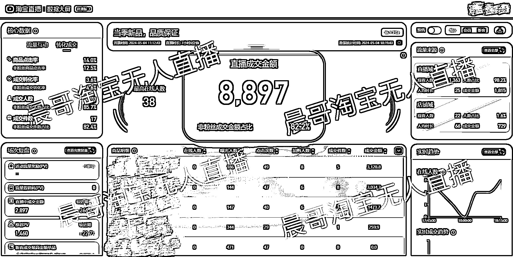
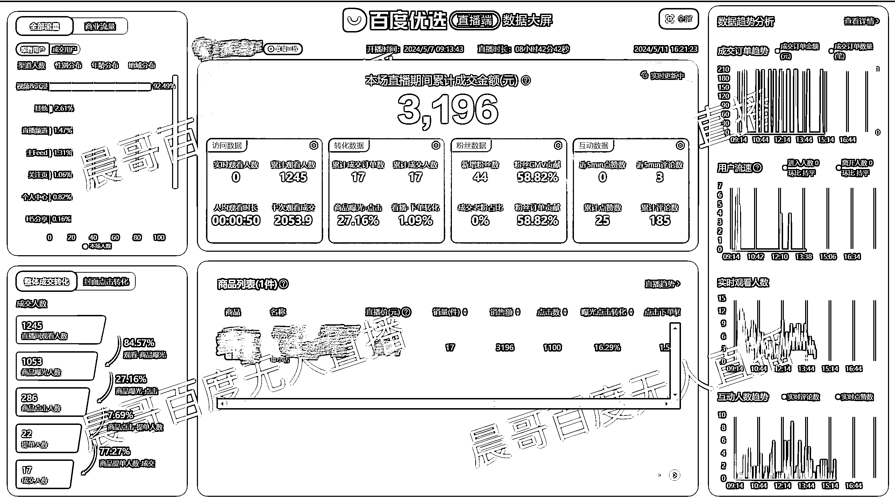
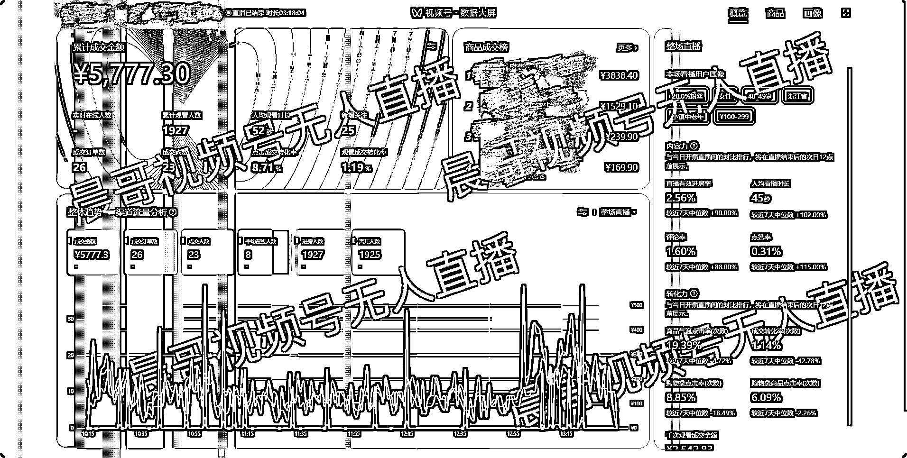

# 2024 个人可复制的矩阵无人直播实战，单日五位数的赚钱思路

各位圈友好，我是龙哥，那个“一年只产一篇”的难产选手又来了。去年我发了一篇关于全平台矩阵直播的玩法，很多老板看完说帮助很大，直到现在都还有人来打听。原帖在这：《让各位老板收入翻倍的玩法，全网多平台直播秘籍》

说实话，做内容分享确实有正反馈，既能帮到别人，也能借机认识更多同道中人。以后创业路上，我也需要各位伙伴相互支撑、一起往前走，把信息差抹平，让每个人都能看到更广的天地。

不过去年的打法更偏团队协作，想在全平台把矩阵直播铺开，首先你得有人数靠谱的直播基本盘。所以今年我换了个方向，专跑个人也能轻松上手的全平台矩阵无人直播。

这套玩法，我依旧是第一个冲在前面的人，实战下来也确实打出了成绩。废话不多说，直接上数据说话：

评论区里也有不少人在问：云端计算机去哪里买？热心朋友回复：云服务器用腾讯、华为、阿里的都行。作者也补充说：淘宝直接搜“物理机”，选择非常多。

