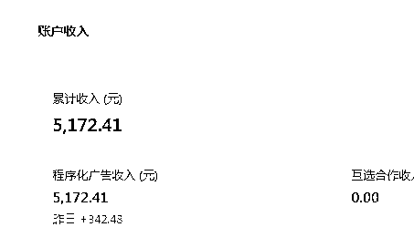

# 我的👸号爆文：连续多篇20w+，确定性终于被我找到了
作者：龙哥

各位朋友好，我是龙哥。👸号爆文这条路，我已经走了一年多。最近把规模放开之后，单号单日的收益已经能到600多块。跟前排的大佬比，这确实不算什么，但对我来说，已经是很满意的结果。

我在赚钱刷到一条风向标，内容正是关于一个叫“飞扬说史”的近现代史账号。当场我就觉得，这项目和我太契合了——毕竟我有6万粉👸号的运营经验，在这行待了三年多，原创文章也有六百多篇。于是，我决定入局。

今年三月份，我又找到一条更贴合的路径：职场赛道。先做职场政策解读，写了几篇10万+。接着往热点方向延伸，竟接连产出多篇20w+爆文，还有不少文章跨过了万阅读门槛。这些正向反馈来得太快，让我彻底确认——👸号爆文就是我的确定性。

希望我的分享能给同样在摸索的你带来一些光亮。

