# 专科出身、下班后做内容，累计赚到80多万：我是怎么选对路子的
作者：龙哥

我没有漂亮学历，也没有辞职，只靠着业余时间做内容，几年下来赚了八十多万。这篇想聊一个很实际的问题：普通人怎么从一堆选择里，找出真正适合自己的那条路。

我在上海一家互联网公司做项目管理，也是宝妈。以前只有专科文凭，靠着长期积累，后来在上海买了房、落了户。2018年开始接触内容创作，最开始替人代笔，后来做社群助理，再后来运营自己的号。在头条号上赚过二十多万，2022年起转向公号，之后靠沉淀下来的用户关系，累计收入超过八十万。加上主业的薪水，今年第一次达到年入百万的台阶。

我进这个社群已经三年，习惯把它当资料库用。想查什么，就按关键词去搜，拿到线索后自己筛一遍再执行。这三年，我看得多，说得少。

上周写了一篇关于学历普通、下班后读书、靠业余时间赚钱的文章，收到不少反馈。今天专门拆解「如何挑适合自己的方向」，把踩过的坑和验证过的方法讲透。

我在内容行业待了六年多，经常对学员讲，写作这条线能干到老，而且越往后越吃香。它不像很多职业有年龄天花板。年纪增长、阅读量变大、素材库变厚，写出来的东西越有分量，能带给别人的价值越高，回报自然水涨船高。

这两年大环境确实难，工作不好找，抱怨声到处都是。这些是事实。但另一个事实是：有人正在闷声赚钱，只是不会声张。市场上的资金不会人间蒸发，只会在行业之间、人群之间转手。某个行业赚不到钱，钱就会流向更赚钱的行业。多数人只是不知道它流去了哪里。

这个“不知道”，恰恰是机会。我常用一句话概括：信息不对称，是普通人最值钱的杠杆。

我当年做内容，目的非常直接：需要钱还债。当时存款只有20万，却敢高杠杆在上海买房，背了两百多万的贷款；孩子要养，妈妈帮忙带娃要给工资，婆婆的生活费也不能少。主业工资光应付房贷、车贷、装修贷就很吃力，被逼着开辟新收入。

所以我一入场就选“捷径”：花钱买课，买别人验证过的经验，用最短时间赚到钱。2018年12月报了写作课，2019年埋头接稿，2020年赶上头条号的项目红利赚了二十多万，2021年累到彻底停摆，2022年重新出发做公号，靠公号又赚了二十多万。

下面拆四件事：一，为何公号值得长期做？二，公号靠什么赚钱？三，新号没有评论入口怎么处理？四，新手该写什么？

## 一，为何公号值得长期做

如果你像我一样，最初就是冲着赚钱来的，大概率会先选公开流量平台，比如种草社区、头条号，因为那里流量大，反馈快。

公开流量平台和私密用户池的区别，看下面这张图就清楚。

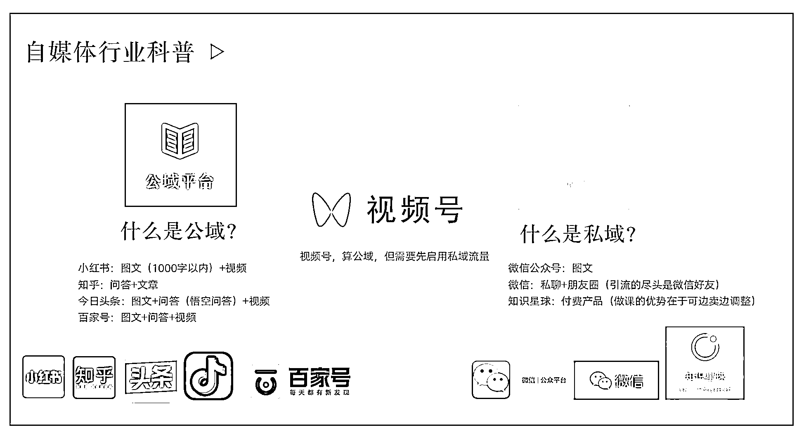

公开流量的致命伤是：流量再大也不归你。平台规则一变，收入来源就可能断掉。私域不完全是这样，你既能借用平台，又能把用户沉淀到手里。光这一点，就值得做公号，因为它是一项能持续积累的资产。

两者的推荐逻辑也不同。种草社区、头条号主要靠系统把内容推给用户，读者未必会点开订阅列表；公号十几年养成的习惯是，用户主动翻看自己关注的博主。即便现在也有非订阅推荐，老习惯仍然占主导。

我也在公开平台拿过不错的成绩，比如下面这些奖励记录：

单篇奖励5000元：

也写过不少十万加、五十万加、百万加的文章：

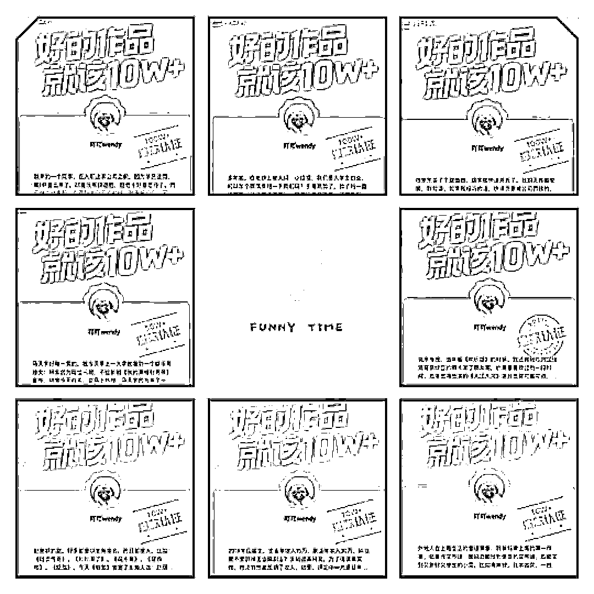

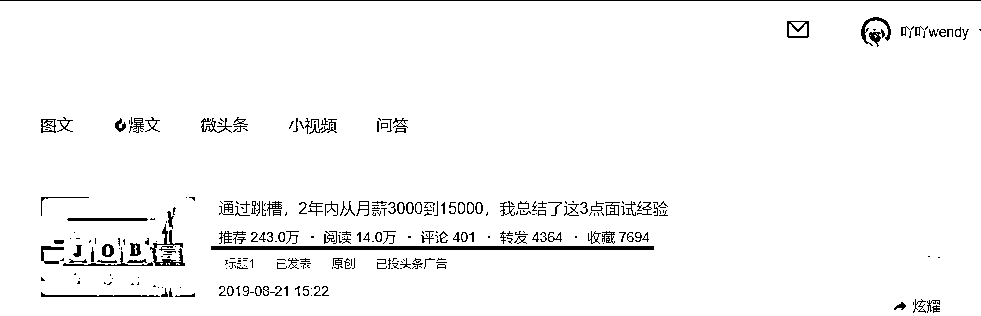

看截图确实体面。但2020年8月，那个奖励项目突然取消，我的主要收入来源一下没了。那一刻我才看清：平台一旦不扶持，创作者就像被随手丢掉的棋子。

我确实赶上过风口，靠那个项目赚到了钱。但正因为赚到过，我更想长期赚。我不想做随时可能消失的短期项目，更不想在某天规则改变时被迫清零。既然写一篇文章花的时间精力差不多，为什么不把它放到能产生复利的地方？

于是我把重心移到公号，到现在两年左右，从它身上赚了五十多万。我的经历本身就是一个参考样本：我经历过一次公开平台规则调整导致的断粮。你在选平台时，多一个真实案例可看。

内容行业有位前辈判断过：公号至少还能再活十年。动脑子想想，🛰️在通信上的地位，十年内谁来替代？超十亿的人都在那里，我一年从中赚几十万，实在不算什么。

别天天追风口。古往今来风口那么多，你也没抓住过，大概率是能力还没到位。就算再来十个风口，可能依然错过。那为什么不找一个用户又多、生态又稳的池子？在公号里认真写三五年，收益是持续累积的。

私密用户池还有三个明显好处：

第一，关注者长期价值高。三年前从头条号加到我🛰️的人，今年还在买我的课。

第二，内容方向自由，能练好写作基本功。不用把自己锁死在某个垂直领域，写你的经历、思考和困惑就好。你的受众可以选择具体人群，内容却可以跨领域。我写婚姻、恋爱、育儿、职场、赚钱、做内容，很杂，放在公开流量平台上很难变现，公号却完全没问题。

第三，离关注者近，互动方式多。很多做种草社区、短视频的人，最后成交也要把用户引到🛰️。🛰️的体系有多庞大，不用多说。

所以，2024年的今天，我依然建议你从自己的公号起步，把它当成个人信誉的第一个阵地。

## 二，公号靠什么赚钱

### 1. 给别人供稿

稿费通常50到200元。不过现在愿意收稿的号越来越少了，我的号以前也收，后来停了。原因是写作基础弱的人过稿率太低；我看一百篇能用的不到三篇，与其花时间审稿，不如自己写。还有一些号仍在收稿，你可以主动搜一搜。

买房、升职、报课、花钱、踩坑，这些生活经历都能变成供稿素材。我自己是一边供稿一边做号，等账号慢慢起来，稿费200元一单，广告费已经到1000元一单，就不再为别人写了。

### 2. 接广告

广告报价是逐步涨上来的。最早一单150元：

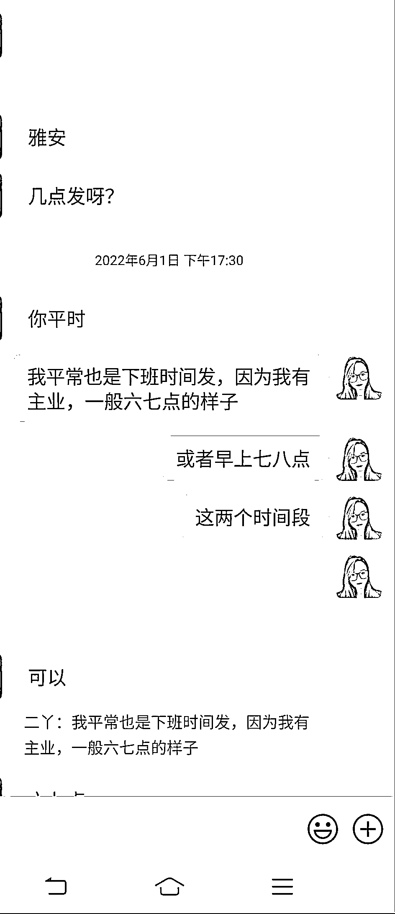

后来报价500元，对方还要砍到450：

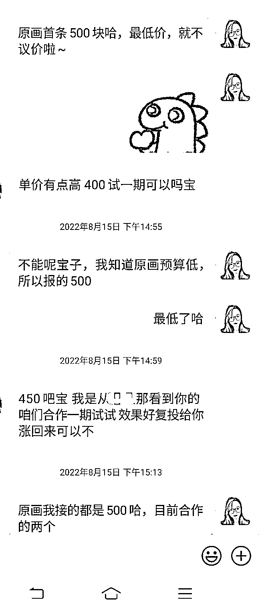

再后来涨到700元，对方嫌贵，直接谈崩：

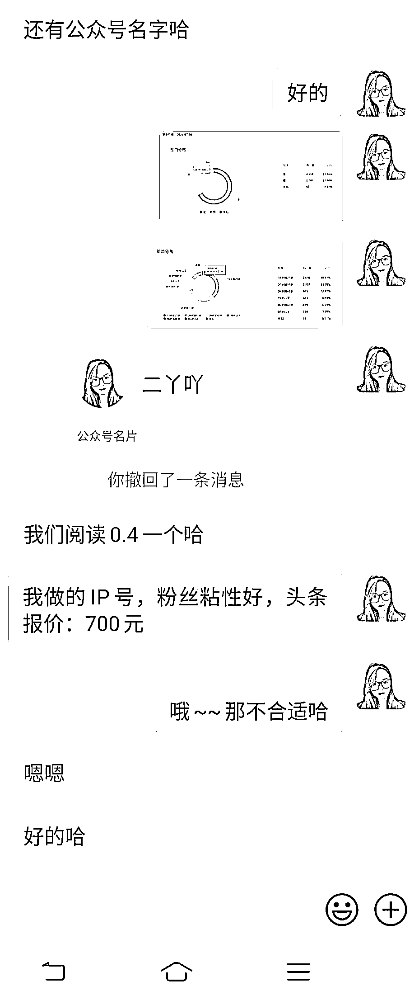

嫌贵就算了，不接：

现在低于1000元的广告我不接，每月稳定有三四个合作方。你可能想不到，像我这种阅读量只有几百、一千多的小号，光广告每月也有三四千入账。在县城，这已经抵得上一个普通上班族的月薪。还是那句话，我不说，没人知道。就算在这个上万人的社群里说出来，放到几十亿用户的互联网里，也只是毫不起眼的一粒沙。

### 3. 分销和卖课

知识类产品的市场每年都在变大：

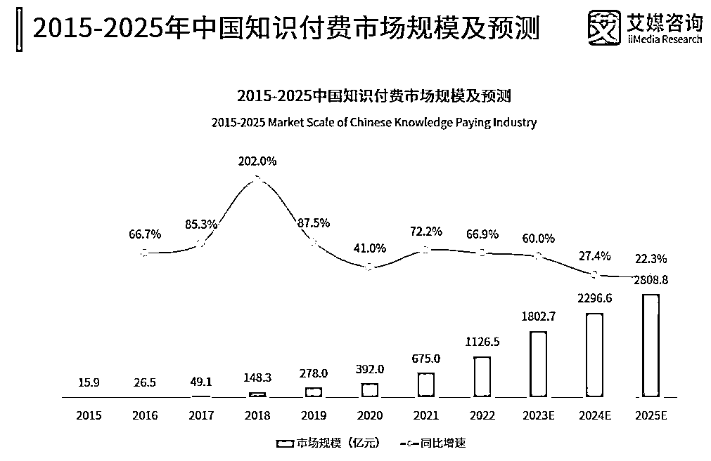

我1990年出生，今年34岁。小时候，大多数人的世界只有两个：现实世界，以及有阅读习惯的人，还能进入书里的世界。书中自有黄金屋，我就是靠大量阅读和自学改变处境的人。我先活在底层，再一步步挪到中产。信不信，全看个人选择。

现在这一代人，以及今天的孩子，比父辈多了一个世界：互联网。现实世界、书里世界、线上世界，三者并列。

线上赚钱的门路很多，不是只有做号一条路。对有本职工作、家庭背景普通的人来说，最现实的路线其实只有两条：一是线上卖货，二是卖知识产品。

卖货的逻辑很直白：把货物卖出去，赚佣金。种草社区、二手交易平台、短视频App上那些不用囤货的模式，基本都绕这个逻辑转。你要搞流量、推商品。其中又分不露脸的IP式卖货，和不露脸的剪辑、只拍产品式卖货。如果你既是宝妈又有本职工作，这条路很难走通，因为你要选品、找爆款、备素材、对接供应商、找货源、处理订单地址和退换货，时间根本不够用。

那剩下的就是卖知识产品。它的覆盖面极广，万事都能做成产品。各平台也有对应项目，比如知乎的带货功能、中视频计划、短视频切片、公号流量分成等。有些项目逻辑很朴素：靠爆款换平台流量，再换收益。以前头条号一万阅读大概有5到10元，十万阅读就是100多，具体标准后来我没再关注。公号流量分成也一样。

这类收益本质由平台说了算。平台缺内容，分成调高；内容多了或项目砍掉，收益就没了。这跟给别的号供稿没区别：博主缺稿，你就能收钱；博主不缺，你再优秀也没用。说到底，这是在给平台打工。你会发现自己处在食物链底层，时间只能卖一次，还卖得特别便宜。

你肯定不甘心。筛到最后，只剩一条真正值钱的路：把自己做成有辨识度的IP。IP是什么？是在线上持续露脸、持续输出，让陌生人对你产生信任。我的公号就是一个典型。所谓露脸，不一定非要开摄像头直播，用文字和图片展示你的观点、你的变化、你的生活，同样是露脸。

做知识类产品的人，有的教怎么赚流量分成，有的教怎么做IP。我属于后者。即便在IP这个圈子里，也分不同流派，这里不展开讲。想搞懂底层逻辑，可以看看知乎高管写的《创作者》。

那些动不动说卖课都是割韭菜的人，多半还没真正进入线上生态，还停留在旁观者视角，对内容行业的收入和玩法完全不了解。思维方式没转过来，自然吃不了这碗饭。我们遇到这种质疑，只会回一句：您说得对。没必要较劲。

我把底牌亮给你看。这是我的工作🛰️收入记录，这个号只用来做内容和卖产品，别的业务一概不掺，所以截图能反映真实的内容收入。其中有帮别人分销的佣金，也有卖自己课程的入账。

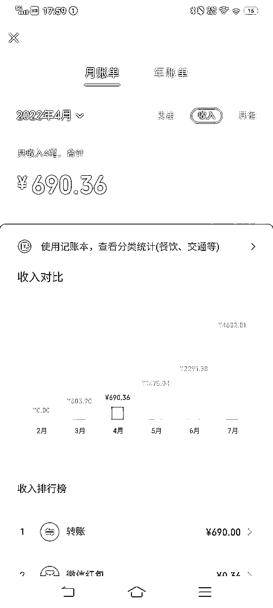

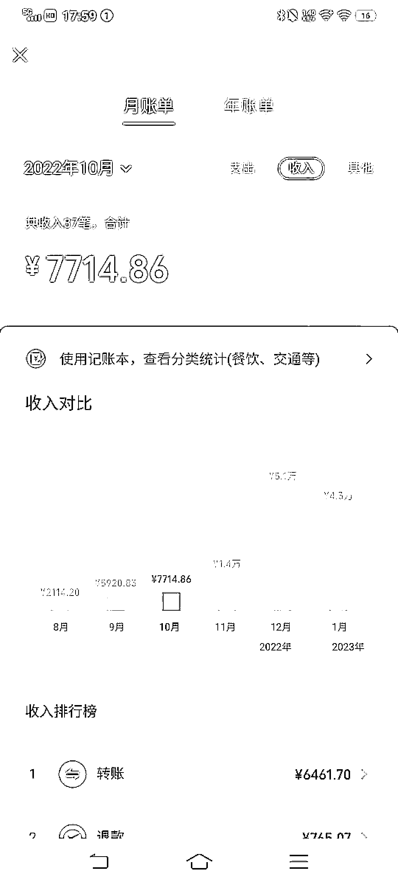

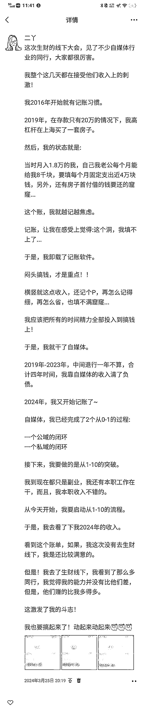

内容这行有自己的行业交流活动，圈外人根本不知道。赚钱从来不容易，只懂皮毛的人只能接到零散小活。要在一个领域真正挣到钱，必须沉下去深耕。自己挣不到钱就骂行业，行业不会因为谁的骂声改变。

前面讲清了为什么要做公号，以及公号怎么赚钱。接下来回答新手最容易碰到的两个基础问题。

## 三，新号没有评论入口怎么办

2018年后注册的公号，默认没有评论功能。下面这是有评论入口的样子：

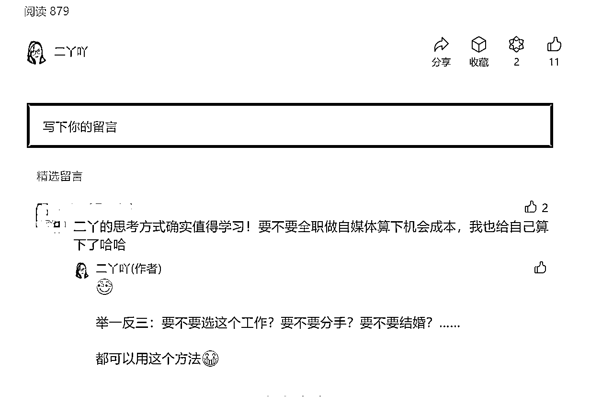

这是没有评论入口的样子：

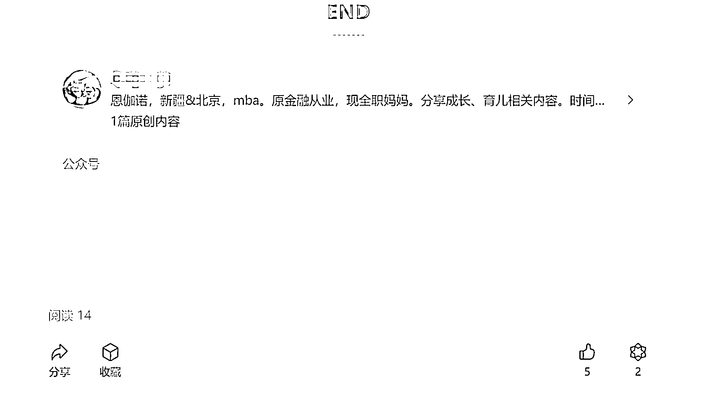

没有评论功能的号可以开启私信，但只有号主自己能看到，读者之间互不可见。好在公号最近在改版，评论功能也在慢慢放开。

评论互动原本有三个价值：带来新选题，给更新提供动力，增加关注者黏性。但在“好内容”面前，这三项都可以忽略。如果你的内容本身没有价值，根本不会有人理你。所以第一步永远是内容。

可没有互动、没有新增关注、没有收入，谁也难坚持。其实可以换一种方式：每篇文章末尾附上你的个人🛰️，最好专门注册一个工作号，别和生活、公司的🛰️号混在一起。就像这样：

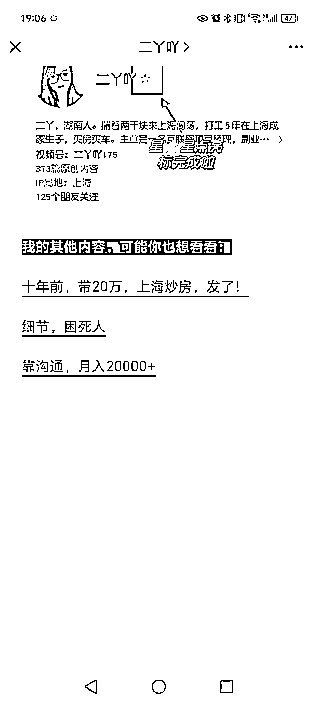

看到文章有收获的人，自然会加你。如果你写的内容真的触动了他，私聊里随时会出现他的反馈，同样能帮你找选题。

即便我的公号有评论入口，也常有人加🛰️，告诉我读完文章的感受：

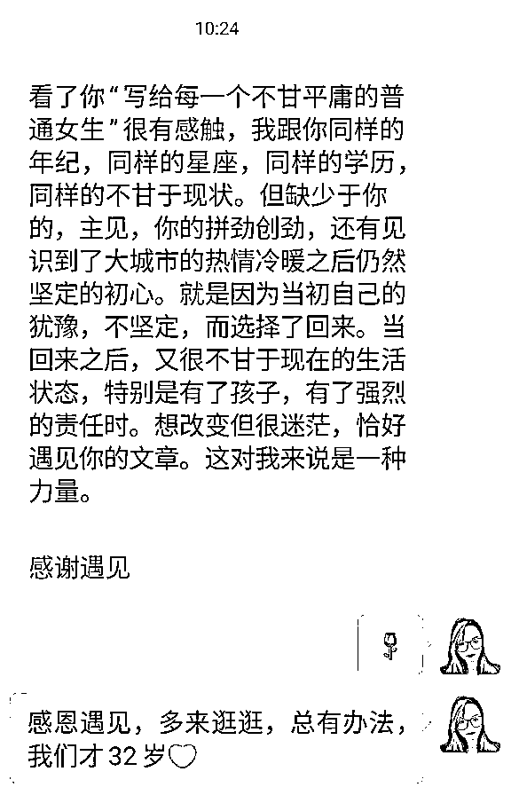

这里有个细节：我的回复都很简短。为什么？因为号有了一定关注量后，加我的人太多，没时间逐一深聊，只能礼貌地回一句。但刚起步那会儿，我完全不忙，有大把时间陪人聊天。那时我很缺素材，会主动拉着加我的人聊。

多聊的好处有三点：交一个线上朋友，换到一些信息，最差也能当写作素材。我通常看到新人，先聊上两个来回。如果对方也愿意交换信息，关系就能往前走，因为聊天过程里，我也会释放信息给对方。如果对方只想要我的经验，却不肯回馈任何东西，我就不再继续，这种人很难成为真正的朋友。

还有一个更现实的认识：线上几乎交不到真心朋友。多数人靠近你，都有自己的目的。看清这一点，就不会纠结。聊得来就继续，聊得累就停下，对方越界索取就果断断开。

当然，我也会主动去认识别人，到别人那里取经。我懂内容这个圈子的交往规则，所以会先发一个红包表达诚意。有人接，也有人不接。

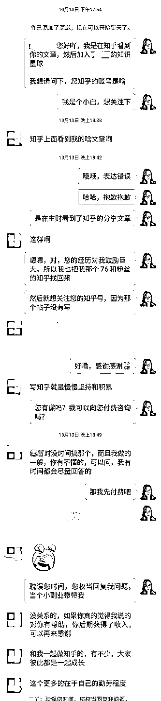

这就是我想分享的全部。方向很多，但适合普通人的路其实很窄；选对了，再笨拙地坚持，时间会给答案。

我见过一个特别典型的案例。当时刚一加上好友，我就直接表明态度：我愿意付咨询费，认可对方的专业度，希望得到指点。

**那些只想空手套白狼、一毛钱都不想掏的人，是赚不到钱的。**

免费的东西当然能拿到一些，比如普通的信息差，靠白嫖确实能搞到一点。但真正值钱的核心信息差，永远不会免费送到你手上。

免费模式下，我顶多给大家普及一下自媒体的基础常识，做个入门扫盲。

但你想知道具体怎么拆分步骤、怎么落地执行吗？那对不起，没法告诉你。这东西三言两语根本讲不透。

那个朋友跟我聊了足足四个多小时，甚至把自己付费报课的课程链接都免费甩给我了。我从他那里拿到不少关键情报，这直接帮我省了一大段弯路。

当然，整个过程里我也没藏着掖着，把我自己做👸号的经验同样分享给了他。

所以你看，**自媒体圈子的社交潜规则就一条：价值互换、信息互换。**

说白了，整个社会运行的逻辑也都是这样，自媒体只是其中一个缩影。

你想让亲戚帮你介绍个工作，不也得拎两箱水果上门坐坐吗？

这个行业，一模一样。

**所以你作为一个刚入场的小白，最不缺的就是时间。那些主动跑来链接你的人，就是你的宝贵资源，多跟他们聊，多攒素材，回头全都能变成你👸号的养料。**

上面说的，就是拿🛰️当读者互动阵地的玩法。

## **四、👸号起步阶段，到底写什么？**

新手刚开始运营👸号，第一篇文章的选题从哪来？

经常有小伙伴跑来问我：

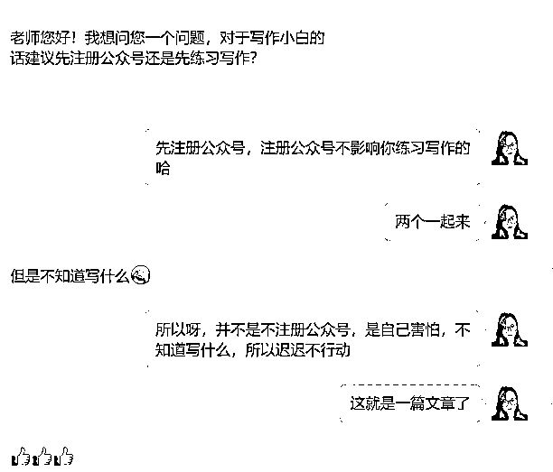

**私域场域最大的妙处就在于：你根本不需要把内容锁死在某个垂直赛道，只要你的受众是垂直的就够了。**

举个例子，如果你的粉丝集中在 20 到 50 岁这个区间，那职场、副业、买房、装修、夫妻相处、原生家庭、书评、自律……这些话题你全都写得。

因为这群人的真实生活就是这样，一边为工作发愁，一边为感情烦恼，一边要供房，一边还要陪孩子写作业。所以你尽管写，写你想写的就好。

不需要急着拿“定位”这个词把自己框死。

先写起来，写着写着你自然会发现自己在哪块比较有感觉，定位是边写边长出来的东西。

那这时候可能又有人问：我年纪轻、阅历浅，写出来的东西哪来的“价值”？

答案是：多去读，多去看别人在写什么。

去扒那些真正“与众不同”的视角。

如果你是已婚人士，说话就可以不用太端着，直接点、坦率点——这本来就是已婚身份自带的一个优势，得好好用起来。**比如我自己，“说话直”就是我的标签和人设之一。**

但如果你是未婚状态，那实际情况是，话讲得太“透”、太“直接”确实需要消耗额外的勇气和能量。这份能量从哪来？就看你平时关注哪些博主、吸收什么内容了。**你完全可以走“温柔但有力”的路线，同样把想说的表达得清清楚楚。**

明白这两点，你现在就可以动手写了。

总结一下：**新手入行，第一件事就是“马上开写”，手别停，想写啥写啥。**

反正头一个月你大概率是赚不到钱的，那这个月就别东张西望，只看“怎么写内容”“怎么把文章写好”这类东西，别的统统别碰，省得打击自己的士气，白白给自己添焦虑。

你就只管研究内容、死磕内容，等基本的内容框架立起来了，再来琢磨运营、变现那些事。

【往期内容】

1）[📕 1 条笔记变现 4000+，聊聊我的爆款创作思路+引流变现全流程](https://t.zsxq.com/SUUhx)

2）[花 1800/月招小助理，副业做自媒体赚到 40 万](https://t.zsxq.com/tNXpB)

3）[内容更新频率，日更≠能做成一个账号](https://t.zsxq.com/135Hvhqii)

4）[做自媒体要先确定自己的优势和变现模式](https://t.zsxq.com/13QbjtfMd)

* * *

评论区：

龙哥 : 优秀

A 大熊 : 学习了，虽然不做自媒体，但是还是看得津津有味。厉害了，一个电商老鸟致敬

* * *