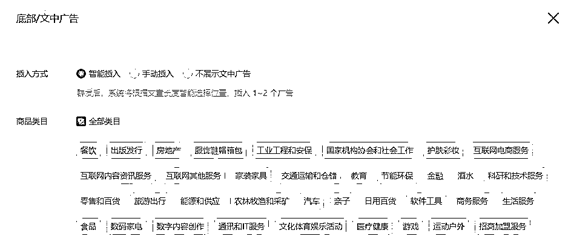
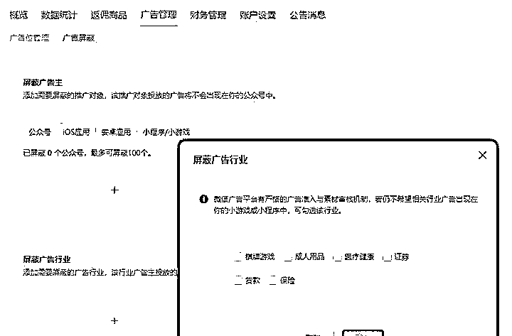
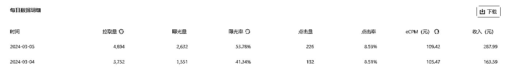
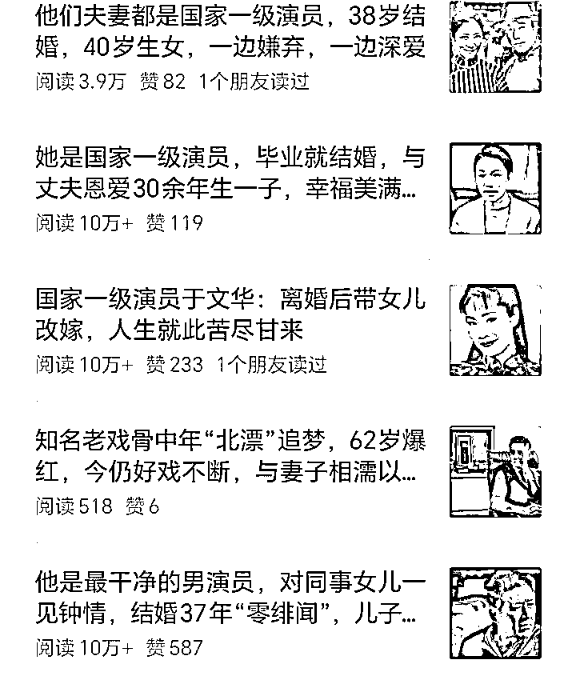
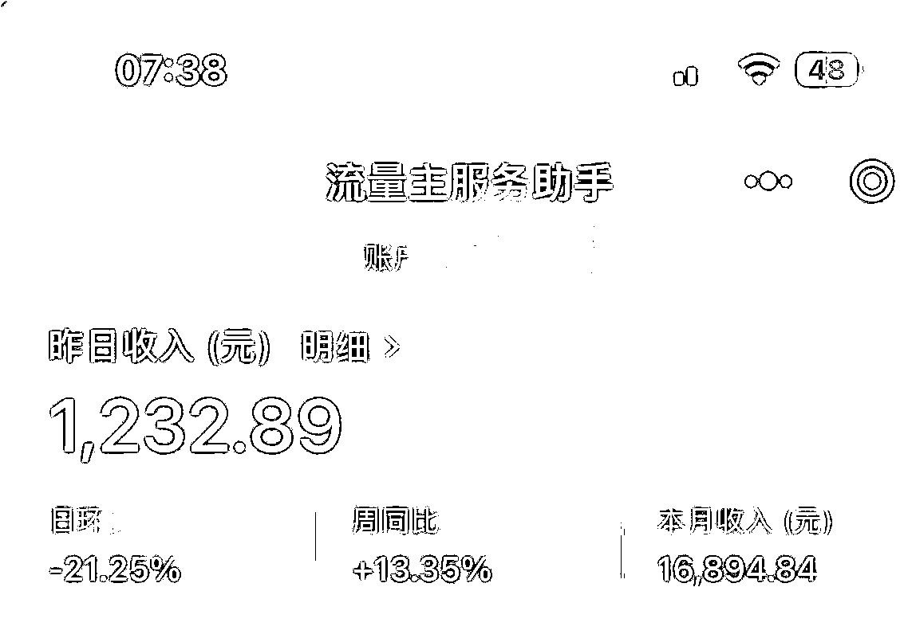

# 👸号流量主变现，这三件事做了就能涨钱
作者：龙哥

## 👸号赚钱的三大核心打法

作者： koko

日期：2024-05-24

**一、把流量主收益做起来的三个实操方向**

### **01 打法一：把广告设置调对**

广告位的设置能动两个关键点：

**① 让广告更贴人**

广告要选和号定位、粉丝画像气质相符的行业。匹配度上去后，读者点击意愿和转化率都会跟着提升，收益自然也就上来了。

像底部广告和文中广告，都能手动挑选行业，也能交给系统智能投放。你要是没啥经验，就直接用智能投放，手动的选项就别去碰。

如果你对自己账号比较了解，可以在广告类目里勾选和粉丝画像高度重合的行业。注意，不同行业的点击单价差异很大，除了选相关度高的，也要把高价值行业一并勾上。系统长期积累你号的数据后，就懂得给你推什么广告最赚钱。

**② 别把高价广告给屏蔽了**

去广告屏蔽设置里检查一下，有没有不小心把高价行业给关掉了。

**高点击价值广告一般指哪些？**

通常就是那 6 大类，广告主给的 CPC 普遍高于其他行业。所以你会发现，财经垂直号的阅读量不一定高，但同量级的收益却能甩其他领域几条街。

### **02 打法二：把 eCPM 想明白**

之前讲过，流量主的结算逻辑是：eCPM = 广告曝光量 × 广告点击率 × 广告出价

也就是说，决定收益的本质上是曝光量、点击率和出价三者的乘积。赛道定了之后，出价我们干预不了，能主动优化的只有曝光量和点击率。

做法就两条路：

一条是持续出内容，用量换曝光；

另一条是做点击率优化，用策略把读者引流到广告上。

### **03 打法三：把爆款选题榨到干**

这个赛道一上手就会发现，80% 的收入其实都集中在少数几篇爆款上。所以做出爆款选题才是最关键的事。很多人找爆款的思路是学同行低粉爆文，但还有一个成功率更高的玩法：把自己账号的爆款榨干。

**怎么榨？**

简单说就是复用。把最近的爆款主题拿出来反复做同款，直到这个点子的价值被耗尽。

为什么要抢跑自己？

因为你不做，别人看到就会跟。你好不容易跑出一个爆点，自己不持续深挖，就等于把饭碗让给别人。别人火了你再说抄袭，收益早跑了。

对于做流量主的号来说，先拿钱再说。不是让你无脑复制粘贴，而是保持核心角度不变，不断延展。

总结一下，上面三种方法最好一起用，效果会更稳更持久。

我之前操作的那个号，就是死死抓住“狂飙”吃瓜这个点反复写，最后撸了 1.6W 收益。所以一旦抓住一个热点，就要一直挖一直写，直到这波热度彻底凉掉。

# 二、目前能做的八个高产领域

1.家庭情感故事类
主力人群是中老年人，时间多、爱转发、偏爱家长里短。更关键的是，这个群体更容易误点文中广告，点击率天然有优势。

2.热点追更类
蹭热搜就是蹭流量，有搜索、有推荐、有情绪。记得要快，热点来得快去得更快。选题最好带情绪，像让人愤怒、气愤、社会不公等，少堆砌事实，多输出态度和观点，才能点燃读者。

3.国学鸡汤类
主打中老年市场，用子孙、福报、健康、遗憾等大主题做包装。配上一个温情故事，阅读量和完读率都不错。

4.三农类
农民、农村、农业相关，加上养老金、退休金等关切话题，很容易出爆款。

5.名人金句类
借名人自带流量，比如罗翔说、莫言说等，引发讨论和情绪共鸣。注意现在很多语录是编的，别夸张到失真。

6.天气预报类
大家出门都看天气，是个刚需信息流。和三农结合效果更佳。

7.历史类
从正史到野史，人物、典故素材无限，发挥空间很大。

8.影视影评类
结合正在热播的剧或电影写，流量是最大的。热点影视 = 自然流量。

* * *

评论区：

koko : 新手起号建议从生活、娱乐、星座这三个方向入手，上手快

koko : 找准一个“点”，然后围着这个点猛发内容

Rio : 自己榨干自己这个思路很绝

* * *