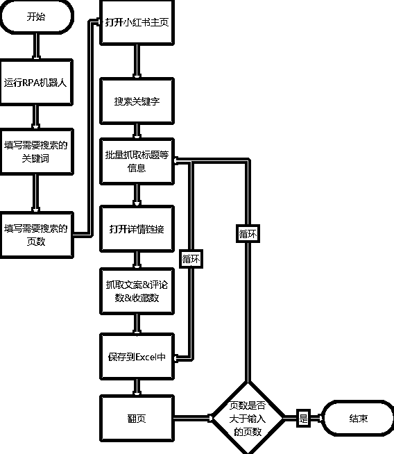
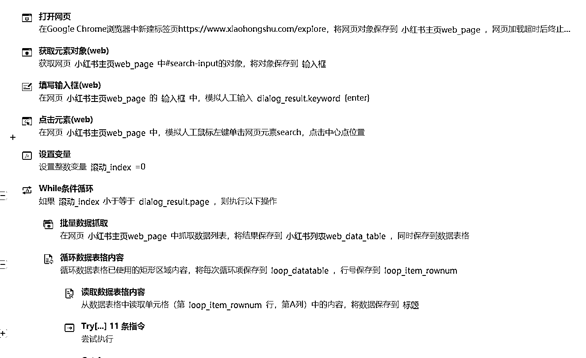
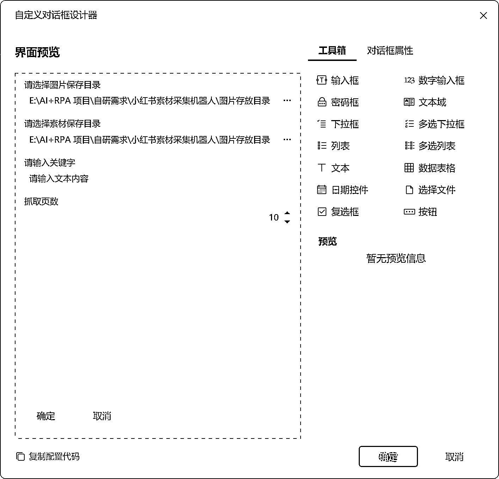
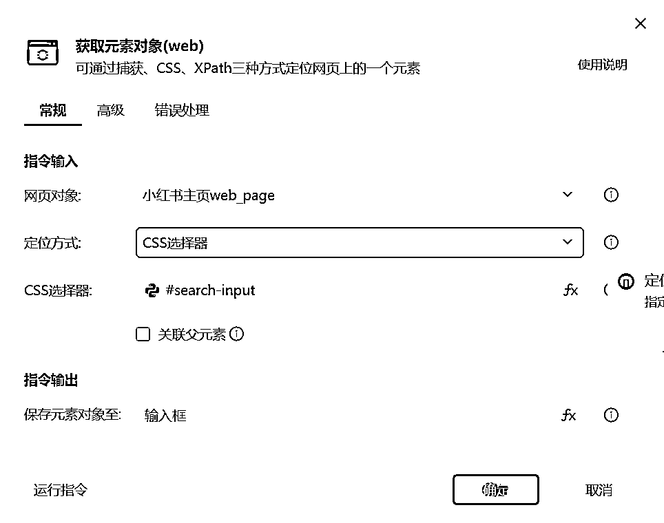
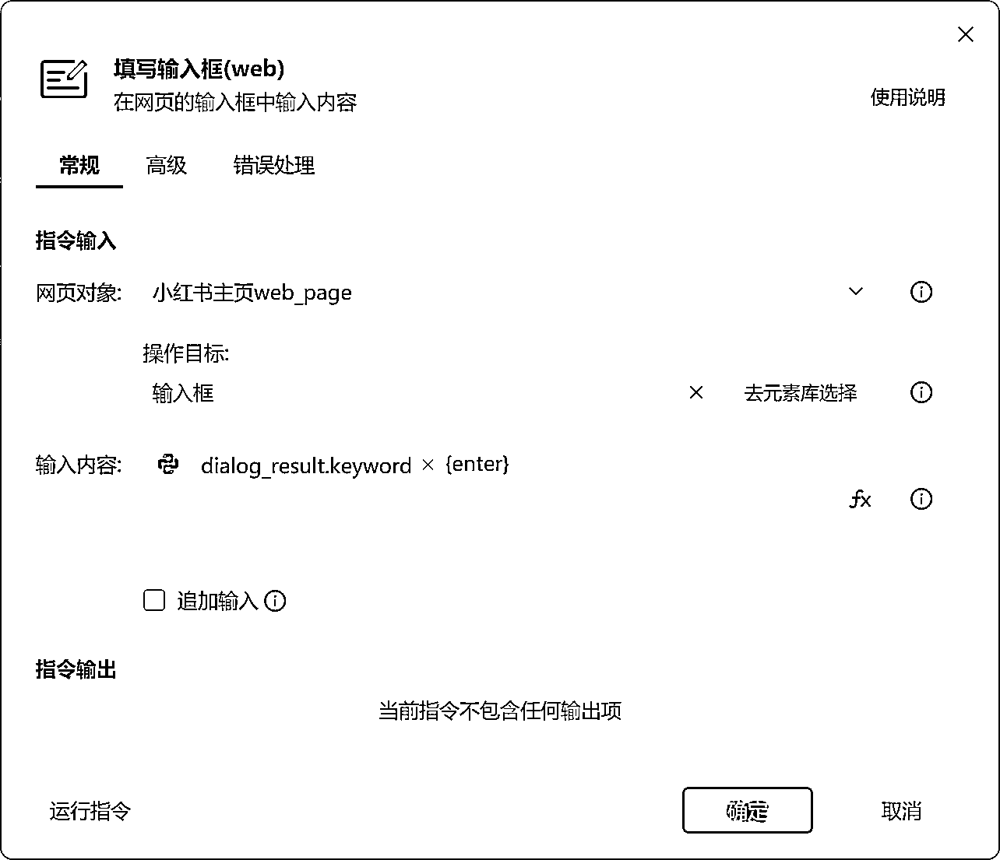
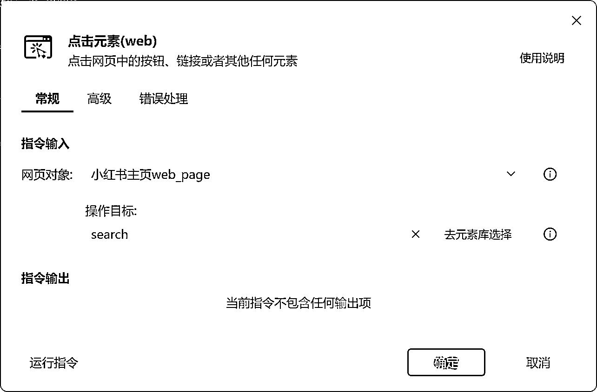
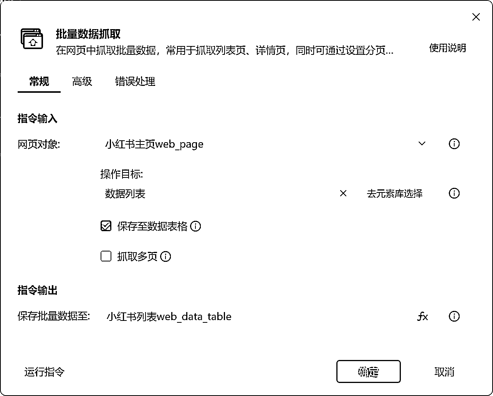
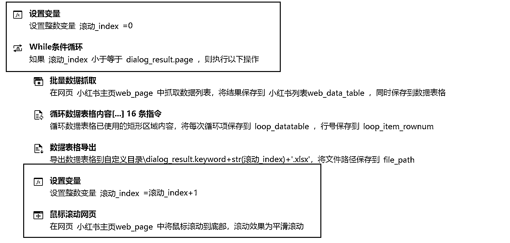
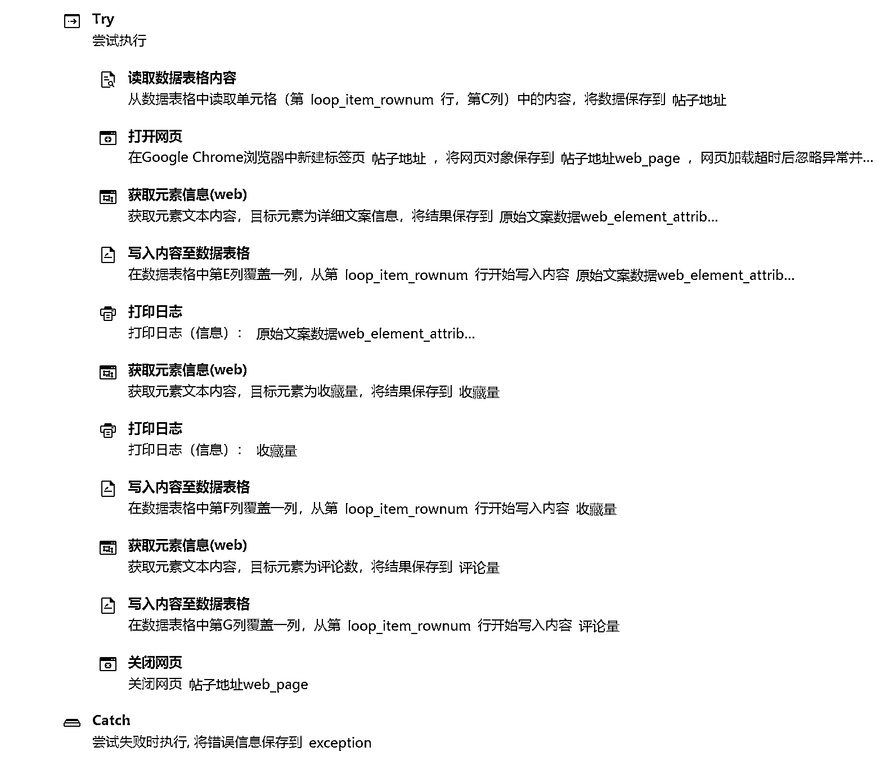

# 手把手教你做一个📕爆款笔记关键词采集机器人，附全套代码实操

## 获取 23 个赞 的📕关键词搜索素材机器人实战教程 | 完整代码截图版

作者：码农飞哥 | RPA 定制开发

发布时间：2024-05-20

大家好，我是码农飞哥。现就职于上市公司，CSDN 认证博客专家，主要方向是 RPA 自动化机器人开发，以及各类毕业项目定制。

## 一、为什么需要这个工具

做自媒体运营时，核心工作就是盯紧自己赛道的爆款内容和竞品账号。比如做美妆内容，就要持续追踪美妆垂类的爆款笔记和标杆账号。**越垂直、越聚焦，赛道账号才越容易做起来。**

### 1、实操演示

暂时无法在飞书文档外展示此内容

下面这张图展示了我用关键字搜索爆款笔记的完整流程：

## 二、机器人运行逻辑

1、启动 RPA 机器人后，在弹窗里填入你要搜的关键词、指定爆款笔记保存的文件夹、以及需要翻查的页码，默认是 10 页。

2、程序会自动打开📕网页版首页，并在搜索框里填入关键词。

3、抓取列表页的标题、博主昵称、头像、点赞数等信息，并写入表格。

4、自动进入每篇笔记详情页，抓取正文、收藏数、评论数等信息，同样写入表格。

5、自动翻页，循环执行下一页的采集任务。

## 三、影刀 RPA 搭建拆解

### 1、整体流程图

### 2、参数输入环节

这里我采用的是一个自定义弹窗来接收参数。之所以这么做，是因为本项目输入项比较多，如果用系统默认弹窗就需要多次弹窗，体验很差，所以选择了自定义弹窗来一次性收集。

### 3、关键词搜索环节

定位搜索框时我用的是 CSS 选择器，并把该元素命名为 输入框。有人可能会问，为什么不直接用可视化捕获？因为我实测过，直接捕获经常元素定位失败。

#### 2.1、填充关键词

在上一节点用【获取元素对象】拿到输入框对象后，这里使用【填写输入框】指令从元素库中调用动态元素 输入框。填入的内容来自弹窗里的关键词，并追加 {enter} 实现回车提交。

#### 2.2、触发搜索

该步骤用于模拟点击搜索按钮，完成搜索动作。

### 4、数据采集环节

数据抓取分为两部分：列表页抓取和详情页抓取。

列表页抓取的是标题、作者昵称、点赞量、详情页链接等一屏可见信息，因为这些数据无需点进去就能拿到，所以可以直接提取。

#### 4.1、批量抓取列表

使用【批量数据抓取】指令即可一次性获取当前页所有可见条目，通常一页约 25 条。

#### 4.2、翻页控制

单次批量抓取只有 25 条，远远不够用，所以必须配合翻页。翻页的核心逻辑如下：

采用 While 循环，当当前页数未超过用户设定的最大页数时，就持续执行翻页并抓取。

#### 4.3、详情页补充抓取

详情页的抓取思路是读取已保存表格中的链接，逐条打开解析。具体的抓取细节会在下一篇继续展开。

* * *

评论区：

暂无评论

* * *