# 我在抖音小店折腾一年，才悟到别只盯利润不看成本

> 原文：[`www.yuque.com/for_lazy/zhoubao/vzs1hlcolb1ayqu7`](https://www.yuque.com/for_lazy/zhoubao/vzs1hlcolb1ayqu7)

## 我在抖音做小店一年，只看利润不看成本差点亏了

作者： 安信

日期：2024-05-24

懂数据，才算真正跨进电商门槛。

今天不先晒战绩，先放两张后台截图，你来判断哪家店在赔本，哪家店在赚钱？

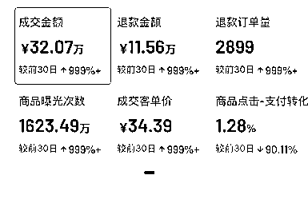

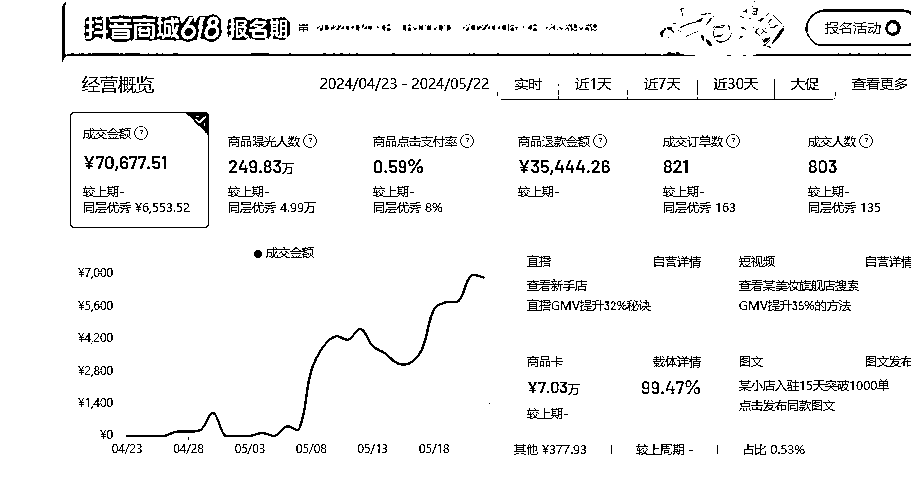

先别往下翻，不管你是否接触过电商，都可以在心里先有个判断，我这篇也会帮你把抖音小店里的常见误区捋清楚。

大家好，我是安信，做电商已经第 8 个年头了。

抖音小店是当下最火的赛道之一，从去年起我就一直在试水，可以说抖音小店能踩的坑，我基本都踩了个遍。

去年团队做抖店基本是赔本赚吆喝，从今年 4 月换了打法后局面才扭转过来。如今所有店铺合算下来，日销稳定在十万左右。这样的体感，让我想起了 18 年操盘天猫店群的时期。

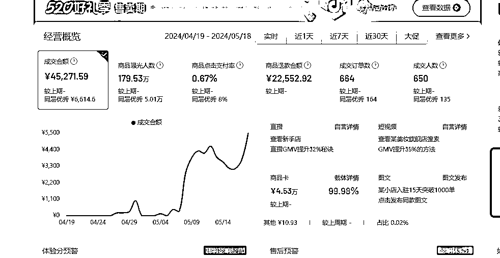

2023 年我们犯的最致命的错，就是只盯着单品利润，看不见综合成本。

后台每天显示利润 4 万、5 万、8 万，看着很漂亮，很快就飘了。结果客单太低，算上人工、运营、售后等隐性开销后，发现基本是在亏损的边缘试探，团队瞬间被打回原形。

我后来才明白，高退款率叠加低客单的模式，在抖音上根本走不通。

于是我们调整方向：把客单价拉升到 150 以上，单笔毛利做到 80 到 100 左右。即便售后成本按 20 元/单算，也能稳稳赚钱，同时人力成本也能被大幅压缩。

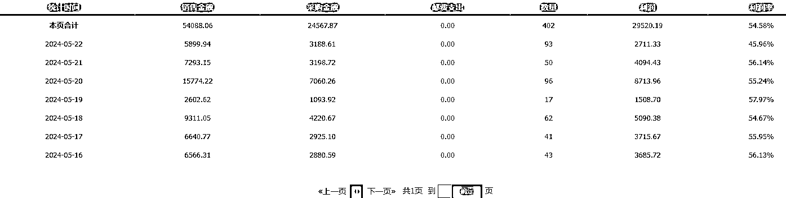

我个人总结，抖音小店能不能挣钱就三件事：**利润率拉满、零付费、客单价拉高。做到这三点，不赚钱都难。**

这个逻辑会贯穿后面整个操作，听我慢慢展开。

# **一、开店准备**

做抖店第一步是入驻。

开店有两点必须注意，一是店铺类型，抖音对个人店和企业店的扶持差异很大，所以我们优先做企业店，通过代办渠道搞定，花费大概 2000 元左右。

二是类目选择，最好选免入驻费的类目，省成本；不同类目的起量速度、利润空间、退货比例也不一样，注册前就要想清楚。

无论选什么类目，一旦做高溢价，受众素质普遍会更高。即便难免出现瑕疵品，退款率也还能接受，做好售后，利润照样可观。

**1、店铺注册**

现在个人店权重太低，所以我们尽量做旗舰店或专卖店。这需要一张营业执照，可淘宝代办或找记账公司代办，商标授权也需要准备好。

办证成本大约两千块，基本是前期唯一的硬性投入。

注意，多店运营时要把主账号放在服务器上登录。一个法人最多关联两家店，法人和 IP 都会被关联。

抖店入驻官网链接，材料和费用都在里面：[`fxg.jinritemai.com/enter/quali-fee?btm_ppre=a0.b0.c0.d0&btm_pre=a1032.b72953.c6917.d63973&btm_show_id=95da929c-02b9-4251-93f8-491fb92a6549`](https://fxg.jinritemai.com/enter/quali-fee?btm_ppre=a0.b0.c0.d0&btm_pre=a1032.b72953.c6917.d63973&btm_show_id=95da929c-02b9-4251-93f8-491fb92a6549)

**2、类目挑选**

注册时商标授权的类目就决定了后续能卖什么。

我们目前操作较多的类目有：服饰配件、男装、男鞋、童装、女鞋、家居日用、女装、收纳整理。

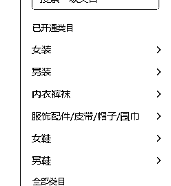

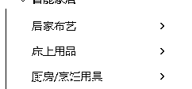

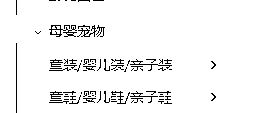

每个类目各有利弊：比如服饰配件，起量快，但退货率高利润也高；收纳整理，流量慢且少，利润偏低，但退货少。

不存在又快又高又少的完美类目，选自己熟悉的，或者把几个类目都试一遍筛选最适合的即可。

**二、冲体验分**

店开好后怎么起号？

最常用的手段就是刷体验分，这可以说是流量加速器。现在平台推流和体验分强绑定，分数上去了才有机会拿到自然流量起号，反之分掉了基本就凉了。

具体影响可以看下面这张图，概念对就行，数据仅供参考。

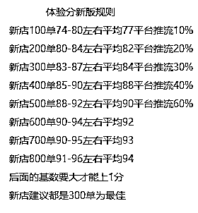

体验分主要看近 30 天的商品质量、物流履约、商家服务。分享两个我常用的拉分方法，单均成本基本控制在 3-4 元。

**第一种：**在抖音商城找爆款，基本是日用百货、袜子这类大众品，去 1688 找同款后降价 3-4 元亏本上架，通常 2、3 天就能出三四百单。思路就是抖音 App 里打卡居家百货，市场大、人人能买的品，如垃圾袋、衣架、纸巾等。

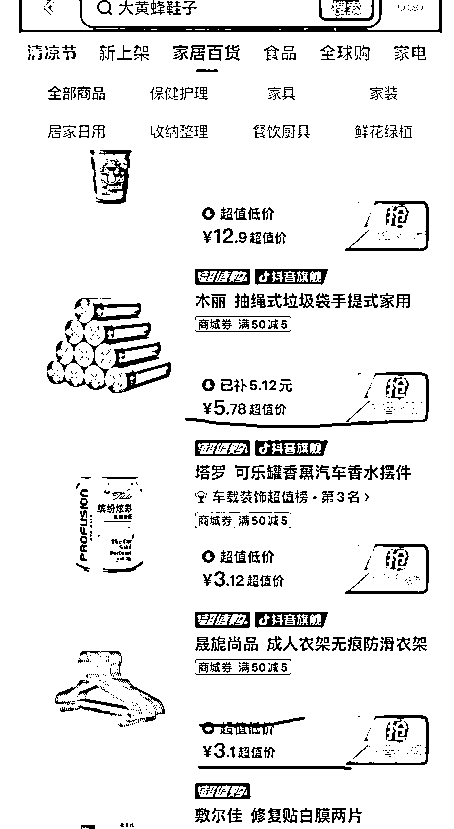

举个例子，抖音上 9.9 元/10 包纸巾，1688 可能 8.5 元能拿。我们定价 4.9 元，单亏 3-4 块，放到抖店很容易动销。

**第二种：**找服务商合作，他们帮你亏 1-2 元/单，再投流亏本，综合下来一单也是 3-4 元成本。

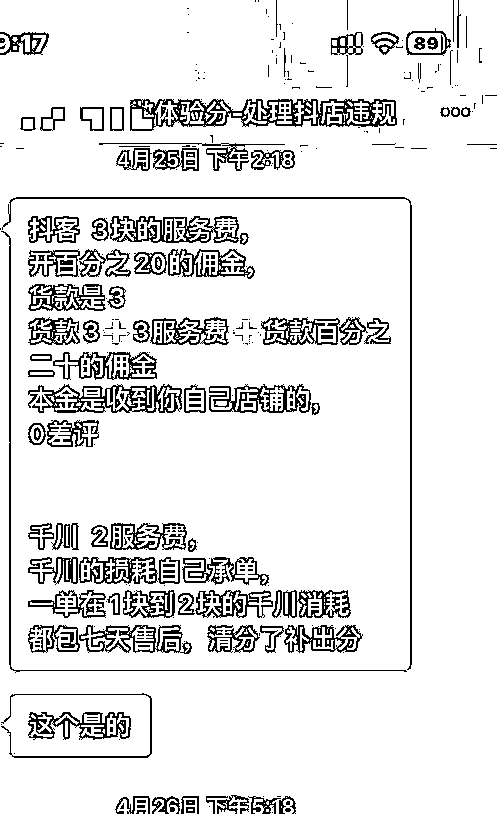

此外体验分还包括回复速度等细节，要每天盯着，尽可能保持在 90 分以上，这点不难做到。

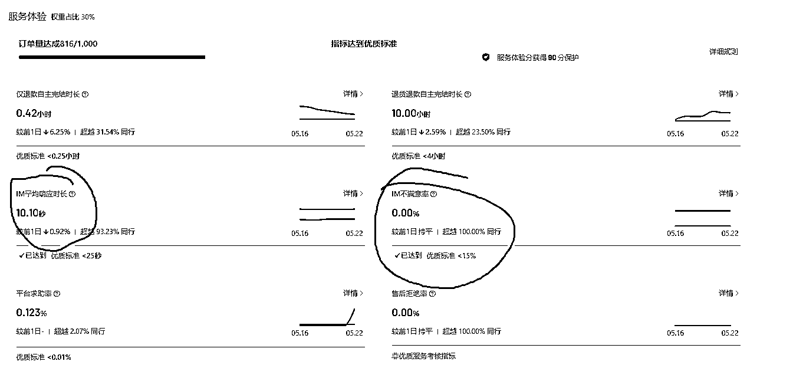

当店铺体验分稳定在 85 分以上，就能开始批量上货了。

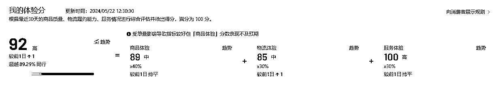

# **三、采集选品**

这个模式的核心就是高客单、高毛利，搞定货源，搞不定就中转，合规即可，关键看执行。

现在无货源被严打，所以我们选品就两条路：

**1、货源网站一件代发**

直接用货源网代发。

1. 居家日用品 👉义乌购或 1688 一键代发
2. 男鞋 👉环球鞋网
3. 童装 👉3e3e 生意网
4. 女装/女鞋 👉17网、货牛牛

1688 本身就覆盖了绝大多数品类的一件代发。

**2、淘宝、拼多多中转**

第二种是先在淘宝、PDD 上选品，客户下单后我们再下单，然后发到中转仓重新出单号。

缺点是时效会+24小时，但淘宝 PDD 的品都是商家筛选过的，品质相对有保障。

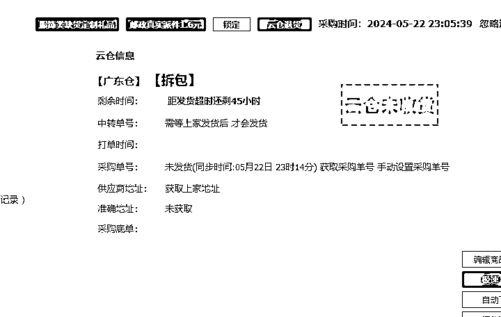

以淘宝童装为例的选品流程。

先搜【童装】，把搜索下拉框的相关词全部记录下来，比如童装女洋气时髦套装、童装女夏款等。

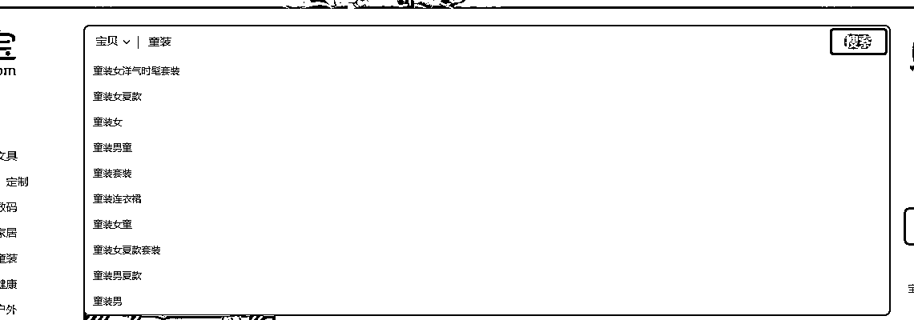

再用这些关键词搜索，按销量排序。

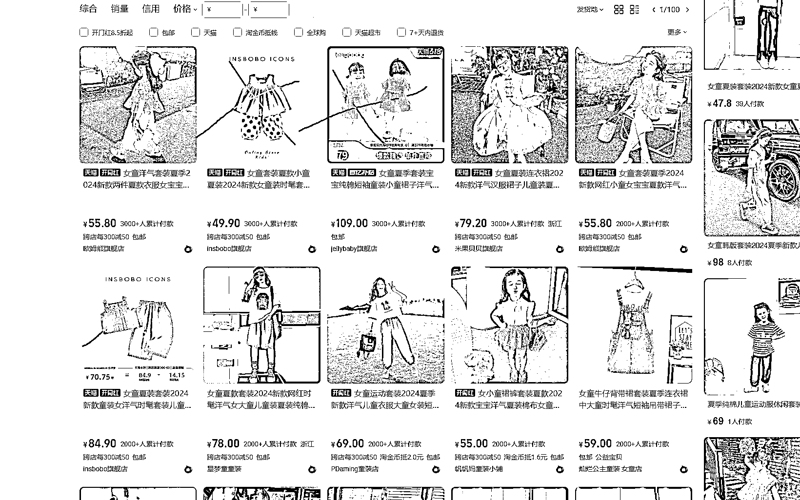

**关键点，必须选无 Logo、无英文的品。出现商标就要罚款，这种无谓成本必须规避。**

所以选品要看两遍以上，图片任何角落都不能有 Logo 或不明品牌，要足够干净。点进详情看五张主图，确认无 Logo、英文、品牌标识后才能拿。

按这个方法持续选，一天挑 2000 个品完全可行。当然也可以用软件批量采集几万个再慢慢筛选。

上架时我们用第三方工具复制，比如熊大复制、欢乐逛等。

以熊大复制为例：

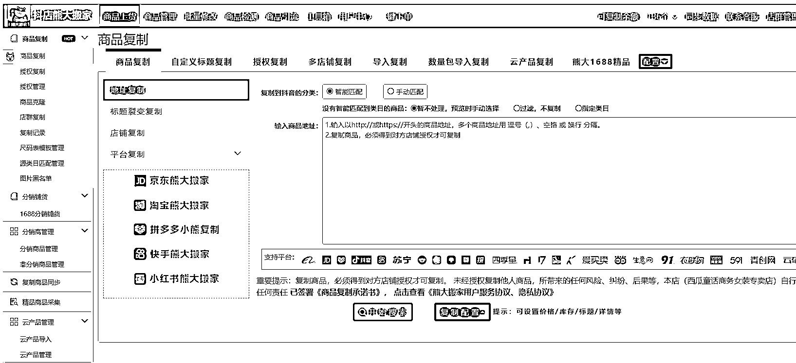

放链接后，我们一般按 *2+5~10 的公式定价，这是测试后利润与出单平衡的区间。

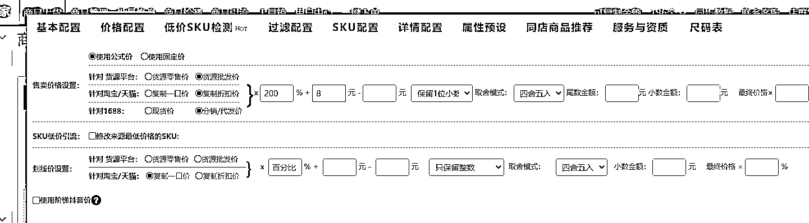

链接导入后挂机即可，上传越多，曝光越多。

一般上几千个 SKU，第 5-7 天就能有几万曝光点击。这个时候一定要持续上新，流量才会一直续上。只要体验分不掉，流量就不会断。

客单高转化低是正常的，坚持上货，总有流量进来。

回到开头的两张图，现在你应该能判断出哪家盈利哪家亏本了。

表面看，30%退货率、1600 万曝光、1.28%点击支付率，好像比 50%退货率、200 万曝光、0.59%点击支付率更好赚。

实际上，高曝光低客单的人工运营成本是成倍增长的。因为询单多、退货多，20 万 GMV 要处理将近 3000 单退货。而客单拉高后，30 万 GMV 只需处理 400 多单退货。

所以结论是图一在亏本，图二是盈利的。

再次强调我的抖店逻辑：高客单、高利润，全靠免费自然流量，不做付费投放。

最后给想入局的朋友两句心里话。这个项目我从 0 开始重新做的，之前的店都退了，执行力到位一定能出成绩，基本是百分百能跑通。

这个赛道有机会也有风险，想一口吃成胖子不可能，慢慢来，效果自然会来。

以上就是我的实操分享，有问题欢迎留言或私聊，我看到就会回。

* * *

评论区：

葱葱 : 哇，学习了

X : 屌的 bro

Gens : 请问可以推荐靠谱的云仓吗

rrcc : 上架几千个品，就是测哪些能出单吧

安信 : 私聊吧，放网址不太好

龙哥 : 牛逼

张伟峰 : 现在同款比价怎么解决

* * *