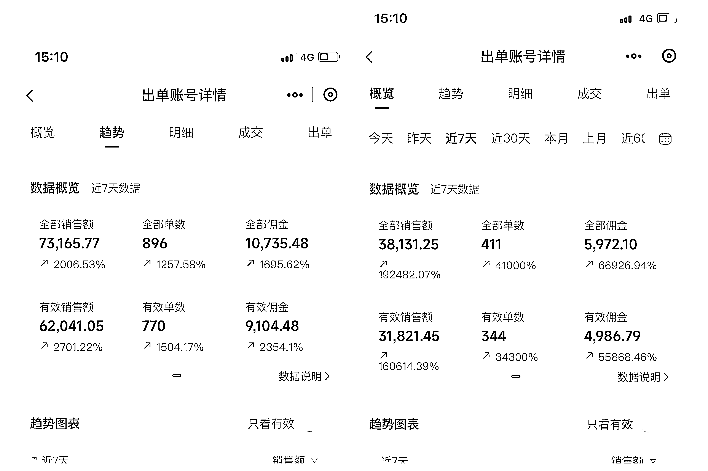
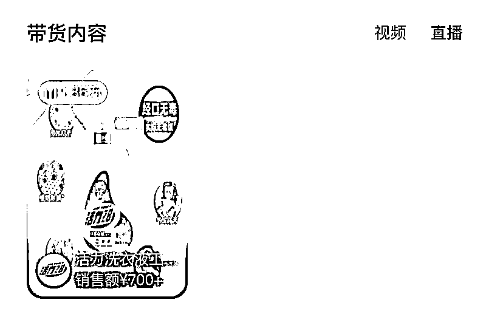

# 首次入局抖音半无人直播，7天GMV冲到11W+，佣金1.1W，我总结了7个实战心得

先还得认真感谢一下生财这个平台。23年考察项目那会儿，正好看到圈里的优质内容，才决定入局抖音短视频带货，时间一晃一年多，也算有了点小成绩。最近遇到增长瓶颈，想着能不能找些能互相加持的项目，就又回到生财来找灵感。结果还真就翻到了师姐的那篇《抖音半真人直播：新手小白7天GMV破10W》的帖子，一下子让我对半无人直播起了兴趣。如果你还不熟悉这个玩法，建议先看看那篇文章。

从第一次开播算起，我总共做了15天，最近7天里GMV跑到11万多，佣金1.1万。跟圈里的大佬比当然不算什么，但越做越觉得这个方向还有很大的上升空间。老规矩，先看数据，目前我一共有2个号在跑：

其实半无人直播的技术和操作，很多大佬已经讲过，真要跑通全套路径，最多花一天时间就够了。所以今天我重点不讲技术，而是把这段时间验证过的几个关键动作和思路分享出来。选品我放到最后，先卖个关子。

**第一，前期别找代播，也别用兼职心态，所有环节都要自己亲自上。**
一件事只有你从头到尾跑通过0到1，才会真正明白哪些环节重要、哪些可以忽略，也才知道日后什么事能外包、什么事必须自研。我以前没碰过直播，第一次开播也紧张，但想赚钱就必须克服。从实操第一天开始，我一个人连续播了10天，每天大概1.5小时；这个项目跑了15天，我一共播了13场。
结果怎么样？虽然还称不上专业主播，但至少开口不结巴了，手里有个内容框架，再熟悉一下产品，就能自然发挥。这种状态，难道不比你拉个人照稿念强得多？更关键的是，自己播完一遍，哪里话术需要改一眼就能发现：卖点塑得够不够？三步验证有没有做到？逼单有没有力度？临时状况有没有预案？有人觉得等播完看评论再补也是一样，但直播间的核心是“人、场、货”，人永远是第一位。所以我建议，新手阶段至少自己播满10场，不要怕自己不好看、不上镜，真没人在意。等以后规模大了、流程标准了，再请更专业的主播来放大优势也不迟。

**第二，直播间一定要有实物，重要的事情说三遍。**
我自己打过的品，全部会在直播间露出实物。你连产品实物都让人看不到，凭什么让观众相信你然后下单？一张图或一小段视频，说服力真的不够。有了实物，你能对着产品展开讲，也能拉长直播录像时长和有效互动；没实物，你只能反复跟大家说“去小黄车看”。当然，不同品类情况不同，比如卖冰箱、电视机的，很难在桌上摆一台实机。但就我打的这些品来说，实物展示会让产品更直观、更好促单。我的体感是，有实物和没实物的直播间，效果差别不是一点半点。

**第三，话术要一直磨，还要找到正确的话术来源。**
每次下播，我都会去盯停留数据，从最初的10秒，到30秒，再到现在接近一分钟，核心功臣就是不停优化话术。开场暖场有没有给观众埋钩子？讲品时是不是干巴巴念详情页？有没有做到三步论证？逼单是不是够果断？这些都是提升停留和转化的关键。
再分享一个寻找优质话术的小技巧：不要扒同行直播间，同行话术多半也是抄来的。你要去找同类产品的官方直播间话术，他们有专职团队、有销量验证，话术更经得起考验。你要做的只是把里面的卖点替换成自己的。路径很简单：抖音—电商带货—选品广场—点开主打品—带货内容—直播

有了好主播、好话术，流量来了才接得住。否则观众进来就流失、毫无转化，直播间只会陷入恶性循环。我们虽然主要做搜索流量，但搜索只解决“有没有人看到”的问题，真正决定转化效率的，依然是话术。

**第四，场景方面，我自己测下来视频背景好过静态图片；实时布景还没测，先不多说。**
很多朋友不敢用视频，主要是怕过不了去重、被判违规。这里分享一个我的处理方法。你要明白，直播间的背景视频只是为了丰富场景、让产品展示更直观，没有观众会死盯着你背后的视频看。所以它和平时发短视频带货的混剪逻辑不一样。短视频混剪要讲究逻辑性、一致性，因为观众看到乱七八糟的视频不可能下单。但直播间背景视频只需要把画面展示出来就行，通不通顺无所谓，混剪难度自然大幅下降。
我的具体做法是：找5到8个同产品视频，导入剪映；右键选择“智能分镜头”；把所有分出来的镜头重新排列组合。这里有个细节，如果是功效类产品，效果对比镜头要尽量多放。假设轨道要10个分镜头，第一个镜头取自第一个对标视频的第1个镜头，第二个取自第二个对标视频的第2个镜头，第三个取自第三个对标视频的第3个镜头，以此类推。接着随机抽一些镜头做放大处理，比例设为101%、102%、103%都行；再加贴纸和关键帧，让画面从左到右或从右到左动起来；最后加两层画中画，拍点鞋子、桌子之类的东西，透明度调到2%。我基本都是这么剪的。如果还担心去重，可以先发到自己的抖音测试，能有几十个播放基本就说明没问题。

**第五，商品搭配和佣金要提前把关。**
一般我会选一个主打品加几个关联副品，总共10个，而且在上架前就找商家谈好佣金。不然只有1%的佣金，出一单都心疼。至于拍样品，直接用“小不点”点击成交就行。除非话术里有指定商品，否则就按话术顺序来排。比如我会在直播里说：1号不喜欢就去看5号，再不行就去小黄车里翻。有一点我早期没太留意，结果少赚了不少佣金。现在我给自己定了个底线：直播间橱窗里，绝不允许出现佣金低于10%的商品。

**第六，“小不点”的关键词一定要多埋。**
埋10个词和埋100个词，转化差距真的很大。很多用户如果不被及时回应，可能直接就离开直播间了。一个更高效的做法是，直接去商城找店铺客服，把他们已经整理好的快捷回复要过来，一次性解决问题。

**第七，说回最受关注的选品。**
一句话总结：抖音上所有做带货短视频的达人，都能成为半无人直播的“打品先锋部队”。你自己好好品品就懂了。

以上就是我个人实战中的经验总结，仅供参考。最后还要感谢@几许大佬的分享，也感谢群里各位老铁的耐心解答，半夜两点多提问都还有人回复，真的又惊又喜。祝大家多爆单、少举报，爱护环境，人人有责。

