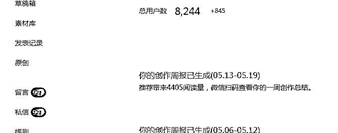
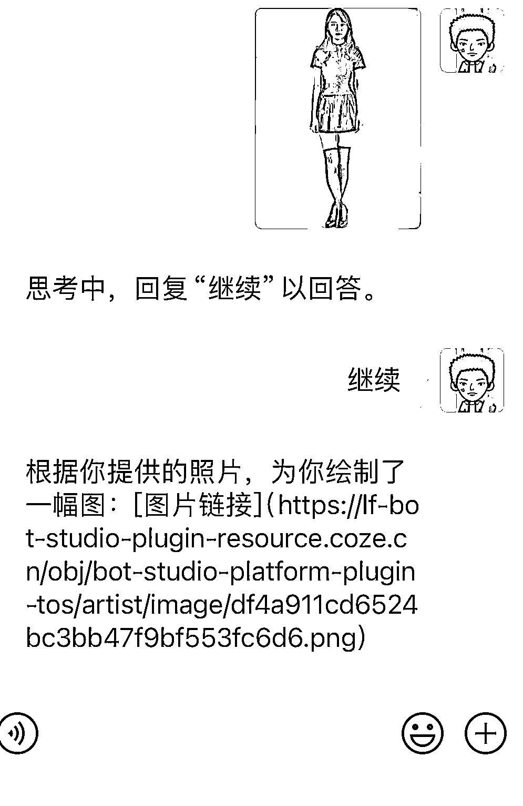

# 一条 Coze 图像流，让医美号520当天涨粉上千，AI婚纱照直接卷到影楼级别
作者：龙哥

## 借 AI 写真做引流，信息差才是真正的流量密码

作者：盟主君

日期：2024-05-22

嗨，我是龙哥。

AI 写真这玩意儿现在听得耳朵都起茧了，可把 AI 写真当成👸号吸粉的钩子，你试过吗？

说到底，世上没有新鲜的玩法，只有还没被你用上的落差。

520刚过两天，我手上正在跟的一个医美客户想搞波节日活动，冲一波关注量。正好520本就是爱情节点，我就给他们搭了一套基于 Coze 图像流的自动化婚纱照生成流程：用户先关注👸号，丢一张自拍进来，系统自动出图。生成的婚纱大片可以直接发朋友圈，晒图凭证到店就能兑换礼品。

说做就做，先看实测数据。

整个操作门槛极低，用户关注后上传任意一张生活照就行。

大概等个5秒左右，AI 就把生活照换成了影楼质感的婚纱作品。

完整搭建思路在这里：

* * *

评论区：

枫晓陌 : 哥，你这链接打不开

枫晓陌 :

枫晓陌 : 可以了😂

浪子 : 打不开

薄荷味 : 大佬，求分享工作流

* * *