# TikTok 中视频分屏打法的底层逻辑与批量执行

## TikTok 中视频分屏玩法拆解

作者： A   😇路途

日期：2024-05-24

做短视频运营，其实就看三件事：对标对手的水平高低、账号本身的权重高低、以及作品的投放数量。这三点里，仅有账号权重是咱们无法直接掌控的。权重高低决定了起步播放量、流量的匹配精度，进而牵动作品数据表现，也决定了是否能持续拿到推流。换句话说，同样的作品发在高权重号上容易爆，发在普通号上就很难起量。

所以 TikTok 操盘的第一步，就是尽快把一批高权重号筛出来。注册成本几乎为零，建 100 个号，先发三天内容，用赛马机制筛选出其中表现最好的 20 个继续深耕。权重这件事，靠投量去挑。

此前我分享过 TikTok 中视频项目，那篇内容也曾被推为精华，原文是@[知识星球 | 深度连接铁杆粉丝，运营高品质社群，知识变现的工具 (](https://wx.zsxq.com/dweb2/index/topic_detail/412511451855118)[zsxq.com](http://zsxq.com)[)](https://wx.zsxq.com/dweb2/index/topic_detail/412511451855118)。TikTok 中视频是目前为数不多能在短期内实现高额变现的赛道，而且现在玩法比过去更激进。需要明确：这套打法不适合新手，也不适合单打独斗的个人玩家。

今天重点聊 TikTok 中视频的分屏模式。TikTok 中视频和国内抖音中视频的机制相近，都是粉丝过万后发布 1 分钟以上视频获取播放分成，但 TikTok 的单价明显更高。以美国区为例，1000 次播放平均约 1.2 美元，折合人民币大概 8 元左右，汇率差带来的收益空间很大。下图中的 RPM 就是千次播放 1.15 美元。

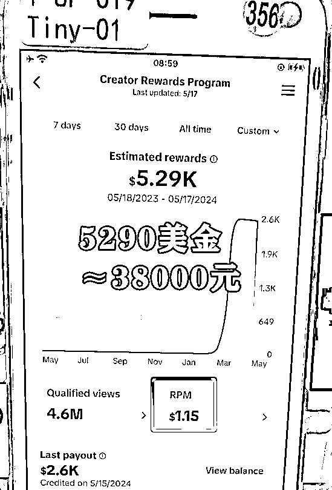

分屏玩法到底是什么？看图就明白了。

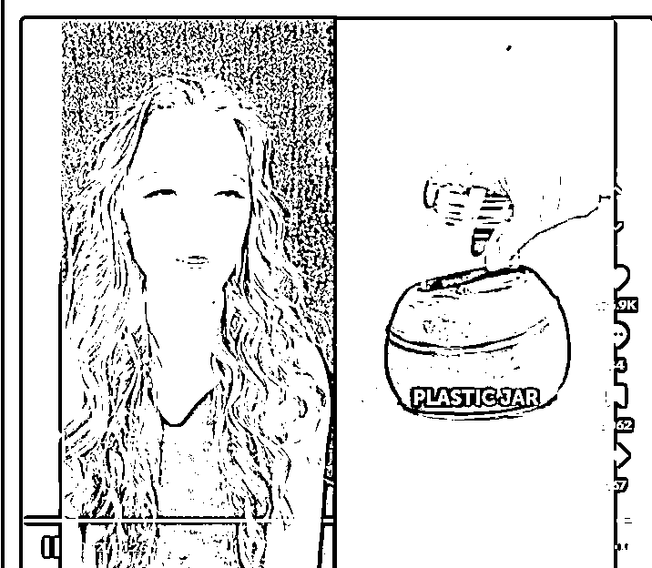

视觉上就是左右各一支视频并排拼接的效果。最初是平台官方的合拍功能，后来大家发现完全可以自己后期拼接发布，效果依然稳定。

你可能会觉得，这也太粗糙了吧，有什么门道吗？

一开始我也有同样的疑问，但现实是这套打法恰恰是最赚钱的。我们把矩阵规模拉到极致，用数量碾压，用简单粗暴的模式持续输出。

举个例子，起步 500 个号，筛出 20 个优质号，每个号月均能贡献 3-5 万利润，算下来一个月就能做到 60-100 万，这就是分屏矩阵的爆发力。

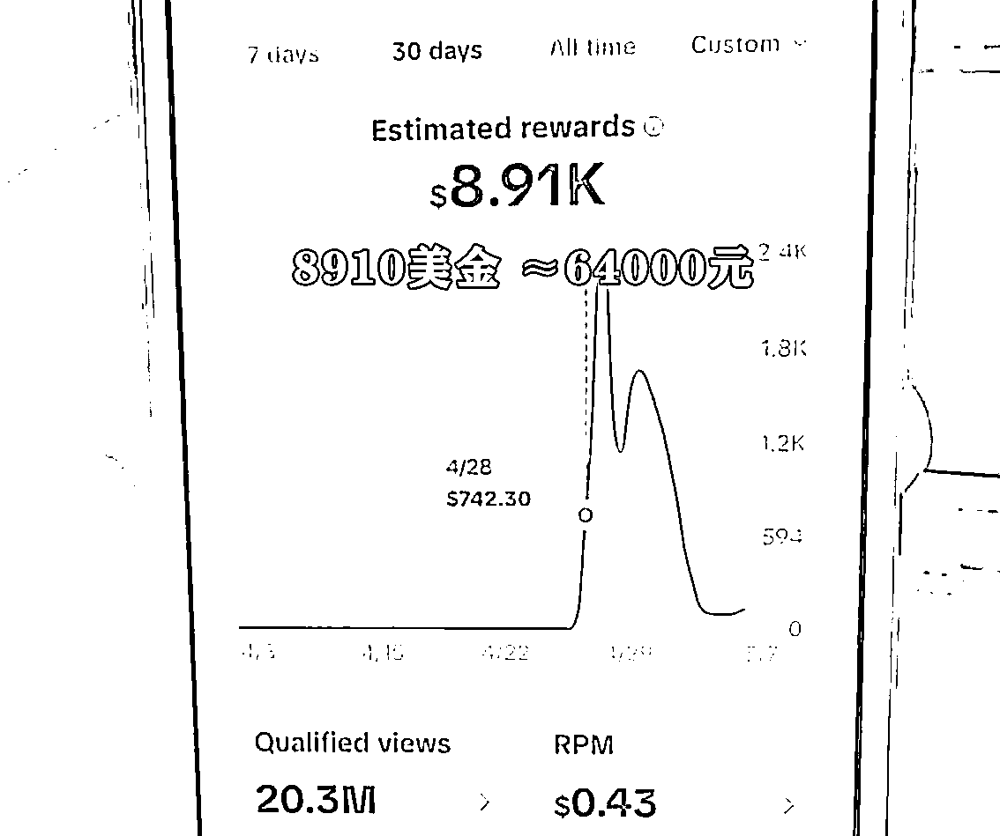

当账号池足够大，收益曲线也会变得越来越稳定、可控。

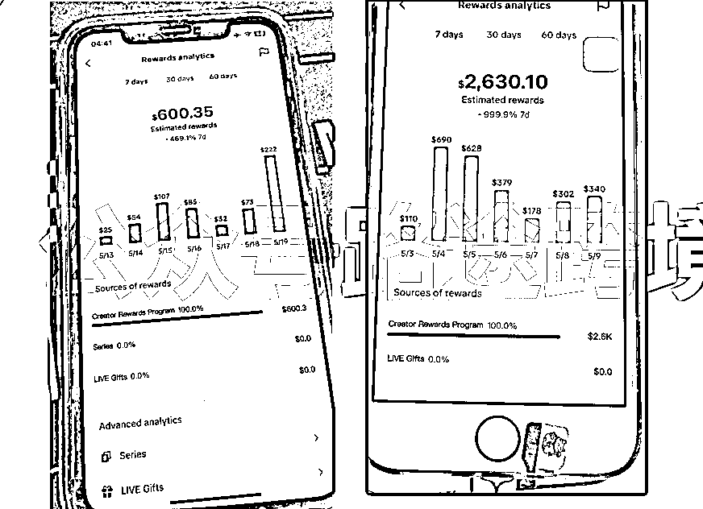

很多人会问，这么简陋的视频凭什么能赚钱？核心原因大致有三点：

1、内容基因：左右两条素材都是 TikTok 上已经被验证过的热内容。哪怕不是 1+1>2，至少同时呈现两个钩子，满足不同兴趣点，完播率自然被拉高。

2、去重优势：做内容很难完全原创，分屏结构让画面中有 50% 是全新组合，直接降低了平台判定重复的风险。

3、矩阵放大：单号起量不难，难的是规模化变现。分屏作品门槛低、复制快，配合矩阵化运营，量变就能产生质变。

怎么批量做出这类作品？

原理很简单，就是把两条视频左右拼接。难点在于效率，矩阵玩法不能靠一条条手工剪。接下来重点讲批量生产的方法。

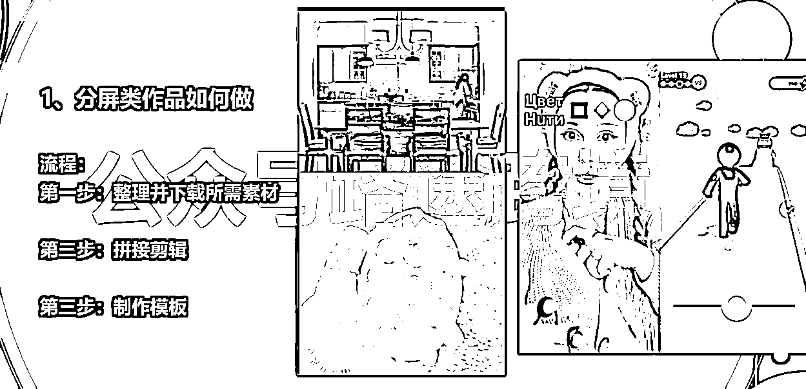

第一步，准备好素材库。

常规的分屏结构是左侧放解压类或手工类视频，右侧放人物类内容。人物视频建议直接从 TikTok 上找本地中小型网红的搞笑段子，解压视频可以在各大平台搜关键词，也可以在淘宝等渠道直接买现成的素材包。

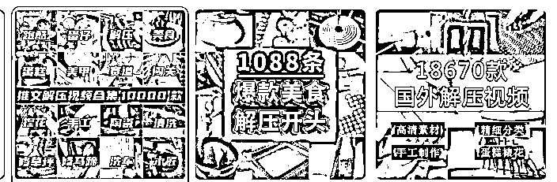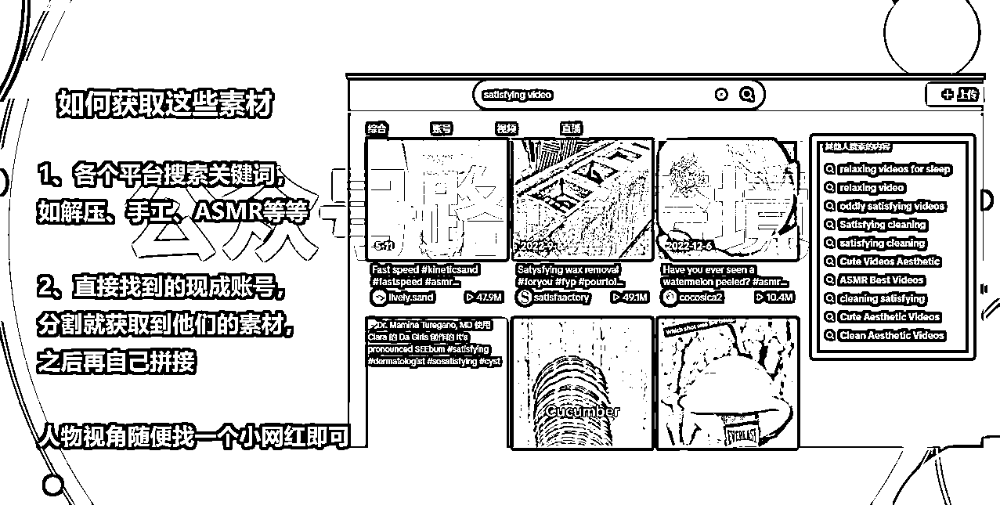

素材齐了之后，如何批量剪辑？

核心思路是左侧一组素材固定，右侧一组素材轮换。具体操作分两个工具流派。

用 Premiere Pro 的话，关键功能是粘贴属性。先把第一条视频的位置、尺寸、轨道关系调好，复制属性后批量应用到其他素材上，一次性统一。再统一导出即可，效率远高于一条条出片。
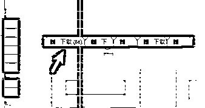

比如人物素材固定在左侧，先把第一条调好位置参数，其他条目保持同宽同高。

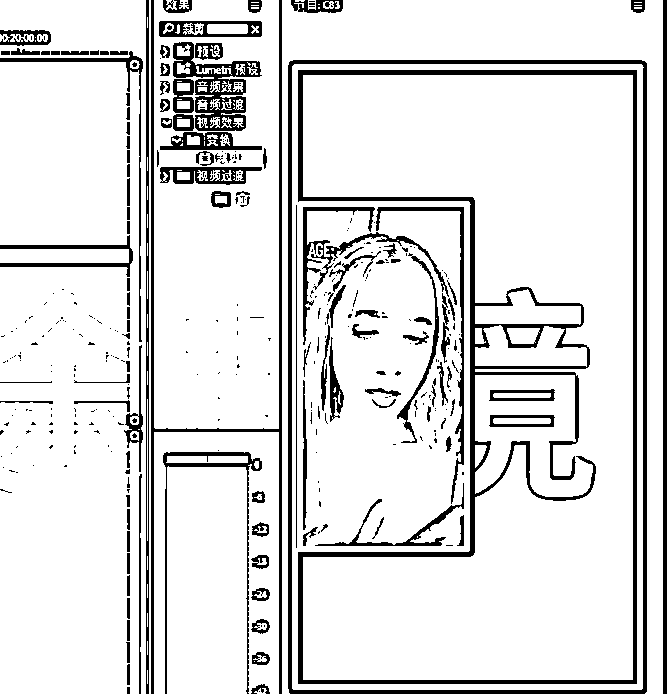

复制第一个素材的属性后，全选剩余素材右键粘贴属性，就能瞬间完成统一排版。随后批量导出。

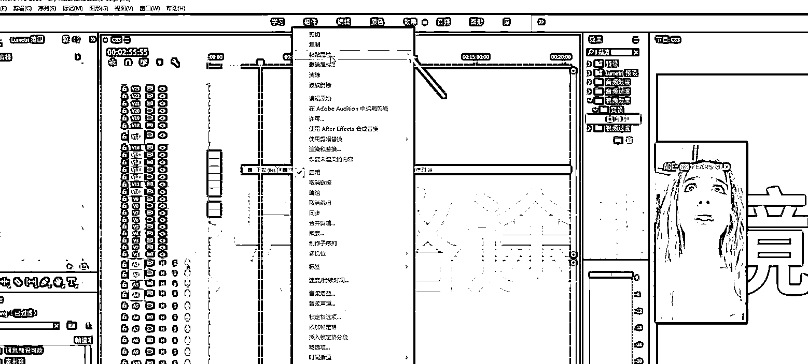

用剪映也能实现批量。做法是先把解压素材拼接成一段长素材，再把人物素材放在上层轨道对齐，统一打时间戳，一次成片。

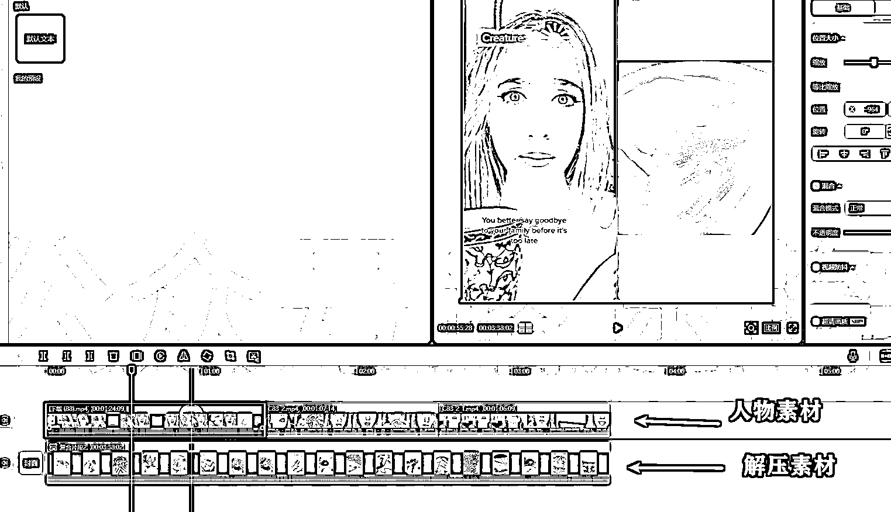

如果操作细节不太清楚，可以找我要录屏演示。

最后再说流量逻辑。分屏作品的本质是靠作品量+账号量做矩阵，别盯着单个作品的播放和收益来判断成败，它是一个模式化变现的体系，更适合小工作室批量运营，不适合个人玩家细水长流。

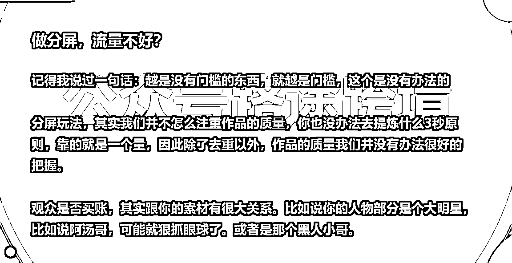

希望这篇拆解对你有启发，觉得有用就帮我点个赞。

* * *

评论区：

coke 丶 : 音频会不会冲突

A   😇路途 : 不会冲突，我漏说了，解压素材的原声要关掉[呲牙][呲牙][呲牙]

* * *