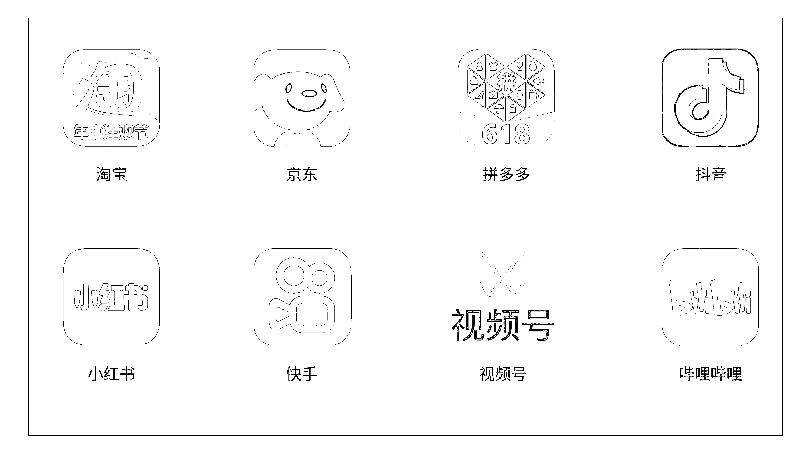
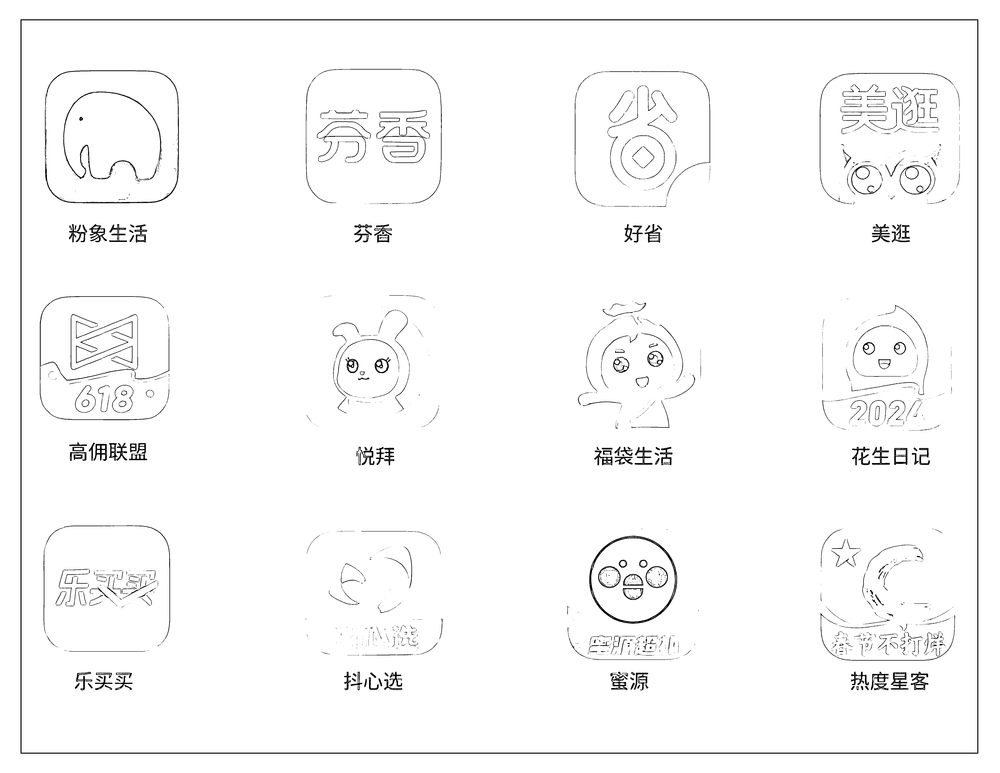
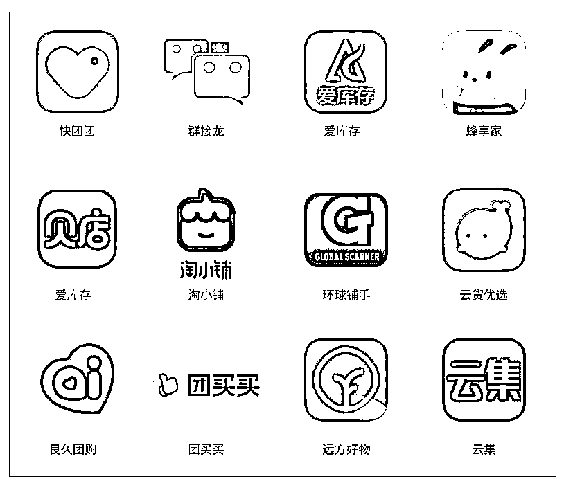

# 深度解析电商分销的三种形态

最近一直在忙短视频的事，踩了不少坑，回头有空再跟大家细聊。今天想认真聊聊一个我早就想写、却一直没腾出时间动笔的话题——电商分销的三种形态。

为什么拖到现在？因为这种深度内容真的烧脑。要把脑子里那张网状的思考，整理成树状结构，再化作线性的文字，确实不容易。

这篇文章里的很多观点，都来自我和电商大厂做营销的高管、市场上做分销的高手、分销平台的老板，以及头部大团长的日常交流。怎么判断一个分销项目值不值得做、能干多大、该怎么干，这些底层逻辑我都放在里面了，算是掏箱底的货。

你花点时间把这篇文章看完、看懂，我不敢保证你能赚多少钱，但以后你再遇到类似的项目，大概能有一个清晰的判断。有了判断，你才会真正相信，有了相信，你才能坚持，最后才可能做出成绩。年入百万这种事，对看懂了的人来说，真的不是梦。

怕就怕那种没有自己思考的人，别人说什么好就跟着上，别人说不好就马上跑。那种随大流的，要么被坑骗，钱和精力全搭进去，还把亲戚朋友都得罪了；要么像蜻蜓点水，遇到一点困难就轻易放弃。

先讲两个我身边的真人真事，我拿人格担保，绝对真实。

第一个叫静静，之前我带队做拼多多旗下的“群买买”时，她是我下面的一个团长。她就是个普通宝妈，当时完全没接触过私域分销，认知几乎是零。但她的理解力和执行力很强，短短几个月就做到了月入2万。后来那个项目因为平台方的一些决策问题，业绩下滑关了，但静静跟着我干了两年，认知和方法论都攒下了。现在换到另一个私域分销平台，8个月做到月入20万，年底估计能到30万。

一个素人宝妈月入30万，听着像天文数字，但放在整个私域分销圈子里看，其实只能算中游水平。懂行的团长都清楚。

另一个叫七七，是个10岁男孩的妈妈。昨天她来杭州，我们还一起吃了午饭。她用了三年时间，年收入从30万干到了千万，直接跨越了一个阶层。听起来是不是很不真实？

三年前，她还在柳州移动公司上班，年收入30万，在小地方有房有车，日子很滋润。但七七想给孩子更好的教育，想去更大的城市。她想年入百万，可留在移动公司很难实现。于是她辞职，带着孩子去了深圳，加入了一个私域分销项目。去年也是这个时候，她来找我，当时月入刚过30万，说2023年的目标是年入500万。结果一年过去，她再来见我的时候，已经是一个月入百万、年入千万的大团长了。说实话我都有点意外，这两年经济环境那么差，倒闭的公司、失业的人遍地都是，她反而一年收入翻倍。这就是私域分销的魅力吧。现在她每天就是全国跑一跑，见见下级代理，办培训、组织聚会，没事就旅游、访学，生活、事业、家庭全不误。连我都羡慕。到现在她也没租办公室，就请了10个兼职的在线助理帮她打杂。

讲这两个故事，就是想告诉大家：电商分销领域，年入百万、千万，甚至上亿，都是真实存在的。只是这些人要么低调不说，要么说出来没人信，很多人觉得是在吹牛、P图、搞传销。我因为经常跟她们接触，自己也创过业、做过大团长，所以了解更深一些。谁的收入是真的，谁的是P的，聊几分钟我基本就能判断出来。当然，她们一般也不会骗我。

好，回到正题。我眼里，电商分销就三种形态：**纯公域分销、公私域结合分销、纯私域分销**。

每种模式都有自己的优点和缺点，适合不同的流量类型和人群，没有绝对的好坏。只要你用心参与进去，基本都能赚到钱，差别只是赚多赚少、发展快慢、生命周期长短的问题。下面我一个个拆开讲。

### 一、纯公域分销

所谓纯公域分销，就是在公域电商平台内完成的分销，比如淘宝、京东、拼多多、抖音、快手、视频号、小红书、B站这些。

过去真正算公域电商平台的只有淘宝、京东、拼多多。但现在抖音、快手、视频号、小红书、B站这些内容平台，都在拼命做自己的闭环电商。为什么？因为闭环电商最赚钱——卖家在这里投大量广告，平台把流量反复卖给不同的商家，所以抖音能超过腾讯，成为中国最赚钱的公司。

这些平台的商家越来越多，平台流量有限，还越来越贵。商家想拿到更多流量，只能找平台内的达人合作分销带货。达人有粉丝信任，转化率比硬广高。这种在平台内完成的分销带货，就是我说的纯公域分销。

它的特点是：达人在平台里注册账号、做内容、吸粉，然后通过直播、短视频、图文帮商家卖货，赚佣金。从起号到变现全在站内完成，不搞什么导到微信再成交的套路。

当然，平台里的卖家主要还是靠广告流量，比如淘宝直通车、抖音千川，这也是平台最主要的收入来源。除了平台，最赚钱的就是那些站内达人——李佳琦、薇娅、小杨哥、广东夫妇、郝劭文、辛巴、太原老葛，这些头部依靠给商家带货赚佣金，早就财务自由了。还有大量中小达人，几万、几十万、上百万粉丝的，这几年也靠帮商家卖货赚到了真金白银。也难怪现在全民都想当网红，这条路确实被无数人验证过。

说句实在话，在公域平台做达人分销确实是最好的路。不管你做短视频、直播还是图文，不管你是超头还是中腰部，都能快速赚到钱，因为平台会给你流量，你还可以自己投流做规模，商家也愿意给你充足预算和佣金，甚至亏本帮你投流都愿意。

为什么商家亏本也愿意？因为有品牌杠杆。商品被头部达人带过以后，再去找中小达人，人家就愿意带。所以商家愿意给头部坑位费+高佣金，甚至100%、120%的佣金。啥意思？卖100块，佣金给100块，甚至给120块。这下你明白为什么大家都想做网红了吧。

但网红不是那么好当的。现在不是红海，是血海。你看郭有才火了，多少人跑菏泽南站去蹭流量。普通个人想成大网红极难，公司重金孵化也不容易成功。我身边做MCN的老板不少，批量孵化达人成功率连3%都不到——孵化100个，能跑出3个就烧高香了。这条路，我们普通人基本上不适合走。真要是能选，我早去干了。

总的来说，纯公域分销这条路很难走，不管是投流还是自然流，素人进去机会渺茫。了解一下就行，别只看到贼吃肉，没看到贼挨打。

**真正适合我们普通人的，是下面这两条路。**

### 二、公私域结合分销

这种模式，就是把公域平台的商品拿到私域来分销，赚佣金。业内人熟悉的淘客、抖客、京东客、多多客，全属于这一类。这也是我最熟悉的模式，我在这块干了15年，亲眼看着它从0到1，一直到今天全民参与。

如果说淘客、抖客这些名字太专业，普通人听不懂，那我再说几个APP，你们至少听过一个。要是连一个都没听过，那这篇文章你就别浪费时间看了，真不如去刷短视频。

花生日记、蜜源、好省、粉象生活、高佣联盟、悦拜、美逛、福袋生活、芬香、乐买买、热度星客、抖选生活（原抖心选）……一大堆，这些APP或小程序，全是公私域结合分销。

这个模式能快速崛起，核心就是靠私域团长机制实现了全民覆盖。具体原因我之前文章讲过很多，就不重复了，感兴趣的可以去翻我公众号2019-2021年的内容。

今天重点说几个大家关心的问题。

**1. 为什么平台和商家都能接受它？**

因为公域平台自己也很缺流量，商家在平台内投流的获客成本越来越高，已经快吃不消了。

听说有个卖家在抖音一年卖了3000多万，最后利润只有1.7万。别笑，很可能是真的。利润全砸去买流量了，还要给主播发工资发提成，给合作主播坑位费加佣金，再扣公司运营成本，能不亏就不错了。

还有个例子，之前“风中的厂长”说他在义乌参加饭局，一个卖家在拼多多做了2个亿销售额，卖的是日百杂货、毛巾杯子这种，一年利润55万。算下来毛利其实是负的，那55万靠的是包裹里夹游戏卡赚出来的——他发货量大，一家游戏公司在他包裹里塞卡片，每月给十几万，最后减去全年亏损，剩下55万。

这种局势下，淘宝、抖音、京东，甚至被叫“索马里平台”的拼多多，都希望卖家别死掉，但平台自己也挤不出更多流量。这时候，站外的分销伙伴要是能给站内商家带流量，那简直求之不得。因为站外分销流量几乎是免费的——成交才付佣金，不成交不花钱。

那肉眼可见的站外流量在哪？毫无疑问，微信里。但平台不可能自己去微信里疯狂投放给商家导流，何况现在微信到淘宝、抖音的链路也不顺。所以，让无数中小个人用蚂蚁雄兵战术，在微信群、朋友圈帮淘宝、京东、抖音卖家分销，就成了各方都能接受的办法。

**2. 为什么这种模式适合普通素人？**

一般素人的微信好友有限，影响力有限，光靠朋友圈发广告赚不了几个钱。但公私域结合的分销不一样，它借了势——推广的是大平台的品牌特价货，是“货带人”，不是“人带货”。

卖家为什么愿意在私域渠道给大额隐藏优惠券和高佣金？因为他们也是亏本在打，目的很明确：把这款货在私域打爆，然后拿到平台内部的流量杠杆。简单说，商品卖得多、好评多，搜索排名就靠前，就能免费拿到站内搜索和推荐流量。做过淘宝、京东的商家都懂。

所以在大平台信任背书下，加上品牌商家愿意亏本玩“货带人”，素人带货就成立了。一个普通宝妈，在朋友圈发条信息：“优衣库原价100的裤子，现在领50块券，复制口令打开淘宝，50块就到手了。”站内买可没这个券，得原价买。你说朋友看到买不买？肯定买。好友买了，她拿20%左右的佣金，10块钱。普通人靠这种推荐，一天赚几百块真不难。而且这种特价品经常有。

说到底，朋友下单不是因为信你，而是信优衣库和淘宝。这就叫借平台的势、借品牌的势。抖音的抖客逻辑也类似，只是细节略有不同，这里不展开。

**3. 为什么这种模式能快速爆发？**

如果只是上面那种逻辑，素人还是难赚大钱——好友有限，好推的品也不天天有。但这类分销平台还有个杀手锏：查券和返利功能。

常规玩法是分销者在社群推商品，好友复制口令去平台买。但这些APP额外做了一套多级分佣的代理体系，鼓励私域用户把微信里的亲朋好友都拉进APP里来。这样一来，亲朋好友每次想上淘宝、京东、抖音买东西，都会先用这些APP搜一下，看看有没有隐藏券和返利，然后再去买，省钱。

在这种逻辑下，分销者哪怕每天不发朋友圈、不发群，也能有收益。因为用这些APP购物的人太多了，只要拉人进来，就能长期拿分佣，何况还有多级裂变的抽成。

这就是公私域结合分销能迅速爆发的根本原因：借了大平台的信任背书，享受了品牌卖家的定向折扣和高佣金，还把常购用户沉淀到了自己的私域工具里，长期吃佣金分成。一个完美又高效复制的模式。

过去几年，一大批私域团队长靠这个赚到了钱，头部几千万上亿，腰部几百万的一大把。当年我创业做的兔子优选，后来和好省合并，平台里就有不少赚到财富自由的团长。

**4. 聊聊它的弊端**

首先，各家平台很难做出差异化。说白了都是给大平台做私域分销，货盘和佣金比例都差不多，于是只能疯狂让利：你给30%，我给35%，他给40%，最后大家都没利润。分销平台不赚钱就可能随时不干了，这对加盟的分销者是致命打击，所有的努力白费。我当年把兔子优选和好省合并，主要就是为了不让大家的心血打水漂。

其次，很容易受大平台政策和环境的影响。一个政策变化，下游分销渠道可能瞬间熄火。比如拼多多现在不允许这些渠道给用户返利，很多做拼多多私域分销的平台就关了。商家营销预算一缩减，影响也巨大。以前淘宝商家愿意亏本在私域冲销量换站内流量，但现在淘宝整体流量下滑，搜索流量也掉了，商家就算亏本做了私域销量，也换不来多少搜索推荐，自然就不肯继续亏了。下游素人推广者就没有好货可推。

还有些商家会降低或关闭私域渠道的推广计划，那消费者就算下载了那些APP，也找不到大额隐藏券，返利也少得可怜，慢慢就不用了。分销团长的收益断崖式下滑，最后引发整体出逃。这就是今天发生着的现状。

当然，并不是说公私域结合分销就没戏了。现在依然有不少做淘宝、京东私域分销的公司和个人在赚钱，只是周期拉长了，门槛高了很多，素人很难再有以前那种机会。真正的黄金红利期是2018到2021年。不过，随着抖音和视频号货架电商的发展，这两个平台的公私域结合分销会不会带来新一波造富机会，我也一直在关注研究，有消息会及时同步给大家。

### 三、纯私域分销

这是第三种形态。就像前面讲的，私域分销领域里那些年入百万、千万的大团长，很多就是纯私域玩家。他们不依赖公域平台的流量分发，也不靠从公域引流，而是直接扎根微信生态，靠社群、朋友圈和个人信任，直接对接品牌供应链，做深度分销。这种模式一旦跑通，生命力极强，超级个体的天花板也远高于前两种。具体玩法，我们下次有机会再慢慢拆开讲。

今天重点聊聊大家关心的纯私域分销，这也是目前分销团长里体量最大、人数最多的一块业务。

简单说，纯私域分销和之前说的公私域混搭模式，本质区别就一个字：流量去哪。公私域混搭是帮淘宝、京东这些大平台导流带货，而纯私域是为自己家的平台拉人成交。

这一赛道其实是随着微信一起长大的。从早期的微商，到后来的云集、贝店、环球捕手、淘小铺、蜂享家、爱库存也就是饷店、云货优选、良久、远方好物，再到快团团、群接龙、团买买等，名字换了几轮，玩法却没变。鼎盛时期，光是做纯私域分销的平台就超过上千家。

就算现在大浪淘沙、不少项目关停了，依然有几百家在坚挺运营，而且活得相当滋润。

虽然各家对分销员的称呼不一样，代理、店主、团长、帮卖，叫法五花八门，但干的事都一样：都在微信里帮商家把货卖出去。

在我看来，纯私域分销可以拆成两大阵营：社交电商平台和私域电商工具，差距挺大的。

**1、社交电商平台**

逻辑很清晰：平台自己整合上游供应链，搭好分销体系，然后招募大量中小分销员，用他们的朋友圈和社群来卖货。

平台基本不投广告，流量全靠分销员自带；货盘也是靠分销员去消化；商家想进来只能签约入驻。整个销售链路由平台操盘，客服售后也由平台对接，商家只需要做好发货和退换就行。

云集、贝店、环球捕手、淘小铺、蜂享家、爱库存、云货优选、良久、远方好物等等，都是这种模式的代表。虽然贝店和淘小铺已停止运营，但剩下的头部玩家大多已经年销售额过百亿，中腰部也活得不错。

这种模式最舒服的地方是稳定、可长期经营。微信生态里各家有各家的圈层和地盘，鼠有鼠道猫有猫道，很少互相打价格战、烧补贴。

对品牌商来说，这里毛利可控、几乎零流量成本。有位做保健品的渠道负责人跟我说，他们在天猫利润率撑死10个点，抖音是亏着玩，在私域分销渠道毛利能做到40%，所以他们把这块当长期基本盘来养。

不同平台的品类和人群画像也各不相同，有做服饰特卖的，有做食品健康的，有深耕大健康的。生态像片原始丛林，大树有大树的活法，小草也能自在生长。

**2、私域电商工具**

快团团、群接龙、团买买是典型代表，有赞、微盟、微店本质也属于这一类，都是给商家提供在微信里快速开店的工具。

区别是，快团团这类相对轻、而且免费；有赞微盟这类相对重、需要付费。时间线上，前者是近两年的新玩家，后者是早期的工具派。

和社交电商平台的根本区别在于：平台不帮你备货控货，而是把开店体系搭好，让商家自己进来开店。流量也要商家自己去找分销员，工具只提供SOP。

这对商家要求很高：要自己上架、自己找分销、自己做客服售后。但自由度也最高，想卖什么卖什么，不受平台强管控，利润最大化，也不用交广告费，成本低、起盘快。

现在不少淘宝、京东、抖音的老商家都在把公域来的客户导入微信，再用这些工具在私域里闭环成交。

**3、普通人做纯私域分销该怎么选？**

说点实用的。如果你只是个素人，或手头有一定私域流量，想入行，建议避开私域工具平台的分销，比如快团团、群接龙、团买买这类。

这些工具虽有帮卖体系，但大多只有一级帮卖，没有多级裂变逻辑。更关键的是，你必须自带大量微信好友才有意义，而大多数普通人的好友数根本撑不起转化。

另外工具平台上的商家鱼龙混杂，良莠不齐，平台基本不做商家审核和售后保障，出了问题全靠商家自己扛。信任一旦被消耗，对你的朋友圈就是永久伤害。

更靠谱的选择是加入社交电商平台。这类平台有多级分销、管道佣金，产品有差异化，平台会做商家筛选、活动策划、物料供给，你只需要专注分发就行。

纯私域分销比公域的爆发速度慢，但胜在稳、能长跑、细水长流。尤其是社交电商模式和公私域结合模式，都很依赖多级代理抽佣的机制。未来60%-80%的收入，其实都来自你的团队，而不是你每天在朋友圈现卖。

我文章开头提到的月入30万、年入千万的两个案例，做的就是这种纯私域分销。需要提醒的是，市场上纯私域平台太多，选坑很重要。有些平台收人头费、玩法模糊，甚至涉嫌传销，加入前一定要仔细甄别。

如果你判断不清，也可以来找我聊聊。

另外我近期准备发起一个“老胡分销联盟”，长期免费输出私域分销方法论，并每年亲带1-2个实操项目，聚焦公私域结合分销和纯私域分销。目前加入完全免费，不收费。由于精力有限，需要先报名审核，通过后才能正式加入。

有私域资源、对分销感兴趣、有执行力，愿意认真做这件事的，可以关注我的公众号“老胡地盘”，在文章尾部扫码报名，未来一起同行。

我的目标是2-3年内，带出100位年入100万的徒弟，然后我们一起边玩边赚钱。

* * *

评论区：

帅彬 : 大佬👍利他思维

李同学 : 行业深度好文[玫瑰]

龙哥 : 很赞

邂逅的时光 : 怎么报名呢

张大宝 : 糟糕，这些 APP 真的一个都没听过[发呆]

老胡 : 看文末

老胡 : 那不适合你[偷笑]

起不来就 s : 只有想干的心，没做过私域您会同意吗

* * *