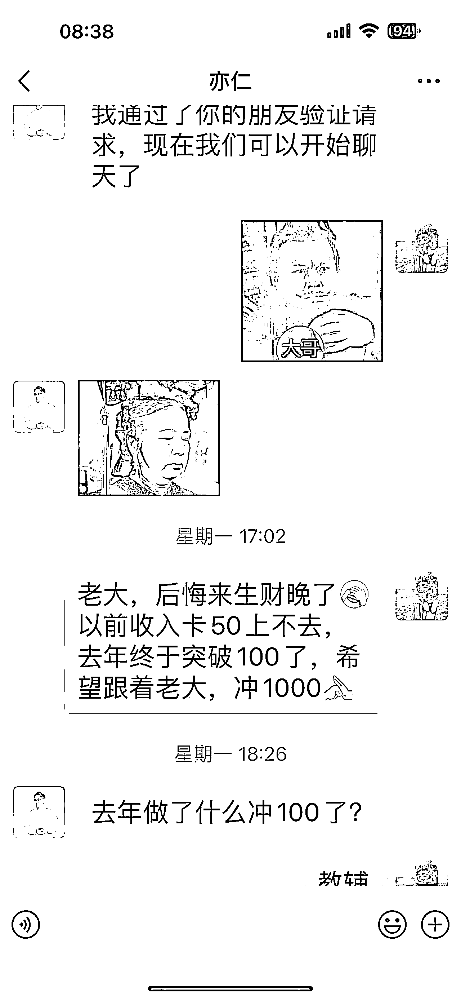
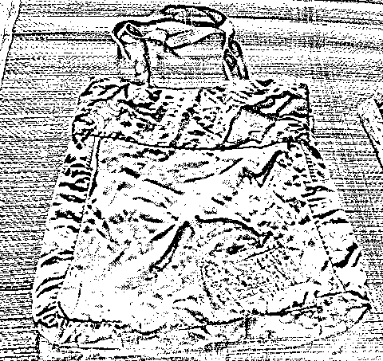
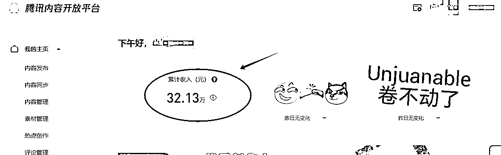
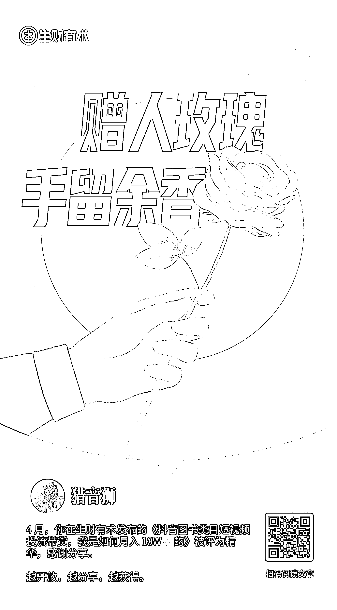
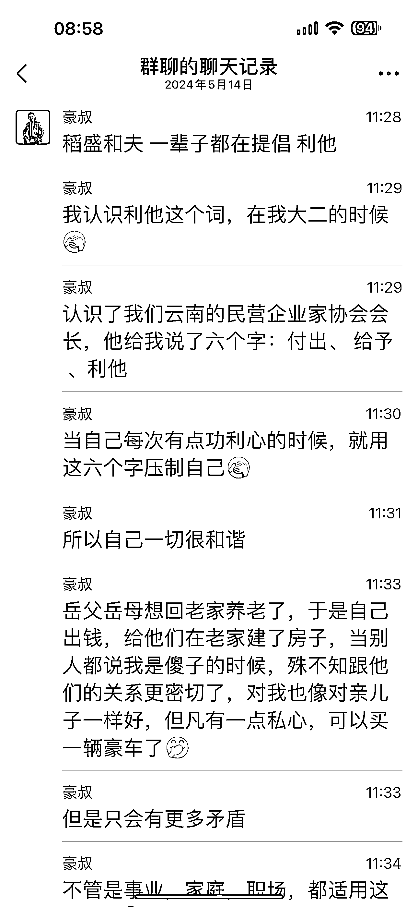
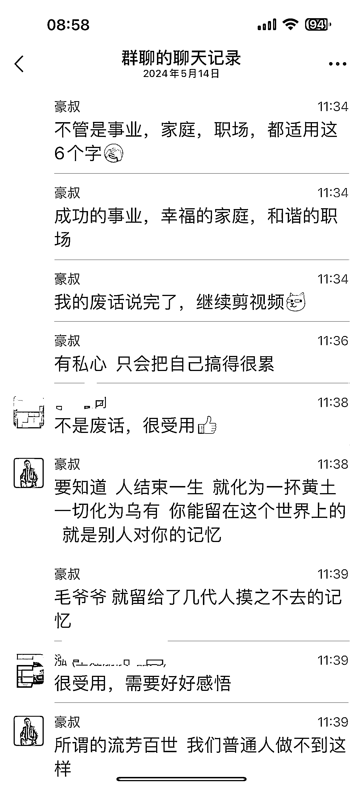
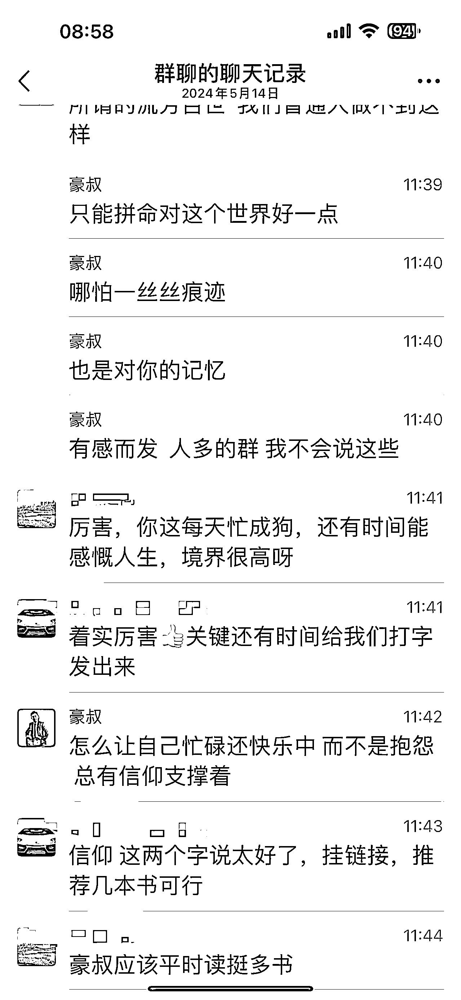
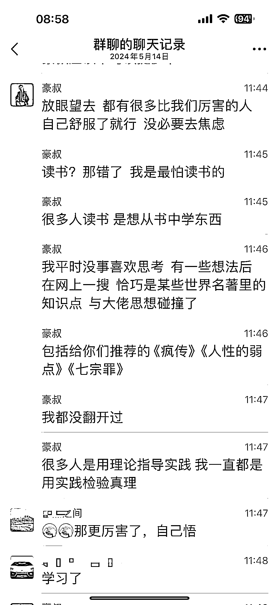
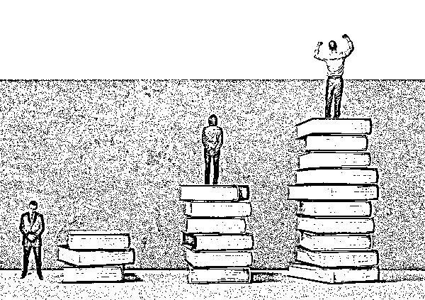

# 从50万到100万，我的收入翻倍只做对了一件事

各位圈友好，我是豪叔，去年刚加入赚钱这棵大树的小萌新。为了表达谢意，我把自己的真实经历写成下面的文字，送给刚进来的伙伴们。这点成绩在圈里不算什么，但对我个人来说，真的太重要了。

先交代背景：90年属马，出生在云南边境的小山沟。普通二本，专业是环境科学与工程系里的土地资源管理，和现在做的自媒体八竿子打不着。所以说，这行学历真没那么关键，我学员里不少初中毕业的，照样干得好。

穷人的孩子早当家。我9岁才上学前班，学费一学期才15块，父亲都不想让我去。后来总算入了学，书包是母亲用几块布拼成的袋子，跟现在拎的纸袋子差不多。知道机会来之不易，小学到初中我一直保持全校第一。等到了县城上高中，被花花世界迷了眼，最后只考了个二本，村里少了个清华大学生。父亲叹了口气说：“回家修地球吧，读书没用。”哪是没用啊，是家里太穷。大学四年省吃俭用要八万块，对农村家庭来说就是天文数字。

高考完那个暑假，别人出去旅游，我留在县城蹬三轮送货。两个月挣了1800块，给自己买了个行李箱，一张去昆明的汽车票，剩下的当生活费。学费是助学贷款，大学四年我就没停过工，白天上课晚上打工，最狠的时候门门90多还不挂科。餐厅服务员、房产中介、家教、发传单，我都干过。

大二失恋了，大概被人嫌弃穷。颓废两个月后，我决定不再出卖苦力，而是利用手里的商家资源，做了个免费兼职平台。因为当年的我吃过中介的亏，不想让后面的学弟学妹再被骗。利他的种子就是那时候种下的，没想到福气真的会来，后来认识了现在的老婆，人生开始转运。

毕业后，因为做过平台，我进了家互联网公司，月薪只有2300。上了三年班没攒下钱，但一直没离开网络，一边上班一边偷偷做自媒体。2018年，一个拿2300月薪的人，兼职一年赚到了50万，当时开心坏了，立马辞职，一个人干到现在。那时候做的是企鹅独家号，时过境迁，现在只剩下一个号还能登录。

靠着利他思维，我每换一次项目都像顺水推舟，毫不费力。这些年换了不少路子，每次都像踩在风口上。2023年4月，经圈友@墨鱼介绍，我进了赚钱，收入直接翻了好几倍，从原来每年三五十万突破到百万大关。在这里边学边写，发过几十篇文章，还得到龙哥老大的加精，特别有成就感。

现在我还是一个人猫在家里做互联网，不爱社交，不碰烟酒，就喜欢安静。因为安静下来才能思考、创作，那些爆款文案全是在这种状态下写出来的。

有人问：“一个普通人怎么能做这么多事，还有空来分享？”答案就是两个字：利他。关于利他，我和朋友聊过一段，字太多，截图放这了。

光有利他可能还不够，支撑我的还有几个信仰。每次快坚持不住时，我就默念这些，也分享给你：

1. 别等着别人来照亮你，你得拼了命让自己发光。

2. 竹子用四年只长了3厘米，但从第五年开始，每天能蹿30厘米，六个星期就能长到15米。那四年不是没用，它一直在把根在土壤里延伸数百平米。生活也一样，你经历的沉默和努力，都是在扎根。

3. 想得到自己从没拥有过的东西，就得去做自己从没做过的事。

4. 量攒够了，质变自然会发生。

5. 这个世界上最顶级的商业模式，就是利他。

谢谢看完，以上就是我今天的全部分享，咱们一起共勉！

评论区里很热闹，有人说“真诚利他”，有人说“一个人”，有人说“对利他理解更深了”，还有人说“功利心太重了，感谢”，我都一一抱拳回应。