# 下班后靠读书，副业累计变现 80W+ 的大专女孩自述

## 大专起点，下班读书，副业变现 80W+

作者：二丫吖
日期：2024-05-17

赚钱的伙伴们好，我是二丫，也是赚钱的航海家。

现在在上海一家互联网公司做项目经理，宝妈一枚，大专学历，却在上海买房并落了户。

2018 年我开始碰自媒体，最初给大 V 写稿，之后做助教，再后来自己起号。今日头条的变现曾有 20W+，2022 年起做👸号，叠加私域到现在累计变现 80W+。

主业叠加副业，今年首次年入破 100 万，对我而言是里程碑。

今年是我在赚钱社群的第三年，我把赚钱当作我的素材库。需要信息时按关键词检索，拿到信息后筛选再执行。

三年下来，我看得多，写的少。

今天想聊一个很具体的成年人话题：怎么功利地读书，再靠它赚钱。希望能给正在找路的人一点参考。

我在网上常被叫做几件事：

一、大专学历，本职年入 40W+，上海买房。
二、大专学历，嫁了个硕士老公，拿到上海户口。
三、做自媒体副业，累计变现 80W+。

跟头部大 V 比，这点成绩不算突出，但我的起点很低。想拿到今天的结果，需要反复解决：

这些事，没有捷径，只能靠持续输入和自我纠偏。

我是湖南娄底人。原生家庭很艰难。父母年轻时在娄底跑出租，后来想转行做生意赔了。后来两人一起去广东惠州进厂，一个 2500，一个 3500。

我弟也是大专，每年寒暑假都在工厂做流水或当保安挣点零花。

我算家里第一个探路的。

**我靠不断阅读和试错，才摸到互联网这条路。**

2017 年月入 1.5 万时，我把刚毕业一年的弟弟带了进来，手把手教。现在他年入 20 万，今年计划在上海买房，右戳：《[我弟弟要在上海买房啦！](https://mp.weixin.qq.com/s/Cs4WwGu0dkMY97RrpDWk1g)》。

父母现在也在上海。母亲帮我带娃，我每月付工资；父亲在上海开滴滴，月收入八九千。

家里遇到挫折、大事、小决策，都会来问我。而我能给的人生建议，他们基本给不了。他们常说的一句话是：我们不懂，你看着办。

**一个人没有灯塔，就会乱。**

**还好我喜欢看书，书里给我的很多指引，让我走到了今天。**

下面说说阅读在我生活里的实际作用。

坦白说，我的阅读量并不夸张，不像有些博主一年几百本。

**我更看重的是用出来的能力，而不是读出来的数量。**

今年春节我盘点了书柜。

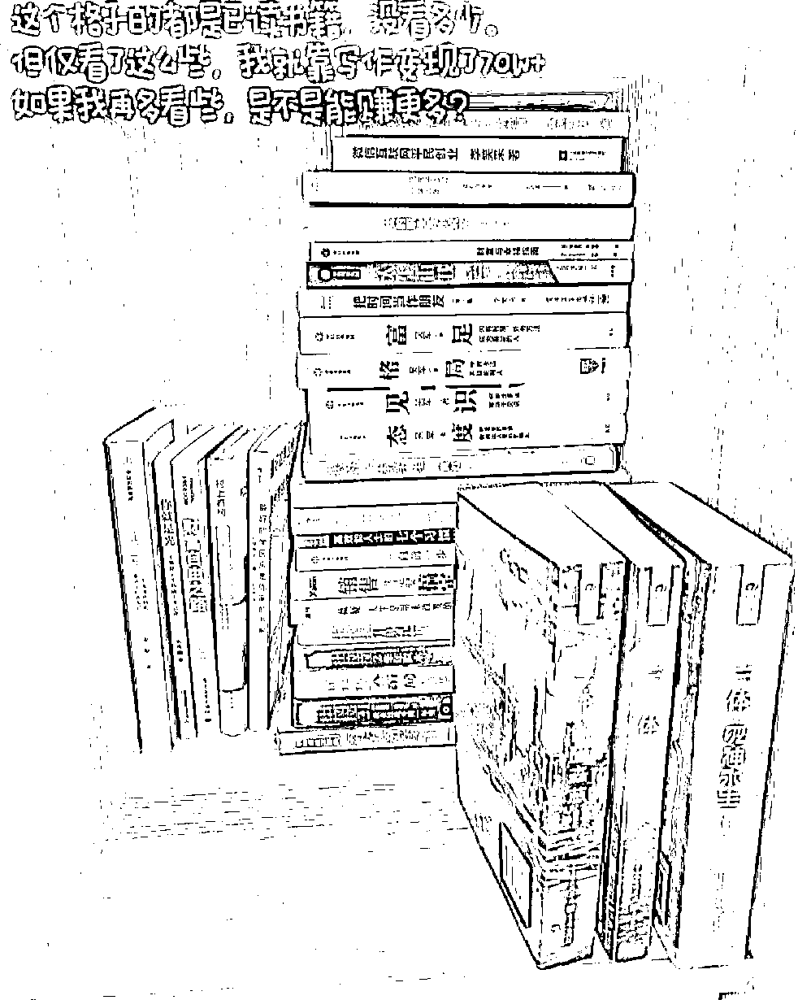

一格书架的书，就支撑了我副业的收入。

2019 年我靠今日头条青云计划入圈，最初靠写书评来变现。

刚开始不知道写什么，那就写我读过的东西。

我能把一本书拆成多篇评测：

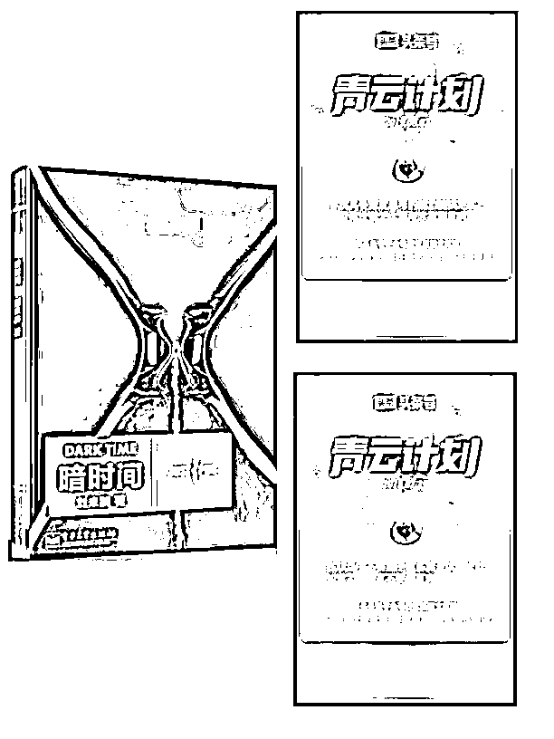

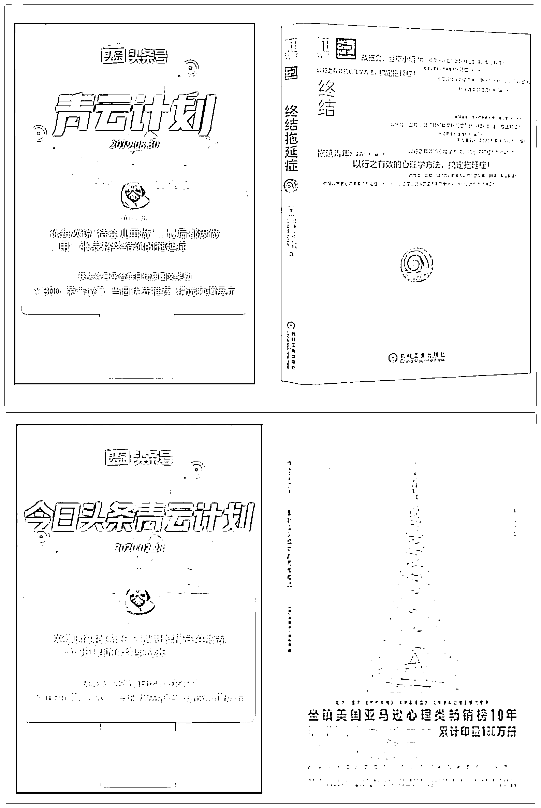

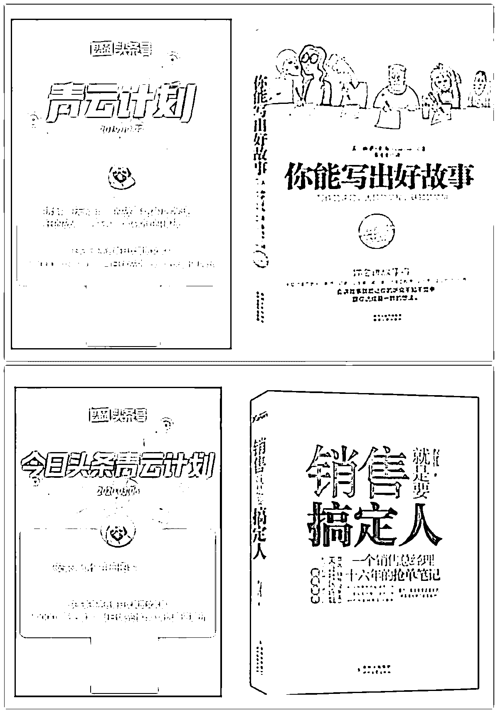

工具书能写，小说文笔也能用上。

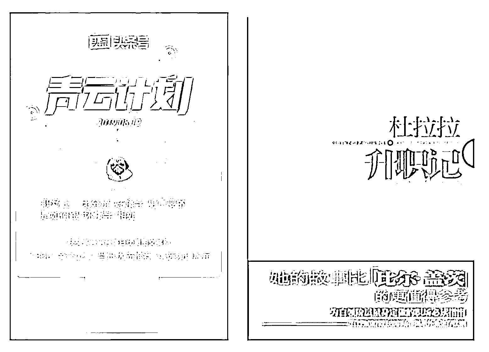

持续写、持续中青云，平台给我了优质账号奖励。

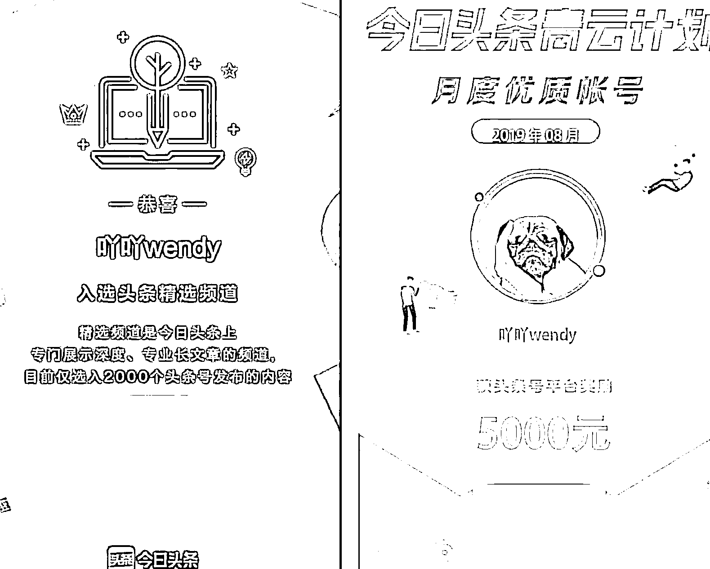

就这样，一个写作新手，靠一点点阅读嗜好，靠书评起步。

后来我已经熟练掌握了书评中青云的套路，想换个方式，于是去写平台征稿，还是从书评切入，只是换了写法。结果拿了二等奖，奖金 5000：

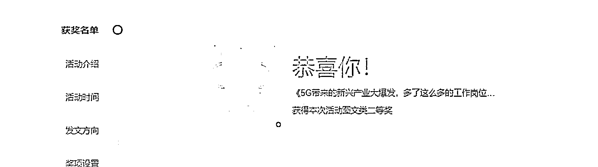

开心。

青云计划 2020 年就下线了，现在没有了。但头条征文还在，会不断更新，每次都有截止日期，可以去看看哪些适合书评。

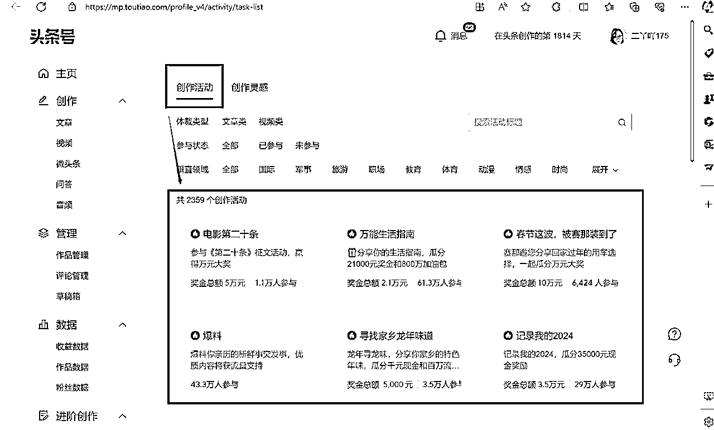

当我把书评写征文的路走通时，青云项目也刚好取消，赖以生存的项目断了。

**项目会死，人不会。**

于是我转思路：写文章卖书。

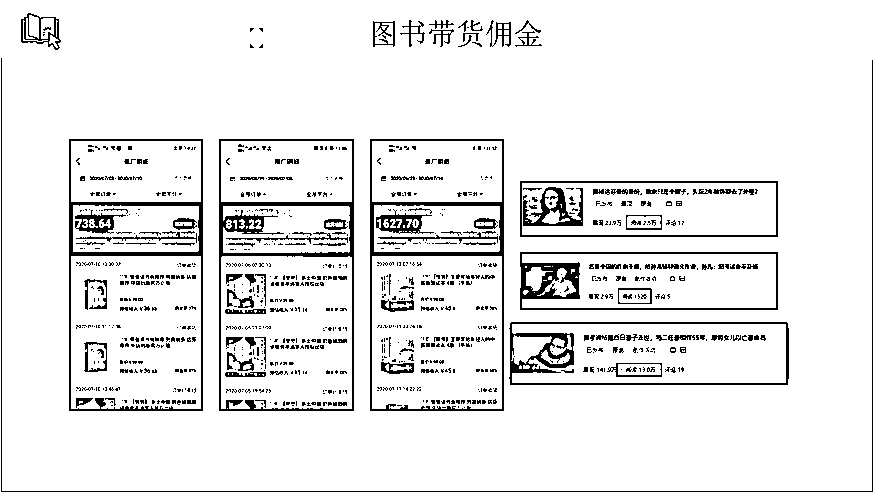

我连发三篇，每篇推一本书：《乡土中国》《达芬奇传》《王蒙写给年轻人的中国智慧》。三本书累计收益 3000+。

当时《乡土中国》并不好卖，出版社压货少，竟因我一篇 10W+文章卖断货，出版社紧急补货。

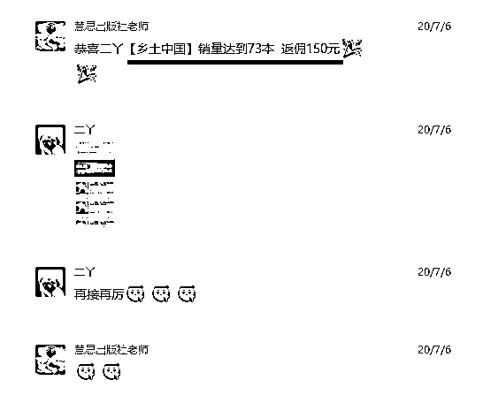

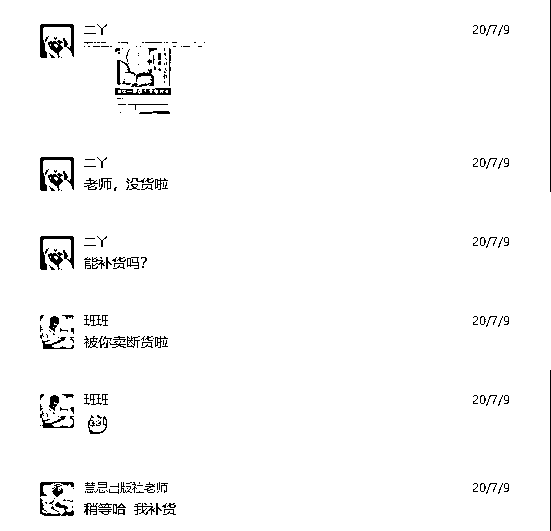

这就是自媒体里读书带来的直接回报。

有人问我：像你这么功利地读书，还有意思吗？

我建议去🛰️读书搜华杉版的《孙子兵法》，翻第一页：

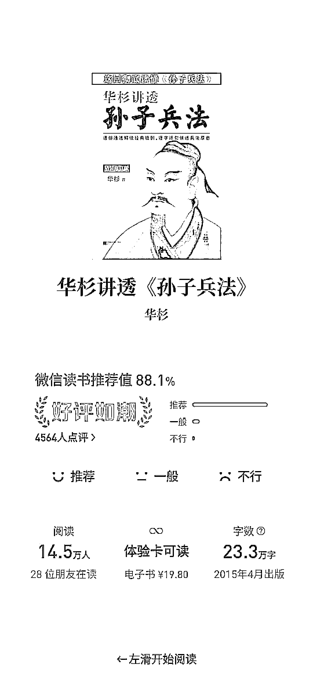

作者的警示是：

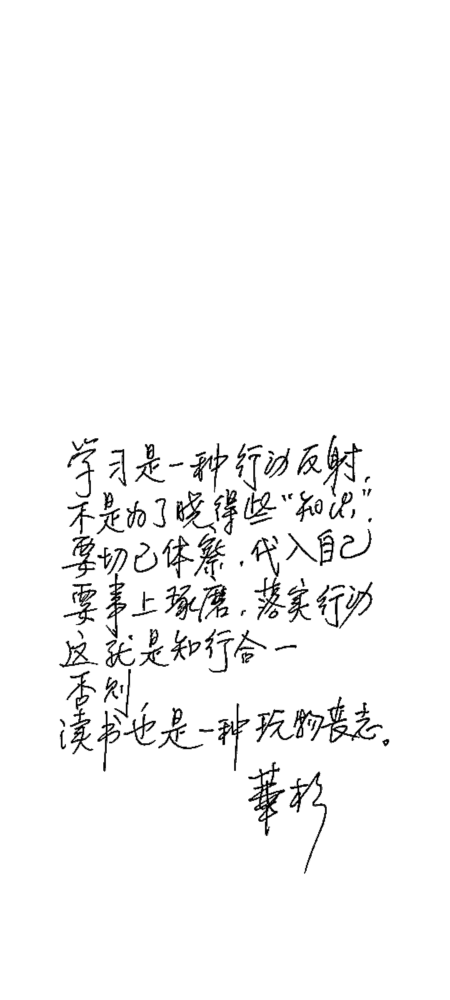

只读不做，知行不合。读书和刷剧玩游戏一样，都是消耗。

所以我一直要求自己：**知行合一。**

我个人的经验是，靠读书变现是个渐进过程。

**书得亲手翻过才知道合不合适，喜欢不喜欢。事得亲手做过才知道适不适合。**

靠“有效阅读”这项手艺，我在公域试过：单篇书评稿费、征文奖金、爆款文带书变现。

也累了。

生完娃后我一直在线上冲。买房压力大，后面没人兜底，只能往前。

2021 年我 31 岁，那年我关掉了所有副业，让自己歇一歇。副业停了，主业还在。

读书对副业有用，对本职更是关键。

2014 年我揣着大专文凭和两千块到上海，第一份工作是月薪 3500 的物流系统销售，业绩平平。

2015 年我读了两本职场小说，《杜拉拉升职记》《圈子圈套》，老板推荐的第二本。看完就用。

先在公司内部用方法换岗，从销售调到实施工程师。熟悉系统后跳槽，正好赶上互联网大潮，以月薪 1 万进入一家电商上市公司做系统需求分析师。

这个岗位要会点基础代码，我是零基础。领导看重我沟通能力，觉得代码能学，沟通是天赋。只要求会增删查改。

入职后他给我买了本 SQL 书自学。

就这本。

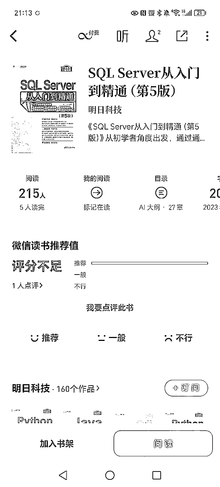

靠看书加同事指点，我学会了基础操作。

9 个月后，我跳槽到新三板公司，当项目经理，月薪 1.5 万。

我没做过项目经理，但我看过别人怎么做的。面试时把“看到的”翻译成“专业语言”。

这点翻几本项目经理的书就能学会。

比如这本就很实操。

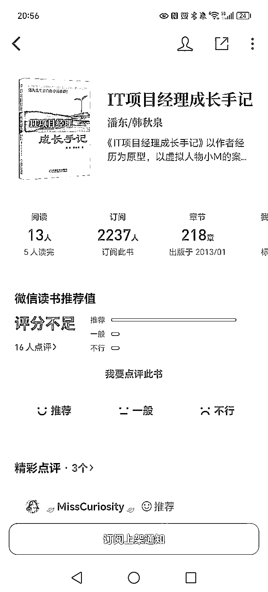

**把书里的案例换成我在公司遇到的客户场景就行。**

概念、职责、风险、话术都差不多。

**书能把日常琐事归纳成专业表达。** 我把这种表达用在面试，面试官觉得我认知、理解都匹配岗位，于是给了 offer。

入职后我知道自己经验浅，立刻报班考 PMP，公司报销费用。之后一样的方式换岗、跳槽、换行。

2021 年底，我找到离家三公里的工作，年薪 40W+。

**这份收入离不开持续阅读、学习和落地。**

这几年我的阅读越来越宽：育儿、成长、心理学……很少写书评了，但书已经长进我的习惯里。

**我现在能把不同书的信息融合、提炼出自己的判断，再结合人生经历输出。**

四年的写作，最享受的就是这种输出。所以 2022 年在主业稳定时，我开了👸号。不怎么写书评，多写自己的故事，里面却沉淀着多年阅读、阅人、经验。

这个号加上私域，今年变现很不错。

总结很简单：**如果我不读书、不学习、不行动，我和我弟弟现在可能还在广东工厂的流水线上。赚不到钱，看不到更大的世界。**

是持续阅读把我带到今天，我是受益者，所以想强调输入的重要性。

自媒体这两年火，很多普通人靠它翻身，我就是其中一个。当年我高杠杆买房，手里只有 20 万，在上海买了房，背了两百多万债。

原生家庭有点重男轻女，我妈帮我带娃，我每月给 5 千工资。老公虽是硕士，但因为我大专+家庭条件一般，我走雌竞路线也找不到更优的，只能说很满意。

在上海我一个人扛着，没人撑腰。婆婆身体不好，每月要给 3500 生活费，由保姆照顾。大姑子、小姑子跟我们家一起摊费用。

所以我没退路，只能冲，而且每一步都不能错。

正因如此，我清楚赚钱不易，也知道自媒体有泡沫，人均百万的说法很常见。我今年第一次破百万，明年能不能保持不知道，只能持续找机会。

成年人要冷静：**自媒体确实是普通人翻身的好赛道，但没有空手套白狼。**要付出时间和精力，要学会读、学会写。

我是实在人，能达到我这样的人不多。当年一起到上海的同事，很多都回老家了。

但我希望我的案例说明：**有目标，能坚持，不下牌桌，就有机会。**

按我的体会，阅读力影响理解力，理解力影响赚钱力。

把书读活，人生才持续龙哥盟。

【往期内容】

1）[📕 1 条笔记变现 4000+，聊聊我的爆款创作思路+引流变现全流程](https://t.zsxq.com/SUUhx)

2）[花 1800/月招小助理，副业做自媒体赚到 40 万](https://t.zsxq.com/tNXpB)

3）[内容更新频率，日更≠能做成一个账号](https://t.zsxq.com/135Hvhqii)

4）[做自媒体要先确定自己的优势和变变现模式](https://t.zsxq.com/13QbjtfMd)

* * *

评论区：

咿呀花花 : 看完了，真的很优秀，尤其是对于读书的理解，能够把书用到自己身上才是有用的，我也时常提醒自己，要知行合一

二丫吖 : 共勉～

小怪兽、 : 看完了，萃取-抽象-转化-凝练，真的是知行合一，把书里的知识运用到自己身上，而不是孤零零的在脑海中有个印象

感谢这么有力量的表达！[爱心]

二丫吖 : [爱心]

帅彬 : 真的很棒

敏杰 : 挺励志，知行合一，读书是为了更好的实践

风萧萧兮 : 太厉害了！[强]

* * *