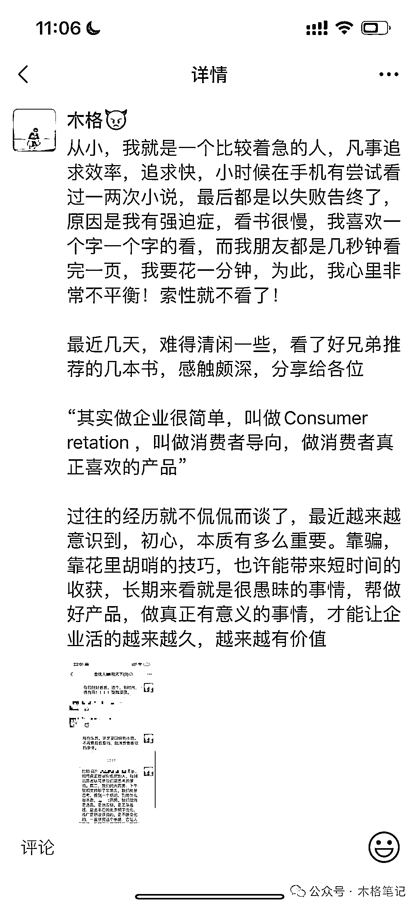
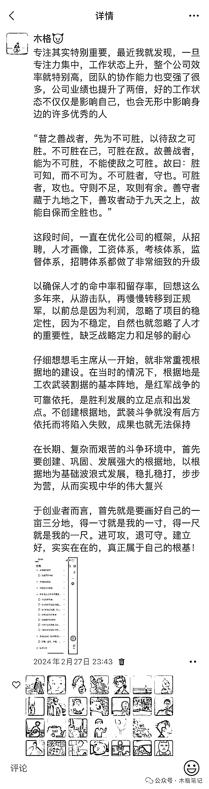

# 践行长期主义，实现百万营收我的成长之路
作者：龙哥

从焦虑到笃定，一个创业者的年度回顾：时间会奖励做难事的人

最近，我把过去十二个月里发生的事重新拿出来，像旁观者一样过了一遍。表面看，公司收入跨过了七位数的线；往深了说，我更想弄清自己是怎么一路跌撞到今天的。

价值到底是什么？我的答案是：价值藏在你走过的弯路里。所以我一边读书，一边把每一步踩出来的痕迹都摊开看，也顺手把今后几年的方向理清楚。

我一直相信：不忽略那些不起眼的小环节，大结果自然会长出来。可小环节也有标准，它需要一颗足够远的定盘星，一张看得懂的地图，再靠边做边调整打法。先把0到60分的地基打好，后面才谈得上其他。

但大约四十天前，我是龙哥。也许是年前歇得太久，我整个人陷入一种熟悉的空转。花了好几天才把心绪拉回来，也借这几天想通了一点——之所以慌，根子在于我看不清前路。

深夜我独自驾车到河边，耳机里放着老歌，孤零零坐在台阶上发呆。我问自己：当初那种爱较劲、不认命的劲头，丢到哪去了？那种非要干出名堂的执念，怎么就被舒服日子磨平了？想着想着，我明白了：不是人变了，是方向模糊了。前路要通向何方、具体从哪一步开始、何时启动、找谁同行——我心里完全没底。

我办的头一件事，就是把公司整体方向重新描一遍。搭起核心团队，想清每个位置配什么样的人，把各环节的训练做扎实，再让所有人认同同一套价值观。从那以后，从管事的到干活的，都清楚自己每天在忙什么，节奏感和成就感完全不同了。

那阵子，我把几位企业家的传记和复盘笔记都啃了一遍。读不明白的章节，我便反复咀嚼，直到懂了为止。早前我老觉得“创新”“文化”“用户导向”这些话离自己很近，真正做事才意识到，我只是认识那些字，离真正吃透还差得远。

前些天我发了条状态，说自己从小就不是爱读书的人。一本书别人两三天就能翻完，我要磨上半个月。我怕漏掉任何信息，总是一字一句慢慢啃。渐渐地，我发现这反而成了优势：读得慢，但记得牢，还顺带练出了坐得住的功夫。

看历史就知道，人一旦活成孤岛，完全屏蔽外部反馈，离危险就不远了。做公司尤其如此。刚开始做生意那几年，我也犯过这类错，现在回头看，那种自信过头的样子特别可怕。

真正有本事的人，不是从来不犯错，而是能很快看出问题，并且立刻掉头。这段日子我明显感觉到，自己的行为和反应方式都在变，特别是平时写下的东西，好像会反手推着我去做更清醒的决定。

我曾有两个很明显的毛病：拍板太急，等不起。这两点如今都改了不少。

过去挑项目，我几乎不考虑和自身合不合拍，只看哪个来钱快。一切向钱看的结果，往往是钱没挣到，时间却赔了不少。偶尔走运赚到一点，也撑不了太久。

现在，我会为一个决定留出至少一个星期的余量，长一点也无妨。定下来之前，还会找身边真正有结果的人聊一聊。阅读和整理，也让我慢慢能坐得住了。前几天我还跟团队开玩笑：眼前这个项目做了一年多快两年，换作以前，我早就没有这份耐性了。

如今我更信一句话：天衣无缝的打法极少见，方向靠谱才要紧。战术上走偏一两次不稀奇，只要大方向没偏，就不用慌。真正常胜的人，总会先保证自己输不了，再等着看对手出错。不必场场都赢，但在关键战役上不能输。只要绕着长远的目标前进，别人看得懂也追不上，这本身就是一种坦荡的优势。

所以我给自己定了三条线：不躲难事，做确定有益的事，啃别人不爱啃的骨头。

什么叫确定有益的事？生活里，运动、阅读，都算。公司里，货品选择、供货网络、员工培养、内部机制、价值共识，也都是要日日下功夫的基本功。把这些一点点磨到位，已经能打赢大多数同行。早些年我一直不懂这些，是因为我压根没把时间轴拉到五年之外去看。直到今天我才悟到：一项事业最终能走到哪一步，常在出发时就写好了答案——起点、发心，以及你肯把哪些环节磨穿，都在悄悄定义结果。

还有一条路，叫不与同行贴身缠斗。成天跟水平相近的对手较劲，几年后彼此依旧很近；把眼睛盯在最顶尖的人身上，几年后，你身旁的竞争者可能都不见了。看齐什么样的对象，决定你能走到什么位置。

那怎样才算难而正确？说个真实的过程。我们扎在健康产业里，最早跟着本地生活平台做业务，之后依次铺开线上零售、医疗设备、连锁药房，最后开始做自有品牌。表面看是一条顺路，其实每一步都是硬闯。

前几天开会，我向团队抛了几个思考题：

一，如果公司明天清零，我们各自还剩下什么本事？
二，往哪个方向使劲，才有可能走得远？
三，为了公司以后的路，今天该把哪些事做得更好？
四，接着，我请大家一起回望刚过去的这一段。
五，如果当年只守着原本的业务，没去开辟新战线，可能早就被淘汰了。
六，如果医疗器械赚钱时只顾着扩张门店，照样会栽。
七，如果把关键位置托付错了人，公司同样挺不到今天。
八，如果没有一套靠谱的内部机制，结局也不会好。
九，如果不逼自己迈过药房那道门槛、不去做自有品牌，更是没有活路。
十，想了解更多细节，可以翻我过去写过的总结，答案都在里面。

以上全是我的亲身经历。我并非天赋异禀，不过是坑踩得多了，慢慢长了记性。为什么我们一次次穿越难关，收入和盈利能撑起今天的盘子？答案就两个字：总结。总结让交出去的学费没有白费。

我也曾交过天文数字的学费。在传统货架电商上开过八十多家店，最风光时单月利润冲到百万级；短视频电商刚兴起时我也第一批冲进去，很短时间营收摸到八位数。可这些故事都没有延续性，它们只给了我一些短期快钱，没沉淀出真正值钱的东西。现在再想，那些小成绩根本不值得念叨。

我眼下之所以对一些判断特别笃定，很大程度得益于总结和写作。这个账号就是我的成长标本，写下来，等于给自己装了一面镜子，越照越通透。

一件事值不值得做，我不再拿短期进账当尺子，而看它能不能长期为某一群认可的人持续创造真实的好处。把产品打磨得够好，把人放在第一位，把路走得够远，钱只是顺路带上的行李。

所以，麻烦来了别绕道，痛苦来了就接着。用最笨的方式，把一件事坚持到有结果为止。

万物的运转自有章法，所有人都在找属于自己的平衡。经商这门生意的内在逻辑并不玄乎，说到底就是始终为某一部分人提供别处给不了的价值，用稀缺和独特垒起护城河。这话说出来轻巧，真正做起来要命。希望你我能把它记在心上，拿时间来验证。

