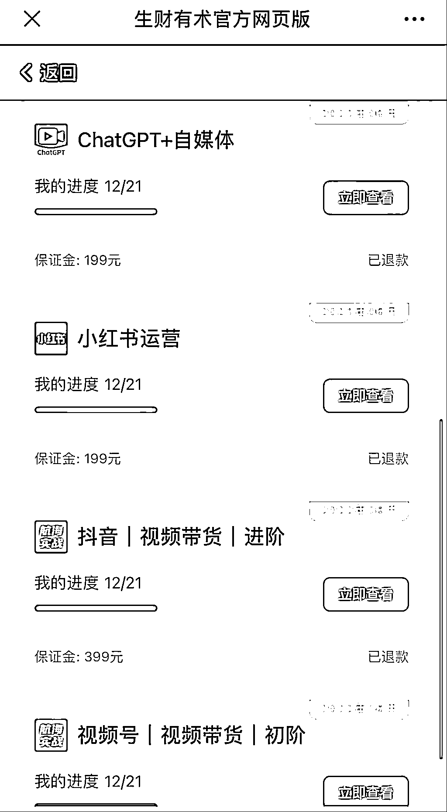
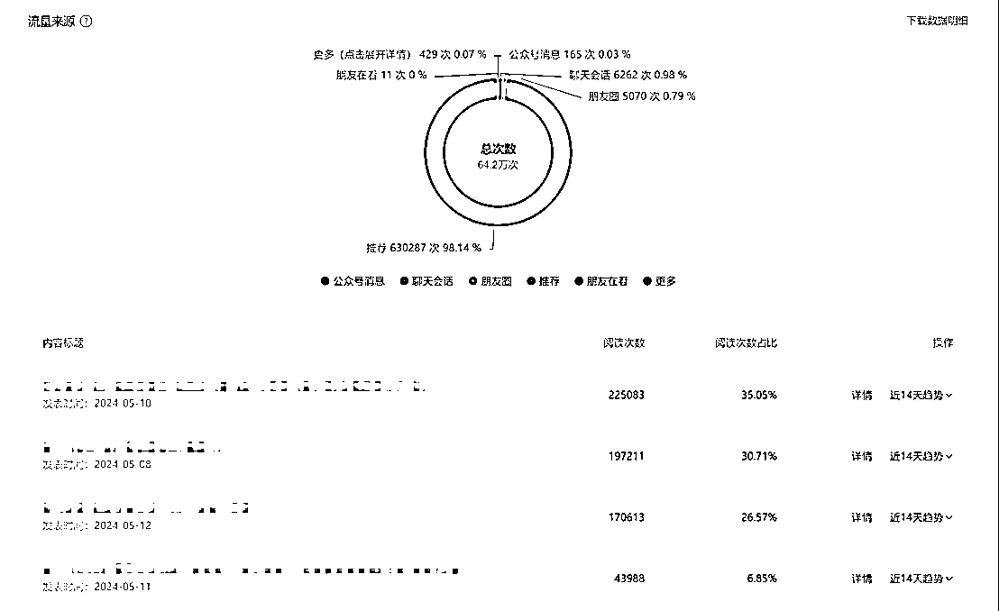
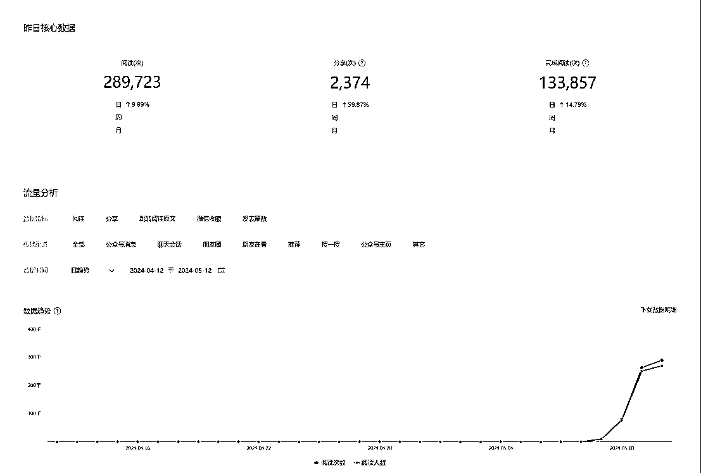
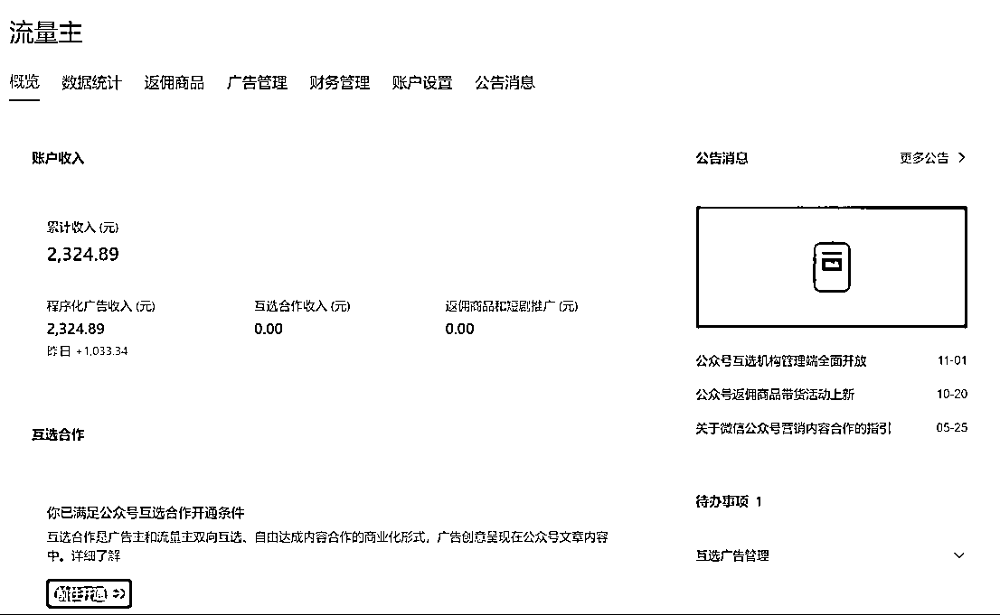
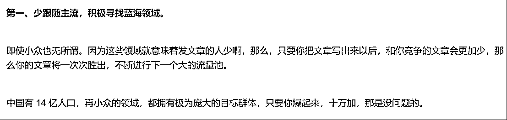
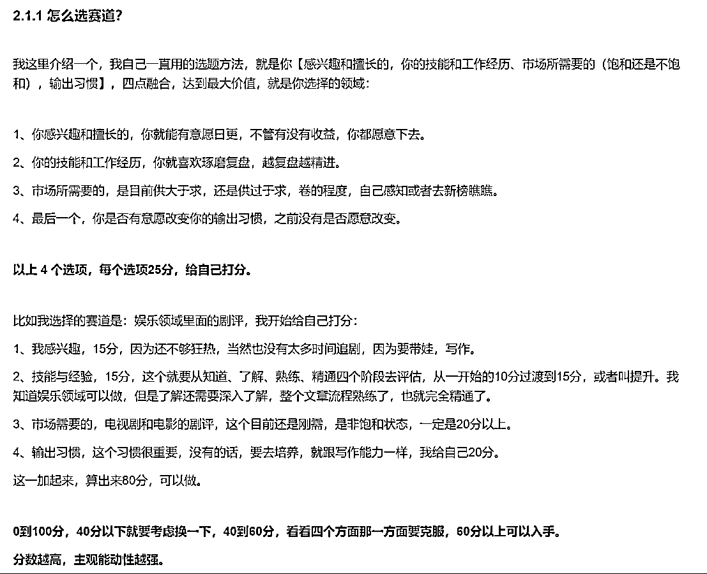
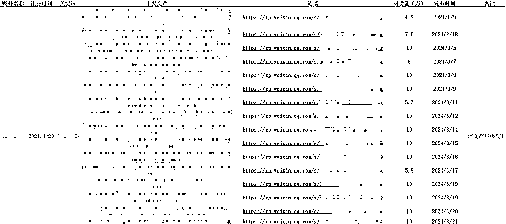

# 公众号爆文新手，5天拿下64.2万阅读：这4件事，我做对了

先说明一下，这篇文章其实是补发的。之前发过一次，因为疏忽被删了，忙完手头的事，重新整理一遍。

自我介绍：圈友们叫我“一 ge 不小心”。混龙哥盟挺久了，但一直在潜水，不大说话，更多时候是默默看帖。今年给自己立了个flag：要多输出、多互动。

先澄清一个词，标题里的“新人”不是赚钱新人，而是在公众号爆文这个项目上，我算“从零开始”。2023年那期ChatGPT+自媒体航海，我也跟过，写了不少，却颗粒无收。所以大家看到“新人”时，可以把我理解成：公众号爆文赛道的小白。

我一直喜欢写作和做总结，也一直关注公众号爆文。它既能沉淀个人IP，又能靠流量主赚钱，是很理想的一种“手艺活”。2023年6月，我一边做电商航海，一边报了ChatGPT+自媒体航海。可那阵子我的精力主要放在电商和带抖音团队上，每天面试、开会，自媒体只能勉强跟完进度。航海结束时，结果自然不理想。但我不觉得是项目不行，反而一直在观察它的趋势，也持续学习圈友们的经验。

之后这件事就暂时搁下了，一直到今年五一。放假在家没什么事，我又翻出赚钱精华和航海手册，同时还在重读《孙子兵法》。这次看手册格外仔细，边看边做笔记。奇怪的是，原本熟悉的电商经验，竟和公众号爆文产生了同频共振。抖音玩法、小红书打粉、淘宝选品逻辑……这些看似不相关的工具，好像全都变成了公众号爆文的解法。一个门外汉，忽然有了握到秘籍的感觉。那还说啥，立刻开干！

先给大家看成绩，免得空口无凭。5天合计64.2万阅读，几乎每天都有10万附近或10万+的文章出现。

说真的，这个结果把我自己吓到了。以前在航海里算学渣，怎么几天就变学霸了？我不想稀里糊涂收下这份运气，所以认真回看了这5天的操作，发现真正起作用的是下面几件事。

第一件事：用蓝海思维，避开最拥挤的战场。

在电商圈里，所有人都能感受到内卷的窒息感。想长期有饭吃，就得持续制造差异化，主动把竞争的烈度压下来，除非你有“钞能力”，什么都用钱解决。我体量不大，这些年一直躲着大商家走，活下去比什么都重要。

巧的是，这正好和我五一重读的《孙子兵法》撞了个满怀。能不战，就不战。“铭记直接竞争，是不得已而为之”——真正的高手，总是先选好战场再打仗。公众号爆文的航海手册里也提示过蓝海思维，大家看这里：

蓝海思维不难理解，难的是怎么落地。我的做法是：先把可能想做的方向筛出来，比如职场，再拆出失业、降薪、裁员、晋升等关键词，一个个去搜。如果看到10万+的文章，我会从标题里抓出几个高频词，再往下搜，尽可能把职场这个大池子下的子赛道都挖出来。看文章时，还要顺带留意账号的注册时间和发文数量。如果一篇文章10万+，但号是新的、发文也很少，这个“异常值”往往就是机会。我会把它记录下来，并标注好子赛道——千万别只写“职场”两个字就完事，要写成“职场+找工作+国企”“职场+八卦+赚钱”这种，分类越清楚，越容易找到竞争小的方向。别看不起小赛道，有人就靠一个冷门细分天天10万+。找对标账号时，优先找最近注册的新号，发文越少越好，但必须有10万+文章。我们的任务，就是盯住那篇爆文，反复拆解。

第二件事：贴身肉搏的铁血思维。

选了蓝海，不代表没有竞争，只是把烈度调低了。商业世界和真正的战争还不太一样，你看到的好赛道，别人不会自动让给你。所以除了“谋”和“交”，关键时候还得能“伐兵”“攻城”。我特别推崇曾国藩的打法：“结硬寨，打呆仗”。别总幻想一蹴而就，而是把准备工作做到极致，靠笨功夫和韧劲赢下来。

具体操作时，我会把候选方向全部拉进表格，记录文章链接、阅读量等关键信息，方便比较，再挑出真正适合自己的软柿子。数据足够多，就能交叉验证是真蓝海还是假蓝海。有些文章写得很糙却拿了10万+，往往说明赛道是真蓝海；有些赛道文章质量一般，几万阅读居多，但账号普遍有稳定数据，也值得一试。下面这张是我整理对标时用的表，大家看的时候只抓表头和逻辑就行：

方向筛选占了我整个项目的大部分时间。我一边筛，一边用爆文“喂养”网感，短短几天过了一千多篇爆文，并把5万阅读以上的都标出来，便于反复对比。我一直觉得，这步不能省，因为它基本决定了项目的生死。这大概就是选择大于努力的真实含义。

第三件事：像婴儿学话一样机械重复。

我是公众号新人，网感不算好，所以从一开始就很认一个死理：向对标账号学习，老师怎么做，我就怎么做。我有个朋友之前也做过这个项目，最好时有八九万阅读。这次他想跟我一起冲，可我教他的时候，他的动作总是变形。爆文标题明明只该微调，他非要自己另起炉灶；内容结构和立意也完全看不出对标痕迹。结果自然很难起量。

这件事给我的启发很深：当你在前期做过大量调研后，战略方向已经定了，执行时就别再塞太多“我觉得”。想法一多，动作就会漂移。前期得像婴儿学话一样，把“教练”的每个动作机械重复。但注意，不是抄袭，那会违规。你要做的是在结构、标题、立意上尽量接近，能力够就优化，不够就让ChatGPT帮忙起稿。一句话：高仿，甚至复刻。刚入门，先把脑子放空，别上来就“我有想法”。

第四件事：不断复盘，用量变换质变。

第一天发出去，数据并不好。我把自己的文章和对标文章摆在一起，逐段逐句地抠，反复改，然后问自己：为什么他能10万+，我却只有3000？难道同款思路再来一次也能爆？带着问题调整动作，后面开始写多版、改多版，有时改完甚至觉得比对标更好，再发出去等系统“开奖”。慢慢地，几乎每天都能出爆款。五天内，10万+一共出了3篇，5月12日更是单日拿下近29万阅读。

把这段经历浓缩成4条经验：

第一，蓝海思维。别粗线条地选赛道。职场、八卦是大赛道，可以用职场+、八卦+去切；如果还嫌挤，就职场+A+B。总能找到一片没人跟你抢的地方。

第二，结硬寨，打呆仗。不要觉得“做了就行”，要做就做到位、做到更好。量变必然带来质变；如果还没质变，先看方向对不对，方向没问题，那就是量还不够。

第三，机械重复。你认准的教练怎么做，你就怎么做。模仿在前，优化在后，超越是最后的事。顺序一乱，动作就会变形，失之毫厘，谬以千里。

第四，总结复盘。没做好的地方，别急着找借口，回到对标账号里逐处对比。方向没错却没结果，一定是哪里没做到位，那就重走一遍“长征路”，把细节抠透。

这次能成，还有一个隐藏前提：我之前做过很多项目，脑子里解决问题的工具箱比较全。所以如果你更早入局，建议多刷圈里的帖子。工具越齐，遇到问题时能用的解法就越多。

评论区里不少圈友说“有收获”，也有人问我那个对标表格是不是爬虫抓的。我的答案很朴素：一没爬虫，二没工具，就是手动整理。因为整理的过程，本身就逼着你想清楚很多事，这笔功夫省不得。

