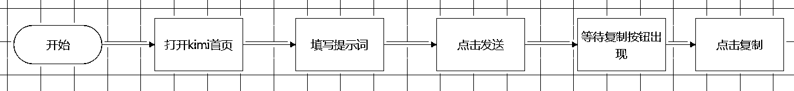
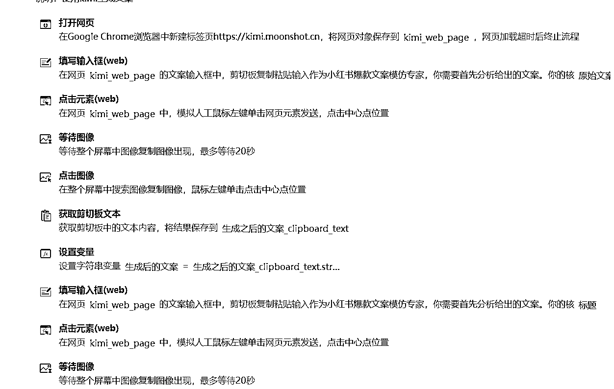
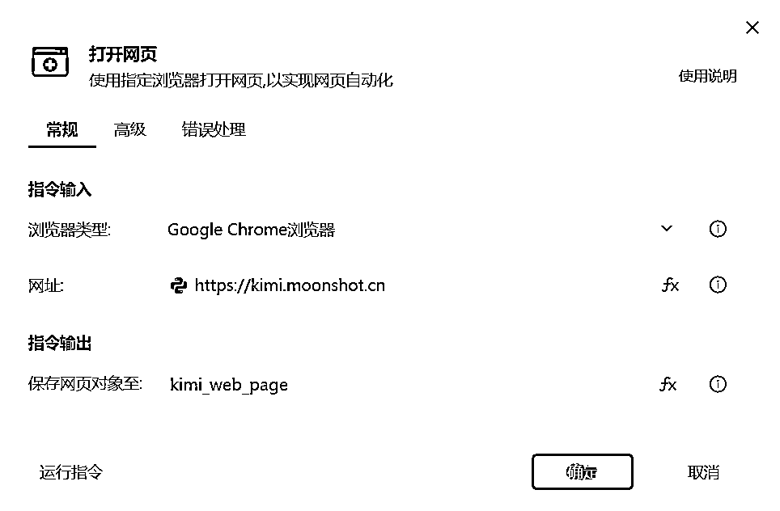
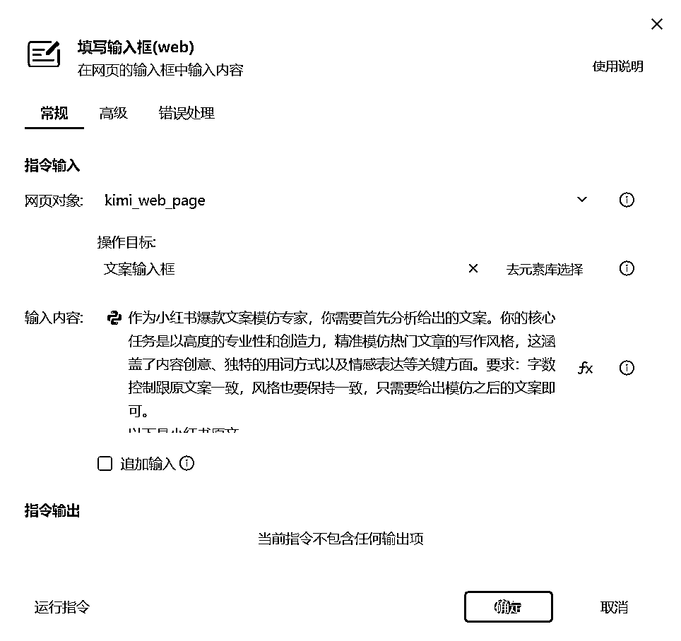
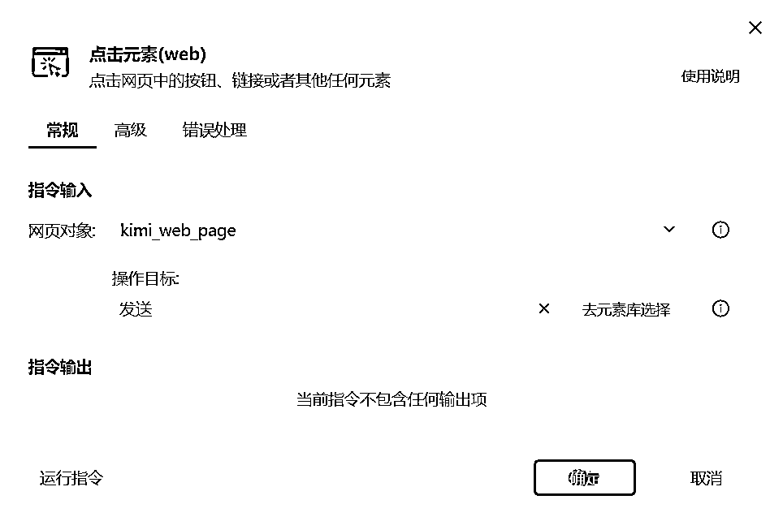
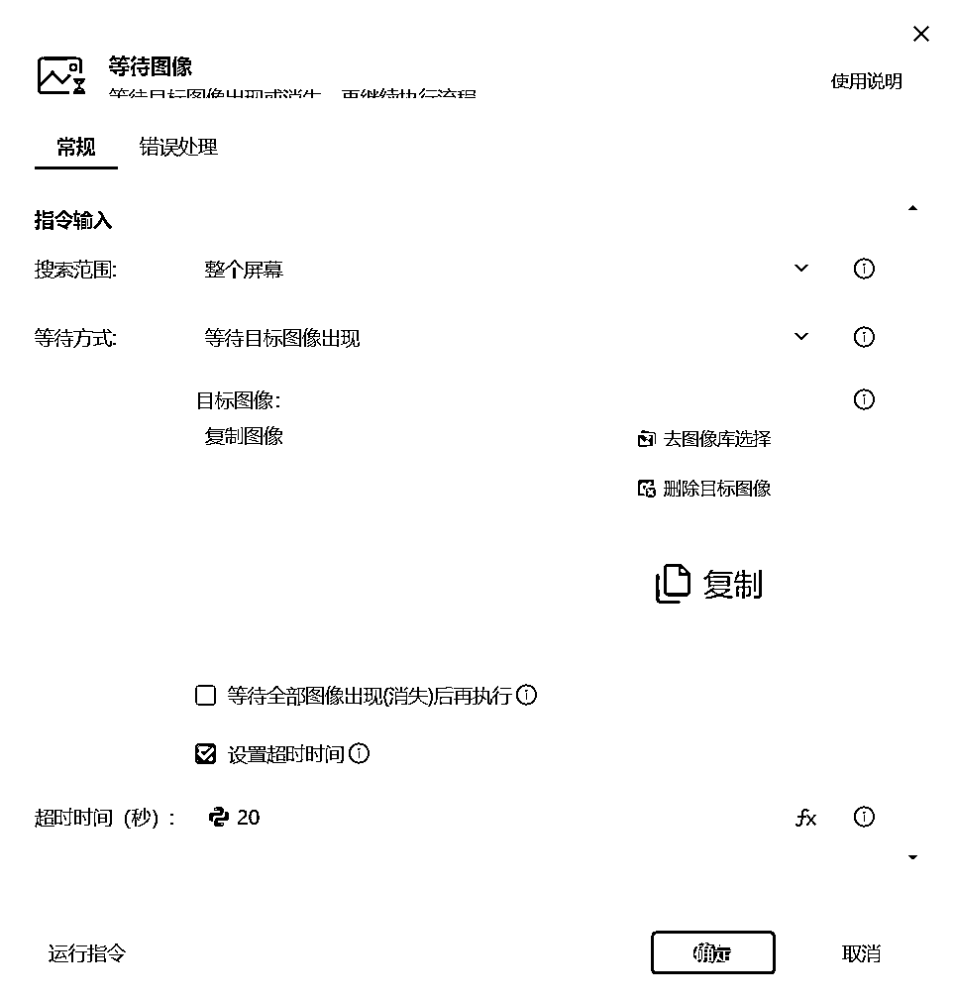
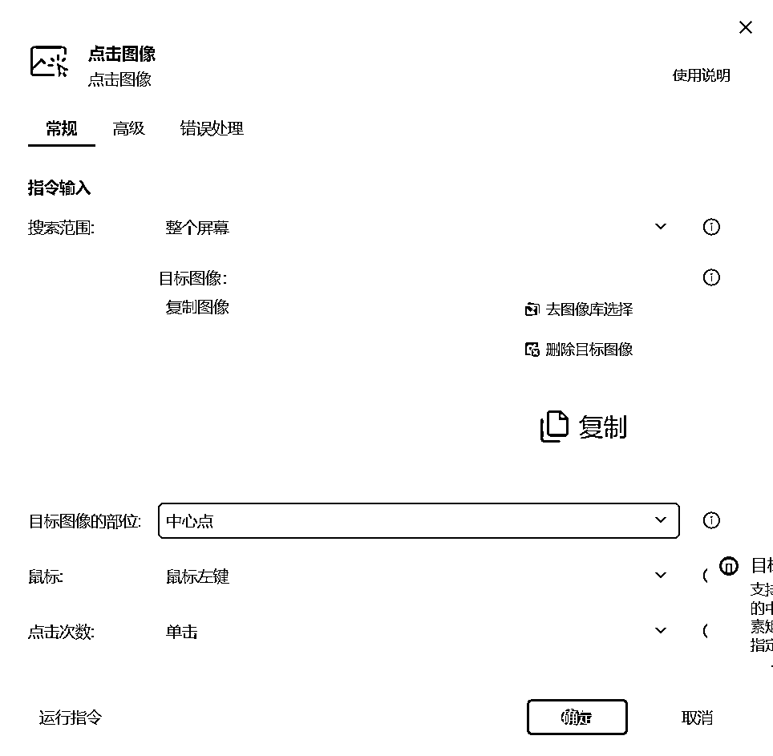
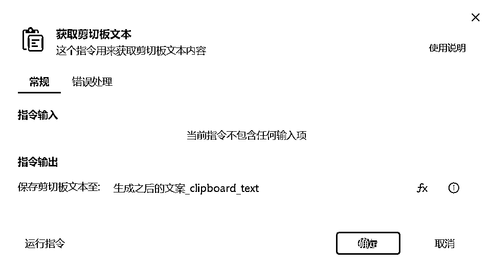

# 📕全自动写文发文机器人-爆文仿写笔记（二） -附提示词

给爆款笔记换个写法：📕仿写自动化实操手册（续）｜附可直接照搬的prompt

各位朋友，我是飞哥，大家叫我码农飞哥就行。所在的公司是上市科技企业，同时也是CSDN博客专家，平时主业是RPA自动化方案和毕业设计定制。这篇文章整理自2024年5月的一次实操复盘。

前一篇讲了如何让RPA在站内搜索并收集爆款笔记。这期继续往下走：素材到位后，让大模型照着素材的风格重新写一批新笔记出来。

具体来说，仿写就是把采集到的标题和正文交给大模型，由它产出风格统一、内容全新的版本。这个环节关键就两件事：引导指令要设计到位，大模型要选对。我多次对比后，锁定了Kimi。

整体推理路径可以看下图：

接下来是影刀里的落地配置。

演示视频
视频受平台限制，这里直接上图解。

标题仿写和正文仿写走的是同一套逻辑，这里用标题仿写做示范。

第一步，进入Kimi。
影刀启动Chrome，打开Kimi官网。记得先完成账号登录，否则后面没法用。

第二步，写入prompt。
把下面的提示文本粘贴到输入框里：

现在请你化身📕热门笔记模仿专家。拿到一篇笔记后，先对原文进行拆解，主要职责是依靠专业功底和创意，尽力复刻爆款内容的笔法，包括内容构思、词汇特点、情绪表达等。要求：输出篇幅要和原文差不多，文风也要贴近原文，直接给出仿写结果即可，不要附带多余说明。待仿写的原文如下：
---
[在此粘贴原文]
---

随后让RPA对页面上的发送键做一次点击。

第三步，等待生成完成。
Kimi输出内容后，页面上会出现一个复制图标，看到它就代表本次生成已经结束。所以先让程序通过图像识别盯着这个图标出现。

等到图标出现，立刻点一下它。

第四步，取回剪贴板内容。
按下复制图标之后，生成的成果就已经被放到系统剪贴板里。此时只需读取剪贴板，就能把文案捞出来。

到这里，仿写这条自动化链路就完整走通了。把上一篇的素材采集和这一篇的仿写接在一起，就能让找素材到出成品整条链路自动跑通。希望这套实战路径能帮到有需要的朋友。

评论区里的讨论也有价值。有位读者习惯用代码把流程自动化，但发笔记到📕这一步，最后还是用了RPA，理由是平台对机器发文查得很严；作者认同这个做法，觉得模拟真人的操作方式更容易融入普通用户的使用节奏。还有人表示终于看到这么容易上手的教程，连连点赞。另一位朋友问“等20秒再拿结果”是不是不太稳，作者解释那是一个最长时限，正常情况下等到复制图标出现就会继续，不是傻等20秒；对方追问遇到异常怎么办，作者说走兜底的异常处理即可。

* * *