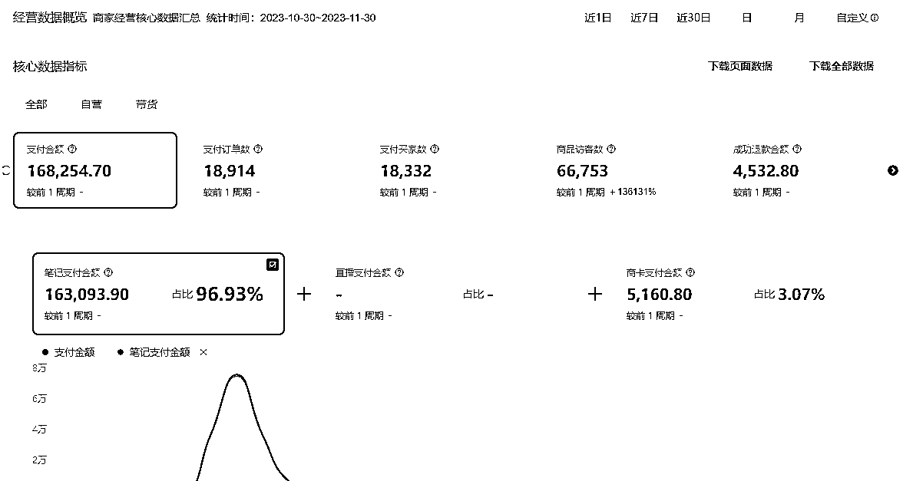
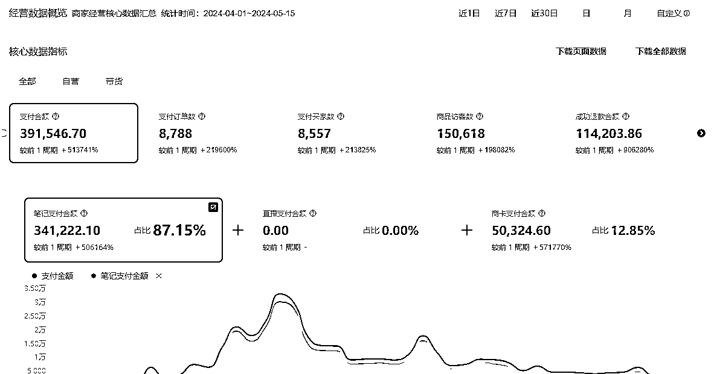

# 小红书单月30万GMV实战复盘：一个98年杭漂的阶段性答卷

大家好，我是小辉，98年，在杭州打拼。加入龙哥盟已经两年，之前一直潜水，刷着各位大佬的帖子默默偷师。最近这阵子，自己做的小红书项目终于跑出了点成绩，忍不住来和圈友们同步一下。

这次复盘里，我把整个操作过程中的选品、内容、转化、供应链和复盘逻辑都梳理了一遍，谈不上什么高大上的理论，更多是踩过坑之后的真实沉淀。单月做到30万GMV，对我来说算是一个小小的里程碑，希望这篇内容能给同样在摸索期的朋友一点方向感。

完整版内容（含数据截图和实操细节）建议直接看飞书文档，体验更佳：  
https://lnbxqg5dh9.feishu.cn/docx/Sg6MdGUq4oN8K4xV3uhcMtZUnqc?from=from_copylink

* * *

顺便把评论区大家关心的几个点也说一下：第二次启动时不是拿老店继续做，而是直接开了新店。至于客服这块，是自建还是找助理、订单量不大时有没有靠谱的兼职客服渠道，已经有圈友在追问了，后续有答案我再更新。

