# 6000块起步做到百万利润，我靠的不是选品，是把平台小二的关系经营明白了

## 电商卖货从6000启动资金到100万，关键是懂得和平台相处

作者： 微尘🐳

日期：2024-05-17

你有没有在支付宝里刷到过商家积分兑换的页面？纸巾、牙膏、袜子这些高频日用品，经常会出现在里面。

这些货源其实都来自支付宝官方的供货招募，负责运营的小二会直接找商家给到曝光位。哪怕你手里没有工厂，只要在1688上把店铺跑起来报名活动，就有机会切入这个赛道。

我就是用这套打法拿到的第一桶金100万。

本质就两件事：搞好和平台小二的关系，吃透平台规则。用1688店铺承接合作之后，重仓参与618、双12等大促并把指标完成好，官方自然会给你倾斜流量和资源。

下面我把从0到1的完整路径拆开讲。

通过1688承接的支付宝定制纸巾项目，半年做到GMV破5000万，净利润过100万。

纸巾是典型的消耗品，单品毛利薄，靠走量堆利润。量起来了，利润自然就起来了。

先上图

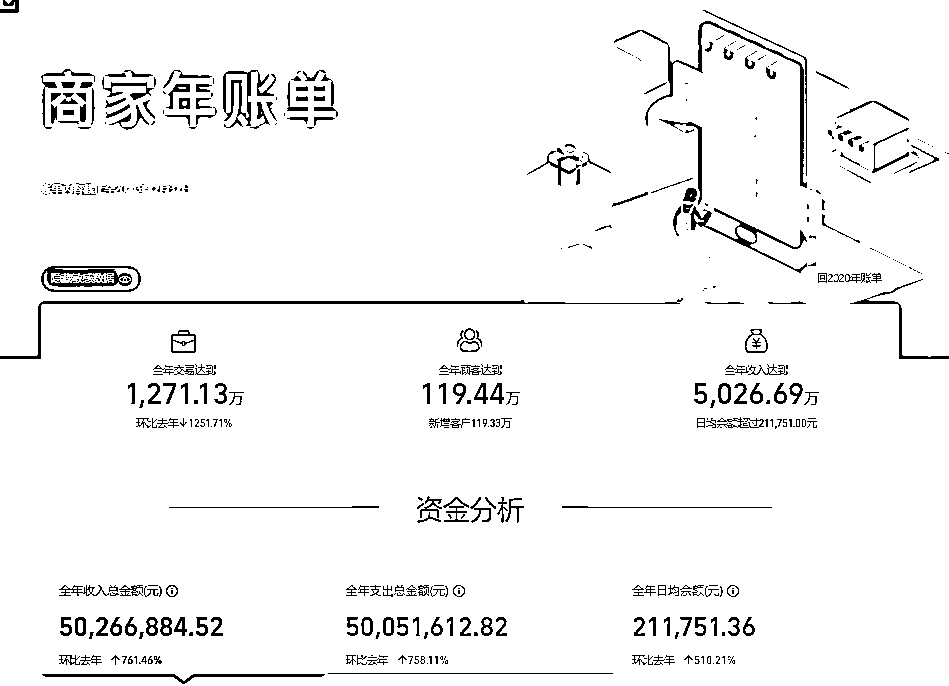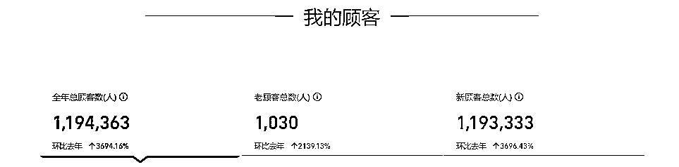

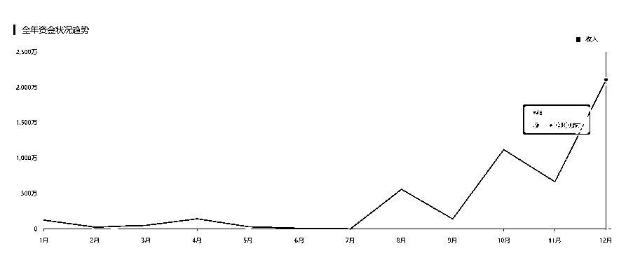

纸巾大家都不陌生，生活用纸、商务用纸处处都在用。今天要讲的就是如何借助1688店铺，拿下和支付宝联动的纸巾项目。

大家好，我是京悦，电商做了十多年，实体也摸爬了三年。今天就用通俗的话把这个机会讲清楚。

我老家在河北保定大册营镇，被称为华北纸都，全国80%的纸巾都出自这里。做纸巾这行的人应该都知道这个地方。

当地除了纸巾，还有驴肉火烧、槐茂酱菜、春不老等。景点有满城汉墓、狼牙山、清西陵、白石山、野三坡等，欢迎来玩，到了请你吃驴肉火烧。

先说项目怎么跑。

## 一、项目是什么

核心逻辑是：用1688店铺去对接支付宝商家积分兑换的纸巾项目。

1688可能不熟，支付宝谁都用过。入口在支付宝-我的-商家服务-商家积分，并不是所有个人号都有，部分以B端商家为主。

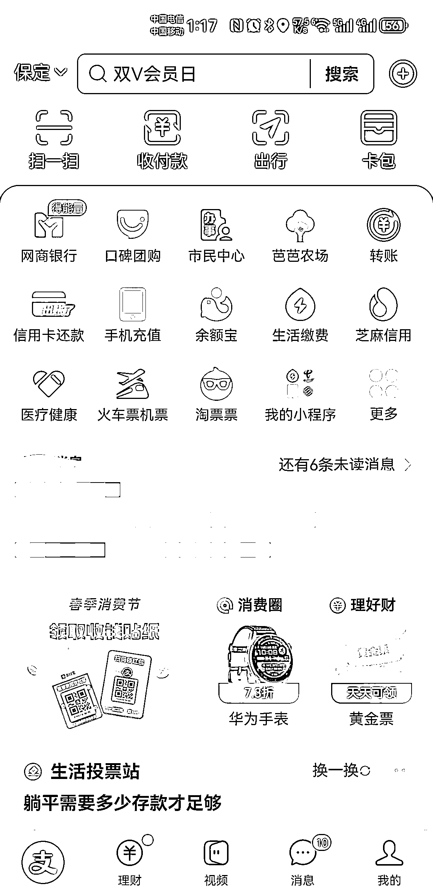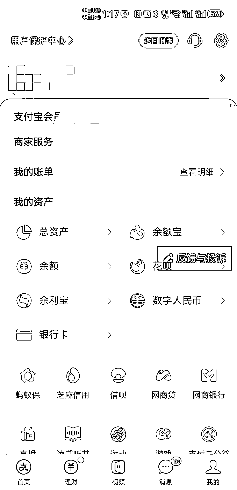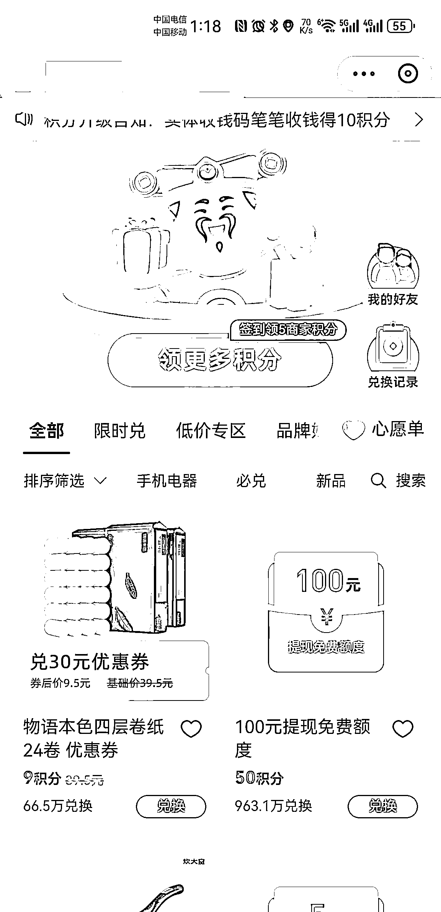

兑换页商品很多，覆盖多个品类。如果你的品类在列，就去1688开店报名，抢占名额。

我08年就接触电商，一开始是淘宝一件代发，在北京通州上班时就在淘宝开店上传资料包。那时还在QQ群找货源。

10年回老家结婚，又在机械厂干了两年，12年和老婆一起开始自己打包发货，后来出来单干。原因很简单，老板不允许员工有副业。

扯远了。说下门槛。

有人会问有没有门槛。1688诚信通年费6688，圈内可以找服务商谈返点。店铺开通需要营业执照、身份证、手机号、支付宝，建议找第三方代开，能省不少事。

**1、店铺搭建**

店铺开好后就上商品。

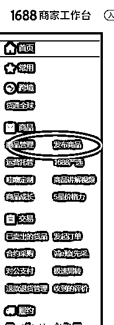

店铺等级达到L2后可以报名严选产品

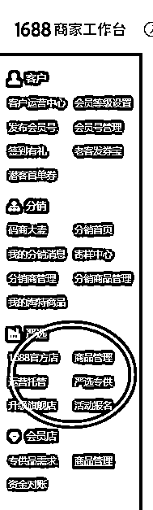

严选可以全店做也可以部分做，会抽5%佣金，自行权衡。

**2、入驻严选**

准入门槛如下：

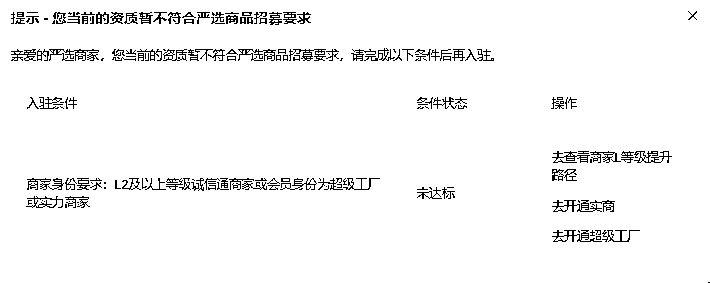

L2级诚信通商家即店铺达到L2。等级划分标准见图。

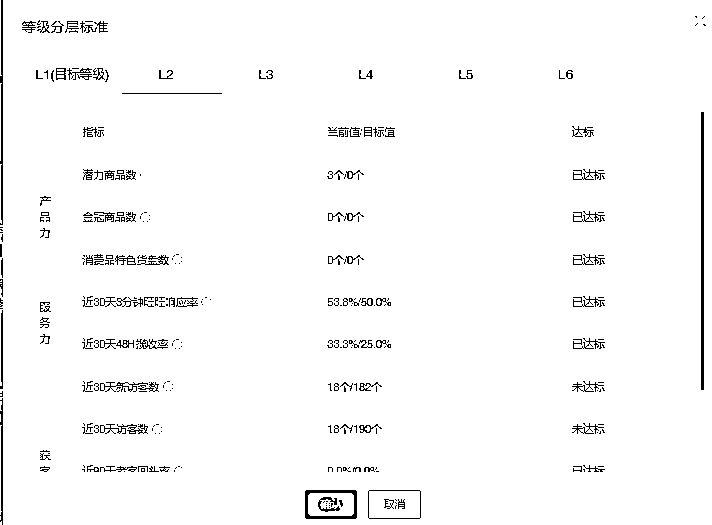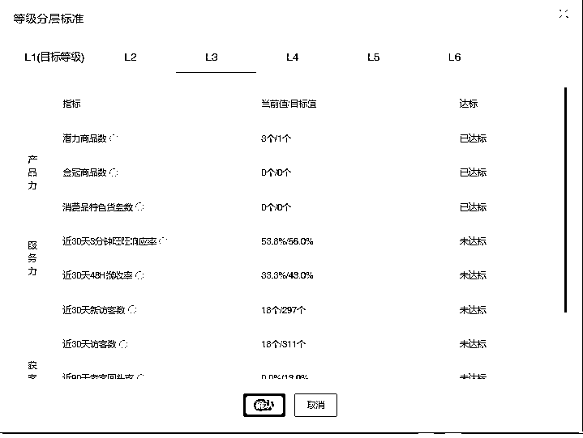

超级工厂和实力商家需要付费，这里先不展开。普通诚信通也能做，我咨询过小二可以。

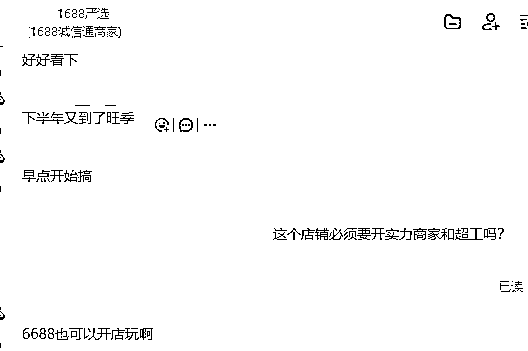

店铺运营起来后，达到L2就开始跟着类目群小二发的活动报名，积极发声让小二看见你。另外要申请钉钉号并绑定店铺，进入类目群。

钉钉绑定入口在店铺后台右上角头像处。

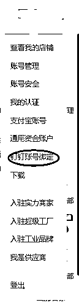

店铺开好后注意营业执照年检，避免异常。

年检教程我整理过：[`wx.zsxq.com/dweb2/index/topic_detail/814822212552542`](https://wx.zsxq.com/dweb2/index/topic_detail/814822212552542)

**2、如何拿到项目**

店铺+严选搞定后，就要盯着项目机会。

每个类目都有内部商家群，要常泡在里面。群里有活动就报名，先别管是否出单，关键是先通过审核，再去做运营表现，让小二看到你的价格和质量数据。

店铺后台的活动也要报。

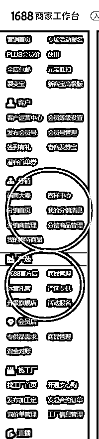

1688一年有3次大促，3月、9月、12月。小二会在群里发报名链接和完成奖励。

## 二、我实际做了什么

店铺上线后迅速吃透平台规则和工具，正常运营的同时疯狂报名后台和钉钉群的活动链接。那时支付宝货源活动很猛，市场厂货通是满10减5。每个场次我们都做运营，把卷纸和抽纸做到类目前列，我和朋友的店长期霸榜。

当时还没千人千面，出单多自然就有曝光。

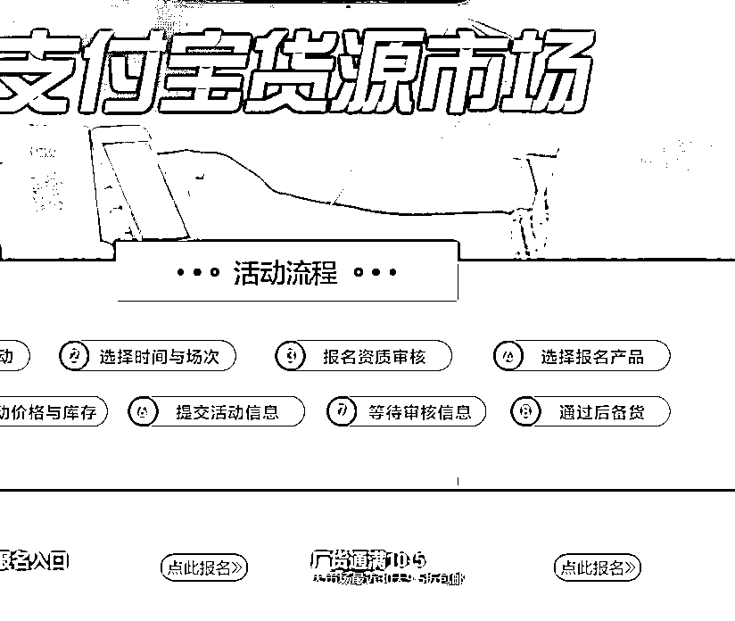

接着就是死磕三大促，3月、9月、12月一场不落，都能完成高GMV和各项指标。这里用的店铺是专做大促的，和主店分开。

大促前平台会联系你，要求完成一定业绩，金额不小，几百上千的GMV很常见，自然不止找你一个商家。但只要你开口，他们会想办法帮你达成。这样既帮平台完成任务，你也能拿到资源位奖励。

完成高业绩不需要大量现金，靠平台工具就能撬动。

之后我们就拿到了项目报名的链接，填写含税包邮价和规格，等待审核。因为前期铺垫到位，很快通过并被通知寄样。从通知到样品寄出，再到包装设计定稿，全部一周内完成。效率就是这么高。

包装样品：

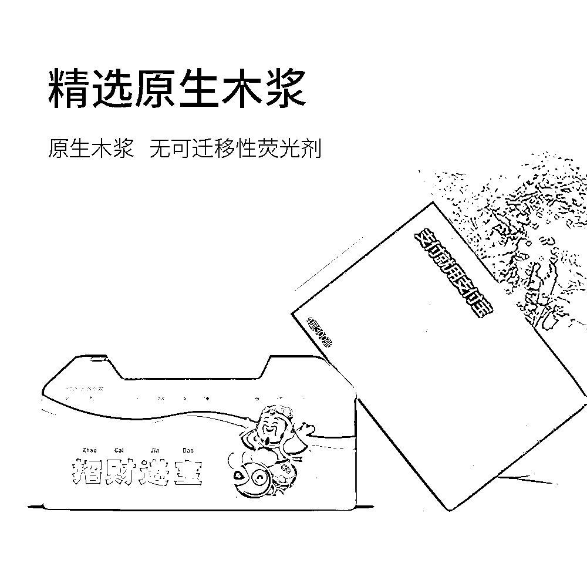

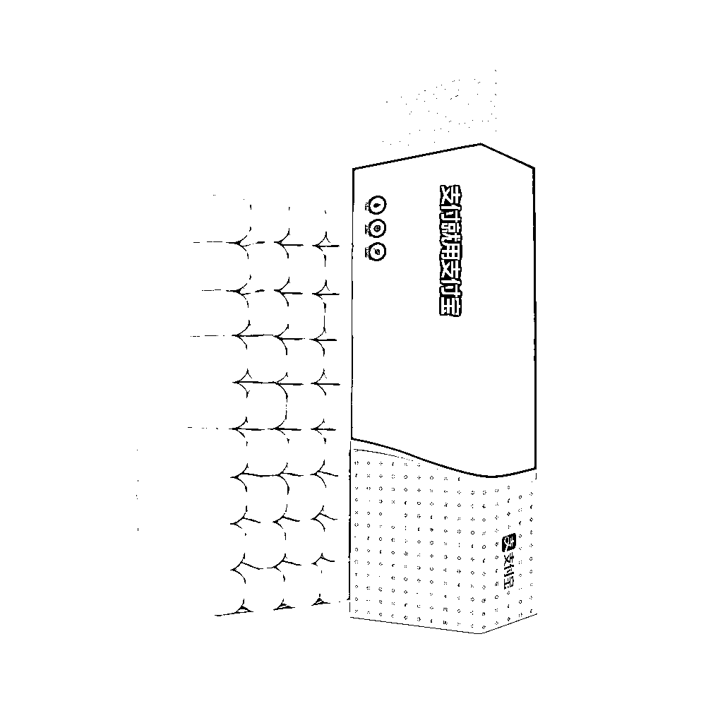

总结一句话，我能拿到项目，核心是和类目负责人保持沟通，持续完成活动指标。商家和平台是共赢关系。

## 三、操作要点

1688店铺必须用营业执照，没有工厂的商家和类目负责人聊天时别主动提自己没工厂。

钉钉群里要保持活跃，和负责人维护好关系。1688主要靠活动获取B端客户，订单里筛选出B端加🛰️维护。

无论有无工厂，产品质量一定要稳。积分兑换商品容错率极低，报名时库存和价格算准。出现问题立刻在钉钉群或私聊负责人反馈。

希望对想做1688的朋友有帮助。感谢阅读。

* * *

评论区：

FF : 我有品牌底价库存尾货供应链，可以研究合作一下[呲牙]

大虫 : 啥类型的

泰来 : 同保定圈友，优秀！向你学习～

康先生 : 啥类型

Do_no : 啥类型的

FF : 小家电 个护 清洁 3C 数码类

FF : 小家电 个护 清洁 3C 数码类

FF : 小家电 个护 清洁 3C 数码类

* * *