# 新人怎么快速在生财找到自己的位置？我靠“写风向标”这件事，三个月把门票钱赚回来了

> 说真的，刚进生财那会儿，我心里挺没底的。

当时是通过镇海团队进来的，印象最深的是靠谱讲过一句话：**在生财，一定要占好自己的生态位。**

这句话我记到现在。六万多人的圈子，真正能把资源用透的人其实不多，我不想成为那个“门票白花”的人。

所以一进来，我几乎把新手能参加的活动都过了一遍：新人融入营、生财思维课、6天微实操训练营，一个没落下。

但心里还是觉得少了点什么。我一直想写一篇像样的精华贴，可每次动笔，写完自己都不忍直视，实在拿不出手。

后来我想明白了一个问题：**精华贴这东西，天然就有滞后性。**

为什么这么说？因为大部分精华贴都是项目跑出结果之后才写的，第一步就是晒成绩。它更像是解决“执行差”的工具，而不是解决“信息差”的抓手。

而真正能第一时间捕捉赚钱信号的，其实是**风向标**。

那天我照常刷风向标，突然脑子里蹦出一个念头——我也可以写啊。

风向标是什么？简单说，就是生财里面最新、最快、最浓缩的赚钱情报集散地，大家把看到的“短情报”和“小玩法”丢进来，讲究的就是短平快。

我这个人吧，天生对选品有点敏感。以前摆过地摊，赚得不多，但挑东西的眼光还行，看人、货、场基本能判断一个品能不能打。后来做拼多多，上百个品试下来，也攒了不少判断力。所以写风向标这事，对我来说难度不大。

风向标的核心就两个字：**短**、**快**。

140个字以内，讲清楚重点，把核心玩法说明白就行。大部分还配了图、带了数据，记录的是真实商业世界里正在发生的事。

短，意味着不需要大块时间。平时刷消息有了灵感，三五分钟就能写一条。发出去之后，圈友点赞、亦仁加精，很快就能形成正反馈，这就是一个标准的MVP。

快，意味着机会每天都有。别人写了不等于你没机会，我们跟行业资深玩家站在同一条起跑线上——他们看到的和我们看到的未必一样，但都比写一篇精华贴来得轻松。

学完生财思维课之后，我更确定了一件事：**用生财思维写风向标，又快又简单，赚回门票这件事，真的可以落地。**

下面我就把这套实操路径，一条一条拆给你看。

---

## 01 MVP思维：先做一个最小可行的东西，再谈赚钱

MVP，全称Minimum Viable Product，最小可行性产品。

翻译成大白话就是：用最小的成本、最少的资源，先搞出一个能用的东西来，看市场买不买账，再快速迭代。

放在生财里，风向标就是最典型的最小MVP。

航海要21天，项目要从准备到学习再到实操，写帖子也得打磨文字——只有风向标，140字封顶，随手截图配句话就能发。

所以，如果想在生财拿到第一个正反馈，**风向标就是最好的MVP入口。**

反馈的维度也特别多：有人点赞、有人评论，甚至有大佬直接告诉你“这条价值不大”——这不就是市场最真实的反馈吗？

而且最关键的是，**每一条风向标，亦仁都会亲自看。**他觉得行，就给打上“中标”两个字。这个反馈机制，够直接、够市场化。

亦仁说过一句话：**每一条风向标背后，都可能藏着一个赚100万的机会。**

冲着这句话，风向标说是生财第一MVP，一点不过分。

我第一次写风向标，发出去是这样的：

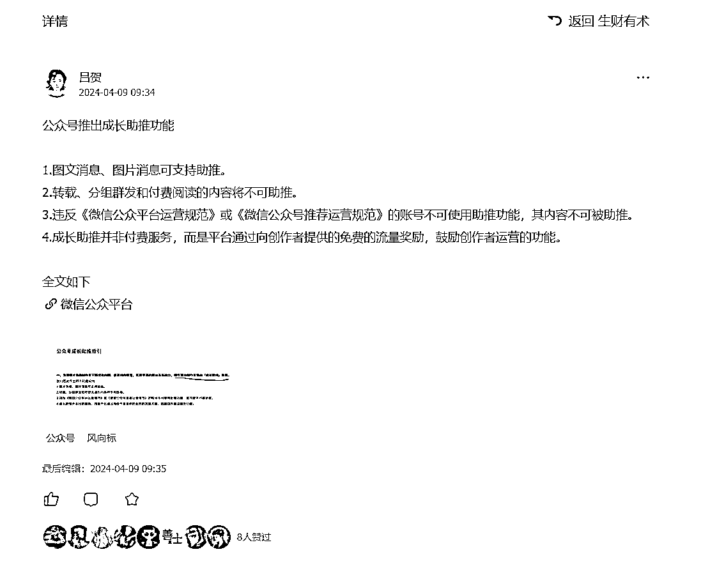

结果嘛，没中标。但也拿到了8个赞。

没关系，继续干。

用好MVP思维，其实就是三步走：

1）先做出一个最小可行产品；
2）扔到市场上验证需求；
3）根据反馈决定下一步——有戏就深耕，没戏就换方向。

---

## 02 异常思维：反常的地方，往往钱最多

什么叫异常值？

就是跟正常情况明显不一样的东西。

举个例子：一个百万粉丝的号出了10万+，太正常了。但一个只有几十人关注的号突然爆出10万+，这就是异常。

我加入生财之前，做过一年公众号，天天刷“低粉爆文”，刷得眼睛都酸了。低粉爆文就是典型的异常值。

后来我发现，风向标里不少做公众号的大佬，也经常发低粉爆文当风向标。

这对我完全是降维打击——我本来每天就要刷公众号，现在只是多一步截图+发布而已。

于是，我的第一条公众号对标号风向标就这么发出来了。

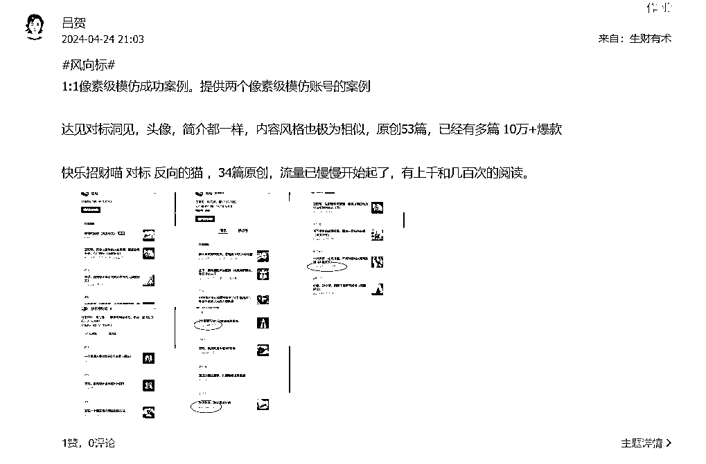

果不其然，还是没中标。

不过讲实话，那时候我对“中标”压根没什么概念，一心只想着提高自己的生态位，所以不中标也不影响我继续发。

反正发条风向标也占用不了多少工作时间，发呗。

---

## 03 对标思维：盯着牛人抄作业，是成长最快的方式

既然我的目标是要找对标号，那我干脆用对标思维去研究一下：那些中标的风向标到底长什么样？

我仔细刷完了风向标里所有公众号相关的内容，发现经常中标的大佬就那么几个：辰风、林林AIGC、善士笔记、who等等。

观察下来有个规律：**中标多的那些人，发得也特别勤。**做公众号爆文的人不少，有自己的爆文库的人也不少，但真正持续发出来的，就那么一小撮。

就像赤面说的：很多小白还没意识到风向标的杠杆作用，要么没下场，要么想下不知道怎么下。

我没有统计功能，看不出自己到底刷了多少条，但近一年公众号方向的风向标，我基本一条没落下。

之前是每周一、周三固定刷一两个小时，把漏掉的全补一遍。后来自己开始天天写，就随时随地刷——地铁上、上厕所、午休时间，全都不放过。

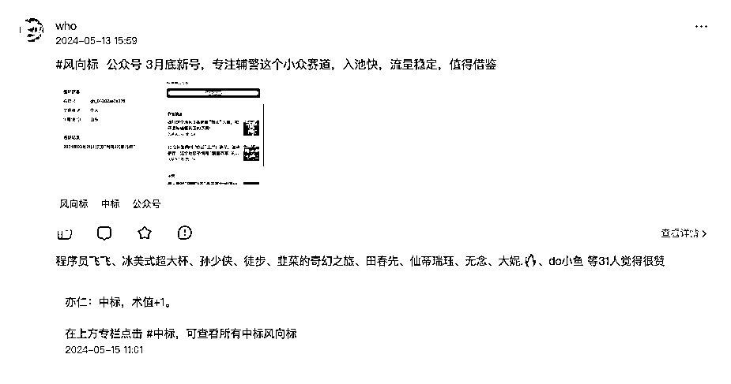

---

## 04 第一块钱思维：一百万也是从一块钱开始的

**任何一个一百万，都是从赚到第一块钱开始的。**

风向标不是商品，不能直接卖钱，但我可以把“第一块钱思维”转化成另一个版本——**第一次中标思维。**

前期写的时候，我也跟大多数人一样：发完就忍不住隔几分钟刷一次后台，看看亦仁是不是给标了“中标”。

后来慢慢发现，亦仁是每天固定时间统一处理的，你刷一百次也不会改变结果，只会徒增焦虑。

从那以后，我有意识地控制自己不去频繁刷新，把注意力放在“长期坚持”上，而不是“短期反馈”上。

**但行好事，莫问前程。**

配合对标思维和蓝海思维不断找方向，再用迭代思维调整写法，中标是迟早的事。

没想到，第一次中标来得这么快！

5月15号，我突然发现自己的赞数涨得不太对劲，点进去一看——亦仁回复了四个字：“中标，术值+1”。

那一刻真的开心到飞起。

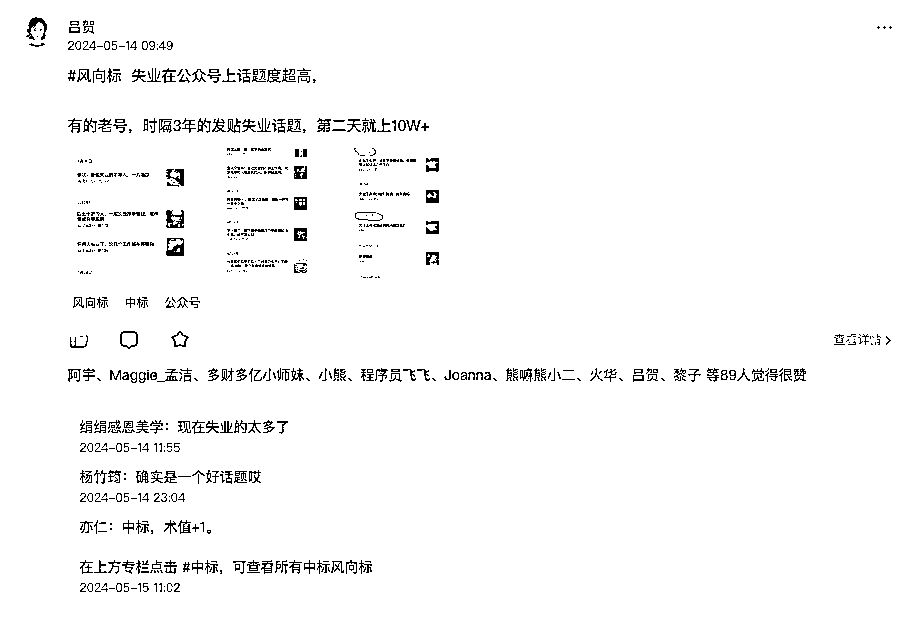

第一块钱到手之后，紧接着就收到了鱼丸发来的「风向标共创群」入群邀请。

说实话，这个群目前看也没什么特殊功能，更多是一种荣誉感。但它一方面让我更深度地参与生财的互动，一方面也倒逼我给自己提要求——**每个月至少发4条风向标。**

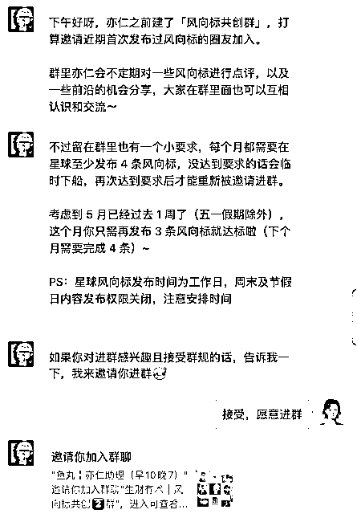

对了，鱼丸写过两篇关于风向标的帖子，质量很高，想下场的同学建议反复读：

风向标收集创作指南：[`t.zsxq.com/0cLu2pgrS`](https://t.zsxq.com/0cLu2pgrS)

如何在风向标中掘金挖宝：[`t.zsxq.com/0cYBnyrw7`](https://t.zsxq.com/0cYBnyrw7)

我后来那个“靠写风向标赚第二年门票”的想法，就是受第一篇指南启发的。

---

## 05 算账思维+概率思维：用数学算清楚“赚回门票”这件事

**人在正确的方向上持续行动，偶然的成功就会变成大概率事件。**

这句话我越品越有味道。

生财有一套积分体系：术值。

换算公式很简单：**100术值 = 1张生财门票（2765元）。**

50术值可以换1个龙珠碎片，7个碎片换1颗龙珠。

算下来，**1个术值 = 27.65元。**

也就是说，每中标一条风向标，我就赚到了27.65元的未来收益。

如果想把明年的门票省下来，我需要攒够100术值，也就是**至少100条风向标中标。**

按照1/3到1/2的中标率倒推，我需要发200到300条。

发300条，平均到一年里，每天连1条都不到。这个目标实在太容易了。

所以我把标准往上提了提：**每天发3条，假设1到2条中标，三个月就能攒够100术值。**

这个目标合理吗？合理。可执行吗？每个新人都能执行。

（顺带提一句，这个算法思路是受一位风向标达人的分享启发，链接在这：[《发了快700条风向标后，我总结出「风向标收集创作指南」》](https://uhvdpsq44s.feishu.cn/docs/doccnrqtZE3h7TLdS9uMbycX1Vd)）

---

## 06 蓝海思维：找一块竞争者少的洼地，事半功倍

**在一个领域里找到蓝海产品或方向，赚钱的概率会大很多。**

我平时刷风向标的时候发现一个很有意思的现象：小红书类目的风向标数量，远远超过公众号、抖音、TikTok和实体类目。抖音可能排第二。

光看风向标的密度，我都快觉得小红书是全中国最好做的变现平台了。

但换个角度想：大家都在写小红书，那小红书风向标想中标，竞争肯定也激烈。公众号风向标就没那么多，我算是歪打正着，选了一个相对蓝海的赛道。

如果你平时爱刷YouTube、TikTok，那写风向标会更有优势。海外市场足够大，关注的人又相对少，信息差的机会多得是。

想下场的小伙伴，建议优先从这些蓝海领域找突破。

---

## 07 迭代思维：先完成，再完美，别憋大招

拿自己的风向标和大佬的一对比，差距立刻就出来了。

我写的，“低粉爆文”而已。但风向标真正要找的是——**能赚钱的信息差，或者说商机。**

低粉爆文只能说明公众号平台偏爱某种内容，并不等于这是信息差或商机。

一条合格的风向标，得呈现出一个完整的商业闭环，让大家看到可复制、可变现的可能性。

比如这条没中的，就是一个典型的反面案例：

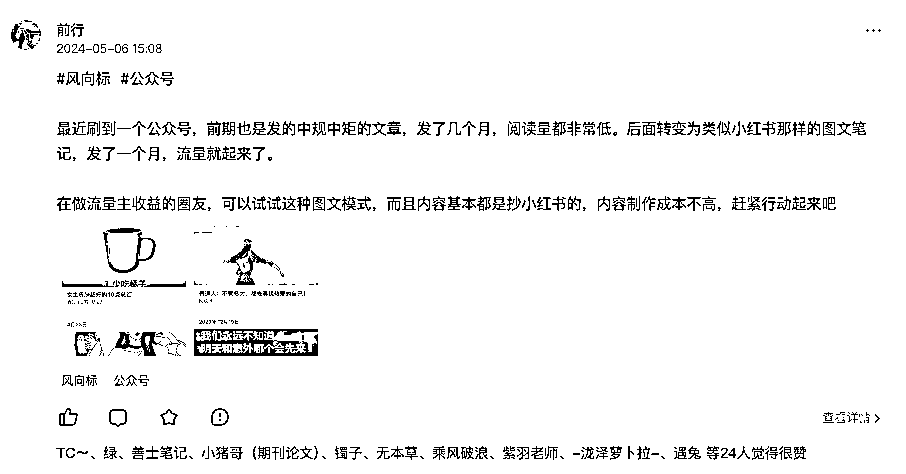

这条风向标确实挖掘出了一个公众号的异常值——从没流量到突然爆发。单从公众号视角看，这是很好的模仿对象。但作为风向标，只有流量异常是远远不够的。它缺了从流量到产品、再到付款那一段完整的商业流程，所以没中标。

再看这条中标的内容，同样是公众号，但流量本身没那么夸张，有的只有2万、几千的阅读。关键在于，这个号背后藏着完整的商业模式——卖书、卖课。一条链跑通，收益远不是单一靠流量主能比的。

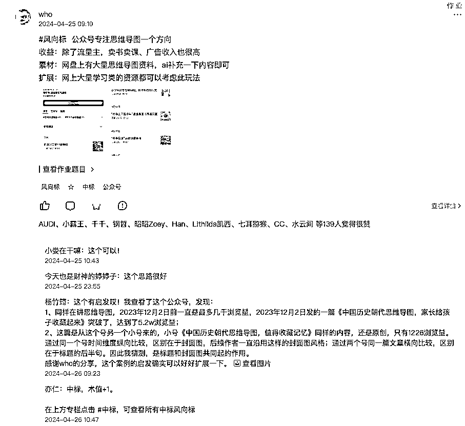

这条中标也是同理。公众号只是流量的载体，真正的价值在背后的商业化闭环。流量重要，但不是全部。

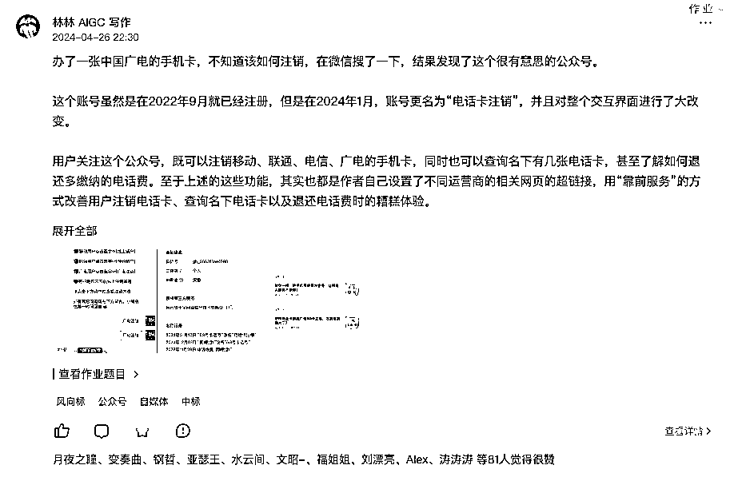

看懂这个区别之后，我写风向标的思路完全不一样了。

---

## 08 合作思维：把信息流动起来，效率翻倍

我自己除了生财，手里还有一个小IP社群，主要是做公众号的。

学了合作思维之后，我开始干一件事：**把生财里所有公众号相关的风向标整理出来，同步到我的社群里。**反过来，社群里如果有小伙伴分享了低粉爆文的公众号，我也会用生财的标准筛选一遍，符合要求的就发到生财风向标。

比如社群分享了一个叫“文案带风”的号，我稍微做了点分析，配上文字，就发成了风向标。

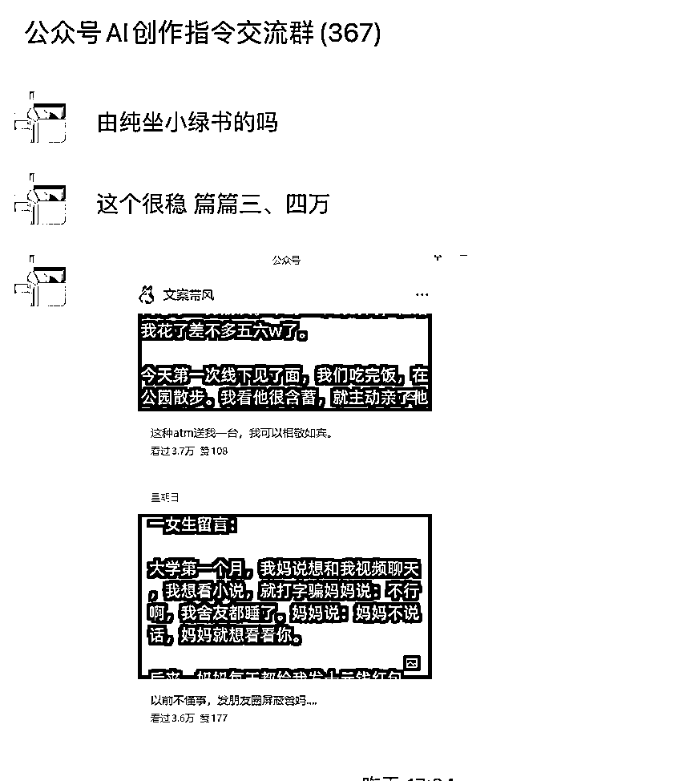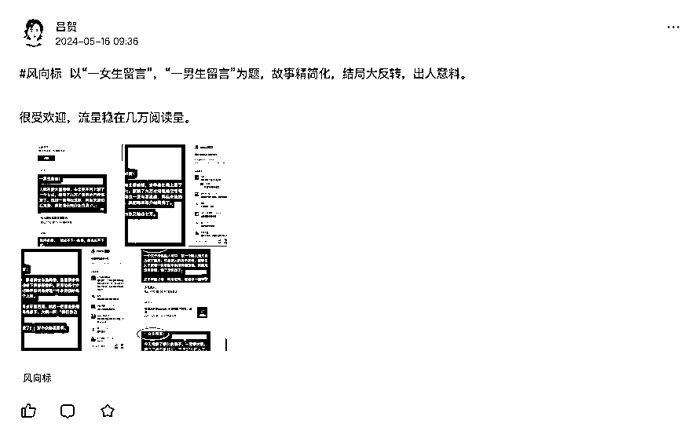

生财风向标 To 公众号AI创作指令社群

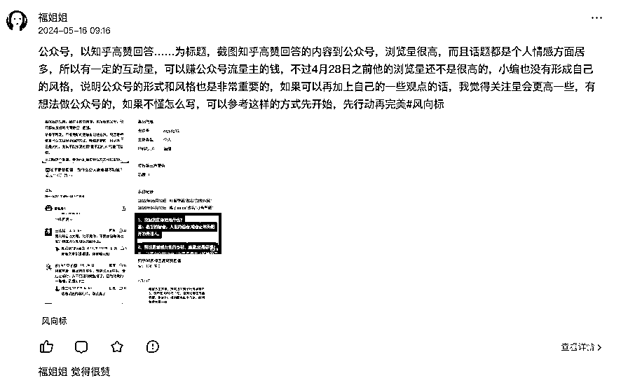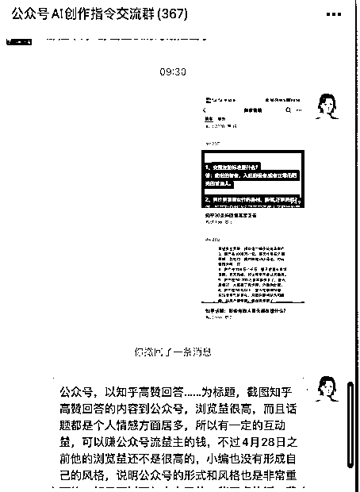

这一个动作，既加快了信息在两个圈子间的流转，也大大降低了我找素材的难度。

后来有一条中标的风向标，素材就是从社群里淘来的。

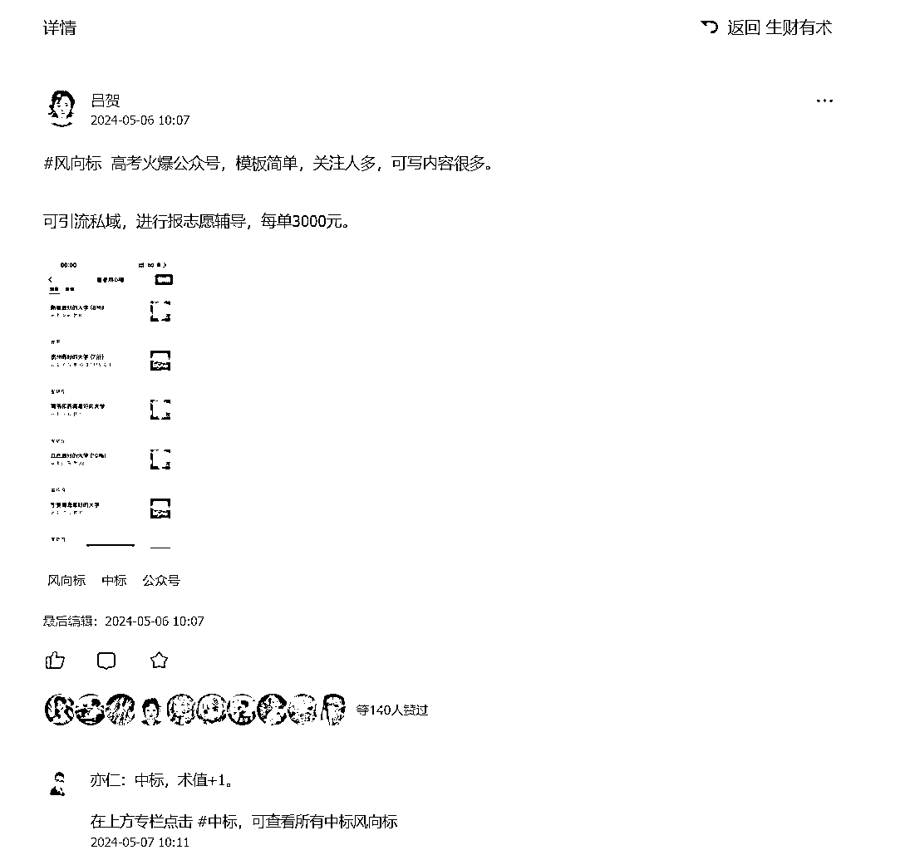

---

## 09 花钱思维：花小钱撬大资源，才是真省钱

**花钱思维说白了就是：用钱换资源，用资源加速目标达成。**

做公众号爆文久了，你会发现一件麻烦事：手动刷公众号会陷入信息茧房。系统推送来推送去，都是你看过的号，很难刷到新的低粉爆文。

为了破这个局，我干了一件野路子的事——**花钱买爆款案例。**

我在公众号发了一条“小任务|5元一次，简单易做”，内容是：帮我找公众号爆款案例，一个5元红包。

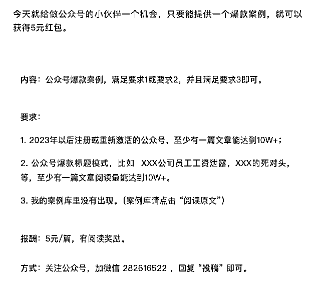

从结果来看，这5块钱花得太值了。

一方面，它打破了信息茧房，源源不断地有人帮我找低粉爆文；另一方面，它还顺便给我引流了——那条任务的阅读量做到了4895，加我微信的有近100人，还带动了我公众号的整体流量。

一件小事，三重收获，这波不亏。

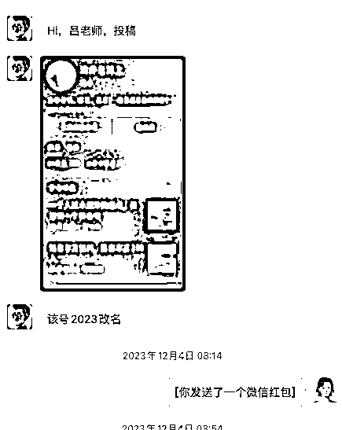

---

## 10 逆向思维：别人往东你往西，反而走得更快

逆向思维，也叫反向思维或颠覆性思维，就是打破常规的思考方式。

我见过一条印象很深的风向标，专门收藏起来了，因为它就是逆向思维的教科书级案例。

那条风向标讲的是：**从TikTok搬视频到小红书做混剪。**

现在大家的常规打法，都是从小红书搬内容到TikTok，方向是单向的。但那条风向标里的博主，偏偏反着来——用TikTok的素材做混剪，发到小红书，结果一个月出了4.4万单。

这就是逆向思维的魔力：所有人都挤在一起的通道，你换个方向，反而畅通无阻。

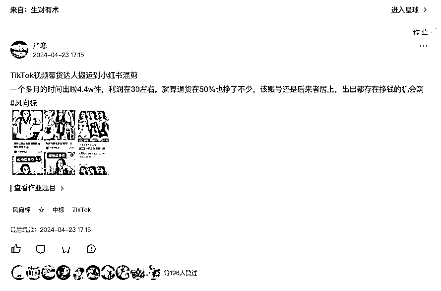

---

## 11 中介思维：空手套白狼的信息差玩法

最后再提一个思维：中介思维。

本质上，风向标就是信息差的生意。你把有价值的情报从一个地方搬运到另一个需要它的人面前，中间的连接行为本身就创造了价值。

说到底，生财思维课不是一个只停留在理论上的课程，它是一套可以直接实操的方法论。我用它来指导每天写风向标这一件小事，三个月赚回门票，亲测可行。

如果你也是个新手，想在生财里找到自己的生态位，不妨从今天开始——打开风向标，写第一条试试。

一百万的起点，往往就是那不起眼的第一块钱。

> > > > > > > 

> > > > > > > 与其亲手从零打造产品，不如去发现已有好物，并链接上真正需要它的人，你充当的正是这条连接线的搭桥者，用最小的成本和风险吃到中间的匹配红利。

> > > > > > > 

> > > > > > > 对于刚踏入生财、手上几乎一无所有的新人来说，目前最务实的变现路径无非两条，

> > > > > > > 

> > > > > > > 一头是加入航海，跟项目一起做成结果拿收益；

> > > > > > > 另一头是发挥中介思路，把生财介绍给身边的朋友，每成功推荐一位就能拿到五百多元的分佣。

> > > > > > > 

> > > > > > > 把生财的知识库充分用起来，把你认为有潜力、有价值的风向标和精华内容挑出来发到朋友圈，主动推送给可能用得上的人，这就是把第一桶金真正落袋的方式。

> > > > > > > 

> > > > > > > 简单复盘一下我入圈一个月以来做风向标的实操经历。总体感觉是，写出一篇真正优质的精华帖门槛不低，但批量产出上百条风向标却相对容易，希望这份经验能帮助刚进来的新人更快在生财里找到自己的位置，尽快从旁观的状态切换到实操的状态。

> > > > > > > 

> > > > > > > 风向标正是最容易上手的一个切入口，先从这里打开局面，再逐步延伸到精华帖、航海帖等更高阶的内容，层层递进把生财的价值用起来。

> > > > > > > 

> > > > > > > 最后附上「生财思维课」的入口，希望大家都能掌握赚钱的底层逻辑。

> > > > > > > 

> > > > > > > 感谢靠谱把我带进生财，也感谢她对这篇内容给出的指点。

> > > > > > > 

> > > > > > > 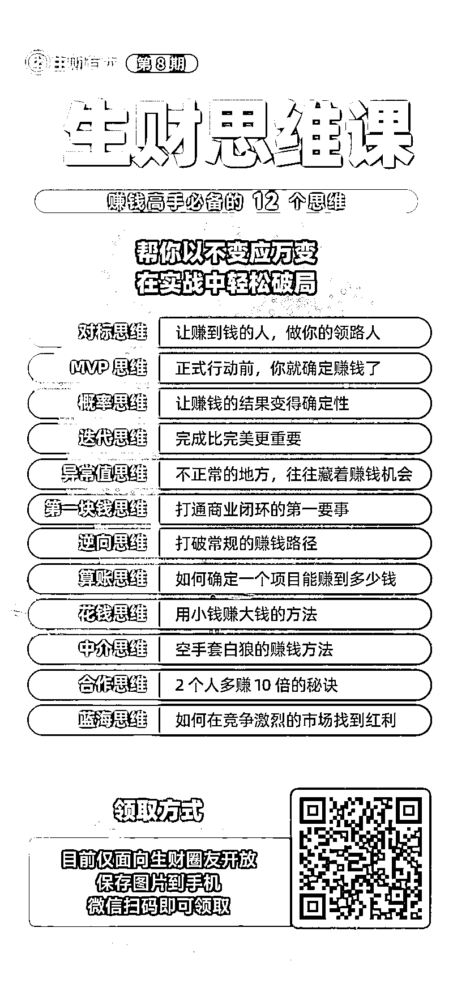

> > > > > > > 

> > > > > > > * * *

> > > > > > > 

> > > > > > > 评论区：

> > > > > > > 

> > > > > > > Rio : 最近我做了个工具采集风向标的

> > > > > > > 吕贺 : 采集生财内写好的风向标吗？

> > > > > > > 竹子 : 真的是把生财思维课用到极致了！行动力超强

> > > > > > > 卷啊卷 : 好强的思维[强]

> > > > > > > 咿呀花花 : 优秀

> > > > > > > Rio : 对 因为风向标不都是我想要的内容，1 天 100 多条，所以要过滤不想看的，省点时间

> > > > > > > 老彭 : 加油

> > > > > > > 春夏 : 标题党，你没赚回你这么写[擦汗]

> > > > > > > 

> > > > > > > 

> > > > > > > 

> > > > > > > * * *