# 快手数字人直播单品百万级消耗复盘：付费投流测品的心得与反思

> 原文：[`www.yuque.com/for_lazy/zhoubao/whrb6ka8hcqhykii`](https://www.yuque.com/for_lazy/zhoubao/whrb6ka8hcqhykii)

## 快手数字人直播单品百万消耗万字测品复盘（付费投流测品反思）

作者： 书豪  
日期：2024-05-17

大家好，我是杭州龙珠社群的书豪，目前在运营小红书店铺并担任聚光投放航海教练。

很久没发长文了，一方面近况可言不多，另一方面今年打品节奏太紧，第三是我对内容质量有一定执念，希望每篇都能给做电商的伙伴带来实操收获。

2024 年各大平台竞争白热化，想在电商拿到持续结果，必须不断滚动出爆款。

找爆款本质上是概率博弈，多测才多中。测品本身也是一门精细手艺，对普通玩家而言，方法论的精进比单纯堆人手更关键。

年头团队扩编，测品效率被放到更高优先级。回头看生财里的大量个体户创业者，我自己也曾走过这条路。刚起步时总觉得一人可扛，后来组建团队才明白协同作战才是放大器。

  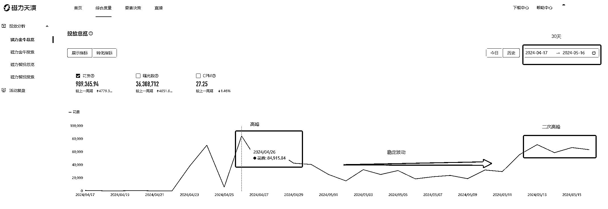

送给想跑出爆款的伙伴一段肺腑话：当手上已有可打的品，最合适的时间就是立刻补两个人力。因为组织化才能把琐碎事务剥离出去，比如剪辑这种极度占时的环节。电商人的核心精力应该 80% 放在选品与内容创造上，剪辑会吞噬掉最宝贵的时间与生命。

招人后才不会被琐碎困住。红利期里，时间成本是所有成本里最贵的。

我个人能力有限，今天分享的是我们团队迭代出来的测品模型。

**测品的本质，是在验证人而非验证商品**

对电商而言，测品是永恒的动作。

测品思路不清，很容易让团队判断漂移，主观判定放弃后，等同品被竞品拿下直接后悔。

我们趟过大量坑后沉淀的一套打法，能把测品命中率抬到 30% 左右，同时节省约 70% 的时间和费用。

这套思路涵盖测品前期准备、打法优劣、费用管控、执行流程与复盘逻辑，内容翔实，全是血泪换来的。

以下方法论仅限快手平台，以短视频导流直播间的玩法做了数据验证与实操复盘。

**目录概览：**

**测品方法论框架**

**内容电商平台为何必须追求测品效率**

**完整测品路径：准备与执行**

**复盘对测品的决定性作用：人货场拆解三大模块**

**测品注意事项**

# 1、测品方法论的框架

今年业务聚焦在两大板块：快手数字人直播与自营小红书店铺。

自营盘始终保持持续测品、滚动打品的节奏。

在快手短引测品上，早期经验不足踩了不少坑。

花过不少无效费用，也因测品节奏慢错失爆发窗口。回顾来看，很多弯路本可规避。

自己淋过雨，也希望后来者能及时递把伞。

测品切忌带感情，死磕单一 SKU 会浪费大量可用于有意义工作的时长。

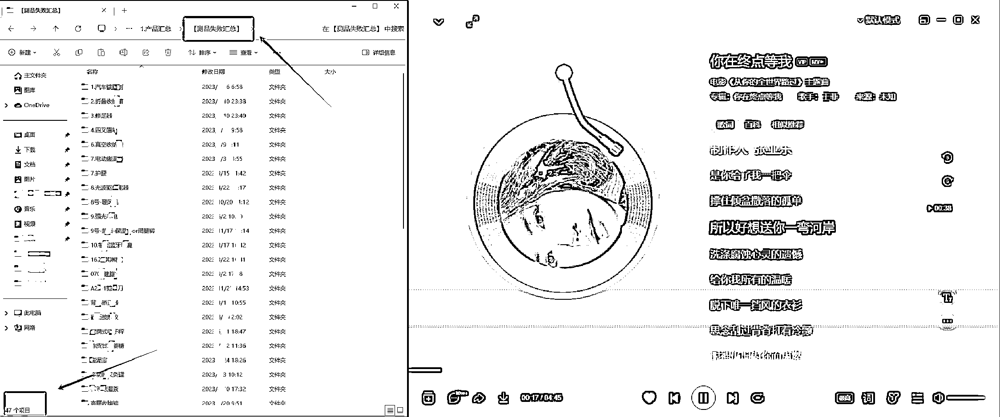

## 2、为何内容电商平台必须高效测品

做过电商的都懂，测品几乎是必修课。

除了自有品牌与自有供应链的玩家，大多数做淘宝、小红书、视频号都绕不开测品。

各平台规则与投放工具差异很大，测品打法自然不同。

对白牌团队来说，测品是全年无休的主题。没品时要测，品稳定了仍要测，长期处于品焦虑。

在小红书与快手之间切换后我们发现，测品测的并非商品本身，而是人，是特定时间段人群的爆发性需求。

想快速捕捉人群需求，需要多少轮试错？

我们强调的高效，既是时间上的高效，也是准确率上的高效。

外界说法不一，有人主张两天测完，有人主张十天测完，对应的是不同逻辑。

两天派主打高开，用付费快速探人；十天派主打细水长流，用时长换量。

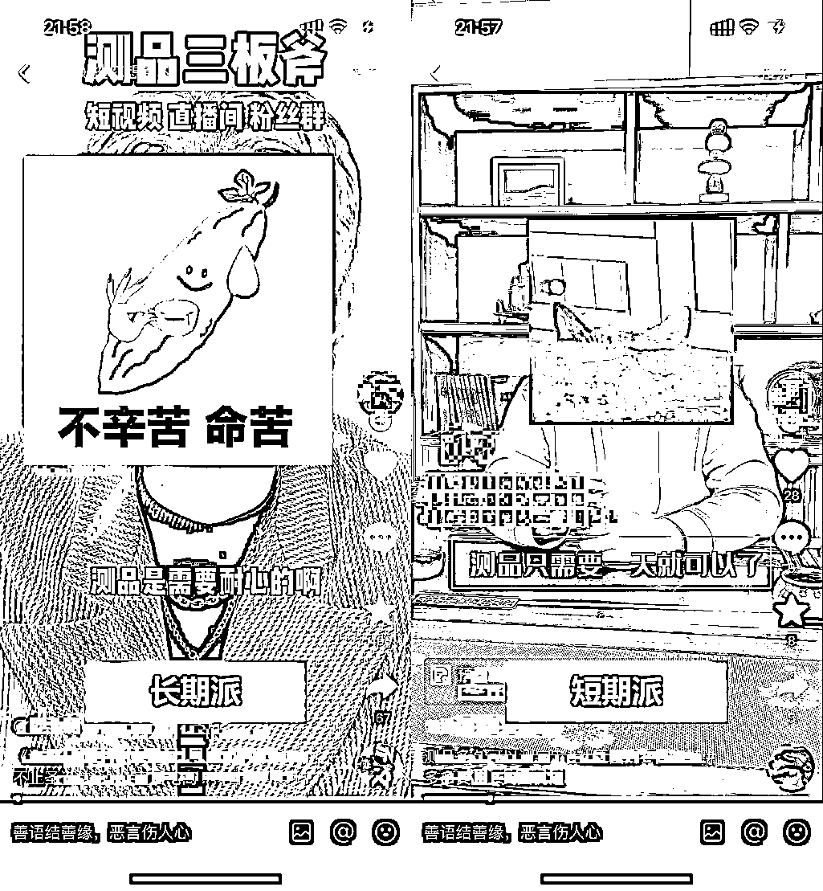

我们不做站队评判。

站在付费打品的团队或个人视角，必须同时兼顾测试速度与测试可靠性。

经过数十次实测，我们的结论是 **3~7 天，费用控制在千元以内；【特殊品类时长与费用会有波动】**

### 2.1 为何是该时间区间？

先明确一点，短视频测品期的时长意义在于积累足够决策数据。

我们走纯付费路线，虽有自然流量但占比通常仅 15% 左右，所以决策主要看付费数据。

**若只测一天，需要什么样的打法？**

1-2 天测期，市场常见的是高开策略，用广告费与货款 1:1 甚至 1.2:1 的比例强拉投放工具快速探索人群、抢占份额。

这套逻辑在抖音部分品类适用，因为抖音人群基数大、历史沉淀厚，即便近期无人打，系统对人群定向是相对完整的。所以高开可以更快实现素材与人群匹配，抢占电商流量份额，达成测品目的。

说明：在快手上，高开仅适用于两种情形：其一市场体量足够大，高开后 GMV 能跃迁；其二竞品已先一步验证市场与人群，此时高开抢份额。

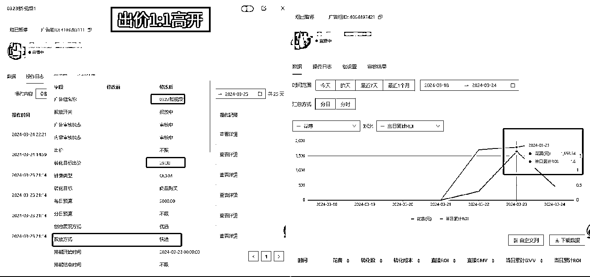

**若测十天以上，会付出什么代价？**

思考一个问题，什么情况下需要十天去验证一个产品？

短引里常见两种：

1、上头了，坚信产品没问题只是脚本没对上，持续加码；
2、前三天免费流尚可，就觉得品有量，继续跟投。

这两种情形下 ROI 通常不理想，日日小亏，短期看只是货物成本，但长期会形成赌徒心态，总觉得再试一次就能翻盘。

最终时间和金钱双向亏损。

说实话，金钱损失充其量就是一两万，致命的是时间成本。你浪费十几天，等于错过同期其他好品的机会。别人吃肉你喝汤，别人数钱你玩钢镚。

举例：你测品耗时 15 天，同期有人 5 天测一个品，15 天他测了三个，成了一个。你 15 天未必成功。

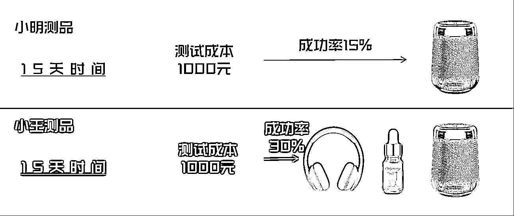

**目前已覆盖女装、男装、中性服饰、日用百货、食品、小家电及汽车后市场赛道，因品类差异数据回流与计算口径不同，所以只能给出一个相对收敛的时间区间。**

### 2.2 为何要把费用压到千元内？

测品本身风险极高，即便成熟的打品团队在换品期也不能保证每月都有爆款。

这也是测品成为团队长期动作的原因。

测品的终极目标，是找到一个稳定且可长期盈利的成本结构。

朋友们，记住初心是赚钱。

测十个品九个亏一个赚，赚的那一个放长周期可覆盖前面亏损。但亏多了想回本，就会掉进赌徒陷阱。测品是有科学方法的对赌。

**通过数据分析、内容深耕与投流手段，把成功率做高才是正解。**

这里说的千元，对标的是快手短引的小白玩家。预算本质和筹码与目标相关。若你的目标是月净利十万【**￥100000**】的爆品，花两万去测试也是合理的，前提是筹码够、目标大。

若目标是月利润 2-5 万的产品，就必须精算前期测品预算。

心态也很重要，手里筹码多，心态更稳。

**测品成本主要是人为可控，我们的理想状态是广告费不亏，只亏货款。**

跑出来了多出单，即便货款亏了也没关系，关键是系统记住了购买人群画像，有了人群模型，系统会持续找到有需求的群体。

## 3、完整测品流程：准备与执行

想在不出现主观误判的前提下完整测完一个品，流程必须闭环。快手短引本身就复杂，加入无人直播后复杂度再增。

**每个环节都要做到严丝合缝，不留纰漏。**

举个例子：早上开播挂了三条移动端智能计划测新视频，消耗三百一单未出，回头才发现直播间讲解与场控转化没做。那你不仅亏了钱，还浪费了早上的黄金流量。

## 3.1 测品前准备

选品确定后，前置准备是成败关键。

**大致分六块：上品、供应链沟通、脚本搜集、爆款拆解、内容制作、直播间准备。**

这六项最好半天到一天内完成，忙中有序。

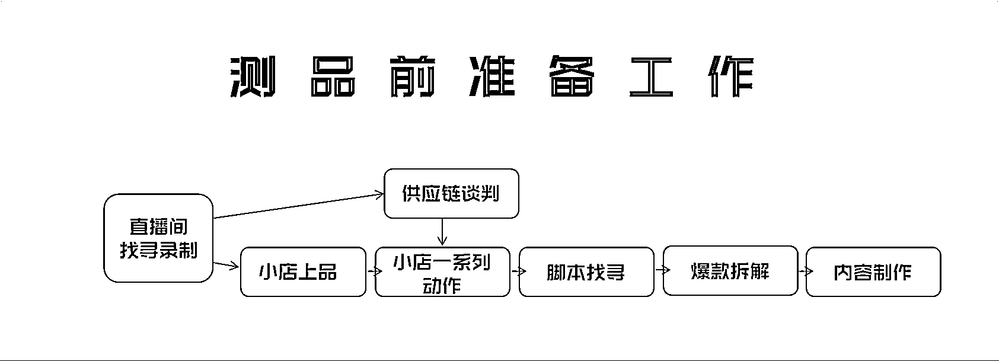

其中相对轻的基建是直播间录制和小店上品。

直播间录制：去其他平台找同款目标价的直播间，确认话术无误后用软件录制。

小店上品：上架商品、填地址、设售后。只要有电商基础都能完成，这里不展开。

重点聊供应链谈判、脚本搜集、爆款拆解和内容制作。

### 3.1.1 供应链谈判技巧

不聊高大上的供应链整合，对大多数人偏远。

聊如何快速找到靠谱稳定的供应链并实现双赢。

供应链不用纠结，1688 基本覆盖全量。从 1688 起步，熟悉后再去产业带找更优价更稳的工厂。

流程：**1688 找链路——判断价格是否合理——谈判——让对方信任你**

现在进货渠道五花八门，建议别卷低价。卖货本质是把货送到有需求的人手里。有需求的人对价格敏感度没那么高。

直接在 1688 搜品名，会出大量同款。感觉价格不对就搜同款。

一个同款搜索下来，价格差异很大。你怕买贵被宰，又怕便宜质量差。记住两点：我们做一键代发，不是批发商，所以拿不到批发价；一键代发涉及环节多，价格差异最大。

参考法：看拼多多均价，减去 10-15% 就是一键代发价左右。

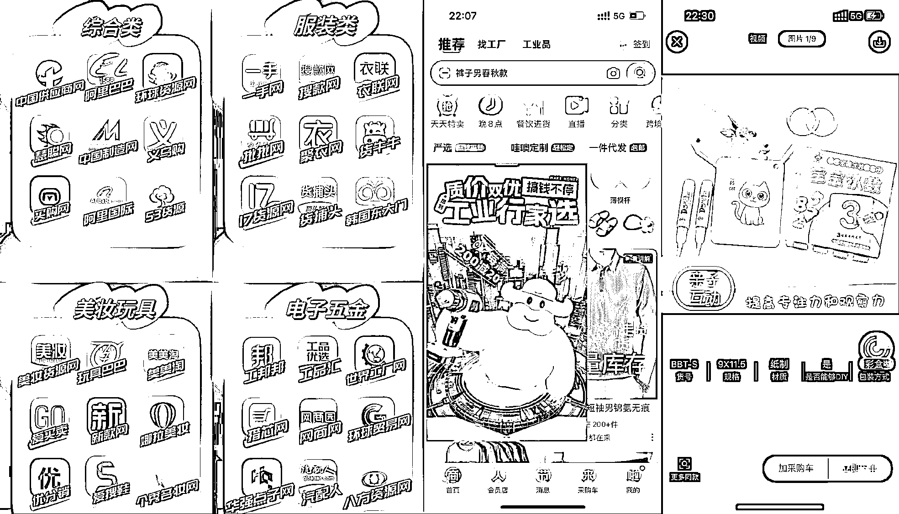

如何谈判？这是一门进阶课，没人能对每个品的市场价和底线了如指掌。

要做的就是在人性边缘拉锯。建议以实避虚，真假参半，但发心要正。我们不求占便宜，只求双方舒服的双赢。

注意：供应链一定要多备，防人之心不可无，多储备不亏。

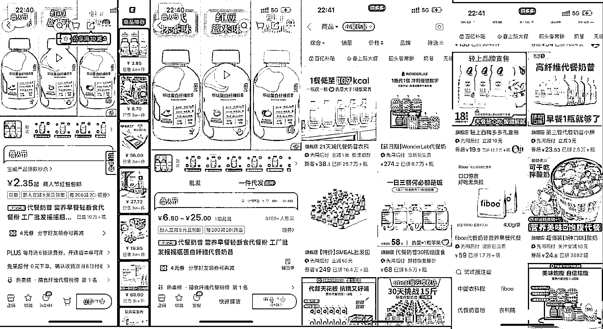

### 3.1.2 脚本搜集与爆款拆解

选品确定后，脚本是核心。找到优质脚本可把测品成功率提升五成，变量很多，后面拆解。

**先明白，市面上 99%的产品都是老品，老品意味着已有试水。**

已有试水，就意味着已有短视频素材，甚至脚本已成型。

曾经我放着一堆验证过的爆款视频不管，非要做品类下原创高峰。结果品无疾而终，创业未半而中道崩殂。

后来感觉自己像个小丑，明明有现成脚本不用却偏要原创。

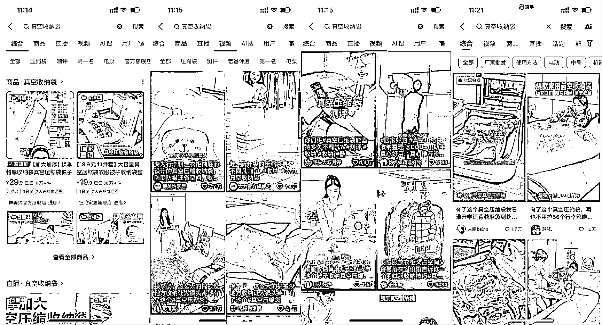

钱大部分是搬运和编辑赚来的，别固执。

**脚本主要来源三个地方：抖音、快手、有米有数。**

抖音原创量大，内容制作和达人原创度高；

快手是我们主战场，了解最新与老爆款有助于快速筛选；

有米有数聚焦信息流广告，内容不同步主页，是隐藏金矿。

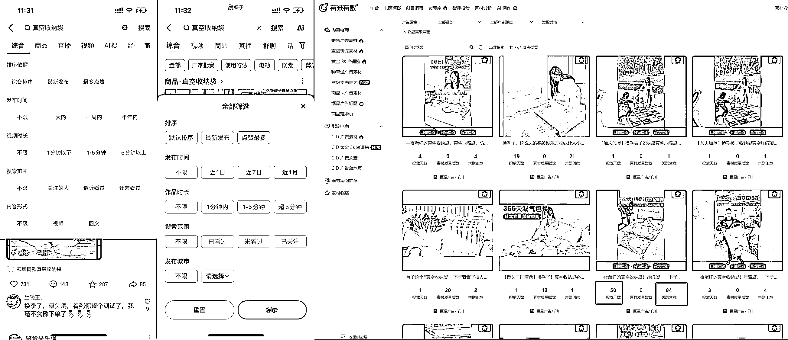

筛选时同步做初筛，近期快手已爆发的脚本尽量避开，避免人群冲突。

筛选后要拆解，保证复制脚本的原创度。

脚本拆解分三层：**1】框架拆解；2】画面拆解；3】用户拆解；**

以真空收纳袋为例：

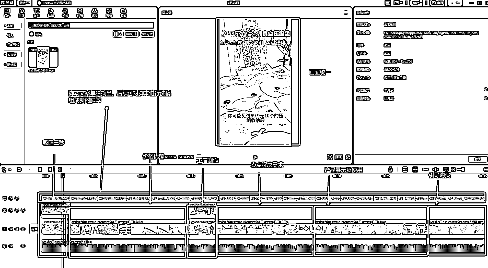

挑有米有数投放时长最久、关联创意最多的视频做案例。

1】框架拆解：看故事性结构

拿到视频先抠音频转字幕，先看后听，不先评判。将视频切成板块：3 秒吸睛、价格优势、工厂制作、卖点解决需求、产品展示使用及引导购买。

45 秒内快速传递信息并形成转化。目的是了解框架，方便后续镜头替换。

2】画面拆解：看整体呈现

该脚本以混剪为主，音画基本同步，尤其在卖点解决需求时用强烈对比冲击。思考素材准备方式，分类。

以真空收纳袋：大类分产品展示、使用展示、卖点突出、工厂制作。

优秀剪辑要更细：产品展示=手拿、多款对比、新老对比、陈列、场景静态拍摄；使用展示=抽真空、不同尺寸装袋、放进柜子/行李箱、一镜到底收纳、封边收纳、放气还原；卖点突出=3 秒抽气、1 秒封边、省空间、防潮、耐用等。

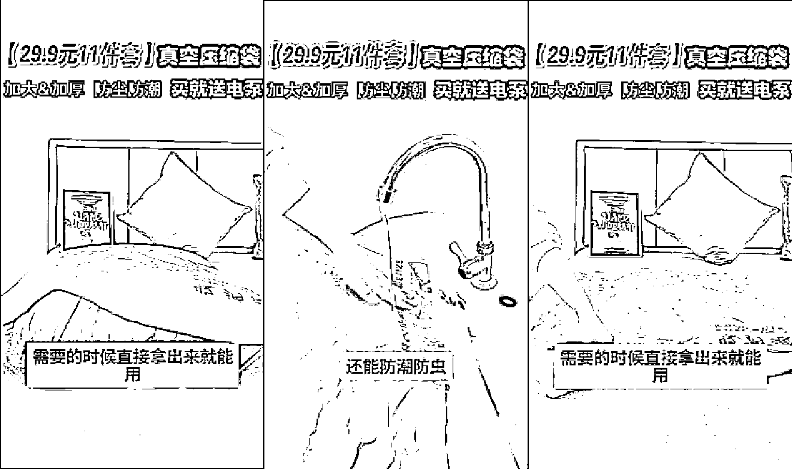

3】背后用户拆解

从文案还原人群内心需求，也可看评论。视频前 15 秒围绕价格优势，突出性价比敏感人群；紧接着工厂发货，打消顾虑。

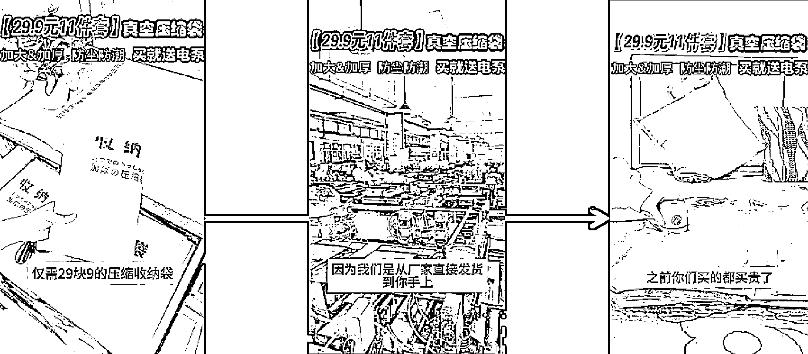

**用户拆解的核心是：搞清人群基础画像，深刻理解需求。**这一步可反哺剪辑、客服、主播话术和场控话术。

## 3.2 测品动作

正式测品前有个前置必检，反复确认准备与物料无误，否则开始后钱会直接变成测试结果。

测品动作本质是循环：测试、复盘、调整、再测。

**测试包含三块：素材、投放、投放时间。**

首测期素材要全面。比如一次发 15 条素材，是测一个脚本划算，还是测五个脚本划算？同等量级下，脚本越多越能快速找到能跑量的素材。

短视频测期看两点：合规下的消耗速度和投产速度。短视频播放递增会经历几次审核：安全审、观感审、高热审、TOPK 审核。短时间测品的弊端是审核节点可能卡住。

**短视频测试就是要找出能突破观感审、实现端口起量的高热视频。**

很多视频卡在观感审，23 年的曝光数据要求近期有变化，拉到 3-4 万播放仍无法突破，或直接判负向。

投放工具的作用是用付费加速视频的播放发酵，但烧出视频后若被观感审判定负向【24 年极简版审核更严】，就白费。

磁力金牛广告端口，我们主要关注 PC 户和极简户。

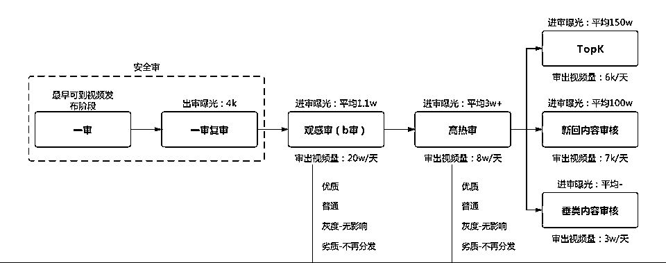

做测品，真正能决定成败的不是爆品运气，而是两套账户怎么用、怎么复盘。

先说清楚PC户和极简户的区别。PC户自带人群模型自学习的功能，跑下来模型越校准越稳，长期来看是能持续稳定赚钱的。极简户就不一样，它的核心价值是帮PC去探路，主要用来试新素材、给有潜力的视频加热，它的模型是不稳定的。

测品期的投放，这两套账户的侧重点完全不同。

PC户在前期基本很难吃预算，判断标准不是单日花得多，而是看消耗曲线在往上走。今天花五毛钱，明天花三块，后天花五块，曲线一旦开始抬头，基本就离出单不远了。大多数情况下，只要产品和内容方向没问题，PC户都会迎来一波爆发。

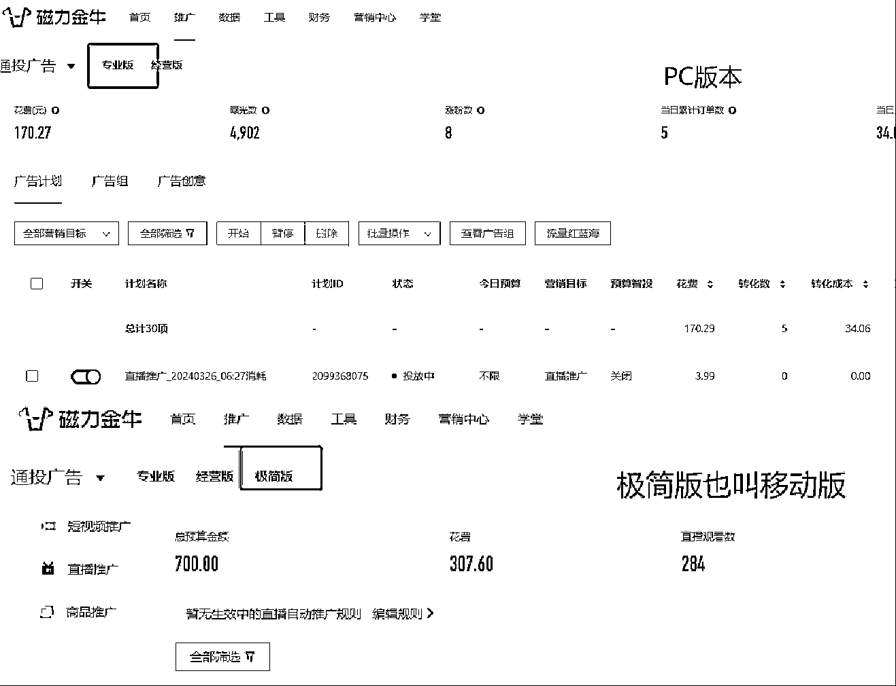

极简户要更娇贵一点，每次拉计划都得人盯着。因为它的任务就是测新片，新片有的对得上人群，有的完全歪了，就会产生空耗，即花了钱不出单。这种情况要提前设好止损线。我们常规的容忍标准是，空耗达到商品售价的80%左右就果断关停。

投放和内容铺完后，真正的核心就落在复盘和调整上。

## 4、复盘对测品的影响：人货场三板块全盘拆解

这里说的复盘，是基于真实的花费和GMV，反推直播、素材、投放这三大块哪里出了问题。

举个例子，你第一天上测了30条作品，PC和移动都拉好了计划，结果移动端某条计划空烧了50块，一单没出，商品点击和进间数据也很差，这时候就必须全面复盘了。

复盘的顺序我建议是一层层剥开：先看投放，再看直播间，最后回到素材本身。

### 4.1 投放板块复盘检查

当计划开始空耗，或者原本跑得好的计划突然掉速，第一件事是回头检查计划的基础设置。

是不是开了智能出价、智能投放？素材有没有被系统判定为负向？是不是误选了直投直播间？甚至是计划时段设置错了，也会直接拉低效果。测品拼的就是这些细节，细节没对齐，数据就不能说明产品不行。

把这些基础问题排除干净后，再去看下一层。

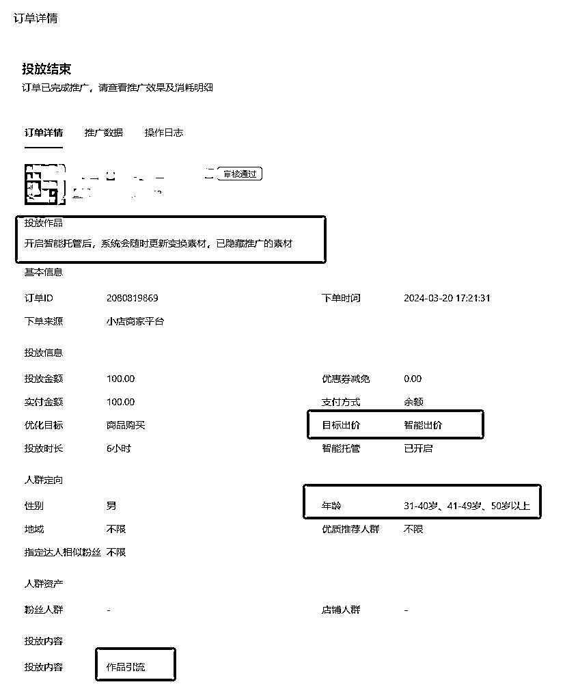

## 4.2 直播板块复盘与检查

直播这块依然是细节的战场，主要看直播素材、OBS设置、助推工具、硬件设备这四处。

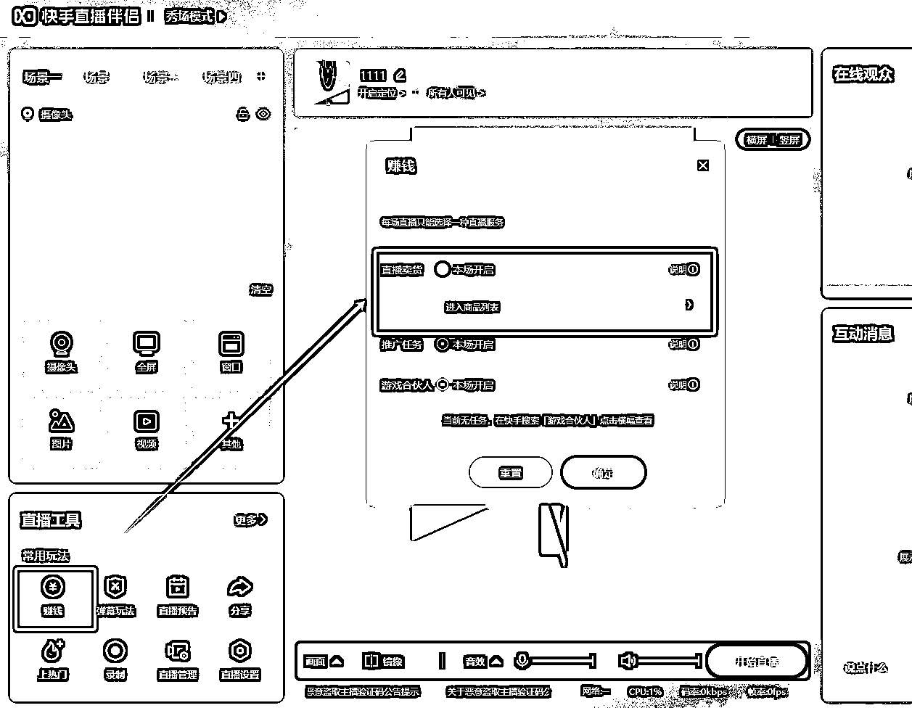

直播素材：转化差的时候，别急着改投放，先把自己的直播切片听十几分钟。用脑子过一遍用户进来后的路径。合格的短引直播话术应该是欢迎定语→痛点点破→卖点给出→产品使用演示→下单引导。话术框架对了，主播的情绪和氛围感也会直接影响能不能成交。

OBS调节：声音有没有、杂音严不严重、画面是否干净、能不能顺畅循环。做无人短引，OBS就是命根子，出一次问题整个间就废了。

直播间助力工具：我们之前用淦核，现在换成小雨滴。核心功能就是商品弹窗、自动客服回复、场控引导。这三项直接决定转化，一定要养成开播必检的习惯。

各类设备调试：麦克风、摄像头、耳机这些基础硬件。最好按真人直播的标准完整模拟一遍，确保快手后台不会因为设备问题报警。

## 4.3 素材板块复盘

如果投放和直播都没问题，那问题就集中在素材上了。短引测品的瓶颈，基本都在内容能不能打中人。

今天不聊内容怎么做，给你两个快速判断人是否对板的方法。

### 4.3.1 素材播放与投流数据双看

一般来说，内容不对板，播放量基本起不来，几百个播放就是常态。

但最难判断的是那种播放大几千却死活不出单的情况。这时要同时看两个端口：投流下的商品点击数和引流到直播间的人数。

第一看投流数据，判断脚本有没有市场吸引力、用户需不需要。第二看视频本身数据，封面点击率、3秒、5秒完播率、互动量等，来判断视频质量本身是否过关。

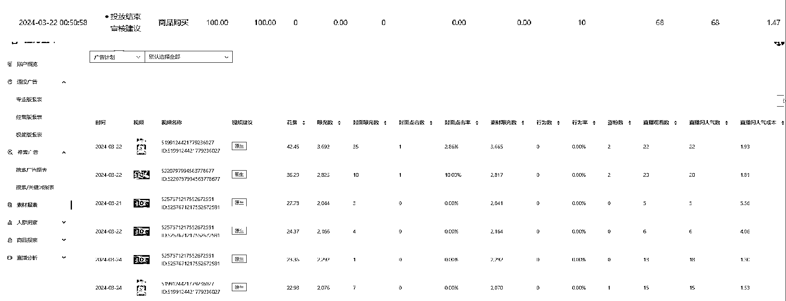

### 4.3.2 素材爆发时的自然流

有一种情况是作品自然播放非常炸，但投流数据很拉胯。这时候关键看自然流。

除了看生意通，更要直接盯直播间进人来源。快手会明确告诉你每个进来的人是来自短视频、推荐、搜索还是推广。除了推广，其他都算自然流。

如果某条作品自然流非常好，播放量起来时直播间的自然流GMV也跟着猛涨，那即使磁力金牛目前是亏的，也要立刻拉上去补量。

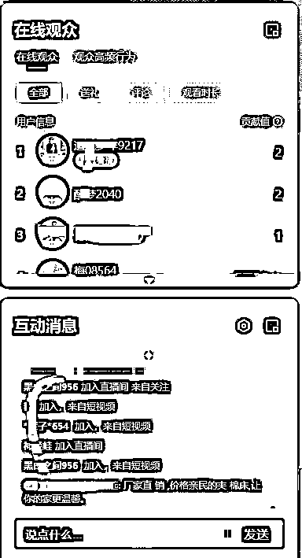

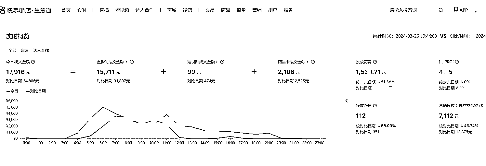

# 5、测品期注意事项

测品期间别频繁关播开播，固定开播时间，尽量拉长时间。

设备一定要开播前检查到位，麦克风耳机没插这种低级失误绝对不能有。

视频的测试只在早晚两个时段做，中午测片基本没意义。

素材剪辑一定要认真对待，这些视频后面都是用真金白银去验。

直播间黑屏、卡顿这些问题必须提前排查。

场控要做好，直播间评论全员可见，一句脏话就砸招牌。

投放时段也集中在早晚，不是能吃苦的人，这行不适合你。

高退货率的产品测到就果断放弃。

投放期间别乱点乱改，你的每一次手滑都会干扰系统学习。

爆发期可以乱来，测品期绝对不能瞎搞。

搬运内容前必须核查快手上是否已经有人用过。

投放时短视频千万别挂小黄车，会直接污染数据。

磁力金牛亏钱不要怕，不断拉热视频本身就是测试的一部分。

计划数量要控好，既不贪多也不偷懒，按规划来，每天算好大账，做好财务表。

2024年已经过去三分之一了，希望这套测品复盘思路能给做电商的朋友带来点启发。别太焦虑，我自己也焦虑。

电商创业就是常年坐冷板凳的事情，外人只看到爆品，却看不到背后无数次测品的消耗和心力。创业更是修心，安于现状的那一刻，机会就走远了。

我希望自己无论遇到什么都能直面向前冲，也希望圈里的朋友都能在生财找到适合自己的打法，拿到结果，遇到问题就解决问题，不要怕。

我目前主要在做小红书和快手，其实各平台短视频的核心逻辑是相通的。有什么问题欢迎交流探讨，我的微信：wsh137552775

* * *

评论区：

Yye-柏寒 : 书豪老师出品必属精品，先点赞再看

李又懂（赚钱版） : 赞

🌈程程爱数码 : 书豪老师出品必属精品，先点赞再看

颜乐乐 : 这复盘绝了，书豪老师牛逼

董大甜 : 书豪老师太高产了 好赞

竹子。 : 书豪老师牛逼

大脸猫 : 赞

Mr.Zhao : 请教下，投放的时候，一定不能短视频挂小黄车，这个是为啥呢？

* * *