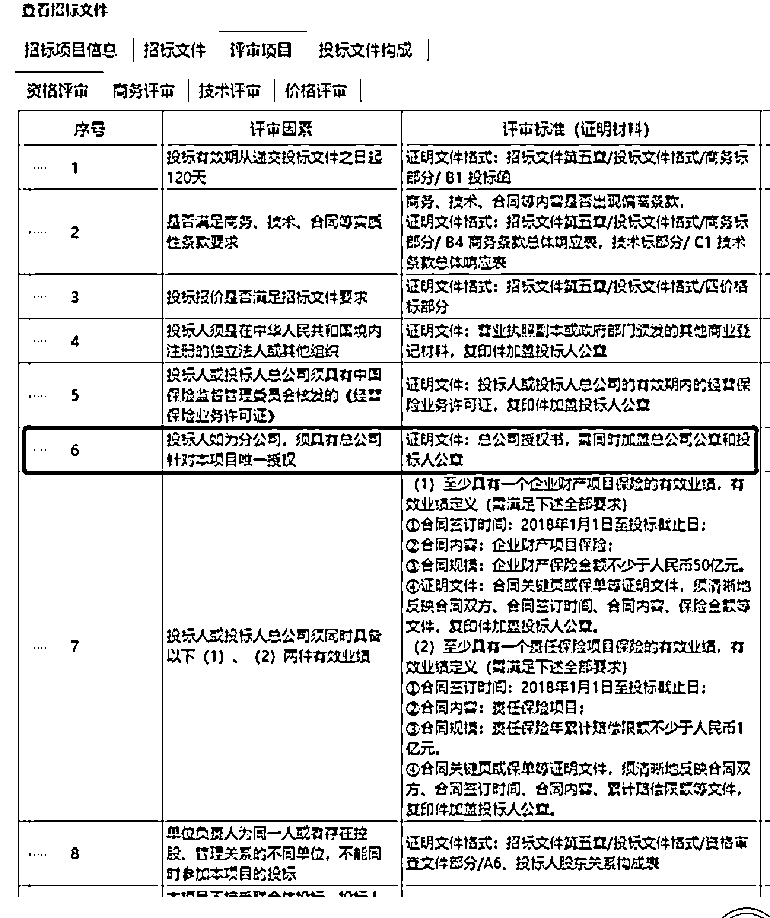
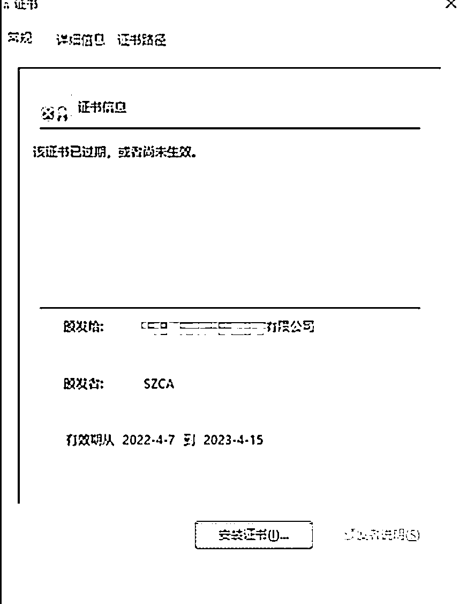
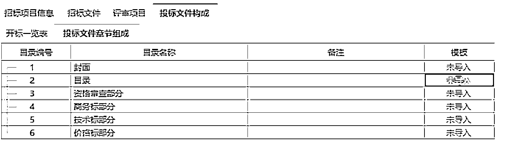
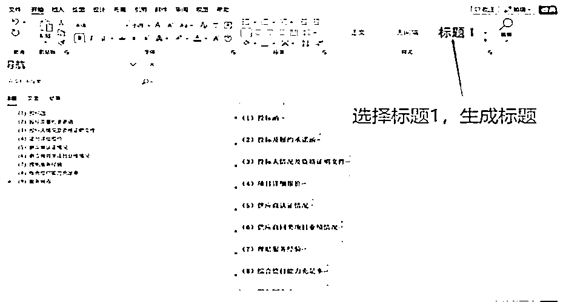
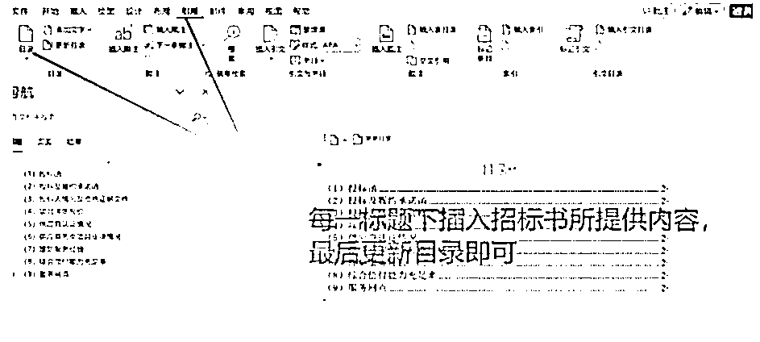
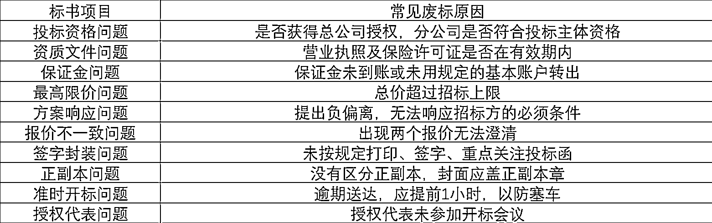
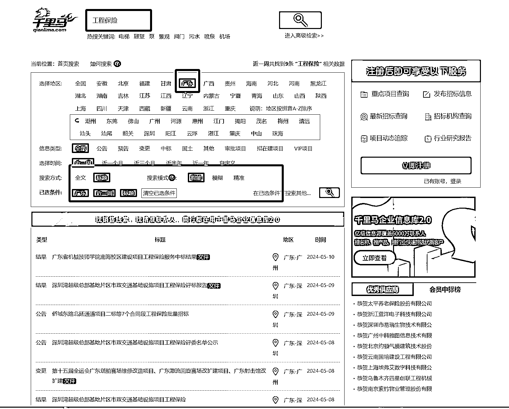

# 发现商机，拿到“项目”招标书，该怎么做？
作者：龙哥

拿到招标书后，先按这套流程走，能少踩很多坑

在龙哥盟里，风向标栏目是很多人挖客户信息的常用入口。但除了互联网玩法，传统招投标领域同样藏着机会。我扫了一圈专栏，发现讲“怎么制作一份能用的投标文件”的内容几乎没有。刚好我自己总结过一套流程，今天拿出来和大家交流。

先看资质门槛。明确招标方要求的是总公司出面，还是分公司？如果限定分公司参与，就必须拿到总公司出具的授权，而且授权里要写明是“唯一投标人”。这项前置条件拖不得，赶紧办。

接着看是否要交保证金。若要求缴纳，就在上报应标条件时，同时向财务部提交申请，免得后续手忙脚乱。

再检查数字证书。若项目走线上投递渠道，下载招标文件后，要确认法定代表人和机构的CA证书都在有效期内，尤其不能在递交截止时间前过期。

然后通读整份招标文件，弄清它包含哪些板块——商务标、技术标、资信标、电子标都算。同时搞清楚文件的编排规则，是Word还是PDF，分项上传还是整体打包导入。

根据招标文件指定的格式，尽快排出初稿。建议按商务标、技术标等类别分别建文档，并建好目录，后续往里面填内容时更有条理。

再把公司最后审批下来的投标条件填进去。这里要特别关注标书里带★或者加粗的条款，确认是否写明了“不允许偏离”，如果没有按条款执行，会不会让标书直接作废。把企业资质文件一并放入，排版定稿，走OA审批和盖章；如果走线下流程，打印成册并装订就行。

若是纸质标，需按照不同类别分别打印封面和封条，内层、外层包装都要区分清楚；如果是线上标，记得把U盘备好。

最后，关于“哪些情况会导致标书作废”的高频问题，我整理了一份自查清单，大家递交前逐条过一遍。

怎么去挖掘机会？把行业关键词放进外部检索平台去搜。乙方宝、千里马、剑鱼都能用，前期免费部分基本够用，找到线索后再顺着关键词去官方源头确认。拿千里马做示例，检索类型选“标题”，地区选“广东”，时间范围选“最近七天”，输入“工程保险”（换成你自己的行业词），就能看到刚发布的招标公告。

常用查询入口我按顺序列在下面（先后无所谓）：

中国招标投标公共服务平台  
全国公共资源交易平台  
广东省招标投标监管网  
深圳市政府采购监管网  
深圳市公共资源交易平台  
北京市公共资源交易服务平台  
河北省招标投标公共服务平台  
山西省招标投标公共服务平台  
内蒙古招标投标网  
辽宁省招标投标监管网  
吉林省公共资源交易公共服务平台  
江苏省招标投标公共服务平台  
江西省公共资源交易网  
山东省公共资源交易网  
湖北省公共资源交易电子服务系统  
广西壮族自治区招标投标公共服务平台  
海南省公共资源交易平台  
四川省公共资源交易平台  
贵州省招标投标公共服务平台  
陕西采购与招标网  
甘肃省电子招投标公共服务平台  
宁夏回族自治区公共资源交易网  
新疆生产建设兵团公共资源交易信息网  

最后祝大家逢标必投、逢投必中，一起在龙哥盟慢慢变富！感谢阅读！

评论区也聊得挺开：有人专门代拟投标文件，价码是中标金额的5%，没成就不收钱；也有人问哪里能接到这类需求；另一位朋友提到，建筑工程方向或许有机会，总包方会拿资质去投。但也有行家泼了盆冷水：大企业一般都有成熟的投标团队，重大项目主要靠人脉，泛泛的代写很难分到钱。能拿到这笔佣金的人，往往背后握有资源。说到底，传统领域里的项目，关系和硬实力都得跟上。

