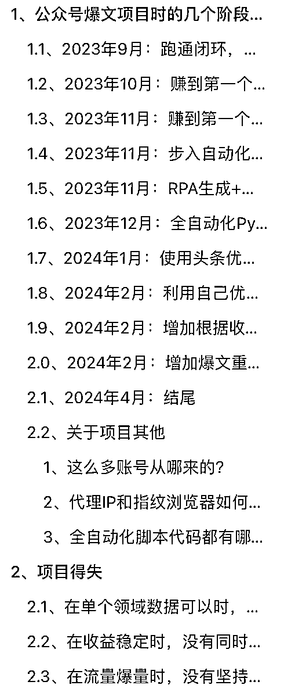

# 👸号爆文全自动化，7 个月收益 37 万复盘
作者：龙哥

做了七年👸号，我最近终于把这个项目跑通了全自动化，七个月下来到手三十七万。趁着项目告一段落，把这段经历完整复盘一遍，顺便也想找些同路人一起搞点新事情。

先说说我为什么写这篇复盘。一方面，👸号爆文这件事在我这里算是暂时画上句号了，我想把这段时间的思考沉淀下来，同时看看能不能找到志同道合的圈友合作下一步；另一方面，看到好朋友@阿泽 发的复盘帖特别有感触，就想着也给自己这几个月的折腾一个交代，把得失都摊开来讲讲。

这篇文章主要分三块内容：

1. 做👸号爆文项目时，每个阶段的思考过程
2. 整个项目里做得好和做得不好的地方
3. 对这段经历的总结，以及下一步新项目该怎么走

下面是文章大纲：

* * *

评论区里大家的反馈也挺有意思：

有人问收益是不是靠👸号广告——其实不止，但广告确实是重要来源之一。也有人觉得文章理论性偏强，比如怎么挖掘蓝海项目这块，感觉👸号已经饱和了，挖掘能力很关键。还有圈友说学到了批量采集对标账号，以及用 Python/RPA 做矩阵化操作。有个特别有趣的评论是作者自己讲的：有次 RPA 发布脚本出了 Bug，同一篇文章在同一个号上连发了七次，第二天一看数据，七次里居然有三次破十万阅读，那天这个号单日赚了一万一。于是作者连夜加了爆文重发功能，这个功能后来额外赚了大概五万块。下面有人回复说“这也太搞了”，还有人卡在矩阵这一步，求分享代码。更有圈友直接夸这是最近在赚钱里看到最好的文章，比那些到处复制粘贴招学员的帖子硬核太多了，说作者太牛了。也有同行说自己也搞了👸号，但只通了 RPA，没法做到像作者这么智能，很佩服。

* * *